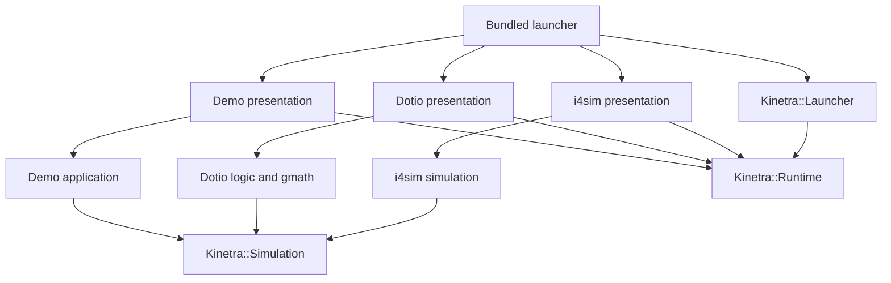
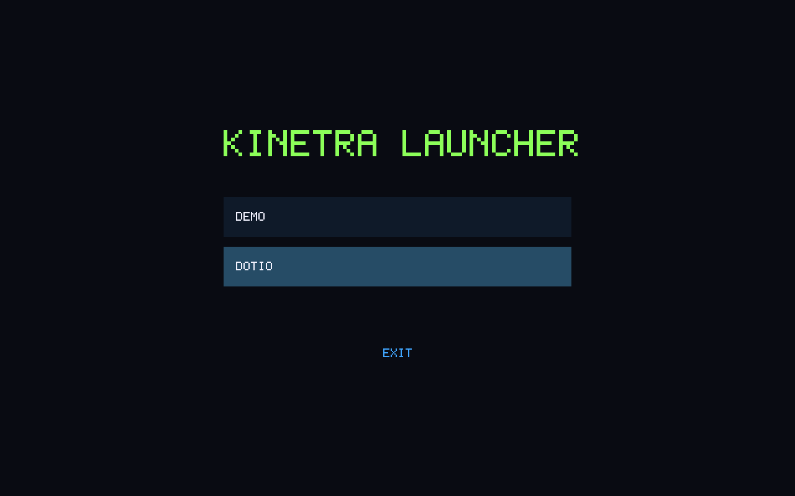
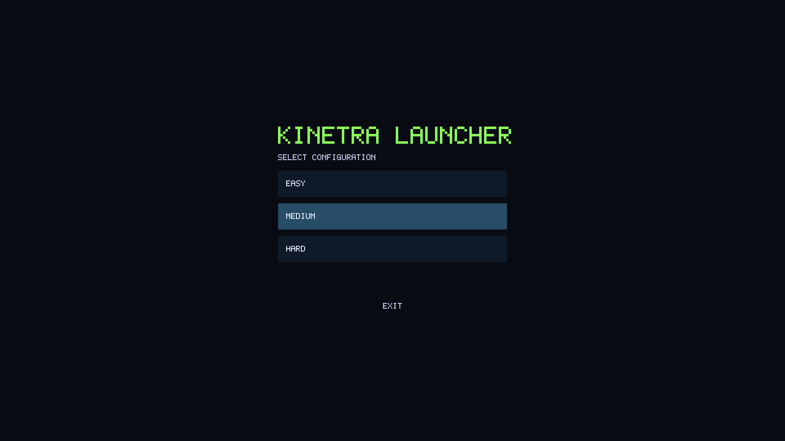
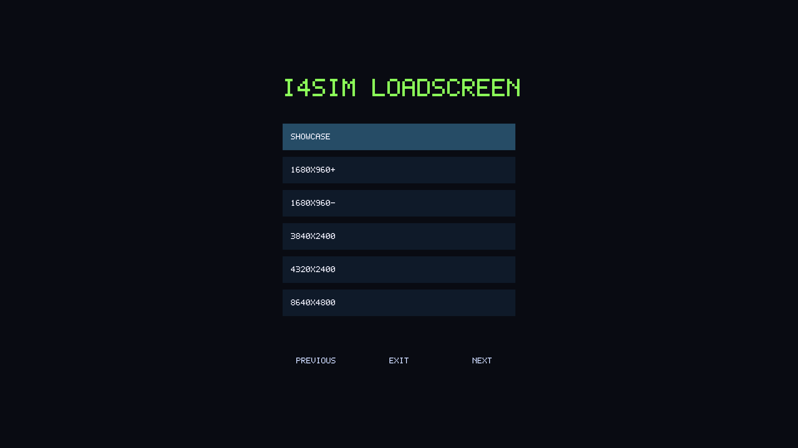
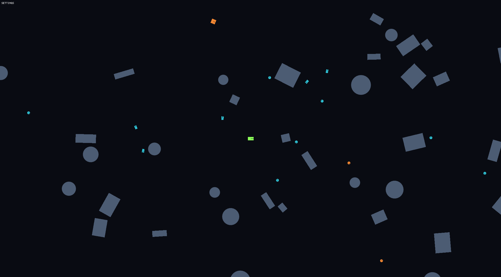
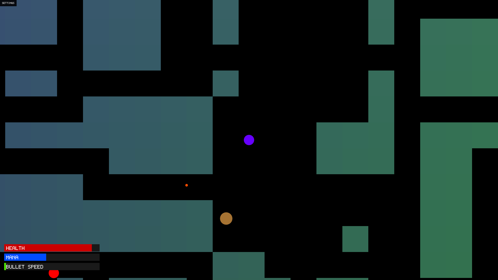
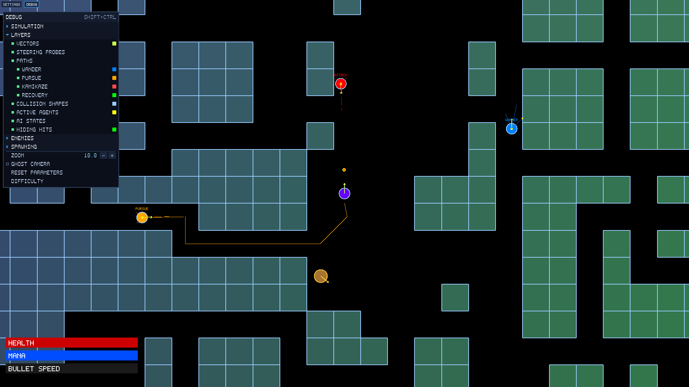

# Kinetra-Lab

Applications and experiments using the reusable [Kinetra](https://github.com/SMB-M87/Kinetra) core library. Launcher, Demo, Dotio and i4sim live here; engine implementation stays in Kinetra.

## Table of contents

- [Visual overview](#visual-overview)
- [Applications](#applications)
- [Screenshots and demo](#screenshots-and-demo)
- [Quick start](#quick-start)
- [Kinetra development workflow](#kinetra-development-workflow)
- [Tests and resources](#tests-and-resources)
- [Architecture documentation](#architecture-documentation)
- [License](#license)

[Documentation index](docs/README.md)

Directory guides: [docs](docs/README.md), [external](external/README.md), [labs](labs/README.md), [launcher](launcher/README.md).

## Visual overview

Arrows show which layer consumes another; application rules stay in Lab.



## Applications

See the [Labs overview](labs/README.md) for application sources and headless test commands.

| Directory | Targets | Purpose |
| --- | --- | --- |
| [launcher](launcher/README.md) | `kinetra`, `kinetra_sandbox` | Menu, registration and application switching |
| [labs/demo](labs/demo/README.md) | `kinetra_demo`, `kinetra_demo_presentation`, `kinetra_sandbox_application` | Terrain, navigation and physics reference |
| [labs/i4sim](labs/i4sim/README.md) | `kinetra_i4sim`, `kinetra_i4sim_application`, `kinetra_i4sim_presentation` | Local factory simulation and original JSON blueprints |
| [labs/dotio](labs/dotio/README.md) | `kinetra_dotio`, `kinetra_dotio_presentation`, `kinetra_dotio_logic` | Survival game and AI experiment |

Kinetra supplies `Kinetra::Launcher` and its public `kinetra/launcher.h` header; Lab consumes that target. The engine checkout must include this target. The bundled checkout supplies this target; verify the default source integration before delivery.

## Screenshots and demo

[Watch or download the 23-second tour](docs/media/kinetra-lab-tour.mp4) (MP4, 1280 × 800, 30 fps, no audio): launcher, Demo, Dotio and their debug views.

| Launcher | Dotio difficulty selection | i4sim loadscreen |
| --- | --- | --- |
|  |  |  |

| Application | Normal view | Debug view |
| --- | --- | --- |
| **Demo** |  |  |
| **Dotio** |  |  |
| **i4sim** |  |  |

Demo and i4sim start with Debug Mode and all visual layers enabled; Dotio keeps debug opt-in. Open the menu with the DEBUG button or Backquote and toggle layers as needed. See the [Dotio settings screenshot](docs/media/dotio-settings.png) and [media guide](docs/media/README.md) for capture details.

## Quick start

Requires a C++20 compiler, CMake 3.16+, a build tool, SDL2 development files, OpenGL development files and an OpenGL 3.3 context. Linux is supported. On Artix/Arch use the normal `base-devel`, `cmake`, `sdl2` and `mesa` packages.

Repository layout:

```text
Kinetra-Lab/
├── docs/
├── launcher/
├── labs/
│   ├── demo/
│   └── dotio/
└── external/
    └── Kinetra/    # expected submodule checkout
```

The build uses the Git submodule at `external/Kinetra`. Clone with its sources:

```sh
git clone --recurse-submodules https://github.com/SMB-M87/Kinetra-Lab.git
cd Kinetra-Lab
```

If you cloned without `--recurse-submodules`, `external/Kinetra` is an empty directory. Load the submodule from Kinetra-Lab before configuring:

```sh
git submodule update --init --recursive
ls external/Kinetra/CMakeLists.txt   # must exist
```

While the directory is empty, `git -C external/Kinetra ...` acts on the Lab repository itself, not the engine; initialize the submodule first. If the update asks for SSH authentication (`.gitmodules` uses a `git@github.com:` URL), switch this clone to HTTPS:

```sh
git config submodule.external/Kinetra.url https://github.com/SMB-M87/Kinetra.git
git submodule update --init --recursive
```

If an earlier configure failed, remove `build/` before rebuilding. No separate Kinetra installation or build is needed.

Run from Kinetra-Lab:

```sh
cmake -S . -B build -DCMAKE_BUILD_TYPE=Release
cmake --build build --parallel
ctest --test-dir build --output-on-failure
./build/kinetra
./build/kinetra --variant demo --agents 12 --frames 120
./build/kinetra --variant dotio --difficulty medium --frames 120
./build/kinetra_demo --frames 120
./build/kinetra_dotio --difficulty medium --frames 120
```

With [CMake presets](CMakePresets.json) (CMake 3.25+, Ninja, ccache), `cmake --workflow --preset dev` configures, builds and tests a Debug build with warnings in `build-dev/`, and `cmake --workflow --preset ci` runs exactly what CI runs. All presets are described in [Kinetra development](external/Kinetra/docs/development.md#presets).

Select with arrows/Enter or click; Ctrl or the SETTINGS button opens centered settings and pauses the run. Settings provides zoom, statistics, Debug Mode, controls and Launcher / Exit actions. Backquote and gameplay wheel zoom require Debug Mode; Space and M have no gameplay action. Each launch creates a fresh session. Detailed controls are in the application guides.

`./build.sh` builds and tests both Kinetra and Lab. It can be invoked from any working directory and refreshes generated CMake configuration when the checkout has moved. Build outputs are local artifacts; do not copy them between machines.

When Kinetra source changes, rebuild Lab; CMake rebuilds the affected core targets automatically. Run core tests separately in Kinetra. Use a fresh build directory when switching source checkouts.

## Kinetra development workflow

Kinetra-Lab and Kinetra have separate Git histories. Lab records one exact Kinetra commit, not a live branch. Editing `external/Kinetra` changes the engine checkout; it does not automatically publish those edits or update Lab's recorded commit. A sibling `../Kinetra` checkout is independent and does not synchronize automatically.

The Git commands below are manual developer steps. Inspect `git status` in both repositories before changing branches or updating submodules; commit or otherwise preserve local work first. Examples use `main`; use your feature branch and the normal review process when appropriate. Publish the Kinetra commit before publishing a Lab commit that references it, so other developers can fetch it.

### Change Kinetra from inside Lab

Submodules normally start with a detached HEAD. From Kinetra-Lab, create a branch before editing engine code:

```sh
git -C external/Kinetra switch -c my-engine-change
```

Edit reusable engine code in `external/Kinetra`; keep application changes in Lab. Build and test the engine independently, then build Lab against those same sources:

```sh
cmake -S external/Kinetra -B build-core -DCMAKE_BUILD_TYPE=Release
cmake --build build-core -j2
ctest --test-dir build-core --output-on-failure
cmake -S . -B build -DCMAKE_BUILD_TYPE=Release
cmake --build build -j2
ctest --test-dir build --output-on-failure
```

The core build above tests the default headless configuration. For runtime changes, also run the runtime/graphics checks in [Kinetra development](external/Kinetra/docs/development.md#graphics-execution) and Lab's [graphics checks](#tests-and-resources).

Commit the intended engine files inside `external/Kinetra`, then publish that branch:

```sh
cd external/Kinetra
git diff
# Stage only the intended engine files, then:
git commit -m "Describe the engine change"
git push -u origin my-engine-change
cd ../..
```

After the Kinetra change is reviewed and merged, select its published upstream commit and rebuild Lab:

```sh
git -C external/Kinetra fetch origin
git -C external/Kinetra switch --detach origin/main
cmake --build build -j2
ctest --test-dir build --output-on-failure
```

If merging changed the engine code, repeat the core checks too. Review and publish Lab's updated pointer, together with any required application changes:

```sh
git diff --submodule=log
git add external/Kinetra
# Stage any intended Lab source changes separately.
git commit -m "Update Kinetra dependency"
git push origin HEAD
```

When initially registering the submodule, also stage `.gitmodules` in the Lab commit. If the workflow uses pull requests, push to your Lab feature branch and open the normal review instead of updating a protected branch directly.

### Change Kinetra in the standalone checkout

Develop, test, commit and publish the engine change from the standalone Kinetra repository first. After it is merged into Kinetra's `main`, run from Kinetra-Lab with a clean submodule checkout:

```sh
git -C external/Kinetra fetch origin
git -C external/Kinetra switch --detach origin/main
cmake -S . -B build -DCMAKE_BUILD_TYPE=Release
cmake --build build -j2
ctest --test-dir build --output-on-failure
git diff --submodule=log
```

Then commit and publish `external/Kinetra` in Lab using the pointer update steps above. Fetching alone does not change the checked-out engine version, and pushing Kinetra alone does not update Lab.

To test unpublished changes from a sibling checkout, use a separate build directory:

```sh
cmake -S . -B build-local-core -DCMAKE_BUILD_TYPE=Release -DKINETRA_SOURCE_DIR=../Kinetra
cmake --build build-local-core -j2
ctest --test-dir build-local-core --output-on-failure
```

This override does not update the submodule pointer. Before publishing Lab, select the published engine commit in `external/Kinetra` and verify the normal submodule build too. If `build` previously used an override, restore it explicitly with `-DKINETRA_SOURCE_DIR="$PWD/external/Kinetra"` when configuring.

### Receive published Lab changes

From Kinetra-Lab, preserve local changes before pulling, then restore the engine commit recorded by Lab:

```sh
git pull --ff-only
git submodule update --init --recursive
git submodule status
cmake -S . -B build -DCMAKE_BUILD_TYPE=Release
cmake --build build -j2
ctest --test-dir build --output-on-failure
```

In `git submodule status`, a leading space means the checkout matches Lab's recorded commit; `-` means uninitialized, and `+` means a different commit is checked out. `git submodule update` selects Lab's recorded commit, not the latest upstream Kinetra commit. Lab application changes never flow into Kinetra automatically; make reusable engine changes in the engine repository and publish them separately.

## Tests and resources

`BUILD_TESTING` defaults to ON. `KINETRA_TEST_GRAPHICS=ON` adds presentation and launcher integration tests requiring a real OpenGL context:

```sh
cmake -S . -B build -DKINETRA_TEST_GRAPHICS=ON
cmake --build build --parallel
SDL_VIDEODRIVER=offscreen LIBGL_ALWAYS_SOFTWARE=1 ctest --test-dir build --output-on-failure
SDL_VIDEODRIVER=offscreen LIBGL_ALWAYS_SOFTWARE=1 ./build/kinetra --variant demo --frames 120
```

`cmake --workflow --preset graphics` does the same in `build-graphics/`. Offscreen support depends on SDL/Mesa; alternatively use a desktop or Xvfb.
Software rendering does not establish desktop feel or performance.

For headless Demo/Dotio logic tests, configure a separate directory with `-DKINETRA_LAB_BUILD_RUNTIME=OFF`. Launcher and graphical executables are omitted in that configuration.

i4sim additionally requires the header-only nlohmann JSON package (3.11+; Debian: `nlohmann-json3-dev`). Its blueprints are copied into the build tree; see [i4sim usage](labs/i4sim/README.md). Shaders, bitmap text, terrain and drawing data are embedded or generated in code.
Build directories and generated artifacts are ignored. Follow the included `.clang-format`; first-party C++ uses `.h` and `.cpp`.

## Architecture documentation

The [documentation index](docs/README.md) links system dependencies, application ownership and session/overlay interactions. Usage and controls live alongside each lab.

Changes follow the shared [development workflow](external/Kinetra/docs/workflow.md): a [design document](docs/design/README.md) per branch, tests, review and documentation, verified at the level the change's impact requires. [AGENTS.md](AGENTS.md) holds the Lab-specific rules; the [quality roadmap](docs/design/2026-11-18-quality-roadmap.md) plans the ongoing clean-up.

## License

MIT; see [LICENSE](LICENSE). Dotio attribution and port limits are documented in its [provenance](labs/dotio/README.md#provenance).
