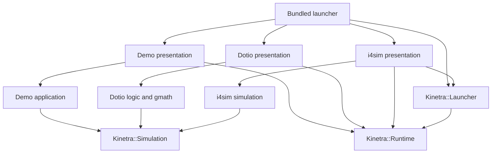
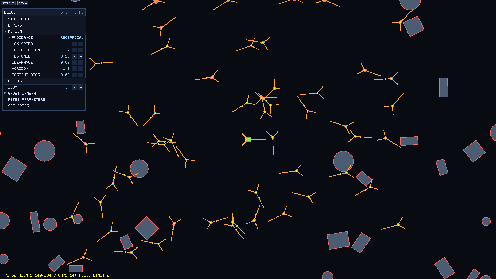
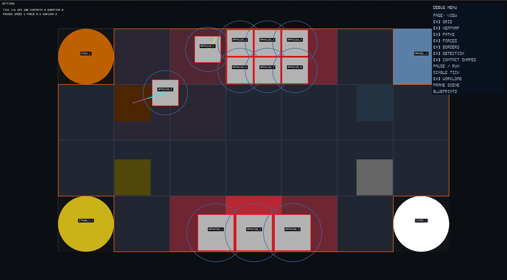
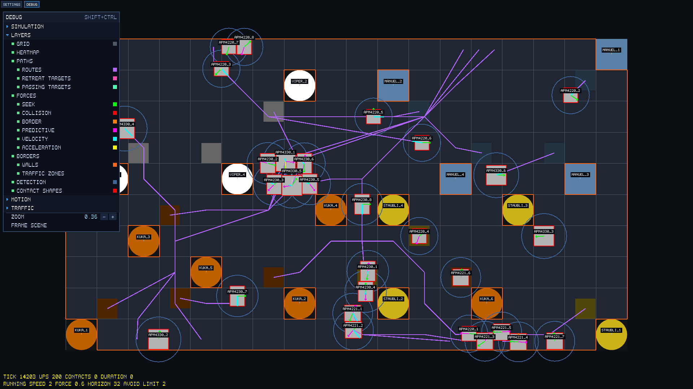

# Kinetra-Lab

Applications and experiments using the reusable [Kinetra](https://github.com/SMB-M87/Kinetra) core library. Launcher, Demo, Dotio and i4sim live here; engine implementation stays in Kinetra.

## Table of contents

- [Visual overview](#visual-overview)
- [Applications](#applications)
- [Screenshots and demo](#screenshots-and-demo)
- [Quick start](#quick-start)
- [Kinetra development workflow](#kinetra-development-workflow)
- [Tests and resources](#tests-and-resources)
- [Architecture documentation](#architecture-documentation)
- [License](#license)

[Documentation index](docs/README.md) · [Agent rules](AGENTS.md)

Directory guides: [docs](docs/README.md), [external](external/README.md), [labs](labs/README.md), [launcher](launcher/README.md).

## Visual overview

Arrows show which layer consumes another; application rules stay in Lab. The i4sim presentation also uses `Kinetra::Launcher` directly, for its blueprint screen.



## Applications

See the [Labs overview](labs/README.md) for application sources and headless test commands.

| Directory | Targets | Purpose |
| --- | --- | --- |
| [launcher](launcher/README.md) | `kinetra`, `kinetra_sandbox` | Menu, registration and application switching |
| [labs/demo](labs/demo/README.md) | `kinetra_demo`, `kinetra_demo_presentation`, `kinetra_sandbox_application` | Terrain, navigation and physics reference |
| [labs/i4sim](labs/i4sim/README.md) | `kinetra_i4sim`, `kinetra_i4sim_application`, `kinetra_i4sim_presentation` | Local factory simulation and original JSON blueprints |
| [labs/dotio](labs/dotio/README.md) | `kinetra_dotio`, `kinetra_dotio_presentation`, `kinetra_dotio_logic` | Survival game and AI experiment |

## Screenshots and demo

[Watch or download the tour](docs/media/kinetra-lab-tour.mp4) (MP4, 2 min 14 s, 1920 × 1080, 60 fps, 64 MB).

| Launcher | Dotio difficulty selection | i4sim loadscreen |
| --- | --- | --- |
|  |  |  |

| Application | Normal view | Debug view |
| --- | --- | --- |
| **Demo** |  |  |
| **Dotio** |  |  |
| **i4sim** |  |  |

Demo and i4sim start with Debug Mode and all visual layers enabled; Dotio keeps debug opt-in. Open the menu with the DEBUG button or Backquote and toggle layers as needed. See the [Dotio settings screenshot](docs/media/dotio-settings.png) and [media guide](docs/media/README.md) for capture details.

## Quick start

Requires a C++20 compiler, CMake 3.16+ and a build tool, SDL2 and OpenGL development files with an OpenGL 3.3 context, and the header-only nlohmann JSON package 3.11+ (i4sim needs it in every build, headless included). The [CMake presets](CMakePresets.json) also need CMake 3.25+, Ninja and ccache. Linux is supported, and Windows through a MinGW-w64 cross build from WSL or Linux, or natively in an MSYS2 shell ([Windows](docs/windows.md)). On Artix/Arch: `pacman -S --needed base-devel cmake ninja ccache clang sdl2-compat libglvnd mesa nlohmann-json`, the same set CI uses (`clang` provides clang-format). On Debian, the JSON package is `nlohmann-json3-dev`.

Repository layout:

```text
Kinetra-Lab/
├── docs/                # architecture pages, design documents, media
├── launcher/            # bundled launcher executable kinetra
├── labs/
│   ├── demo/
│   ├── dotio/
│   ├── i4sim/
│   ├── test_support/    # header-only test helpers
│   └── settings.h       # shared settings overlay
└── external/
    └── Kinetra/         # engine submodule
```

The build uses the Git submodule at `external/Kinetra`. Clone with its sources:

```sh
git clone --recurse-submodules https://github.com/SMB-M87/Kinetra-Lab.git
cd Kinetra-Lab
```

If you cloned without `--recurse-submodules`, `external/Kinetra` is an empty directory. Load the submodule from Kinetra-Lab before configuring:

```sh
git submodule update --init --recursive
ls external/Kinetra/CMakeLists.txt   # must exist
```

While the directory is empty, `git -C external/Kinetra ...` acts on the Lab repository itself, not the engine; initialize the submodule first. If the update asks for SSH authentication (`.gitmodules` uses a `git@github.com:` URL), switch this clone to HTTPS:

```sh
git config submodule.external/Kinetra.url https://github.com/SMB-M87/Kinetra.git
git submodule update --init --recursive
```

If an earlier configure failed, remove `build/` before rebuilding. No separate Kinetra installation or build is needed.

Run from Kinetra-Lab:

```sh
cmake -S . -B build -DCMAKE_BUILD_TYPE=Release
cmake --build build --parallel
ctest --test-dir build --output-on-failure
./build/kinetra
./build/kinetra --variant demo --agents 12 --frames 120
./build/kinetra --variant dotio --difficulty medium --frames 120
./build/kinetra_demo --frames 120
./build/kinetra_dotio --difficulty medium --frames 120
./build/kinetra_i4sim
```

With the presets, `cmake --workflow --preset dev` configures, builds and tests a Debug build with warnings in `build-dev/`. CI ([ci.yml](.github/workflows/ci.yml)) checks formatting with clang-format, runs `python3 external/Kinetra/tools/check_docs.py`, then `cmake --workflow --preset headless` and `cmake --workflow --preset ci`; a second job builds and tests on Windows ([Windows](docs/windows.md#continuous-integration)). All presets are described in [Kinetra development](external/Kinetra/docs/development.md#presets).

`./build.sh` builds and tests both Kinetra and Lab. It can be invoked from any working directory and refreshes generated CMake configuration when the checkout has moved. Build outputs are local artifacts; do not copy them between machines.

In every application, Ctrl or the SETTINGS button opens the shared settings panel (zoom, statistics, Debug Mode, controls, Launcher and Exit) and pauses the run. The full controls are in the [Demo](labs/demo/README.md#controls), [Dotio](labs/dotio/README.md#launch-and-controls) and [i4sim](labs/i4sim/README.md#controls) guides.

## Kinetra development workflow

Lab records one exact Kinetra commit in the `external/Kinetra` submodule. An engine change is committed and pushed in Kinetra on its own branch first, then Lab commits the new pointer; [External dependencies](external/README.md) has the steps and commands.

## Tests and resources

`BUILD_TESTING` defaults to ON. `KINETRA_TEST_GRAPHICS=ON` adds presentation and launcher integration tests requiring a real OpenGL context; CTest labels them `graphics`. The `graphics` preset turns it on and runs CTest with SDL offscreen and software Mesa:

```sh
cmake --workflow --preset graphics      # build-graphics/: everything, including graphics tests
cmake --workflow --preset headless      # build-headless/: logic and its tests, no SDL2/OpenGL
SDL_VIDEODRIVER=offscreen LIBGL_ALWAYS_SOFTWARE=1 ./build-graphics/kinetra --variant demo --frames 120
```

Offscreen support depends on SDL/Mesa; alternatively use a desktop or Xvfb. Software rendering does not establish desktop feel or performance.

The `headless` preset builds with `KINETRA_LAB_BUILD_RUNTIME=OFF`, which omits the launcher and graphical executables. The `dev`, `release` and `ci` test presets skip the `graphics` label.

Every Lab test program is a [doctest](external/Kinetra/docs/testing.md#writing-a-doctest-suite) suite. CTest names every case `<suite>:<case>`, for example `kinetra_dotio:a failed escape triggers kamikaze only at exactly one health`. Select a suite or a single case with `-R`, and skip the two 60-second Demo crowd cases with `-LE soak`:

```sh
ctest --preset release -R '^kinetra_dotio:'
ctest --preset release -LE soak
```

The test guides of [Demo](labs/demo/tests/README.md), [Dotio](labs/dotio/tests/README.md), [i4sim](labs/i4sim/tests/README.md) list each suite; the launcher's are in its [module guide](launcher/README.md#tests).

i4sim blueprints are copied next to each executable that opens them; see [i4sim usage](labs/i4sim/README.md#build-and-run). Shaders, bitmap text, terrain and drawing data are embedded or generated in code.

## Architecture documentation

The [documentation index](docs/README.md) links system dependencies, application ownership and session/overlay interactions. Usage and controls live alongside each lab.

Changes follow the shared [development workflow](external/Kinetra/docs/workflow.md): a [design document](docs/design/README.md) per branch, tests, review and documentation, verified at the level the change's impact requires. [AGENTS.md](AGENTS.md) holds the Lab-specific rules; the [quality roadmap](docs/design/2026-11-18-quality-roadmap.md) plans the ongoing clean-up.

## License

MIT; see [LICENSE](LICENSE). Dotio attribution and port limits are documented in its [provenance](labs/dotio/README.md#provenance).
