<p align="center">
  
</p>

# Kinetra-Lab

Three labs built on the reusable [Kinetra](https://github.com/SMB-M87/Kinetra) core library: Demo, a reference for its physics, navigation and steering; Dotio, a survival game with an AI experiment; and i4sim, a factory simulation. The bundled launcher `kinetra` starts each of them. Engine implementation stays in Kinetra.

## Table of contents

- [The labs](#the-labs)
  - [Demo](#demo)
  - [Dotio](#dotio)
  - [i4sim](#i4sim)
- [Quick start](#quick-start)
- [Applications](#applications)
- [Visual overview](#visual-overview)
- [Kinetra development workflow](#kinetra-development-workflow)
- [Tests and resources](#tests-and-resources)
- [Architecture documentation](#architecture-documentation)
- [License](#license)

[Documentation index](docs/README.md) · [Agent rules](AGENTS.md)

Directory guides: [docs](docs/README.md), [external](external/README.md), [labs](labs/README.md), [launcher](launcher/README.md).

## The labs

[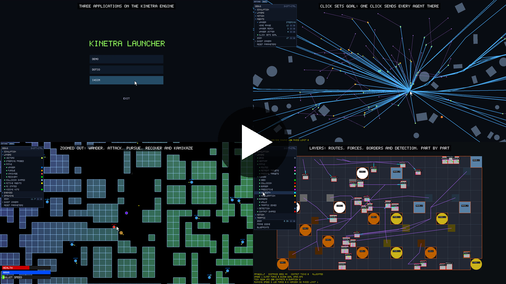](https://youtu.be/jkPwx831MOU)

The video can be older than the code; the clips below are refreshed whenever what they show changes ([media guide](docs/media/README.md)). The launcher's menu and the overlays every lab shares, the settings panel, the debug menu and the agent inspector, are shown in [Kinetra's README](https://github.com/SMB-M87/Kinetra#shared-ui).

Demo and i4sim start with Debug Mode and all visual layers on; Dotio keeps debug opt-in. Shift+Ctrl opens the debug menu in every lab and switches Debug Mode on: layers, zoom, pause, single tick and speed, and the values each simulation runs with change while it runs. The settings panel returns to the lab's own choice, in Debug Mode or not: SCENARIOS in Demo and DIFFICULTY in Dotio go back to the launcher's page for them, BLUEPRINTS in i4sim to its loadscreen, and each of those pages has a LAUNCHER button.

### Demo

The reference for Kinetra's mechanisms: physics and contacts, A* navigation, steering and reciprocal avoidance, in four scenarios that the launcher offers when DEMO is chosen. In Terrain a player walks a streamed, seeded world among a crowd of agents that wander around their homes, by steering or by planned routes, and a click sends the player along a planned route. The debug menu tunes the agents' motion and wander while they run. [Demo guide](labs/demo/README.md)

| Normal view | Debug view |
| --- | --- |
| 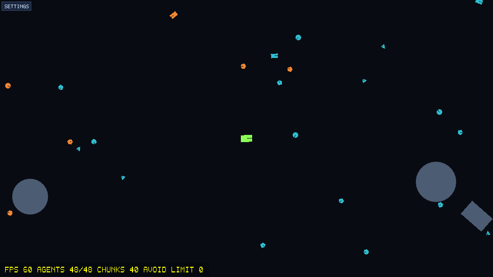 | 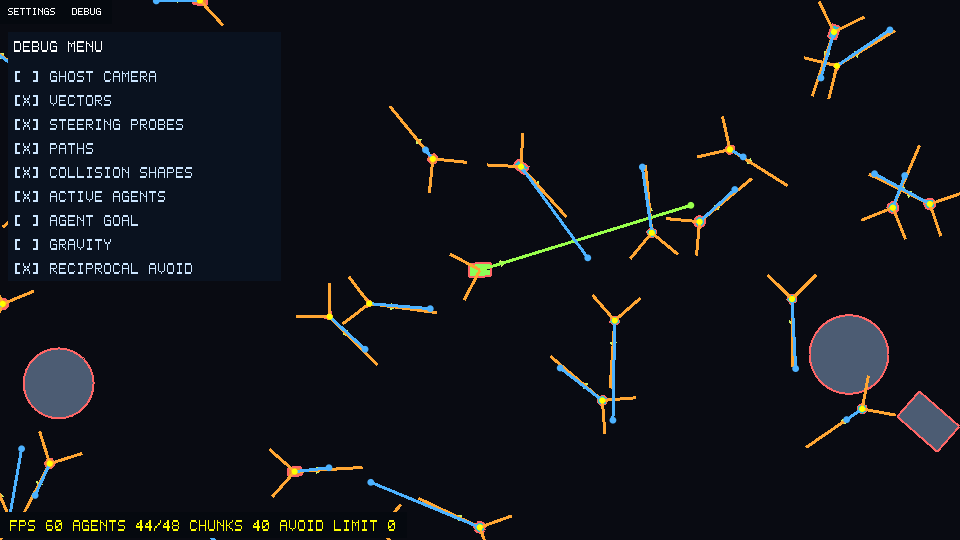 |

The other three scenarios each show one mechanism, from its start, in Debug Mode:

| Scenario | Clip |
| --- | --- |
| **Gravity**: dynamic shapes fall onto two ramps; some slide off, and all come to rest | 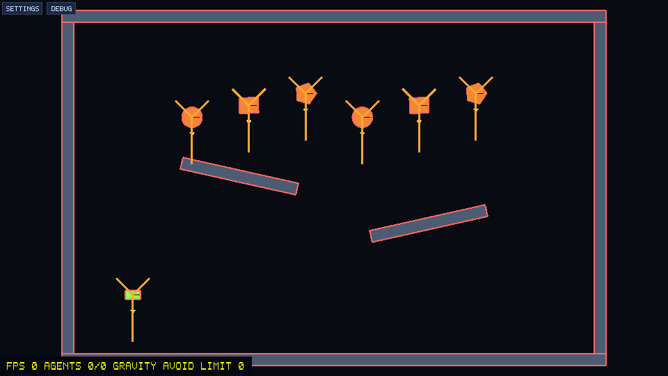 |
| **Maze**: a click beyond the last wall plans a route through the alternating gaps, and the player walks it | 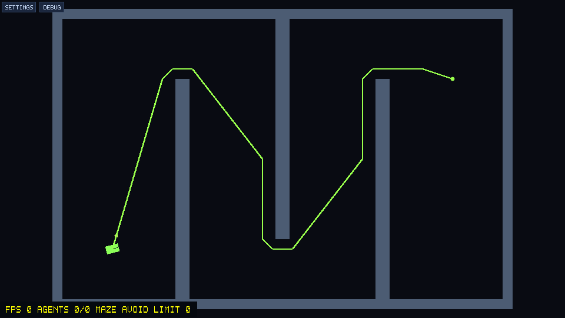 |
| **Doorway**: two groups with opposing goals meet in one opening and pass each other by reciprocal avoidance | 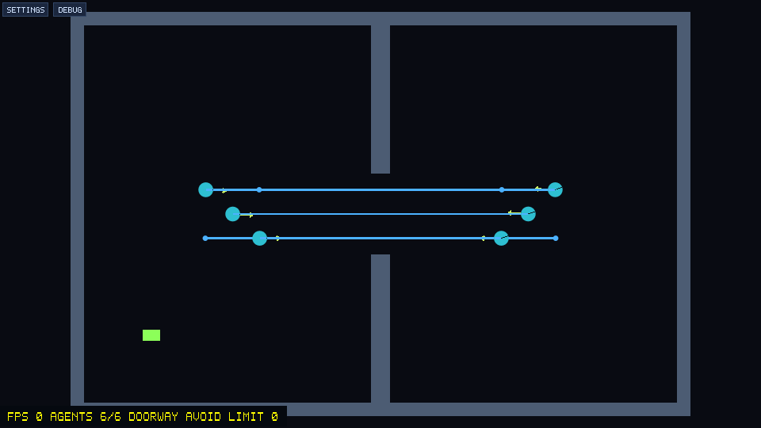 |

### Dotio

A survival game and AI experiment: the player walks a seeded, endless maze and shoots at enemies that wander, pursue, attack, run for shelter to reload and turn kamikaze, decided by a small state machine with fuzzy rules. The launcher asks for Easy, Medium or Hard; the debug menu tunes the enemies' balance and spawning while the game runs. [Dotio guide](labs/dotio/README.md)

| Normal view | Debug view |
| --- | --- |
| 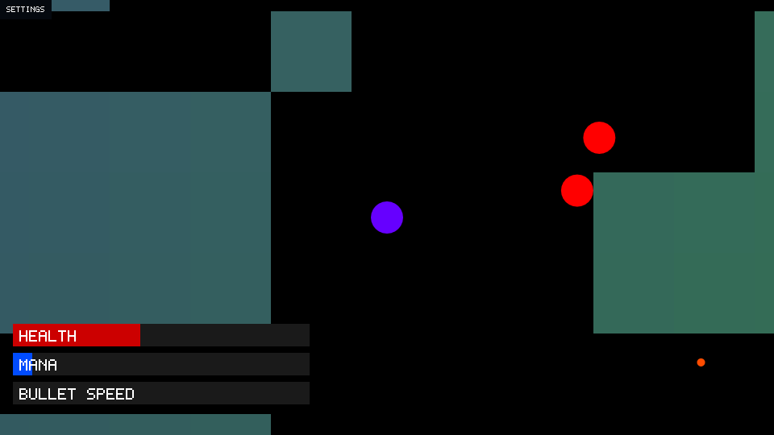 | 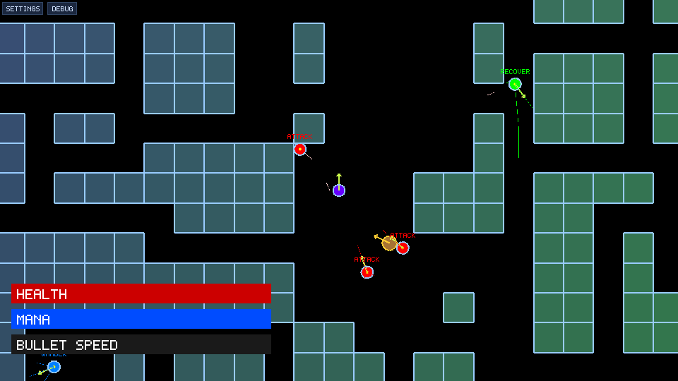 |

### i4sim

A local factory simulation: movers carry products between the stations of a floor read from a JSON blueprint, under motion profiles, path planners and traffic policies that can be switched while the factory runs. Its loadscreen lists the floors and a SHOWCASE page of small scenes that each show one policy at work. [i4sim guide](labs/i4sim/README.md), [architecture](docs/factory-simulation-architecture.md)

The `4320x2400` floor, 29 movers and 18 producers, under the Reciprocal profile:

| Normal view | Debug view |
| --- | --- |
| 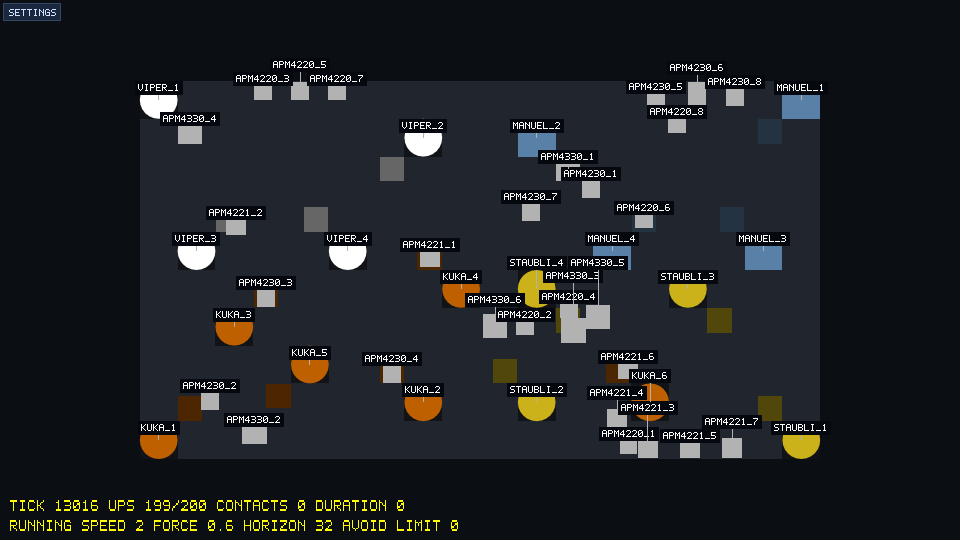 | 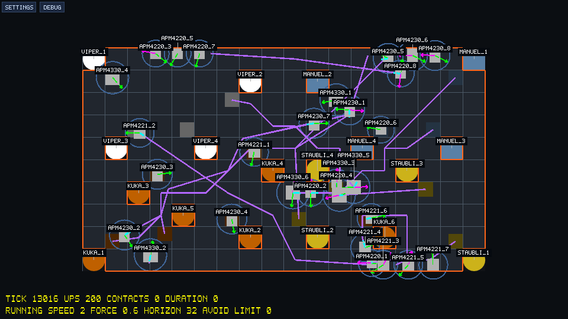 |

The [showcase scenes](labs/i4sim/blueprints/README.md#showcase-scenes), each one full cycle in Debug Mode at 200 ticks per second:

| Showcase scene | Clip |
| --- | --- |
| **Junction crossing**: one mover waits until the other has crossed | 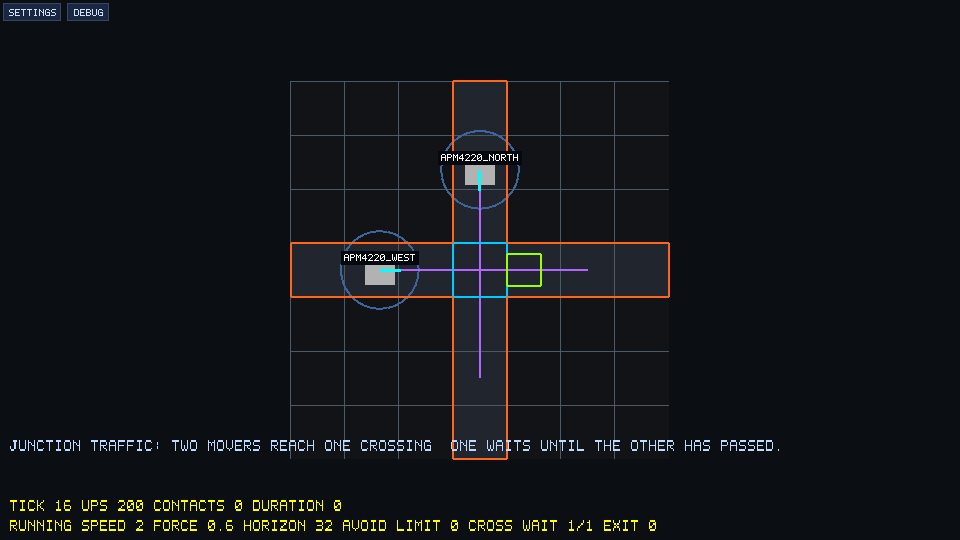 |
| **Corridor passing**: opposing movers take turns through a one-lane corridor | 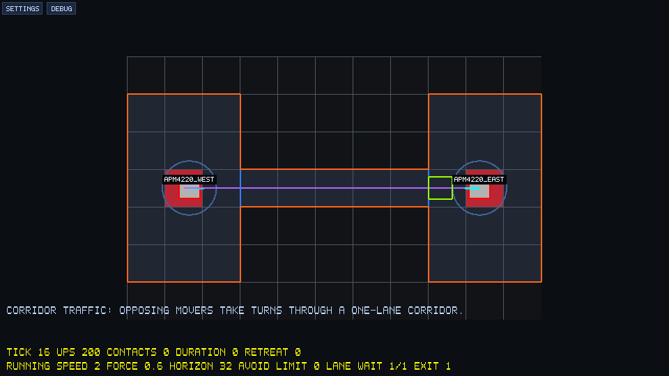 |
| **Corridor recovery**: movers meet head-on inside the corridor and one backs out; the scene then restarts | 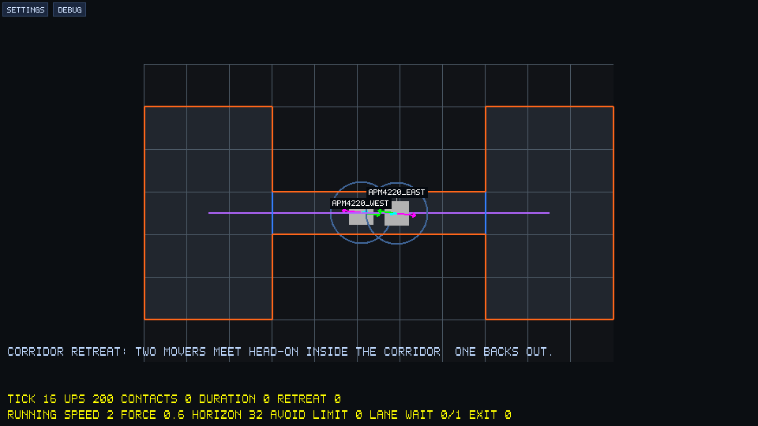 |
| **Predictive passing**: movers on a head-on course agree on sides | 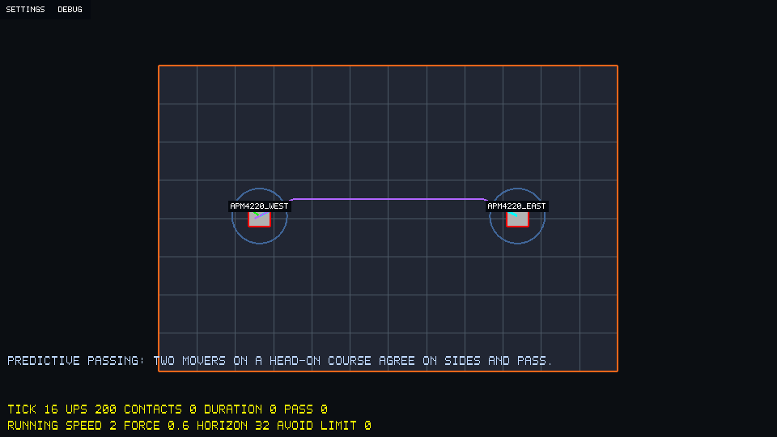 |
| **H crossing**: four movers swap diagonal corners without path planning, straight through the middle bar | 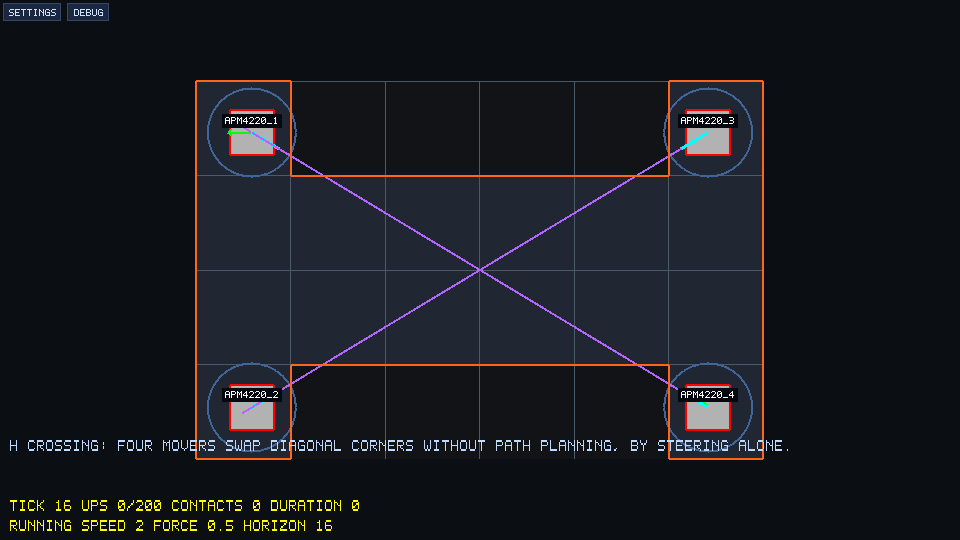 |
| **Make way**: a parked mover yields into a side bay to clear the lane, then parks again | 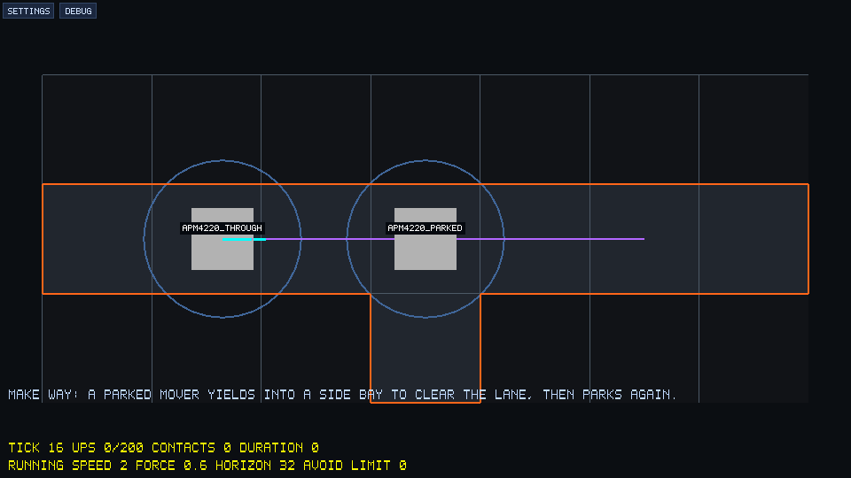 |

The [capture tool](tools/capture/README.md) renders every clip and screenshot, the tour and its thumbnail, and the GIFs of the launcher and the overlays in Kinetra's README.

## Quick start

**Try it on Windows without building:** download [Kinetra-Lab-windows-x64.zip](https://github.com/SMB-M87/Kinetra-Lab/releases/download/main-build/Kinetra-Lab-windows-x64.zip) (built from the latest `main`), unzip it and start `kinetra.exe`. It needs Windows 10 or later with an OpenGL 3.3 driver and nothing else; the i4sim blueprints are included. Fixed versions are on the [releases page](https://github.com/SMB-M87/Kinetra-Lab/releases); how the zip is made is in the [release tool](tools/release/README.md).

**Build from source.** Requires a C++20 compiler, CMake 3.16+ and a build tool, SDL2 and OpenGL development files with an OpenGL 3.3 context, and the header-only nlohmann JSON package 3.11+ (i4sim needs it in every build, headless included). The [CMake presets](CMakePresets.json) also need CMake 3.25+, Ninja and ccache. Linux users build from source. Windows builds use a MinGW-w64 cross compiler from WSL or Linux, or a native MSYS2 shell ([Windows](docs/windows.md)). Install the dependencies for your distribution. Ubuntu 24.04 LTS is the Linux CI environment.

| Family | Command | Notes |
| --- | --- | --- |
| Arch, Artix | `sudo pacman -S --needed base-devel cmake ninja ccache clang sdl2-compat libglvnd mesa nlohmann-json` | Local installation example with SDL2 provided by `sdl2-compat` |
| Debian, Ubuntu | `sudo apt update && sudo apt install build-essential cmake ninja-build ccache libsdl2-dev libgl-dev libegl-dev libgl1-mesa-dri libegl-mesa0 nlohmann-json3-dev` | The CI environment uses Ubuntu 24.04 LTS with GCC 13, glibc 2.39 and CMake 3.28 |
| Fedora | `sudo dnf install gcc-c++ cmake ninja-build ccache SDL2-devel mesa-libGL-devel mesa-libEGL-devel mesa-dri-drivers json-devel` | Package names may vary by Fedora release |

Every test, the golden fingerprints included, passes with the same recorded values on each tested Linux; on Windows five trajectory fingerprints are still excluded ([Windows tests](docs/windows.md#tests)).

Repository layout (every module follows the [directory layout](external/Kinetra/docs/conventions.md#directory-layout)):

```text
Kinetra-Lab/
├── docs/                # architecture pages, design documents, media
├── launcher/            # bundled launcher executable kinetra
├── labs/
│   ├── demo/            # each module: include/<name>/, src/, tests/
│   ├── dotio/
│   ├── i4sim/
│   └── shared/          # shared Lab policy and test helpers (kinetra_lab/)
├── tools/capture/       # media capture tool
└── external/
    └── Kinetra/         # engine submodule
```

The build uses the Git submodule at `external/Kinetra`. Clone with its sources:

```sh
git clone --recurse-submodules https://github.com/SMB-M87/Kinetra-Lab.git
cd Kinetra-Lab
```

If you cloned without `--recurse-submodules`, `external/Kinetra` is an empty directory. Load the submodule from Kinetra-Lab before configuring:

```sh
git submodule update --init --recursive
ls external/Kinetra/CMakeLists.txt   # must exist
```

While the directory is empty, `git -C external/Kinetra ...` acts on the Lab repository itself, not the engine; initialize the submodule first. The submodule URL is HTTPS, so no SSH key is needed. A clone made while `.gitmodules` still had an SSH URL picks up the HTTPS URL with `git submodule sync --recursive`.

If an earlier configure failed, remove `build/` before rebuilding. No separate Kinetra installation or build is needed.

A Claude Code cloud session does this setup itself: when it starts, [.claude/settings.json](.claude/settings.json) runs [tools/cloud_setup.sh](tools/cloud_setup.sh), which loads the submodule when it is empty and installs the Debian and Ubuntu packages above and CI's clang-format version ([Kinetra's tools](external/Kinetra/tools/README.md#cloud_setupsh)). Its permission rules let a session attach Kinetra with push access and post an agent review without a prompt, so a review of a change across both repositories reaches both ([review access](external/Kinetra/docs/workflow.md#review-access)).

Run from Kinetra-Lab:

```sh
cmake -S . -B build -DCMAKE_BUILD_TYPE=Release
cmake --build build --parallel
ctest --test-dir build --output-on-failure
./build/kinetra
./build/kinetra --variant demo --agents 12 --frames 120
./build/kinetra --scenario maze
./build/kinetra --variant dotio --difficulty medium --frames 120
./build/kinetra_demo --frames 120
./build/kinetra_dotio --difficulty medium --frames 120
./build/kinetra_i4sim
```

Run `cmake --workflow --preset dev` for a local Debug build and test run. For pull requests, the `linux` CI job uses Ubuntu 24.04 LTS to check formatting and docs and run the `headless` and `ci` presets. The `ci` preset includes graphics and smoke tests with software OpenGL and treats engine and warning-free Lab module warnings as errors. The required `checks` status follows the Linux build or the lighter documentation check when `changes` can prove that build inputs are unaffected. A separate job builds and tests on native Windows. [CI](.github/workflows/ci.yml) · [Verification in Lab](AGENTS.md#verification-in-lab) · [Windows CI](docs/windows.md#continuous-integration) · [Presets](external/Kinetra/docs/development.md#presets)

`./build.sh` builds and tests both Kinetra and Lab. When the MinGW-w64 cross compiler, Ninja and ccache are installed, it also builds the Windows executables in `build-windows/` without running their tests ([Windows](docs/windows.md#quick-start-from-wsl)); otherwise it says it skipped them. It can be invoked from any working directory and refreshes generated CMake configuration when the checkout has moved. Build outputs are local artifacts; do not copy them between machines.

In every application, Ctrl or the SETTINGS button opens the shared settings panel (statistics, Debug Mode, frame times and limit, controls, the lab's Scenarios, Difficulty or Blueprints, and Exit) and pauses the run. The full controls are in the [Demo](labs/demo/README.md#controls), [Dotio](labs/dotio/README.md#launch-and-controls) and [i4sim](labs/i4sim/README.md#controls) guides.

## Applications

See the [Labs overview](labs/README.md) for application sources and headless test commands.

| Directory | Targets | Purpose |
| --- | --- | --- |
| [launcher](launcher/README.md) | `kinetra` | Menu, registration and application switching |
| [labs/demo](labs/demo/README.md) | `kinetra_demo`, `kinetra_demo_presentation`, `kinetra_demo_logic` | Terrain, navigation and physics reference |
| [labs/i4sim](labs/i4sim/README.md) | `kinetra_i4sim`, `kinetra_i4sim_logic`, `kinetra_i4sim_presentation` | Local factory simulation and original JSON blueprints |
| [labs/dotio](labs/dotio/README.md) | `kinetra_dotio`, `kinetra_dotio_presentation`, `kinetra_dotio_logic` | Survival game and AI experiment |

## Visual overview

Arrows show which layer consumes another; application rules stay in Lab. The i4sim presentation also uses `Kinetra::Launcher` directly, for its blueprint screen.

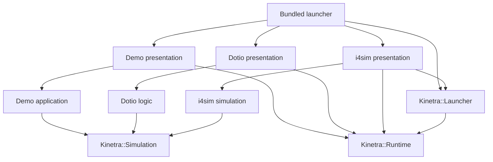

## Kinetra development workflow

Lab records one exact Kinetra commit in the `external/Kinetra` submodule. An engine change is committed and pushed in Kinetra on its own branch first, then Lab commits the new pointer; [External dependencies](external/README.md) has the steps and commands.

## Tests and resources

`BUILD_TESTING` defaults to ON. `KINETRA_TEST_GRAPHICS=ON` adds presentation and launcher integration tests requiring a real OpenGL context, and a smoke run of every graphical executable: `kinetra_smoke:<name>` starts it with `--frames 120` and passes when it exits with 0 (`launcher`, `launcher-demo`, `launcher-dotio`, `launcher-i4sim`, `demo`, `dotio`, `i4sim`, `i4sim-run`). CTest labels them `graphics`. The `graphics` and `ci` presets turn it on and run CTest with SDL offscreen and software Mesa, so CI runs them on every pull request:

```sh
cmake --workflow --preset graphics      # build-graphics/: everything, including graphics tests and smoke runs
cmake --workflow --preset headless      # build-headless/: logic and its tests, no SDL2/OpenGL
ctest --preset graphics -R '^kinetra_smoke:'   # only the smoke runs
```

Offscreen support depends on SDL/Mesa; alternatively use a desktop or Xvfb. Software rendering does not establish desktop feel or performance.

The `headless` preset builds with `KINETRA_LAB_BUILD_RUNTIME=OFF`, which omits the launcher and graphical executables. The `dev` and `release` test presets skip the `graphics` label.

Every Lab test program is a [doctest](external/Kinetra/docs/testing.md#writing-a-doctest-suite) suite. CTest names every case `<suite>:<case>`, for example `kinetra_dotio:a failed escape triggers kamikaze only at exactly one health`. Select a suite or a single case with `-R`, and skip the two 60-second Demo crowd cases with `-LE soak`:

```sh
ctest --preset release -R '^kinetra_dotio:'
ctest --preset release -LE soak
```

The test sections of [Demo](labs/demo/README.md#tests) and [Dotio](labs/dotio/README.md#tests) and the [i4sim test guide](labs/i4sim/tests/README.md) list each suite; the launcher's are in its [module guide](launcher/README.md#tests).

i4sim blueprints are copied next to each executable that opens them; see [i4sim usage](labs/i4sim/README.md#build-and-run). Shaders, bitmap text, terrain and drawing data are embedded or generated in code.

## Architecture documentation

The [documentation index](docs/README.md) links system dependencies, application ownership and session/overlay interactions. Usage and controls live alongside each lab.

Changes follow the shared [development workflow](external/Kinetra/docs/workflow.md): a [design document](docs/design/README.md) per branch, tests, an independent review and documentation for a code change, the author's own review for a change to documentation alone, each verified at the level its impact requires. [AGENTS.md](AGENTS.md) holds the Lab-specific rules; the [roadmap](docs/roadmap.md) lists the planned work in order of priority.

## License

MIT; see [LICENSE](LICENSE). Dotio attribution and port limits are documented in its [provenance](labs/dotio/README.md#provenance).
