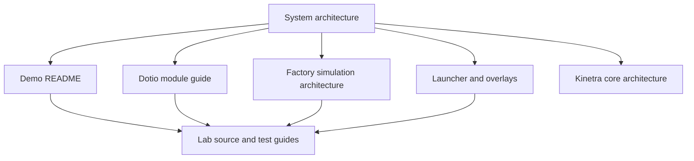

# Documentation index

Design explanations live here; controls, gameplay and provenance live with the application sources.

## Table of contents

- [Visual overview](#visual-overview)
- [Architecture guides](#architecture-guides)
- [Source and usage guides](#source-and-usage-guides)

[Parent guide](../README.md) · [Agent rules](../AGENTS.md)

Directory guides: [design](design/README.md), [media](media/README.md).

## Visual overview

Follow the system guide first, then the application or interaction contract you need.

## Architecture guides

| Question | Guide |
| --- | --- |
| How do Lab, the engine and build targets fit together? | [System architecture](architecture.md) |
| Who owns Demo state, simulation and streamed terrain? | [Demo](../labs/demo/README.md#how-it-works) |
| How does the Dotio port isolate legacy coordinates and game rules, and how do its enemies use navigation? | [Dotio](../labs/dotio/README.md#structure) |
| How does the local C++ factory simulation divide engine and application responsibilities? | [Factory simulation architecture](factory-simulation-architecture.md) |
| How do registration, session transitions and overlay capture work? | [Launcher and overlays](launcher-overlays.md) |
| How do I build and run the applications on Windows? | [Windows](windows.md): MinGW-w64 cross build from WSL, native MSYS2 build, tests through interop, CI job |
| Why are the boundaries the way they are? | [Kinetra architecture decisions](../external/Kinetra/docs/decisions/README.md): 0002 to 0007 record the Demo and Dotio decisions from before the applications moved to Lab, and [0009](../external/Kinetra/docs/decisions/0009-core-and-lab.md) sets the boundary between Kinetra and Lab. Lab has no ADRs yet: a decision that only concerns Lab gets one in `docs/decisions/`, created with the first ([rule](../AGENTS.md#documentation-in-lab)) |
| What is changing now, and why? | The *Now* section of the [roadmap](roadmap.md), and the design document its item links; the [design index](design/README.md) is for a search by topic |
| Which mistakes did reviews find before? | [Review lessons](review-lessons.md), and [Kinetra's](../external/Kinetra/docs/review-lessons.md) for both repositories |
| What is planned next, in which order, and which ideas are waiting? | [Roadmap](roadmap.md), the only plan; engine work in the [Kinetra roadmap](../external/Kinetra/docs/roadmap.md) |
| How do I change Kinetra from Lab, update the submodule pointer, or get the submodule off its detached HEAD? | [External dependencies](../external/README.md) |
| How do we work (cycle, conventions, tests, docs)? | [Agent rules](../AGENTS.md), and in Kinetra: [workflow](../external/Kinetra/docs/workflow.md), [conventions](../external/Kinetra/docs/conventions.md), [testing](../external/Kinetra/docs/testing.md), [documentation guide](../external/Kinetra/docs/documentation.md) |

## Source and usage guides

- [Labs](../labs/README.md), [Demo](../labs/demo/README.md), [Dotio](../labs/dotio/README.md) and [i4sim](../labs/i4sim/README.md).
- [Launcher](../launcher/README.md).
- [Build and verification](../README.md#tests-and-resources).
- [Screenshots, clips and demo video](media/README.md) used by the project overview, and the [capture tool](../tools/capture/README.md) that generates them.
- [Windows release](../tools/release/README.md): the ready-to-run zip and how CI publishes it.
- [Core architecture](../external/Kinetra/docs/architecture.md) for reusable engine contracts.
