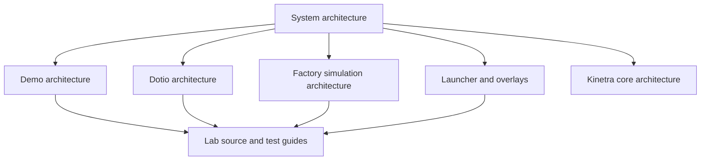

# Architecture documentation

Design explanations live here; controls, gameplay and provenance live with the application sources.

## Table of contents

- [Visual overview](#visual-overview)
- [Architecture guides](#architecture-guides)
- [Source and usage guides](#source-and-usage-guides)

[Parent guide / project overview](../README.md) · [Documentation index](README.md) · [Media guide](media/README.md) · [Design documents](design/README.md)

## Visual overview

Follow the system guide first, then the application or interaction contract you need.

## Architecture guides

| Question | Guide |
| --- | --- |
| How do Lab, the engine and build targets fit together? | [System architecture](architecture.md) |
| Who owns Demo state, simulation and streamed terrain? | [Demo architecture](demo-architecture.md) |
| How does the Dotio port isolate legacy coordinates and game rules? | [Dotio architecture](dotio-architecture.md) |
| How does the local C++ factory simulation divide engine and application responsibilities? | [Factory simulation architecture](factory-simulation-architecture.md) |
| How do registration, session transitions and overlay capture work? | [Launcher and overlays](launcher-overlays.md) |
| What is changing now, and what is planned? | [Design documents](design/README.md), [quality roadmap](design/2026-11-18-quality-roadmap.md) |
| How do we work (cycle, conventions, tests, docs)? | [Agent rules](../AGENTS.md), and in Kinetra: [workflow](../external/Kinetra/docs/workflow.md), [conventions](../external/Kinetra/docs/conventions.md), [testing](../external/Kinetra/docs/testing.md), [documentation guide](../external/Kinetra/docs/documentation.md) |

## Source and usage guides

- [Labs](../labs/README.md), [Demo](../labs/demo/README.md) and [Dotio](../labs/dotio/README.md).
- [Launcher](../launcher/README.md), [headers](../launcher/include/README.md) and [sources](../launcher/src/README.md).
- [Build and verification](../README.md#tests-and-resources).
- [Screenshots and demo video](media/README.md) used by the project overview.
- [Core architecture](../external/Kinetra/docs/architecture.md) for reusable engine contracts.
