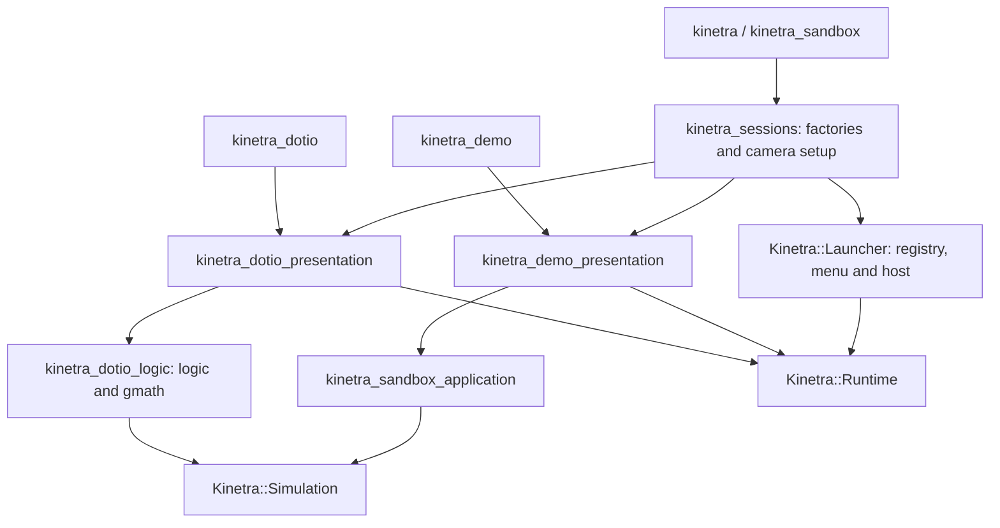
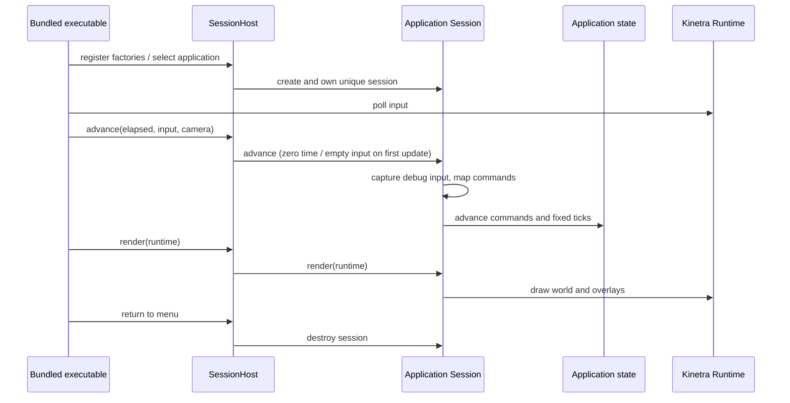

# System architecture

Kinetra-Lab owns runnable applications and their composition. The Kinetra source dependency supplies reusable mechanisms through public CMake targets and headers.

## Table of contents

- [Build boundaries](#build-boundaries)
- [Session ownership and frame flow](#session-ownership-and-frame-flow)
- [Verification boundaries](#verification-boundaries)
- [Navigation](#navigation)

## Build boundaries

Arrows show target consumption; transitive dependencies are omitted. [Root CMake](../CMakeLists.txt), [labs](../labs/CMakeLists.txt) and [launcher CMake](../launcher/CMakeLists.txt) define application targets. Kinetra defines `Kinetra::Launcher` and `Kinetra::Runtime`. Presentation libraries do not depend on the bundled launcher, so direct executables reuse the same sessions without menu infrastructure.

With `KINETRA_LAB_BUILD_RUNTIME=OFF`, only application logic and its headless tests are built. Core tests are disabled in the embedded engine build and run independently in Kinetra. `KINETRA_SOURCE_DIR` selects the recorded `external/Kinetra` submodule by default or an explicit development checkout; no installed package is required.

## Session ownership and frame flow

Runtime outlives hosted sessions. Registrations own factories; sessions own application state. Applications choose timing, bindings, pause behavior and world residency. Debug overlay pointers/callbacks borrow application state and must remain valid during update and draw. The direct executables use the core `run_session` loop instead of SessionHost.

[Launcher and overlays](launcher-overlays.md) details factory failure and transition isolation. [Demo architecture](demo-architecture.md) and [Dotio architecture](dotio-architecture.md) describe their different simulation ownership and coordinate policies.

## Verification boundaries

Headless tests exercise terrain, application command ordering and ported game logic. Generic launcher registry tests run in Kinetra; Lab menu adapter tests run in runtime-enabled builds without opening a window. With `KINETRA_TEST_GRAPHICS=ON`, presentation and launcher integration tests require an actual OpenGL context.

See [Labs verification](../labs/README.md#verification) and [graphics commands](../README.md#tests-and-resources). Engine changes are tested independently; Lab tests validate application integration with the selected engine checkout.

## Navigation

[Directory guide](README.md) · [Project overview](../README.md) · [Documentation index](README.md)
