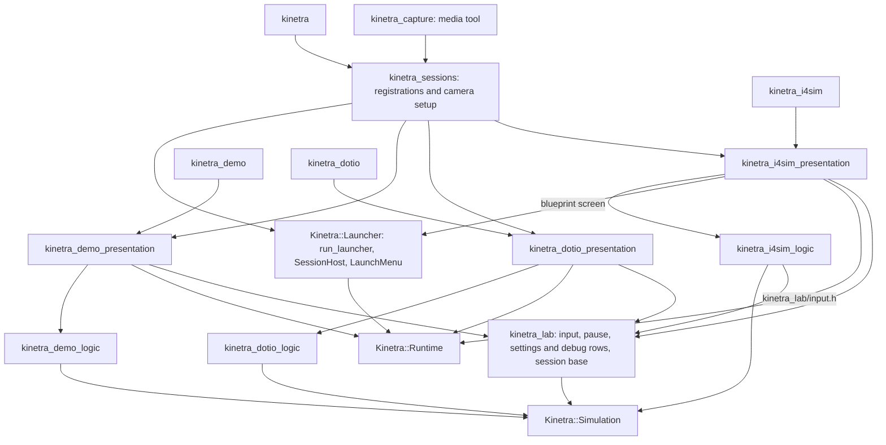
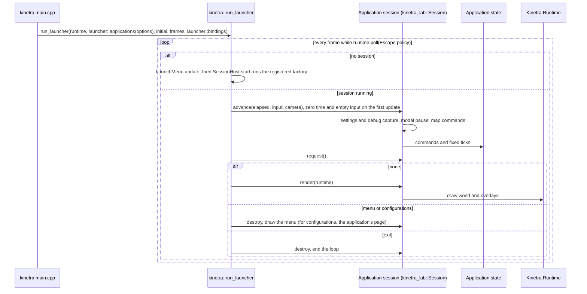

# System architecture

Kinetra-Lab owns runnable applications and their composition. The Kinetra source dependency supplies reusable mechanisms through public CMake targets and headers.

## Table of contents

- [Build boundaries](#build-boundaries)
- [Session ownership and frame flow](#session-ownership-and-frame-flow)
- [Verification boundaries](#verification-boundaries)

[Directory guide](README.md) · [Project overview](../README.md) · [Documentation index](README.md)

## Build boundaries

Arrows show target consumption; transitive dependencies are omitted. [Root CMake](../CMakeLists.txt), [labs](../labs/CMakeLists.txt) and [launcher CMake](../launcher/CMakeLists.txt) define application targets; [tools/capture](../tools/capture/README.md) defines the media tool, which starts sessions through the launcher's registrations and is built only where zlib is found. Kinetra defines `Kinetra::Launcher` and `Kinetra::Runtime`. `kinetra_lab` ([labs/shared](../labs/shared/include/kinetra_lab/)) is header-only Lab policy shared by the three presentations. Its `kinetra_lab/input.h` is headless, and i4sim's logic library uses it for the session's controller, which is tested without a window. Presentation libraries do not depend on the bundled launcher, so direct executables reuse the same sessions without menu infrastructure. The i4sim presentation does link `Kinetra::Launcher` itself, for the `LaunchMenu` of its blueprint screen, which the [layer rule](../AGENTS.md#lab-boundaries) allows.

With `KINETRA_LAB_BUILD_RUNTIME=OFF`, application logic, its headless tests and the i4sim batch executable are built. Core tests are disabled in the embedded engine build and run independently in Kinetra. `KINETRA_SOURCE_DIR` selects the recorded `external/Kinetra` submodule by default or an explicit development checkout; no installed package is required. [External dependencies](../external/README.md) explains the submodule and how its pointer moves.

## Session ownership and frame flow

*Takeaway:* the launcher owns no loop of its own; a session leaves by returning a request from its settings overlay, or from a screen of its own such as i4sim's blueprint screen.

The bundled launcher calls `kinetra::run_launcher` with Lab's registrations and bindings ([launcher](../launcher/README.md)). `SessionHost` owns at most one session. Each session returns its `kinetra::SettingsOverlay`'s request: the panel's first button is the application's own choice of variant, Demo's SCENARIOS or Dotio's DIFFICULTY, which gives `configurations` and returns to the application's page of the launcher menu with the running choice selected; EXIT gives `exit`. That page's LAUNCHER button returns to the application list. i4sim's first button, BLUEPRINTS, also asks for `configurations`, which the session serves itself by returning to its blueprint screen; that screen gives its own `menu` request on LAUNCHER, Escape or M.

Runtime outlives every session; sessions own application state. Applications choose timing, bindings, pause behavior and world residency. Debug overlay pointers and callbacks borrow application state and must remain valid during update and draw. The direct executables (`kinetra_demo`, `kinetra_dotio`, `kinetra_i4sim`) use the core `run_session` loop.

**Drawing between ticks.** Each application keeps the state of its moving objects before and after the last fixed tick and draws them at the fraction of the next tick already accumulated (`TickClock::interpolation()`), so motion stays even when one frame runs more ticks than the next. A paused scene, and any object that changed outside the last tick (a teleport, Demo's chunk streaming renumbering bodies, a Dotio slot reused by a new enemy), is drawn at its exact state, and so is Dotio's player in a tick that respawned it. The first running frame after a pause, and i4sim after a UPS change, start from the current state, so drawing never steps back behind what the paused frame showed. Demo and Dotio move the camera with the drawn player for the frame through `kinetra_lab::ScopedCameraShift` ([labs/shared](../labs/shared/include/kinetra_lab/camera.h)), which restores it afterwards. The snapshots are presentation state: no simulation decision reads them, so seeded runs and characterization fingerprints are unchanged.

| Application | Snapshot | How drawing uses it |
| --- | --- | --- |
| i4sim | `Mover::previous_position`, set at the start of every tick | `Simulation::interpolation()`; the world view draws movers, their labels and debug vectors at the blended position |
| Demo | Every world body's position and angle before and after the last tick, in `Application` | `presented_pose(id)` positions bodies, routes and markers. In Terrain the camera also follows the drawn player for that frame |
| Dotio | Positions of the player and every enemy, arrow and bolt slot, with the world offset added so a streaming shift cancels out | The ported logic draws itself from `Position`, so the presentation swaps the blended positions in for one frame and restores them afterwards |

**Debug layers under bodies.** The routes, probes, vectors, forces and detection ranges of the debug layers never hide a player, an agent, an enemy, a mover or a prop. Each application draws every route before its moving bodies, and right after each body the start of that body's own route, up to where it leaves the body (`kinetra_lab::route_start` in [labs/shared](../labs/shared/include/kinetra_lab/route.h)). The start shows whose route it is; a body drawn later covers it again where the two overlap. Every route line is `kinetra_lab::route_line_pixels` (2.5) screen pixels wide, in every application and at every zoom. The velocity vectors of Demo and Dotio and i4sim's force and target arrows and its VELOCITY and ACCELERATION lines go under the moving bodies too, and right after each body the part of its own arrow or line within the body is drawn again (`kinetra_lab::draw_vector_start` and `draw_line_start` in [under_bodies.h](../labs/shared/include/kinetra_lab/under_bodies.h)), so a line shorter than its body still shows. The steering probes of Demo and Dotio and i4sim's detection ranges go under the moving bodies without such a start: they reach past their body anyway. Demo draws its fixed terrain before all of them, Dotio its walls, i4sim its floor and producers, so they still show across the terrain. Collision and contact outlines, selection markers and labels stay over the bodies ([design](design/2026-11-27-paths-under-bodies.md)).

[Launcher and overlays](launcher-overlays.md) details factory failure and transition isolation. The [Demo README](../labs/demo/README.md#how-it-works) and the [Dotio guide](../labs/dotio/README.md#structure) describe their different simulation ownership and coordinate policies.

## Verification boundaries

Headless tests exercise terrain, application command ordering and ported game logic. The shared input policy tests (`kinetra_lab`) link only `Kinetra::Simulation`, so they build and run without the runtime too. The settings overlay and the generic launcher are tested in Kinetra; Lab's registration tests (`kinetra_menu`) run in runtime-enabled builds without opening a window. With `KINETRA_TEST_GRAPHICS=ON`, presentation and launcher integration tests require an actual OpenGL context.

See [Labs verification](../labs/README.md#verification) and [graphics commands](../README.md#tests-and-resources). Engine changes are tested independently; Lab tests validate application integration with the selected engine checkout.
