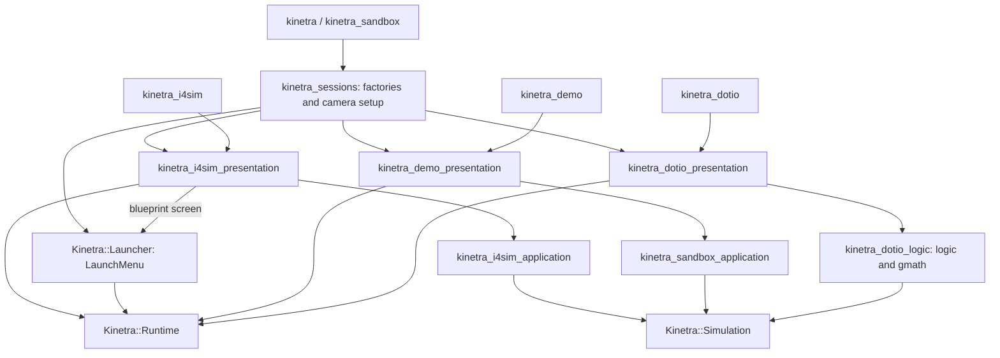
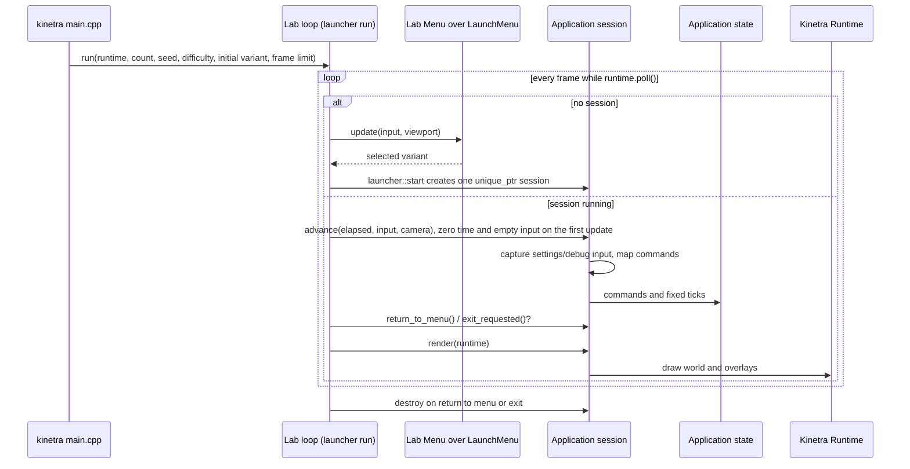

# System architecture

Kinetra-Lab owns runnable applications and their composition. The Kinetra source dependency supplies reusable mechanisms through public CMake targets and headers.

## Table of contents

- [Build boundaries](#build-boundaries)
- [Session ownership and frame flow](#session-ownership-and-frame-flow)
- [Verification boundaries](#verification-boundaries)

[Directory guide](README.md) · [Project overview](../README.md) · [Documentation index](README.md)

## Build boundaries

Arrows show target consumption; transitive dependencies are omitted. [Root CMake](../CMakeLists.txt), [labs](../labs/CMakeLists.txt) and [launcher CMake](../launcher/CMakeLists.txt) define application targets. Kinetra defines `Kinetra::Launcher` and `Kinetra::Runtime`. Presentation libraries do not depend on the bundled launcher, so direct executables reuse the same sessions without menu infrastructure. The i4sim presentation does link `Kinetra::Launcher` itself, for the `LaunchMenu` of its blueprint screen; the [layer rule](../AGENTS.md#lab-boundaries) lists this as an open point for phase 4.

With `KINETRA_LAB_BUILD_RUNTIME=OFF`, application logic, its headless tests and the i4sim batch executable are built. Core tests are disabled in the embedded engine build and run independently in Kinetra. `KINETRA_SOURCE_DIR` selects the recorded `external/Kinetra` submodule by default or an explicit development checkout; no installed package is required. [External dependencies](../external/README.md) explains the submodule and how its pointer moves.

## Session ownership and frame flow

The bundled launcher runs its own loop, `launcher::run` in [launcher/src/session.cpp](../launcher/src/session.cpp). It owns at most one session through `std::unique_ptr<lab::Session>`, and reads the application-owned Settings actions (`return_to_menu`, `exit_requested`) to navigate. It uses `kinetra::LaunchMenu` for selection, but not `kinetra::SessionHost` or `run_launcher`. Moving to `SessionHost` is planned in the [quality roadmap](design/2026-11-18-quality-roadmap.md).

Runtime outlives every session; sessions own application state. Applications choose timing, bindings, pause behavior and world residency. Debug overlay pointers and callbacks borrow application state and must remain valid during update and draw. The direct executables (`kinetra_demo`, `kinetra_dotio`, `kinetra_i4sim`) use the core `run_session` loop.

[Launcher and overlays](launcher-overlays.md) details factory failure and transition isolation. [Demo architecture](demo-architecture.md) and [Dotio architecture](dotio-architecture.md) describe their different simulation ownership and coordinate policies.

## Verification boundaries

Headless tests exercise terrain, application command ordering and ported game logic. The settings overlay tests (`kinetra_settings_tests`) link only `Kinetra::Simulation`, so they build and run without the runtime too. Generic launcher registry tests run in Kinetra; Lab menu adapter tests run in runtime-enabled builds without opening a window. With `KINETRA_TEST_GRAPHICS=ON`, presentation and launcher integration tests require an actual OpenGL context.

See [Labs verification](../labs/README.md#verification) and [graphics commands](../README.md#tests-and-resources). Engine changes are tested independently; Lab tests validate application integration with the selected engine checkout.
