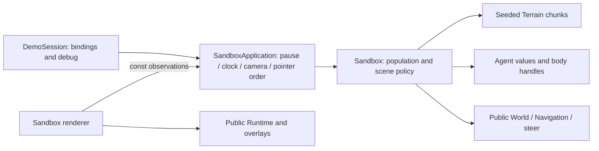

# Demo architecture

Application ownership and its boundary with the public Kinetra engine.

## Table of contents

- [Components](#components)
- [Lifecycle and constraints](#lifecycle-and-constraints)
- [Source navigation](#source-navigation)
- [Navigation](#navigation)

## Components

Session/presentation consume public engine APIs. World generation and agent decisions remain local. Source entry points: [application](../labs/demo/include/sandbox_application.h), [scene](../labs/demo/include/sandbox_scene.h), [agent](../labs/demo/include/agent.h), [terrain](../labs/demo/include/terrain.h), [session](../labs/demo/src/session.cpp).

## Lifecycle and constraints

SandboxApplication owns Sandbox and a fixed clock. Sandbox owns the physics World, Navigation snapshot, terrain and agent values. Body indices must be remapped when scene compaction evicts agents. Terrain rebuilding preserves movers before appending static geometry.

The application orders commands, camera updates and pointer interpretation before fixed simulation ticks. Pausing consumes elapsed clock time without advancing simulation. Player-centered residency controls physical terrain and population; Ghost preview uses a separate terrain cache so camera exploration does not activate distant simulation.

## Source navigation

Start with the [application guide](../labs/demo/README.md), [headers](../labs/demo/include/README.md) and [presentation sources](../labs/demo/src/README.md). See the [system architecture](architecture.md) for target dependencies and shared session flow.

## Navigation

[Directory guide](README.md) · [Project overview](../README.md) · [Documentation index](README.md)
