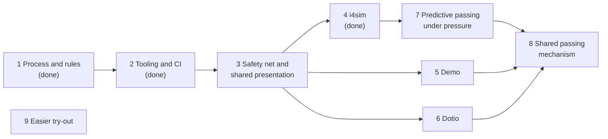

# Quality roadmap

Status: accepted · Branch: one per phase · Related: [development process](2026-11-18-development-process.md), [Kinetra workflow](../../external/Kinetra/docs/workflow.md)

This plan turns Kinetra-Lab and Kinetra into a codebase that has tooling, tests, clear boundaries and documentation that explains the code. It is split into phases; each phase is a separate branch with its own design document, which refines the scope written here. The phases build on each other, so the order matters.

## Table of contents

- [Evidence](#evidence)
- [Decisions](#decisions)
- [Phases](#phases)
- [Status](#status)
- [Phase 2: tooling and CI](#phase-2-tooling-and-ci)
- [Phase 3: safety net and shared presentation](#phase-3-safety-net-and-shared-presentation)
- [Phase 4: i4sim](#phase-4-i4sim)
- [Phase 5: Demo](#phase-5-demo)
- [Phase 6: Dotio](#phase-6-dotio)
- [Phase 7: predictive passing under pressure](#phase-7-predictive-passing-under-pressure)
- [Phase 8: shared passing mechanism](#phase-8-shared-passing-mechanism)
- [Phase 9: easier try-out](#phase-9-easier-try-out)
- [Documentation in every phase](#documentation-in-every-phase)
- [Documentation cleanup](#documentation-cleanup)
- [Open points](#open-points)

[Directory guide](README.md) · [Project overview](../../README.md) · [Documentation index](../README.md)

## Evidence

From a read-only audit on 2026-11-18. Line numbers refer to that date.

| Area | Finding |
| --- | --- |
| Size | i4sim 2637 lines of source; Dotio logic 2706, plus 617 in gmath; Demo 1134 (784 of them in headers); launcher 171 |
| Hotspot | `i4sim::Simulation`: `simulation.cpp` (1230) + `predictive_passing.cpp` (197). Its longest functions: `move_agents` 185 lines, `coordinate_traffic` 146, `coordinate_predictive_passing` 146, `recover_corridors` 104, constructor 100 |
| Hidden state machine | `i4sim::Mover` has 12 `bool`s and 5 progress counters (`labs/i4sim/include/simulation.h`). The session decodes them with a nested ternary |
| Duplication | `FactorySettings` (`labs/i4sim/include/factory_settings.h`) copies `lab::Settings` (`labs/settings.h`) except for 13 lines. Settings capture, pause handling, WASD mapping, zoom and FPS counters are repeated across the three sessions. A `unit()` RNG helper exists 5×; test `require()` helpers 11× |
| Large session class | `FactorySession` (`labs/i4sim/src/session.cpp`): 29 fields, 16 of them `bool`; `render` is 197 lines |
| Global state | Dotio `logic::Grid::Array[155][155]`, `Origin`, `CellSize` are static. Randomness comes from `std::rand` and `std::random_device`, so runs are not reproducible |
| Layer inversions | Dotio logic includes the application adapter. `gmath.h` pulls in `portable.h` with global `using`. The headless Dotio logic target exposes `application.h`. The launcher menu depends on `logic::Difficulty` |
| Boundary candidates | The settings overlay and the `factory_text` glyph patch for `.`, `_` and `-` are reusable mechanisms that belong in Kinetra. i4sim also carries its own geometry helpers |
| Tests | Plain `main()` programs; `simulation_tests` has a 350-line `main`. Session glue (~630 lines) is tested only with graphics, which is off by default. Some tests assert internal counters |
| Formatting | `.clang-format` deviations: 224 in `i4sim/src/session.cpp`, 155 in `simulation.cpp`, 39 in `predictive_passing.cpp`; elsewhere 6 or fewer per file |
| Build | No warning flags, no presets, no `compile_commands.json` export. `cxx_std_20` is set only for Dotio. `priority_queue.cpp` is empty |
| Engine fit | Dotio uses none of Kinetra's motion API: it has its own A*, `PriorityQueue`, `Stack` and `Graph`, and a static `Grid`. In Kinetra, `tangent_steer` is documented as translated from i4sim, and the `PrioritySteering` defaults (2, 0.6) are i4sim's millimeters-per-tick values. Four steering models (`steer`, `priority_steer`, `tangent_steer`, `avoid_collisions`) overlap, take different inputs and return acceleration or velocity |

### Predictive passing baseline

Measured on 2026-11-18 at `4eb5dba` with `kinetra_i4sim_motion_benchmark` (Release, 50,000 ticks, traffic rules off). It reproduces the measurements of the predictive passing work that preceded this roadmap.

| Profile | Passing | 8640x4800 completed (seed 42 / 915839214) | Contacts, 8640x4800 | Run time, 8640x4800 |
| --- | --- | --- | --- | --- |
| Reciprocal | off | 95 / 93 | 0 / 0 | ~9.6 s |
| Reciprocal | on | 99 / 103 | 0 / 0 | ~14.9 s |
| Improved | off | 98 / 99 | 384 / 726 | ~9.0 s |
| Improved | on | 96 / 101 | 767 / 823 | ~13.9 s |

- Reciprocal stays contact-free in all six runs (three layouts, two seeds) with and without passing; passing raises throughput on the large layout.
- Improved gets mixed results and more contacts with passing, so the feature is no general guarantee against contacts or deadlocks.
- Passing costs about 55% more run time on the large layout.
- Reciprocal on `MAS-demonstrator` with seed 42 completes 10 products against 16 with the other seed, which suggests stuck movers. The benchmark reports neither waiting time nor stuck movers.
- The passing checks use snapshots: a third mover that enters a passing lane later is not guarded against.
- Phase 4 extended this baseline on 2026-11-19 with waiting time, stuck movers and passing outcomes; see the [i4sim test guide](../../labs/i4sim/tests/README.md#motion-benchmark).

## Decisions

Settled with the user on 2026-11-18. ⚑ marks answers that differ from the agent's recommendation.

| Decision | Choice | Why |
| --- | --- | --- |
| Order | Safety net and shared presentation before the i4sim refactor | Low risk and removes duplication; makes the i4sim refactor verifiable |
| Test framework | doctest, vendored in Kinetra `third_party/` | Named cases, per-case selection, no network or system package |
| Settings overlay and glyph fix | Move to Kinetra, with an ADR | They are reusable mechanisms ("overlays own shared layout, rendering and input capture") |
| Dotio scope | Replace its A*, PriorityQueue and Stack with Kinetra mechanisms ⚑ | Fully aligned with the engine; behavior may change |
| Dotio acceptance | Invariant tests plus a playtest, with a recording of the old behavior made first | An exact copy of the old A* would make the replacement pointless |
| CI | GitHub Actions per pull request: headless build and tests, format check, docs check | Catches what the Targeted level skips locally; there is no GPU in CI |
| Predictive passing | Its scenarios and diagnostics join phase 4's safety net, before the refactor. Behavior changes follow in phase 7, on the restructured code. The mechanism moves to Kinetra last, in phase 8 | Added on 2026-11-18. Changing behavior inside the hotspot that phase 4 splits would add flags and change the golden values during the refactor. Sharing an unproven mechanism would spread its failures to Demo and Dotio |
| Documentation cleanup | Cross-cutting fixes now, on their own branch; module READMEs are rewritten in their module's phase | Added on 2026-11-18. Stale facts mislead today, but a module README written before its refactor would be written twice |
| Easier try-out | HTTPS submodule URL by default, and a ready-to-run Windows zip with the i4sim blueprints as a GitHub Release asset | Added on 2026-11-21 at the user's request. The build is well documented, but trying the launcher required a compiler, dependencies and possibly an SSH detour first |
| Skill documentation | Every skill gets a `README.md` with use cases next to its `SKILL.md`; `.agents/skills/README.md` stays the page that lists all skills | Added on 2026-11-18 at the user's request. `SKILL.md` instructs the agent; a person choosing a skill needs examples of when to use it and what it changes |

## Phases

*Takeaway:* phases 4–6 depend only on phase 3 and may run in any order; phase 9 depends on none of them; i4sim goes first because it hurts most. Predictive passing changes behavior only after phase 4 restructured i4sim, and is shared only after all three applications are clean. Each phase ends at the **Full** verification level, with its module documentation rewritten.

## Status

Updated on 2026-11-19, after phase 4.

| Phase | State | Where |
| --- | --- | --- |
| 1 Process and rules | Implemented | [Development process](2026-11-18-development-process.md) |
| 2 Tooling and CI | Implemented | [Tooling and CI](2026-11-18-tooling-and-ci.md) |
| 3 Safety net and shared presentation | Implemented: step 1 in Lab #2; steps 2–7 on `refactor/shared-presentation` with Kinetra `feat/overlay-glyphs-navigation` | [Safety net and shared presentation](2026-11-18-safety-net-shared-presentation.md), [Kinetra design](../../external/Kinetra/docs/design/2026-11-18-overlay-glyphs-navigation.md) |
| 4 i4sim | Implemented: step 1 (passing safety net) in Lab #6, step 2 (simulation components) in Lab #18, step 3 (session and module README) on `refactor/i4sim-session` | [i4sim restructuring](2026-11-19-i4sim-restructuring.md) |
| 6 Dotio | In progress: step 1 (statistics baseline) in Lab #50; step 2 (grid per world, seeded randomness) on `refactor/dotio-grid-rng`; step 3 in Kinetra #17; step 4 (routes on Kinetra's weighted grid) on `refactor/dotio-navigation` | [Dotio restructuring](2026-11-21-dotio-restructuring.md) |
| 5 Demo | Implemented: step 1 (headers) in Lab #52, step 2 (scene operations) in Lab #54, step 3 (contracts and README) on `docs/demo-module`; step 4 (contact tests to Kinetra) committed locally, waiting for Kinetra push access | [Demo restructuring](2026-11-21-demo-restructuring.md) |
| 6 Dotio | In progress: step 1 (statistics baseline) in Lab #50; step 2 (grid per world, seeded randomness) on `refactor/dotio-grid-rng`; step 3 in Kinetra #17; step 4 (routes on Kinetra's weighted grid) on `refactor/dotio-navigation` | [Dotio restructuring](2026-11-21-dotio-restructuring.md) |
| 7 Predictive passing under pressure | Implemented: step 1 (causes) in Lab #49, steps 2–3 (guarded passing, measured) in Lab #58, step 4 (standstill near a destination, documented as a limit; MAKE WAY proposed, awaiting a decision) in Lab #59; passing stays off by default | [i4sim passing under pressure](2026-11-21-i4sim-passing-under-pressure.md) |
| 8 | Not started | This page |
| 9 Easier try-out | In review: HTTPS submodule on `build/https-submodule`, Windows zip on `build/windows-release` (stacked); the desktop check on Windows is the user's | [HTTPS submodule](2026-11-21-https-submodule.md), [Windows release zip](2026-11-21-windows-release-zip.md) |

## Phase 2: tooling and CI

Repositories: Kinetra and Lab.

**Status: implemented.** See [Tooling and CI](2026-11-18-tooling-and-ci.md). Additions to the plan below:
- the CI toolchain is pinned to an Arch Linux Archive snapshot;
- CI also runs a headless configuration;
- Lab warnings are reported, and each module's phase turns them into errors.

- **CMake presets.** A `CMakePresets.json` with presets `dev` (Debug, warnings), `release`, `asan` (ASan + UBSan), `headless` and `graphics`, and `CMAKE_EXPORT_COMPILE_COMMANDS` for clangd.
- **Warnings.** An option for `-Wall -Wextra -Wpedantic -Wshadow -Wconversion`, on in `dev`. Fix or explicitly suppress what it reports, module by module (not `-Werror` yet).
- **Per-target standard.** `target_compile_features(... cxx_std_20)` on every target.
- **Static analysis.** A `.clang-tidy` with `bugprone-*`, `performance-*`, selected `modernize-*` and `readability-identifier-naming` matching the [conventions](../../external/Kinetra/docs/conventions.md#naming). It runs on changed files only.
- **Formatting.** One `chore: apply clang-format` commit per repository, separate from any other change.
- **doctest.** Vendored as a single header in Kinetra `third_party/doctest/` with an internal CMake target that Lab can link. Convert one test file first as the pattern.
- **CI.** A GitHub Actions workflow per repository: headless configure, build, tests, `clang-format --dry-run --Werror` and `tools/check_docs.py`.
- **Coding agent hook (optional).** Runs `clang-format -i` on edited `.h`/`.cpp` files.

**Done when:** CI is green on a pull request, `cmake --preset dev` works, and clangd resolves includes.

## Phase 3: safety net and shared presentation

Repositories: Kinetra (overlay, glyphs, ADR) and Lab.

**Status: implemented.** See [Safety net and shared presentation](2026-11-18-safety-net-shared-presentation.md#27-implemented).

1. **Characterization.** A golden summary test for i4sim (fixed seed and blueprint, observable totals) and invariant tests for Demo crowds.
2. **One test helper.** Move the remaining tests to doctest and remove the 11 `require()` copies.
3. **Settings overlay to Kinetra.** Make it generic: applications supply rows and actions. Remove `FactorySettings` and the `bool dotio` flag argument of `Settings::draw`. Record this in a Kinetra ADR.
4. **Glyph fix.** Add `.`, `_` and `-` to Kinetra `bitmap_text`, and remove `factory_text` from i4sim.
5. **Shared presentation helpers.** One place for zoom (`pow(1.1, wheel)` plus clamp), WASD/arrow mapping, pause-while-settings-open and the FPS counter. Reusable parts go to Kinetra, Lab policy to a small shared Lab target.
6. **Launcher.** Move it to `kinetra::SessionHost`/`run_launcher`, keeping the settings-driven navigation. Update the docs that currently describe the Lab loop. Remove the launcher's dependency on `logic::Difficulty` by passing configuration names.
7. **Standalone executables.** Make the LAUNCHER action behave sensibly when there is no launcher (exit, as i4sim does).

**Done when:** the duplicated blocks are gone, the launcher uses `SessionHost`, all tests are named doctest cases, and the session input logic is testable headless.

## Phase 4: i4sim

Repository: Lab.

**Status: implemented.** See [i4sim restructuring](2026-11-19-i4sim-restructuring.md). Against the plan below: the mover's state became one value per axis instead of one `MoverState` enum, because several of the old flags are true together; `Simulation` is a facade over private components; and the session's controller lives in the headless library. The golden lines never changed.

- **Predictive passing safety net (first, before any restructuring).** Pins today's passing behavior, so the refactor cannot change it silently and phase 7 has its baseline. No behavior change; the golden values stay identical.
  - *Diagnostics.* A passing event log in the simulation: participants, chosen lanes, phase transitions and the reason for every cancellation. On a contact it records seed and tick, so a failing situation can be replayed directly.
  - *Pressure scenarios* as named doctest cases with blueprint fixtures: three oncoming movers, a third mover entering an active passing lane, several simultaneous passing plans, and limited room to give way. Each case records today's outcome (contacts, cancellations, arrival), including the known failures.
  - *Benchmark metrics.* `kinetra_i4sim_motion_benchmark` also reports waiting time and stuck movers, next to completed products and contacts.
- **Mover state.** Replace the `Mover` flags with a `MoverState` enum and explicit transitions, documented as a state diagram in the module README. The passing plan gets explicit phases (entering lanes, passing, restoring) in the same model.
- **Split `Simulation` by responsibility.** Separate grid topology, route planning, parking, traffic and corridor coordination, predictive passing, recovery, scheduling and motion. Each part is a class or function group with its own tests; `Simulation` composes them.
- **Constants.** Name the repeated literals (`Vec2{2, 2}`, `0.05f`, `120`) and the braking-distance expression.
- **Encapsulation.** Make `paused` and `workload` private, behind operations, so the session no longer flips `paused` to get past a guard.
- **`FactorySession`.** Split into input/controller, HUD and world rendering; the controller is headless and tested.
- **Tests.** Assert observable behavior instead of internal counters.
- **Documentation.** `///` contracts on all i4sim headers, and a full module README following the template, which absorbs the sub-READMEs.

**Done when:** no function is over ~80 lines without a reason, the golden test is unchanged (or changed deliberately and explained), and the README explains the traffic, corridor and passing algorithms.

## Phase 5: Demo

Repository: Lab.

- **Headers.** Move function bodies from headers (784 of 1134 lines) into `.cpp` files, and remove `using namespace kinetra;` from `sandbox_scene.h`.
- **Encapsulation.** Give `Sandbox` operations instead of 14 public fields.
- **Renderer flags.** Replace the 10-parameter `sandbox::render` with a parameter object.
- **Dead code.** Remove the unused help-overlay path, or wire it up.
- **Zoom constants.** Name the zoom limits (5/17/100), which are repeated in six places.
- **Test placement.** Move `contact_tests.cpp`, which tests only the engine, to Kinetra.
- **Documentation.** `///` contracts and the module README.

## Phase 6: Dotio

Repository: Lab, plus Kinetra if navigation needs an extension.

- **Before:** record a short video and a seeded statistics baseline of the current enemy behavior (Easy, Medium, Hard).
- **Global state.** Turn `Grid` into an instance owned by the world, and inject a seeded RNG everywhere. Runs become reproducible.
- **Navigation.** Replace the own A*, PriorityQueue and Stack with `kinetra::Navigation` and the weighted grid. If Kinetra lacks something Dotio needs, extend Kinetra with its own design document.
- **Layers.** Fix the inversions: logic must not include the adapter; split `gmath`/`portable.h`; the headless target must not expose `application.h`.
- **Conventions.** Move to Lab naming and style (PascalCase members, `_x`/`x_` mixes, include guards).
- **Dead code.** Remove the `Commands` fields that are never set, and the empty `priority_queue.cpp`.
- **Tests.** Invariant tests: paths valid and clear of walls, enemies reach the player, no stuck agents within N ticks, determinism per seed. Then a playtest by the user against the recording.
- **Documentation.** `///` contracts and the module README, including how AI states use navigation.

## Phase 7: predictive passing under pressure

Repository: Lab. Depends on phase 4, which provides the scenarios, the diagnostics and the explicit passing phases.

Goal: predictive passing that stays safe and keeps traffic flowing under pressure, with Reciprocal as the reference profile. It stays off by default until the measurements below justify changing that.

1. **Cause of Improved's extra contacts.** Replay the contacts from the baseline with the event log and establish the cause before changing parameters or behavior.
2. **Guarded maneuvers.** Recheck during the maneuver that it stays feasible, not only when the plan starts, so a third mover entering a lane is handled. Wait or abort under a fixed priority, so movers do not keep switching decisions. Respect braking distance and acceleration limits.
3. **Measured result.** Compare identical seeds, layouts and settings with passing on and off: contacts, completed products, waiting time and stuck movers, including the `MAS-demonstrator` seed-42 throughput gap. The phase 4 scenarios turn from recorded outcomes into required outcomes.
4. **Standstills near a destination.** Added on 2026-11-20. Without passing and without any setting change, two movers can block each other for good about 120 mm from a destination, the other mover 130 to 150 mm away: 2 of 48 seeded runs, almost all under Reciprocal and mostly on 4320x2400. A SPEED, FORCE or HORIZON change in the debug menu can steer a run into one, which is how the user met it. RECOVERY does not free them; with it on, 7 of 48 runs end stuck. First establish the cause from a recorded run (which mover holds the place the other needs, and why avoidance keeps both still), then choose a remedy. Measurements and the harness that reproduces them: [i4sim motion changes keep routes](2026-11-20-i4sim-tuning-stall.md#measurement-harness).

**Done when:** the pressure scenarios end without contacts and with arrival, the benchmark shows no regression with passing on for Reciprocal, the Improved contacts are either explained and fixed or documented as a profile limit, and the standstills near a destination are explained and resolved or documented as a limit.

## Phase 8: shared passing mechanism

Repositories: Kinetra and Lab. Depends on phases 5, 6 and 7.

- **Kinetra design and ADR.** Move the proven, application-free part of predictive passing (conflict prediction, lane agreement, maneuver guard) to Kinetra. Factory policy (traffic zones, parking, junction rules) stays in i4sim.
- **Same scenarios everywhere.** Run the phase 4 pressure scenarios against the Kinetra mechanism, and give Demo crowds and Dotio enemies the same mechanism and scenario set.
- **Steering models.** Use this phase to decide whether the four overlapping steering models in Kinetra can share one agent-motion interface (see [Evidence](#evidence)), and to move i4sim-shaped defaults out of the engine.

## Phase 9: easier try-out

Repository: Lab. Added on 2026-11-21; independent of the other phases.

Someone who wants to see the launcher should not need a compiler, dependencies or an SSH key first.

- **HTTPS submodule.** `.gitmodules` points at `https://github.com/SMB-M87/Kinetra.git`, so a plain `git clone --recurse-submodules` works without an SSH key. CI drops its `insteadOf` rewrite. Developers who push with SSH set `pushInsteadOf` once.
- **Windows zip.** A release workflow cross-builds the launcher and the three applications, and publishes `Kinetra-Lab-windows-x64.zip` with `SDL2.dll`, `i4sim-blueprints/` and the licenses. Every merge on `main` refreshes the `main-build` pre-release; a `v*` tag makes a fixed release.
- **Quick start.** The README's quick start opens with the download, before the build route.

**Done when:** a fresh clone without an SSH key gets the submodule, the zip downloads from a fixed link in the README, and it starts the launcher on a Windows machine without installing anything (checked by the user on a desktop).

## Documentation in every phase

- The module being refactored gets its README rewritten with the [module template](../../external/Kinetra/docs/documentation.md#module-readme-template), and its headers get `///` contracts (`doc-module` skill). Docs are written after the code has its new shape, so nothing is documented twice.
- Navigation-only sub-READMEs of that module are folded in and removed.
- Architecture pages and diagrams are updated in the same phase as the code they describe.
- A phase that adds or changes a skill updates the skill's README and the skills overview in the same commit.

## Documentation cleanup

Two read-only audits on 2026-11-18 (Lab at `4eb5dba`, Kinetra at `b107142`) found stale facts, history text, duplicated diagrams and navigation-only READMEs in both repositories. The cleanup is split so nothing is written twice:

| What | When | Where |
| --- | --- | --- |
| Lab cross-cutting fixes: root README back to an entry point (the submodule workflow moves to `external/README.md`, reconciled with the [Kinetra workflow](../../external/Kinetra/docs/workflow.md#changes-across-kinetra-and-lab)), stale commands and facts, history text, `blob/main` links, the documentation index, `prompt.md` (its plan is phases 4, 7 and 8 above) | Now | Lab `docs/roadmap-and-cleanup` |
| Launcher module README, `docs/launcher-overlays.md` cut to Lab composition, `docs/architecture.md` session loop | Phase 3 | Lab phase 3 branch |
| Kinetra runtime, launcher, session and text docs (`docs/engine/runtime.md`, `docs/engine/launcher-overlays.md`, `docs/architecture.md`, `src/engine/README.md`) | Phase 3 | Kinetra phase 3 branch |
| Kinetra cross-cutting fixes, `///` contracts on every public header, and folding `include/README.md`, `include/kinetra/README.md`, `src/README.md`, `docs/engine/README.md` and `tests/consumer/README.md` into module READMEs. The ADR index moves into `docs/decisions/README.md`: in number order, 0011 and 0012 as rows, with each ADR's status and supersessions; `docs/README.md` and the `adr` skill then point there. The `tests/README.md` test map gets the missing `weighted_navigation_tests.cpp` and the CTest names of suites converted to doctest | After the Kinetra phase 3 branch, stacked on it | Kinetra `docs/cleanup` |
| Skill rule: a `README.md` with use cases next to every `SKILL.md`, `.agents/skills/README.md` as the overview of all skills, and a template in the Kinetra documentation guide | Now | Kinetra `docs/skill-documentation` |
| A README for each of the seven skills (`feature`, `grilling`, `verify`, `doc-module`, `refactor`, `adr`, `pr-feedback`) following that template, linked from the overview | After `docs/skill-documentation` merges; independent of phase 3 | Kinetra `docs/skill-readmes` |
| i4sim, Demo and Dotio module READMEs; their thin sub-READMEs folded in; `demo-architecture.md` and `dotio-architecture.md` absorbed; i4sim test history moved out of the tests README | Phases 4, 5 and 6 | Each module's phase |

## Open points

- Desktop playtests and performance checks remain manual; CI cannot replace them.
- Phase 6 starts with a short video of today's Dotio enemy behavior. Recording it needs the user's desktop.
- Resolved in phase 4: the [layer rule](../../AGENTS.md#lab-boundaries) allows a presentation to link `Kinetra::Launcher` for its menu widgets, as i4sim's blueprint screen does.
- Phase 4 left three session oddities as they were, for a decision on the intended behavior: `R` drops a `--ups` rate, RESET PARAMETERS sets a horizon of 8 against the default 32, and the session ignores its `output` argument ([i4sim open points](../../labs/i4sim/README.md#open-points)).
