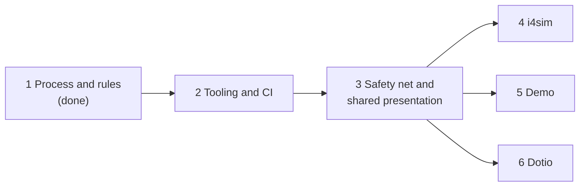

# Quality roadmap

Status: accepted · Branch: one per phase · Related: [development process](2026-11-18-development-process.md), [Kinetra workflow](../../external/Kinetra/docs/workflow.md)

This plan turns Kinetra-Lab and Kinetra into a codebase that has tooling, tests, clear boundaries and documentation that explains the code. It is split into phases; each phase is a separate branch with its own design document, which refines the scope written here. The phases build on each other, so the order matters.

## Table of contents

- [Evidence](#evidence)
- [Decisions](#decisions)
- [Phases](#phases)
- [Phase 2: tooling and CI](#phase-2-tooling-and-ci)
- [Phase 3: safety net and shared presentation](#phase-3-safety-net-and-shared-presentation)
- [Phase 4: i4sim](#phase-4-i4sim)
- [Phase 5: Demo](#phase-5-demo)
- [Phase 6: Dotio](#phase-6-dotio)
- [Documentation in every phase](#documentation-in-every-phase)
- [Open points](#open-points)

[Directory guide](README.md) · [Project overview](../../README.md) · [Documentation index](../README.md)

## Evidence

From a read-only audit on 2026-11-18. Line numbers refer to that date.

| Area | Finding |
| --- | --- |
| Size | i4sim 2637 lines of source; Dotio logic 2706, plus 617 in gmath; Demo 1134 (784 of them in headers); launcher 171 |
| Hotspot | `i4sim::Simulation`: `simulation.cpp` (1230) + `predictive_passing.cpp` (197). Its longest functions: `move_agents` 185 lines, `coordinate_traffic` 146, `coordinate_predictive_passing` 146, `recover_corridors` 104, constructor 100 |
| Hidden state machine | `i4sim::Mover` has 12 `bool`s and 5 progress counters (`labs/i4sim/include/simulation.h`). The session decodes them with a nested ternary |
| Duplication | `FactorySettings` (`labs/i4sim/include/factory_settings.h`) copies `lab::Settings` (`labs/settings.h`) except for 13 lines. Settings capture, pause handling, WASD mapping, zoom and FPS counters are repeated across the three sessions. A `unit()` RNG helper exists 5×; test `require()` helpers 11× |
| Large session class | `FactorySession` (`labs/i4sim/src/session.cpp`): 29 fields, 16 of them `bool`; `render` is 197 lines |
| Global state | Dotio `logic::Grid::Array[155][155]`, `Origin`, `CellSize` are static. Randomness comes from `std::rand` and `std::random_device`, so runs are not reproducible |
| Layer inversions | Dotio logic includes the application adapter. `gmath.h` pulls in `portable.h` with global `using`. The headless Dotio logic target exposes `application.h`. The launcher menu depends on `logic::Difficulty` |
| Boundary candidates | The settings overlay and the `factory_text` glyph patch for `.`, `_` and `-` are reusable mechanisms that belong in Kinetra. i4sim also carries its own geometry helpers |
| Tests | Plain `main()` programs; `simulation_tests` has a 350-line `main`. Session glue (~630 lines) is tested only with graphics, which is off by default. Some tests assert internal counters |
| Formatting | `.clang-format` deviations: 224 in `i4sim/src/session.cpp`, 155 in `simulation.cpp`, 39 in `predictive_passing.cpp`; elsewhere 6 or fewer per file |
| Build | No warning flags, no presets, no `compile_commands.json` export. `cxx_std_20` is set only for Dotio. `priority_queue.cpp` is empty |

## Decisions

Settled with the user on 2026-11-18. ⚑ marks answers that differ from the agent's recommendation.

| Decision | Choice | Why |
| --- | --- | --- |
| Order | Safety net and shared presentation before the i4sim refactor | Low risk and removes duplication; makes the i4sim refactor verifiable |
| Test framework | doctest, vendored in Kinetra `third_party/` | Named cases, per-case selection, no network or system package |
| Settings overlay and glyph fix | Move to Kinetra, with an ADR | They are reusable mechanisms ("overlays own shared layout, rendering and input capture") |
| Dotio scope | Replace its A*, PriorityQueue and Stack with Kinetra mechanisms ⚑ | Fully aligned with the engine; behavior may change |
| Dotio acceptance | Invariant tests plus a playtest, with a recording of the old behavior made first | An exact copy of the old A* would make the replacement pointless |
| CI | GitHub Actions per pull request: headless build and tests, format check, docs check | Catches what the Targeted level skips locally; there is no GPU in CI |

## Phases

Phases 4–6 depend only on phase 3 and may run in any order; i4sim goes first because it hurts most. Each phase ends at the **Full** verification level, with its module documentation rewritten.

## Phase 2: tooling and CI

Repositories: Kinetra and Lab.

- **CMake presets.** A `CMakePresets.json` with presets `dev` (Debug, warnings), `release`, `asan` (ASan + UBSan), `headless` and `graphics`, and `CMAKE_EXPORT_COMPILE_COMMANDS` for clangd.
- **Warnings.** An option for `-Wall -Wextra -Wpedantic -Wshadow -Wconversion`, on in `dev`. Fix or explicitly suppress what it reports, module by module (not `-Werror` yet).
- **Per-target standard.** `target_compile_features(... cxx_std_20)` on every target.
- **Static analysis.** A `.clang-tidy` with `bugprone-*`, `performance-*`, selected `modernize-*` and `readability-identifier-naming` matching the [conventions](../../external/Kinetra/docs/conventions.md#naming). It runs on changed files only.
- **Formatting.** One `chore: apply clang-format` commit per repository, separate from any other change.
- **doctest.** Vendored as a single header in Kinetra `third_party/doctest/` with an internal CMake target that Lab can link. Convert one test file first as the pattern.
- **CI.** A GitHub Actions workflow per repository: headless configure, build, tests, `clang-format --dry-run --Werror` and `tools/check_docs.py`.
- **Claude Code hook (optional).** Runs `clang-format -i` on edited `.h`/`.cpp` files.

**Done when:** CI is green on a pull request, `cmake --preset dev` works, and clangd resolves includes.

## Phase 3: safety net and shared presentation

Repositories: Kinetra (overlay, glyphs, ADR) and Lab.

1. **Characterization.** A golden summary test for i4sim (fixed seed and blueprint, observable totals) and invariant tests for Demo crowds.
2. **One test helper.** Move the remaining tests to doctest and remove the 11 `require()` copies.
3. **Settings overlay to Kinetra.** Make it generic: applications supply rows and actions. Remove `FactorySettings` and the `bool dotio` flag argument of `Settings::draw`. Record this in a Kinetra ADR.
4. **Glyph fix.** Add `.`, `_` and `-` to Kinetra `bitmap_text`, and remove `factory_text` from i4sim.
5. **Shared presentation helpers.** One place for zoom (`pow(1.1, wheel)` plus clamp), WASD/arrow mapping, pause-while-settings-open and the FPS counter. Reusable parts go to Kinetra, Lab policy to a small shared Lab target.
6. **Launcher.** Move it to `kinetra::SessionHost`/`run_launcher`, keeping the settings-driven navigation. Update the docs that currently describe the Lab loop. Remove the launcher's dependency on `logic::Difficulty` by passing configuration names.
7. **Standalone executables.** Make the LAUNCHER action behave sensibly when there is no launcher (exit, as i4sim does).

**Done when:** the duplicated blocks are gone, the launcher uses `SessionHost`, all tests are named doctest cases, and the session input logic is testable headless.

## Phase 4: i4sim

Repository: Lab.

- **Mover state.** Replace the `Mover` flags with a `MoverState` enum and explicit transitions, documented as a state diagram in the module README.
- **Split `Simulation` by responsibility.** Separate grid topology, route planning, parking, traffic and corridor coordination, predictive passing, recovery, scheduling and motion. Each part is a class or function group with its own tests; `Simulation` composes them.
- **Constants.** Name the repeated literals (`Vec2{2, 2}`, `0.05f`, `120`) and the braking-distance expression.
- **Encapsulation.** Make `paused` and `workload` private, behind operations, so the session no longer flips `paused` to get past a guard.
- **`FactorySession`.** Split into input/controller, HUD and world rendering; the controller is headless and tested.
- **Tests.** Assert observable behavior instead of internal counters.
- **Documentation.** `///` contracts on all i4sim headers, and a full module README following the template, which absorbs the sub-READMEs.

**Done when:** no function is over ~80 lines without a reason, the golden test is unchanged (or changed deliberately and explained), and the README explains the traffic, corridor and passing algorithms.

## Phase 5: Demo

Repository: Lab.

- **Headers.** Move function bodies from headers (784 of 1134 lines) into `.cpp` files, and remove `using namespace kinetra;` from `sandbox_scene.h`.
- **Encapsulation.** Give `Sandbox` operations instead of 14 public fields.
- **Renderer flags.** Replace the 10-parameter `sandbox::render` with a parameter object.
- **Dead code.** Remove the unused help-overlay path, or wire it up.
- **Zoom constants.** Name the zoom limits (5/17/100), which are repeated in six places.
- **Test placement.** Move `contact_tests.cpp`, which tests only the engine, to Kinetra.
- **Documentation.** `///` contracts and the module README.

## Phase 6: Dotio

Repository: Lab, plus Kinetra if navigation needs an extension.

- **Before:** record a short video and a seeded statistics baseline of the current enemy behavior (Easy, Medium, Hard).
- **Global state.** Turn `Grid` into an instance owned by the world, and inject a seeded RNG everywhere. Runs become reproducible.
- **Navigation.** Replace the own A*, PriorityQueue and Stack with `kinetra::Navigation` and the weighted grid. If Kinetra lacks something Dotio needs, extend Kinetra with its own design document.
- **Layers.** Fix the inversions: logic must not include the adapter; split `gmath`/`portable.h`; the headless target must not expose `application.h`.
- **Conventions.** Move to Lab naming and style (PascalCase members, `_x`/`x_` mixes, include guards).
- **Dead code.** Remove the `Commands` fields that are never set, and the empty `priority_queue.cpp`.
- **Tests.** Invariant tests: paths valid and clear of walls, enemies reach the player, no stuck agents within N ticks, determinism per seed. Then a playtest by the user against the recording.
- **Documentation.** `///` contracts and the module README, including how AI states use navigation.

## Documentation in every phase

- The module being refactored gets its README rewritten with the [module template](../../external/Kinetra/docs/documentation.md#module-readme-template), and its headers get `///` contracts (`doc-module` skill). Docs are written after the code has its new shape, so nothing is documented twice.
- Navigation-only sub-READMEs of that module are folded in and removed.
- Architecture pages and diagrams are updated in the same phase as the code they describe.

## Open points

- Whether the Lab-specific shared presentation helpers deserve their own target (`kinetra_lab_common`) or stay header-only is decided in the phase 3 design document.
- Desktop playtests and performance checks remain manual; CI cannot replace them.
