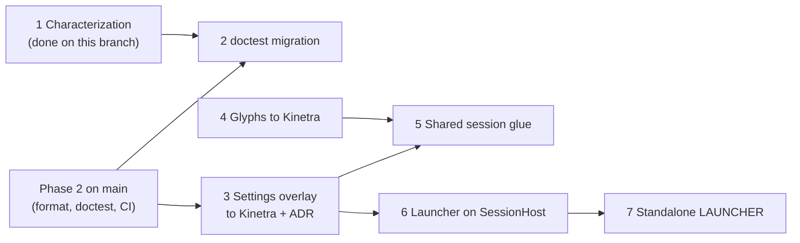

# Safety net and shared presentation

Status: accepted · Branches: `test/characterization-safety-net` (step 1), a later branch for steps 2–7 · Related: [quality roadmap, phase 3](2026-11-18-quality-roadmap.md#phase-3-safety-net-and-shared-presentation), [Kinetra testing](../../external/Kinetra/docs/testing.md), [launcher and overlays](../launcher-overlays.md)

Phase 3 of the quality roadmap. It pins the current simulation behavior with characterization tests, so phases 4–6 can restructure i4sim, Demo and Dotio safely. It also removes the presentation glue that the three sessions duplicate. This document refines the roadmap scope with evidence from the code and records the decisions that are still open.

## Table of contents

- [Problem](#problem)
- [Goals and non-goals](#goals-and-non-goals)
- [Decisions](#decisions)
- [Design](#design)
- [Affected areas](#affected-areas)
- [Test plan](#test-plan)
- [Review](#review)
- [Verification](#verification)
- [Pull request](#pull-request)
- [Open points](#open-points)

[Directory guide](README.md) · [Project overview](../../README.md) · [Documentation index](../README.md)

## Problem

Surveyed on 2026-11-18 on `main` at `a669bf3` (Kinetra `acd5bb2`).

| Area | Evidence |
| --- | --- |
| No whole-run safety net | i4sim tests assert contracts per feature (`labs/i4sim/tests/simulation_tests.cpp`). Nothing pins a complete seeded run, so a refactor of `Simulation` could change routes, timing or throughput without a failing test. Demo crowds are only checked for finite motion and the sweep budget (`labs/demo/tests/crowd_stability_tests.cpp:12-26`). |
| Duplicated settings overlay | `i4sim::FactorySettings` (`labs/i4sim/include/factory_settings.h`) copies `lab::Settings` (`labs/settings.h`) except for the namespace, two help lines and an ignored `draw` flag. |
| Flag argument | `Settings::draw(..., bool dotio)` (`labs/settings.h:71`) switches three help lines and must be kept in step with `sim_controls_height` by hand (Dotio sets 28 at `labs/dotio/include/application.h:43`). |
| Duplicated session glue | Settings capture and debug-menu close: Demo `session.cpp:41-51`, Dotio `session.cpp:14-31`, i4sim `session.cpp:232-243`. Pause while settings are open: three variants (Demo `:47`, Dotio `:27`, i4sim edge detection `:233-239`). WASD/arrow direction: Demo `sandbox_input.h:12-20`, Dotio `presentation.cpp:16-20`, i4sim inline `session.cpp:279-283`. Zoom `pow(1.1, wheel)` with clamps: Demo `[5 or 17, 100]`, Dotio `[2.5 or 25, 50]`, i4sim `[0.005, 10]`, each repeated in the `Settings::update` call. FPS window of 0.5 s: Demo `session.cpp:16-39`, Dotio `application.h:191-197`. |
| Glyph patch | `factory_text` (`labs/i4sim/src/session.cpp:16-27`) uppercases and draws `.`, `_` and `-` over Kinetra's `draw_text`, which renders them blank (`external/Kinetra/include/kinetra/bitmap_text.h:39-48`). It has 11 call sites. Other text, such as the debug menu's "SPEED -" rows, loses the `-` today. |
| Launcher loop | Lab runs its own loop (`launcher/src/session.cpp:21-61`) instead of `kinetra::SessionHost`/`run_launcher` (`external/Kinetra/include/kinetra/launcher.h:54-77`). `run_launcher` binds M to the menu, lets Escape close the window and never reads `exit_requested` or a return request; `kinetra::Session` has no such hook (`session.h:6-14`). |
| Launcher depends on Dotio | `logic::Difficulty` is used in `launcher/include/menu.h:2-23`, `launcher/include/session.h:9-13`, `launcher/src/session.cpp` and `launcher/src/main.cpp:27-41`. |
| Dead LAUNCHER action | Standalone Demo and Dotio run `run_session`, which only checks `exit_requested` (`external/Kinetra/src/engine/session.cpp:16`). Their LAUNCHER button sets a flag that nobody reads. i4sim maps it to exit (`labs/i4sim/src/main.cpp:74-87`). |
| Test helpers | 11 copies of `require(bool, const char *)`, in every test program. |

## Goals and non-goals

Goals:

- A whole-run characterization for i4sim and Demo crowds that fails on any behavior change, runs in seconds and works headless.
- One settings overlay, in Kinetra, with application-supplied rows, actions and help lines; no flag argument.
- One place for the session glue: zoom stepping, direction mapping, pause-while-settings-open and the FPS counter.
- The launcher on `SessionHost`, with settings-driven navigation and without a Dotio dependency.
- All Lab tests as named doctest cases, with one helper instead of 11.

Non-goals:

- No behavior change in the simulations; the characterization values stay identical through this phase.
- No restructuring of `i4sim::Simulation`, Demo `Sandbox` or Dotio logic (phases 4–6).
- No new tooling, warnings or formatting; that is phase 2.

## Decisions

| Decision | Choice | Why |
| --- | --- | --- |
| Scope and order | Roadmap phase 3, steps 1–7 | Settled in the [roadmap](2026-11-18-quality-roadmap.md#decisions) |
| Settings overlay and glyph fix | Move to Kinetra, with an ADR | Settled in the roadmap |
| Test framework | doctest, vendored by phase 2 | Settled in the roadmap; the target name comes from phase 2 |
| Characterization form | A golden line per seeded scenario: totals plus a 64-bit FNV-1a fingerprint of every mover's exact motion after every tick | Totals alone miss route changes; an end-state hash misses them when every mover ends parked (seen during the first attempt: two different runs gave the same end-state hash) |
| Shared test helper | Header-only target `kinetra_lab_test_support` (`labs/test_support/test_support.h`) with `require` and `Fingerprint` | The two new tests need the same hash; adding copies would contradict this phase. doctest replaces `require` in step 2 |
| Sequencing with phase 2 | Step 1 adds files only. Steps 2–7 wait until phase 2's clang-format commit and doctest target are on `main` | Editing the sessions before the repository-wide reformat would conflict on almost every line |
| Pull-request split | Step 1 as its own pull request now; steps 2–7 on a new branch after phase 2 merges | Settled with the user on 2026-11-18. Phase 4 gets its safety net early, and the test-only change cannot conflict with phase 2 |
| Launcher navigation | `kinetra::Session` gains a navigation request (stay, menu, exit) that `run_launcher` honors; its M and Escape bindings become configurable; Lab removes its own loop | Settled with the user on 2026-11-18. Returning to a menu is a mechanism any launcher needs. It changes Kinetra's public API, so it gets a Kinetra ADR |
| Shared helper placement | A `kinetra_lab_common` target in `labs/common/` for Lab policy, included through target include directories | Settled with the user on 2026-11-18. Replaces the `../../settings.h` includes, as the [conventions](../../external/Kinetra/docs/conventions.md#headers-and-includes) ask |

## Design

### 1. Characterization (implemented)

- **i4sim** (`labs/i4sim/tests/golden_tests.cpp`, CTest `kinetra_i4sim_golden`). Ten scenarios: MAS with default motion and with every coordination feature, `3840x2400` coordinated, the Original, RVO and Improved-with-recovery profiles on `1680x960+`, and the junction, corridor, corridor-recovery and predictive-passing fixtures with the manual goals the contract tests use. A `Recorder` ticks the simulation and hashes each mover's position and velocity bits after every tick; the summary adds ticks, completed products, contacts, producer interactions, distance and the open products. Runtime is 0.6 s in Release and 7.6 s in Debug.
- **Demo** (`labs/demo/tests/crowd_characterization_tests.cpp`, CTest `kinetra_demo_crowd_characterization`). A dense idle crowd (240 agents, seed 123, 480 frames) and a player walking east then north through newly streamed chunks, with commanded agents at frame 120 (40 agents, seed 456, 1200 frames). Every frame checks finite motion, the sweep budget, the population cap, a one-to-one agent-to-body mapping and a separate player body. Every 20 frames it checks that no two moving bodies overlap by more than 0.01 units; the largest overlap measured was 0.001. The fingerprint covers every moving body's position, velocity, angle and angular velocity plus the camera. Runtime is 3.8 s in Release and 14 s in Debug.
- Both programs take `--print` to write the current lines for a deliberate update, and report expected and actual lines on failure.
- The tests drive today's public API, including the `paused` and `workload` fields. When phase 4 encapsulates those fields, the calls in the test change; the expected lines must not.

### 2–7. Remaining steps (proposed)

2. **doctest migration.** Convert every Lab test program to named doctest cases on phase 2's target; delete the 11 `require` copies and the one in `test_support.h`. Keep CTest names stable, or register per-case tests where selection helps.
3. **Settings overlay in Kinetra.** A Kinetra overlay that owns layout, picking, drawing and input capture. Applications supply rows (toggle, button, action) and help lines. `FactorySettings` and the `dotio` flag disappear, and the help-height coupling becomes derived. Kinetra ADR and Kinetra design document.
4. **Glyphs.** Add `-`, `_` and `.` to `kinetra::draw_text` with the same pixels as the patch (`{0,0,0,31,0,0,0}`, `{0,0,0,0,0,0,31}`, `{0,0,0,0,0,0,4}`), extract a pure `glyph(char)` lookup so it gets a headless test, and remove `factory_text`. Visible effect: `-` appears in debug-menu and launcher text where it is blank today.
5. **Shared session glue.** One zoom-step function (`pow(1.1, steps)` plus clamp, with each application's limits as named constants), one direction mapping from WASD/arrows, one pause-while-settings-open rule that restores the earlier pause state (the i4sim behavior), and one FPS window. Mechanisms go to Kinetra; Lab limits and key policy go to the new `kinetra_lab_common` target, which also takes over `labs/settings.h`'s remaining Lab parts.
6. **Launcher on `SessionHost`.** Add the navigation request to `kinetra::Session` and honor it in `run_launcher` (Kinetra design document and ADR). Then remove the Lab loop and pass configuration names instead of `logic::Difficulty`.
7. **Standalone LAUNCHER.** Exit when there is no launcher, as i4sim does; the roadmap settles this.

## Affected areas

- Step 1: `labs/test_support/` (new; folds into `labs/common/` with step 5), `labs/CMakeLists.txt`, `labs/i4sim/CMakeLists.txt`, `labs/demo/CMakeLists.txt`, the two new test files, `AGENTS.md` (targeted-verification targets), `labs/i4sim/tests/README.md`, `labs/demo/README.md`, `labs/demo/tests/README.md`.
- Steps 2–7: every Lab test program; `labs/settings.h`, `labs/i4sim/include/factory_settings.h`; the three `session.cpp` files and Dotio `application.h`/`presentation.cpp`; `launcher/`; Kinetra `bitmap_text.h`, a new overlay header, `launcher.h`/`session.h` if the navigation hook goes there; `docs/architecture.md`, `docs/launcher-overlays.md` and the launcher READMEs.

## Test plan

| Behavior | Test | Level |
| --- | --- | --- |
| i4sim runs are unchanged | `kinetra_i4sim_golden` | Targeted |
| Demo crowds keep their invariants and trajectory | `kinetra_demo_crowd_characterization` | Targeted |
| The safety net detects change | Manual mutation check, reverted: heatmap weight (16 → 12) and the predictive arrival threshold were caught; heatmap refresh period and the pair-progress threshold were not. Demo: player size caught; commanded-travel duration (20 → 19) not caught, because the scenario is shorter than the command | Recorded here |
| Overlay rows, picking and actions (step 3) | Existing `kinetra_settings` cases ported to the Kinetra overlay, plus a case per row kind | Full |
| Glyphs (step 4) | Headless `glyph(char)` test in Kinetra | Full |
| Session glue (step 5) | Headless tests of zoom, direction and pause rules; graphics tests unchanged | Full with graphics |
| Launcher (step 6–7) | `kinetra_menu`, `kinetra_graphics` and the standalone smoke runs | Full with graphics |

The golden values stay unchanged through every step of this phase.

## Review

Pending.

## Verification

Step 1, headless Release build (`-DKINETRA_LAB_BUILD_RUNTIME=OFF`) in `build/`:

- `ctest --test-dir build --output-on-failure` before the change: 9 of 9 passed.
- `ctest --test-dir build -R '^kinetra_(i4sim_golden|demo_crowd_characterization)$' --output-on-failure`: 2 of 2 passed.
- Debug build in `build-debug/`: both programs reproduce the Release values.

## Pull request

Pending.

## Open points

- **Uppercasing in `draw_text`.** `factory_text` uppercases; Kinetra's `draw_text` does not. Decide in the Kinetra design document for step 4.
- **Coverage gaps of the golden scenarios.** Heatmap refresh timing, the stalled-pair cancellation of predictive passing and the expiry of commanded agent travel do not change the values. Phases 4 and 5 add targeted tests when they touch that code.
- **Floating-point portability.** The fingerprints need identical floating-point results. CI on another compiler or C library may differ. If phase 2's CI shows that, keep the totals exact and compare the fingerprint per platform only.
