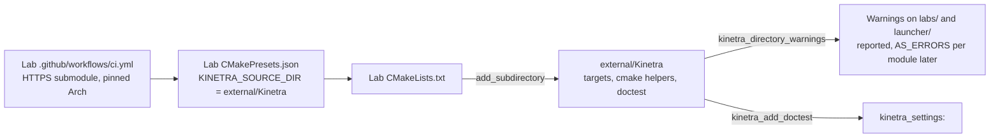

# Tooling and CI (Lab)

Status: implemented · Branch: `build/tooling-ci` · Related: [Kinetra design document](../../external/Kinetra/docs/design/2026-11-18-tooling-and-ci.md), [quality roadmap](2026-11-18-quality-roadmap.md) (phase 2)

Lab adopts the tooling introduced in Kinetra:
- presets;
- the shared warning policy;
- doctest;
- clangd and clang-tidy;
- a formatting pass;
- the same pinned CI.

Lab warnings are reported, not yet enforced.

## Table of contents

- [Problem](#problem)
- [Decisions](#decisions)
- [Design](#design)
- [Affected areas](#affected-areas)
- [Test plan](#test-plan)
- [Review](#review)
- [Verification](#verification)
- [Pull request](#pull-request)
- [Open points](#open-points)

[Directory guide](README.md) · [Project overview](../../README.md) · [Documentation index](../README.md)

## Problem

- **No warnings.** With the strict warning set, Lab has 119 warnings: Dotio 66, Demo 32, i4sim 14 and launcher 7. Nothing reported them.
- **Build commands.** Builds needed long `-D` lists; `build.sh` was the only shortcut.
- **No CI.** Nothing checked format, docs or builds on pull requests.
- **Unformatted code.** 654 `.clang-format` deviations, mostly in i4sim.
- **Opaque tests.** Settings-overlay tests were one `main()` with 30 assertions in a row over four layouts.

## Decisions

| Decision | Choice | Why |
| --- | --- | --- |
| Lab warnings | `KINETRA_LAB_WARNINGS` on in `dev` and `ci`, not errors. Each module gets `AS_ERRORS` in its roadmap phase | The user's choice: no fixes in Dotio and i4sim code that phases 4 and 6 rewrite |
| Engine warnings in Lab builds | Errors in `ci` (`KINETRA_WARNINGS_AS_ERRORS`) | Kinetra is warning-free, and its headers are compiled in Lab translation units too |
| Shared helpers | Lab calls Kinetra's `kinetra_directory_warnings` and `kinetra_add_doctest` | One policy and one test registration for both repositories |
| `.clang-tidy` | Symlink to Kinetra's file | One configuration; Kinetra is the source of rules |
| Submodule in CI | Rewrite `git@github.com:` to HTTPS in CI only | `.gitmodules` keeps the SSH URL that developers use |
| CI layout | One job `checks`: format, docs, headless workflow, full workflow (graphics compiled) | Same name and pinned environment as Kinetra; one required check per repository |

## Design

Lab reuses Kinetra's CMake functions instead of copying them. A later module phase turns its warnings into errors with one call in the root `CMakeLists.txt`.

## Affected areas

**Build**
- `CMakeLists.txt`: Lab warning options, applied through the helper.
- `CMakePresets.json`, `.clangd`, and `.clang-tidy` (symlink).
- `cxx_std_20` on `kinetra_sandbox_application` and `kinetra_i4sim_application`.

**Tests**
- `launcher/tests/settings_tests.cpp` is converted to doctest (11 cases); `launcher/CMakeLists.txt` registers it.

**CI**
- `.github/workflows/ci.yml`.

**Formatting**
- All first-party sources, in one formatting-only commit, plus `.git-blame-ignore-revs`.

**Docs**
- `AGENTS.md`: verification commands, warning rule and the regex for the settings tests.
- `README.md`, `launcher/tests/README.md`, this document and the roadmap.

**Submodule**
- `external/Kinetra` points to Kinetra `build/tooling-ci`.

## Test plan

- **Settings tests.** The doctest version must keep every assertion. Cases start from a fresh overlay per layout. The states they reach are the same as in the former sequence (modal open, sections collapsed, unchanged zoom).
- **Formatting.** No behavior change, so the existing tests must pass unchanged.
- **Verification level: Full.** CMake and presentation sources are touched: the `ci`, `headless` and `graphics` workflows.

## Review

- **Bug in the shared helper.** `KINETRA_WARNING_FLAGS` was a directory-scoped variable in Kinetra, so Lab received no flags. This was found because `dev` reported 0 Lab warnings instead of the measured 119, and fixed in Kinetra (`fix(build): keep the warning set inside the helper`).
- **Slow Debug tests.** In the Debug `dev` preset, `kinetra_i4sim` (≈116 s) and the two crowd soak tests (≈48 s each) dominate test time. AGENTS.md now points to the `release` preset for quick targeted runs.

## Verification

| Command | Result |
| --- | --- |
| `cmake --workflow --preset dev` | passed: 20/20; 119 Lab warnings reported, 0 engine warnings |
| `cmake --workflow --preset ci` | passed: 20/20 non-graphics tests, 0 engine warnings (`-Werror`), 119 Lab warnings reported |
| `cmake --workflow --preset headless` | passed: 19/19 |
| `cmake --workflow --preset graphics` (SDL offscreen, software Mesa) | passed: 24/24, including `kinetra_graphics` and the Demo, Dotio and i4sim presentation tests |
| Smoke runs: `kinetra` (menu; Demo, Dotio and i4sim variants), `kinetra_demo`, `kinetra_dotio` with `--frames` | passed: all exited 0 |
| GitHub Actions `CI / checks` | see the pull request |
| `clang-format --dry-run --Werror`, `clang-tidy --verify-config`, docs check | passed |

## Pull request

**Title:** `build: adopt presets, warning reporting, doctest and CI`

The description is published with the pull request. It covers the changes above, verification results, and the merge order: Kinetra phase-2 PR first.

## Open points

- **Warning-free modules.** The 119 Lab warnings are resolved per module: i4sim in phase 4, Demo in phase 5, Dotio in phase 6, and the launcher with the phase 3 changes.
- **Graphics tests in WSL2.** Lab's graphics tests pass locally. Kinetra's own `kinetra_engine_graphics` mouse-input check fails under WSL2; this is pre-existing and recorded in Kinetra's design document.
