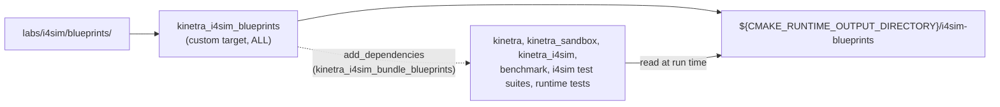

# Blueprint copy race

Status: implemented · Branch: `fix/blueprint-copy-race` · Related: [i4sim restructuring, open points](2026-11-19-i4sim-restructuring.md#open-points), [i4sim blueprints](../../labs/i4sim/blueprints/README.md)

The i4sim blueprint catalog is copied into the build output once per build by one target, instead of once per executable after it links. The per-executable copies write into the same directory and fail when executables link in parallel.

## Table of contents

- [Problem](#problem)
- [Goals and non-goals](#goals-and-non-goals)
- [Decisions](#decisions)
- [Design](#design)
- [Affected areas](#affected-areas)
- [Test plan](#test-plan)
- [Review](#review)
- [Verification](#verification)
- [Pull request](#pull-request)
- [Open points](#open-points)

[Directory guide](README.md) · [Project overview](../../README.md) · [Documentation index](../README.md)

## Problem

- `kinetra_i4sim_bundle_blueprints` (`labs/i4sim/CMakeLists.txt:9`, at `750a0e2`) adds a `POST_BUILD` `cmake -E copy_directory` to every executable that opens blueprints. Up to eight targets use it (`kinetra_i4sim`, the benchmark, three i4sim test suites, `kinetra`, `kinetra_sandbox`, `kinetra_runtime_tests`), and all of them write to `${CMAKE_RUNTIME_OUTPUT_DIRECTORY}/i4sim-blueprints`, because the root `CMakeLists.txt:19` sends every executable to `CMAKE_BINARY_DIR`. The generated `build-dev/build.ninja` holds six of these copies (graphics tests off).
- When Ninja links several of these executables at once, the copies run concurrently. During step 1 of the i4sim restructuring a `cmake --workflow --preset ci` run failed once with "Error copying directory" while linking `kinetra`, and passed on a rerun.
- Reproduced outside the build with CMake 4.5.0: eight concurrent `cmake -E copy_directory labs/i4sim/blueprints <dir>` runs, repeated 300 times, printed 260 "Error copying directory … No such file or directory" lines into an existing, already filled directory, and 346 into a fresh one. So every incremental build that relinks two of these executables can fail, not only a clean one.
- A configure-time `file(COPY blueprints/ …)` (`labs/i4sim/CMakeLists.txt:16`) writes the same directory a third way. It dates from the initial import and duplicates what the build copy does.

## Goals and non-goals

- Goal: exactly one writer of `i4sim-blueprints/` per build, so a parallel build cannot fail on the copy.
- Goal: the same result as today: the catalog, including its `README.md`, beside every executable that opens it.
- Non-goal: removing stale files from the build directory when a blueprint is deleted. `copy_directory` never did that.
- Non-goal: install rules or packaging.

## Decisions

| Decision | Choice | Why |
| --- | --- | --- |
| Copy once | One `add_custom_target(kinetra_i4sim_blueprints ALL …)`; `kinetra_i4sim_bundle_blueprints` becomes `add_dependencies` | A single writer removes the race; the function keeps its name and call sites |
| Always run | The target has no stamp file or file list, so it runs on every build | Picks up edited, added or renamed blueprints without a reconfigure or a relink (the old copy ran only after a relink), and costs one copy of fifteen small files. Dependents wait for it but do not relink because of it. A build therefore never reports "no work to do" |
| Destination | `CMAKE_RUNTIME_OUTPUT_DIRECTORY`, plus `/$<CONFIG>` for multi-config generators. Configure fails when that variable is unset, and the function fails for a target with another output directory | `$<TARGET_FILE_DIR:…>` would make the copy depend on one executable that itself depends on the copy, a cycle. The check keeps the old guarantee ("beside every executable") explicit instead of silently breaking it |
| Configure-time copy | Removed | The build copy runs before every executable that reads the catalog, so the directory is never read before it exists. One writer is easier to reason about |

All four are local build mechanics with one obvious option; none needed the user.

## Design

Before: each executable in the right-hand box ran its own copy after linking. After: the copy is one node that every such executable waits for; it cannot run twice in one build.

## Affected areas

- `labs/i4sim/CMakeLists.txt`: the copy target, the function, the removed configure-time copy.
- No source, test or public API change. `launcher/CMakeLists.txt` keeps its calls to `kinetra_i4sim_bundle_blueprints`.
- [i4sim restructuring](2026-11-19-i4sim-restructuring.md#open-points): the open point links here.

## Test plan

A race in the build graph has no deterministic unit test, so the proof is structural plus the existing tests.

| Behavior | Check | Level |
| --- | --- | --- |
| The race is real | Eight concurrent `copy_directory` runs into one directory, 300 rounds, before the change | Manual, recorded in [Problem](#problem) |
| One writer | `build.ninja` holds one `copy_directory … i4sim-blueprints` command, against six before | Manual |
| Same catalog | `diff -r labs/i4sim/blueprints build-dev/i4sim-blueprints` after deleting the directory and building | Manual |
| No relink | A second `cmake --build --preset dev` runs only the copy | Manual |
| Executables still find the catalog | `kinetra_i4sim_relocation`, the catalog cases of `kinetra_i4sim_tests`, the golden suite and the graphics suites, which open blueprints from beside their executable | Full |
| Whole branch | `cmake --workflow --preset ci`, `headless`, `graphics` | Full, because the build configuration changed |

## Review

`/code-review` at high effort on `main...HEAD`:

| Finding | Resolution |
| --- | --- |
| With `CMAKE_RUNTIME_OUTPUT_DIRECTORY` unset, the destination would be `/i4sim-blueprints` and every call would fail with a `NOTFOUND` message | Fixed: configure stops with a message that names the missing variable |
| The comment and this document called the always-run copy equal to the old behavior, but the old copy ran only after a relink | Fixed: both now say every build refreshes the catalog |
| The output-directory check ignores `RUNTIME_OUTPUT_DIRECTORY_<CONFIG>` | Skipped: no target sets it; checking every configuration adds code for a case that does not exist |
| `copy_directory` rewrites all files on every build; `copy_directory_if_different` would not | Skipped: it needs CMake 3.26, the project's minimum is 3.16, and the cost is fifteen small files |

## Verification

Full level, because the build configuration changed. Run on `ffc6eaa` (the final code), and before the review fixes on `a2ee12b` with the same results.

| Command | Result |
| --- | --- |
| `cmake --workflow --preset ci` | passed: 140/140 tests |
| `cmake --workflow --preset headless` | passed: 133/133 tests |
| `cmake --workflow --preset graphics` | passed: 152/152 tests, including the graphics suites that open the catalog beside `kinetra_runtime_tests` and `kinetra_i4sim_presentation_tests` |
| `grep -c 'copy_directory.*i4sim-blueprints' build-dev/build.ninja` | 6 before, 1 after |
| Delete `build-dev/i4sim-blueprints`, `cmake --build --preset dev`, `diff -r labs/i4sim/blueprints build-dev/i4sim-blueprints` | identical |
| Second `cmake --build --preset dev` | `[1/1] Copying i4sim blueprints`, no relink |
| `python3 external/Kinetra/tools/check_docs.py` | all links resolve |

Not run: a multi-config generator, which no preset uses; the `$<CONFIG>` branch is reasoned, not tested. The configure-time guard for an unset `CMAKE_RUNTIME_OUTPUT_DIRECTORY` is not exercised, because the root `CMakeLists.txt` always sets it.

## Pull request

**Title:** `fix(i4sim): copy the blueprint catalog once per build`

**Description:**

> **Summary.** Every executable that opens i4sim blueprints copied the catalog into the shared output directory after linking. When Ninja linked several of them at once, the copies ran concurrently and could fail the build with "Error copying directory" (seen once in `cmake --workflow --preset ci`). One target now copies the catalog once per build. Resolves an open point of the [i4sim restructuring](2026-11-19-i4sim-restructuring.md#open-points). Design: [blueprint copy race](2026-11-19-blueprint-copy-race.md).
>
> **Changes.**
> - `labs/i4sim/CMakeLists.txt`: an always-run custom target `kinetra_i4sim_blueprints` copies `labs/i4sim/blueprints/` to `${CMAKE_RUNTIME_OUTPUT_DIRECTORY}/i4sim-blueprints` (plus `/$<CONFIG>` for multi-config generators). `kinetra_i4sim_bundle_blueprints` keeps its name and call sites and now adds a dependency on it; it fails at configure time for a target outside the shared output directory. The redundant configure-time `file(COPY …)` is gone.
> - The i4sim design document links this fix from its open points.
>
> **Evidence.** Eight concurrent `cmake -E copy_directory` runs into one existing directory, 300 rounds with CMake 4.5.0: 260 failures. `build-dev/build.ninja` held six copies of the catalog before and holds one now.
>
> **Verification.** See the design document's Verification section: `ci`, `headless` and `graphics` workflows, docs check, catalog diff and a no-relink rebuild.
>
> **Review notes.** Four findings, two fixed (a guard for an unset output directory, an inaccurate comment), two skipped with reasons. Behavior change: the catalog is now refreshed on every build, also when no executable relinks, so a build never reports "no work to do".
>
> **Dependencies and merge order.** None; no Kinetra change. Merge with a merge commit.
>
> **Follow-up.** None.

## Open points

- None yet.
