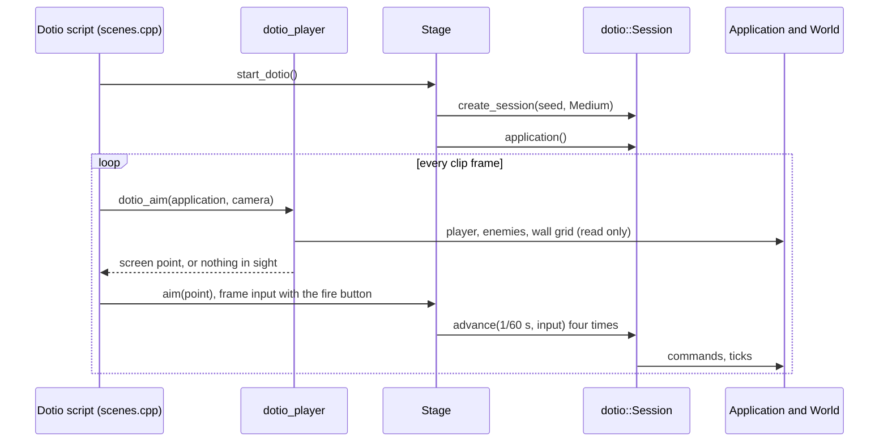

# Credible media clips: aimed fire in Dotio, a larger i4sim floor

Status: accepted · Branch: `feat/credible-media-clips` · Related: [media capture tool](2026-11-19-media-capture.md), [i4sim showcase clips](2026-11-19-i4sim-showcase-clips.md), [media guide](../media/README.md), [capture tool](../../tools/capture/README.md)

The gallery's Dotio player fires at a fixed point of the screen, whether an enemy is there or not, and its debug clip is too short and too close to show what the debug layers are for. The i4sim captures show the small MAS demonstrator at four times its speed. The user asked for a Dotio debug clip with believable shooting, more insight into the AI (recovery in particular) and a wider view, and for i4sim captures of a larger floor with good-looking, smooth traffic. This change gives the capture tool a scripted Dotio player that aims at the enemies it sees, and moves the i4sim captures to the `4320x2400` floor with the Reciprocal profile.

## Table of contents

- [Problem](#problem)
- [Goals and non-goals](#goals-and-non-goals)
- [Decisions](#decisions)
- [Design](#design)
- [Affected areas](#affected-areas)
- [Test plan](#test-plan)
- [Review](#review)
- [Verification](#verification)
- [Pull request](#pull-request)
- [Open points](#open-points)

[Directory guide](README.md) · [Project overview](../../README.md) · [Documentation index](../README.md)

## Problem

**Dotio.**

- `dotio_play` in [scenes.cpp](../../tools/capture/src/scenes.cpp) parks the pointer at 70% / 45% of the window and holds the button for the first half of every second. The bolts fly at walls; an enemy is hit by chance.
- The debug clip lasts four seconds. An enemy leaves the Attack state for Recover only when its ammunition is spent: nine shots at one per second on Medium, with the player in sight all the time ([state.cpp](../../labs/dotio/logic/src/state.cpp), `AttackState::Update`). Reloading in shelter takes another five seconds. Neither fits in the clip, so the RECOVERY path filter and HIDING HITS, two of the rows the script turns on, never draw anything.
- The debug menu stays open and covers the upper-left fifth of the 960 × 540 frame. Three wheel notches out show 12.8 × 7.2 cells.
- The capture tool drives a session through `kinetra::Session` only, and Dotio's AI draws from `std::random_device`, so a script cannot know in advance where an enemy will be.

**i4sim.**

- The four i4sim captures load `MAS-demonstrator.json`: 11 movers on a 2160 × 1200 mm floor. The clips run at 800 ticks per second, because at 200 the movers barely move in four seconds; at 15 frames per second a mover then jumps most of its own length per frame.
- They use the default motion settings, Improved with heat A*. On a busy floor that profile corrects its heading constantly (see the measurements under [Decisions](#decisions)).

## Goals and non-goals

- Goal: the Dotio player of every Dotio capture aims at an enemy it can see and holds fire without one.
- Goal: the Dotio debug clip shows the AI cycle, with at least one enemy in Recover when it starts, in a wider view with the whole frame free.
- Goal: the i4sim screenshots and clips show a larger floor with the motion settings that look smoothest, at the session's own speed.
- Goal: a menu change that moves the rows the i4sim scripts click fails a test instead of silently changing a picture.
- Non-goal: seeding Dotio's randomness. It stays a roadmap item, so Dotio captures still differ per run.
- Non-goal: changing an application's behavior, its menus or its blueprints. The six original blueprints stay unchanged.
- Non-goal: the tour video, and the Demo, launcher and showcase captures.

## Decisions

The user left the choice of floor and motion settings to what looks best and smoothest, and named plain A* with the Reciprocal profile as the expectation. The other choices are capture details that a refresh can change; they were made here and are listed for the reviewer.

| Decision | Choice | Why |
| --- | --- | --- |
| How the script learns where the enemies are | `dotio::create_session` returns a `dotio::Session`, a `lab::Session` that also gives its `Application` | The tool can then read the world and answer with ordinary input, through the real session. Finding enemies in the rendered pixels would be fragile; composing a second session in the tool from `Application` and `render` would capture something other than the application |
| Where the aiming lives | Free functions in the capture tool ([dotio_player.h](../../tools/capture/src/dotio_player.h)) | It is capture policy, not a game rule, and it is testable without a window. Nothing is added to the game for it |
| Target and aim | The nearest live enemy on screen with no wall between it and the player, led by its velocity for the bolt's flight time | What a player does: shoot at the closest threat in view. The sight line is the one the enemies' AI uses. Bolts fly at 6 px per tick, so an unled shot misses a moving enemy |
| Fire | Half-second bursts while a target is in sight, in both views | Kept from the old script: outside Debug Mode a shot costs 10 mana, and bursts make it last |
| Start of the debug clip | Hold fire until an enemy on screen enters Recover, at most 60 s, then record | The AI is not seeded, so a fixed warm-up cannot promise a recovery. A player that shoots from the start kills an enemy (two hits on Medium) long before its ninth shot |
| Movement in the debug clip | A half-second sidestep every two seconds, in turn right, down, left and up | The player holds its ground, so paths and sight lines stay readable, and the camera rests three quarters of the time: 1.4 MB against 3 MB for the running square, 0.5 MB for a player that never moves |
| Dotio debug clip view | Nine wheel notches out (10.6 px per unit, 22.6 × 12.7 cells), debug menu closed, twelve seconds | "Zoom out somewhat more": the whole spawn area is in view and labels stay readable. The screenshot next to it keeps the menu with every row. Twelve seconds hold a flight to shelter, the reload and the return |
| Other Dotio captures | Same player, otherwise unchanged: the running square, four seconds, the debug screenshot with its menu at three notches | They share the script; a normal clip that still fired at walls would contradict the debug clip |
| i4sim floor | `4320x2400`: 29 movers, 18 producers | Of the larger originals it is the busiest that stays readable at 960 × 540. `3840x2400` has 13–27% of its movers driving in the measured windows against 22–56% here. On `8640x4800` the mover labels cover the floor |
| i4sim motion settings | Reciprocal profile, plain A*, traffic policies off | Measured below: Reciprocal turns five to twenty times less per meter than the other profiles and has no contacts. With plain A* the routes are long straight lines; with heat A* they are staircases around producers |
| i4sim speed and length | 200 ticks per second, twelve seconds, after 116 s | The session's own rate: a mover covers about 4 px per clip frame instead of 17. Ticks 23200–25600 are the busiest stretch of this floor with the capture seed |
| i4sim debug clip menu | Closed; the debug screenshot keeps LAYERS open | At 960 × 540 the open menu would cover a fifth of this floor. Same choice as for the showcase clips |
| Guarding the clicked rows | The i4sim clicks are a named list of row and expected label; a window-free test replays it on a `FactoryController` | A script that clicks a row by number breaks silently when the menu changes ([capture tool](../../tools/capture/README.md#changing-this-module)) |

**Measurements for the motion settings.** `4320x2400`, seed 42, measured with a throwaway probe over `Simulation::tick` and `FlowMetrics` (not part of this change). *Driving* is the share of mover-ticks above 0.3 mm per tick; *turning* is the summed heading change of driving movers per meter driven; *waiting* is `FlowMetrics::waiting_ticks`.

| Settings | Ticks 8000–12000: driving, turning, waiting, contacts | Ticks 23200–25600 (the clip): driving, turning, waiting, contacts |
| --- | --- | --- |
| Improved, heat A* (default) | 39%, 66 rad/m, 47, 0 | 32%, 55 rad/m, 37, 0 |
| Original, heat A* | 41%, 63 rad/m, 88, 0 | 42%, 40 rad/m, 27, 0 |
| RVO experiment, heat A* | 39%, 92 rad/m, 256, 25 | 52%, 110 rad/m, 393, 0 |
| Reciprocal, heat A* | 39%, 6.4 rad/m, 523, 0 | 36%, 2.8 rad/m, 2380, 0 |
| **Reciprocal, plain A*** | 32%, 5.9 rad/m, 5098, 0 | **53%, 12.6 rad/m, 810, 0** |
| Reciprocal, plain A*, predictive passing | 35%, 3.7 rad/m, 4402, 0 | 30%, 6.8 rad/m, 4602, 0 |

Reciprocal with plain A* waits more than with heat A* over a long run, because movers stand and wait for each other instead of driving around; that is why the clip takes the stretch where most of them drive. Predictive passing adds standstills (both movers stop at their entry points first) and is shown by its own showcase clips.

## Design

*Takeaway:* the script reads the world between frames and answers with a pointer position and a button, so the session still gets nothing but input.

**Dotio session** ([session.h](../../labs/dotio/include/session.h)). `dotio::Session` derives from `lab::Session` and adds `virtual Application &application()`. `create_session` returns `std::unique_ptr<dotio::Session>`; the launcher and `main.cpp` keep compiling, because the pointer converts to its base. `Application` is forward-declared, so the launcher still does not compile the world.

**Scripted player** (`tools/capture/src/dotio_player.h`, `.cpp`):

- `dotio_target(application, camera)`: the nearest enemy that is active, not frozen, with its center inside the camera's viewport and no wall cell on the segment from the player (`Grid::IsIntersectingAnyCell`, as `Enemy::IsInLineOfSight`). Null without one.
- `lead_offset(offset, velocity, bolt_speed)`: solves `|offset + velocity·t| = bolt_speed·t` for the earliest positive `t` and returns `offset + velocity·t`; returns `offset` when there is no solution or the flight would take more than 90 ticks.
- `dotio_aim(application, camera)`: the target's led position as a screen point, clamped to the viewport; empty without a target.
- `dotio_recovery_on_screen(application, camera)`: whether an enemy on screen is in Recover.

**Stage.** `start_dotio()` starts Dotio as the launcher's entry does (camera at the origin and `dotio::initial_zoom`, capture seed, Medium) and keeps the application for `dotio()`. `play_until(limit, input, done)` advances undrawn clip frames until `done()` holds or `limit` frames have passed, and returns the count.

**Dotio scripts.** Every Dotio scene starts with `start_dotio`. `dotio_shoot` aims the pointer and adds the fire button to a frame's input; `dotio_play` is the running square with it, for the screenshots and the normal clip. The debug clip turns on Debug Mode and the rows as before, closes the menu, zooms nine notches, then `play_until` an enemy recovers with sidesteps and no fire, and records 180 frames of sidesteps with `dotio_shoot`. If the 60 s pass without a recovery it records anyway and says so on standard error.

**i4sim scripts.** `scenes.h` gets `MenuClick{row, label}`, the list `i4sim_motion_clicks` (MOTION, PROFILE, RECIPROCAL, PLANNER, A*, counted in the menu as each click finds it), `i4sim_layers_click` and the blueprint's file name. `i4sim_start` loads `4320x2400.json`, opens the debug menu, clicks the list, then either clicks LAYERS (debug screenshot) or closes the menu, turns Debug Mode off for the normal view, presses Space and waits 116 s. The clips record 180 frames without the two `E` presses.

## Affected areas

- `labs/dotio/include/session.h`, `labs/dotio/src/session.cpp`: the session type and the factory's return type. No behavior changes.
- `tools/capture/src/`: new `dotio_player.h/.cpp`; `stage.h/.cpp` (`start_dotio`, `dotio`, `play_until`); `scenes.h/.cpp` (the Dotio and i4sim scripts, the click list); `CMakeLists.txt`.
- `tools/capture/tests/capture_tests.cpp`, `tests/smoke.cmake`.
- `docs/media/`: the five Dotio and four i4sim files; the media guide.
- `README.md` gallery captions, `tools/capture/README.md`, the Dotio header guide.
- Level: Full with graphics (a `session.cpp` changes, and the capture tool with its smoke test).

## Test plan

| Behavior | Test | Level |
| --- | --- | --- |
| A led shot meets a moving target; a target that cannot be caught, or only after 90 ticks, is aimed at directly | `kinetra_capture_tests`: `lead_offset` for a resting target, a crossing one (the returned point satisfies the intercept equation), one that outruns the bolt and one too far away | Targeted |
| The player targets the nearest enemy in sight and ignores one behind a wall, one off screen, a frozen one and an inactive one | `kinetra_capture_tests`: enemies placed by hand around the player of a headless `dotio::Application`, in cells found in its wall grid | Targeted |
| The aim point is the target's screen position, led when it moves, inside the window; empty without a target | `kinetra_capture_tests`: `dotio_aim` on the same world | Targeted |
| A recovering enemy on screen is found; one off screen, or in another state, is not | `kinetra_capture_tests`: `dotio_recovery_on_screen` | Targeted |
| The i4sim clicks find the rows they name and leave the Reciprocal profile with plain A*; LAYERS is where the screenshot clicks it | `kinetra_capture_tests`: replay `i4sim_motion_clicks` on a `FactoryController` with the captured blueprint | Targeted |
| The session gives the application it runs | Covered by the smoke test below: the script throws without it | Full with graphics |
| The Dotio debug clip and the i4sim debug clip render end to end | `kinetra_capture_smoke` runs `dotio-debug-clip` next to `i4sim-debug-clip` and checks their frames | Full with graphics |
| The captures show what this document says | Run `capture_media.sh` for the nine scenes and look at every file | Manual, recorded below |

## Review

To be filled in after the review.

## Verification

To be filled in.

## Pull request

To be filled in.

## Open points

- Dotio captures are not reproducible until its randomness is seeded ([quality roadmap](2026-11-18-quality-roadmap.md)). The debug clip therefore waits for a recovery instead of a fixed time, and a refresh still needs a look.
- The Dotio debug rows are still clicked by number without a label check: the rows are built inside `Application::debug_options()`, next to a `DebugMenu` the test would have to construct.
- The i4sim warm-up of 116 s is tied to the capture seed and today's simulation. A change in the simulation moves the busy stretch; the clip then still renders, but may show a quieter moment.
