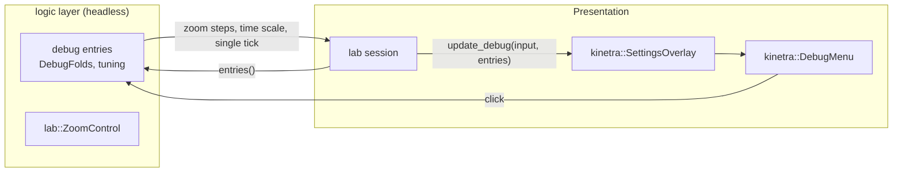

# Debug workbench: tunable Demo and Dotio, tree menus everywhere, steering wander

Status: implemented · Branch: `feat/debug-workbench` · Related: [Kinetra design](../../external/Kinetra/docs/design/2026-11-19-debug-workbench.md), [launcher and overlays](../launcher-overlays.md), [i4sim debug menu](2026-11-19-i4sim-debug-menu.md), [smooth rendering](2026-11-19-smooth-rendering.md), [media capture](2026-11-19-media-capture.md)

i4sim lets the operator change motion settings while a scene runs; Demo and Dotio only switch drawing layers on and off. The user wants all three to be workbenches: the same tree menu, live parameters, a shortcut that works on every keyboard, zoom as a debug tool, and agents that stay around. This is phase 1 of two; phase 2 regenerates the tour video on top of it.

## Table of contents

- [Problem](#problem)
- [Goals and non-goals](#goals-and-non-goals)
- [Decisions](#decisions)
- [Design](#design)
- [Affected areas](#affected-areas)
- [Test plan](#test-plan)
- [Review](#review)
- [Verification](#verification)
- [Pull request](#pull-request)
- [Open points](#open-points)

[Directory guide](README.md) · [Project overview](../../README.md) · [Documentation index](../README.md)

## Problem

- **Demo and Dotio cannot be tuned while running.** Demo's steering values are literals inside `Sandbox::update` ([sandbox_scene.h](../../labs/demo/include/demo/world/scene.h)); Dotio's balance is a `constexpr` preset ([difficulty.h](../../labs/dotio/include/dotio/difficulty.h)) and its state forces are literals in [state.cpp](../../labs/dotio/src/ai/state.cpp). Their debug menus are flat lists of check boxes ([Demo session](../../labs/demo/src/presentation/session.cpp), [Dotio application](../../labs/dotio/include/dotio/application.h)); Dotio indents its PATHS filters with spaces.
- **Demo's agents leave.** An agent wanders with a persistent heading and never uses its home ([agent.h](../../labs/demo/include/demo/world/agent.h), `choose_wander_goal`). It walks out of the active area around the player, where agents sleep, and a chunk is populated only once ([sandbox_scene.h](../../labs/demo/include/demo/world/scene.h), `populated_`). The user's screenshot shows 8 of 566 agents active.
- **Wandering plans routes.** Every wander leg in Demo is a navigation query, and Dotio's WANDER state runs A* to a random cell. The user expects wandering to be a steering behavior.
- **Backquote and the ZOOM row.** The debug menu opens with Backquote, and only after Debug Mode was switched on in the settings panel. Zoom sits in the settings panel although the wheel already zooms only in Debug Mode.
- **Uneven frames in WSLg** and **no icon in the WSLg title bar**: causes and measurements are in the [Kinetra design](../../external/Kinetra/docs/design/2026-11-19-debug-workbench.md#problem).

## Goals and non-goals

- Goal: Demo, Dotio and i4sim show the same tree menu: SIMULATION, LAYERS and the application's tuning sections, then ZOOM and the application's commands.
- Goal: Demo's motion and wander values and Dotio's balance and state forces change from the menu while the scene runs, and reset to their defaults from the menu.
- Goal: Demo and Dotio can pause, run one tick and change their time scale from the menu.
- Goal: agents wander by steering by default, in Demo around their home; the planned-route wander stays selectable for comparison.
- Goal: Shift+Ctrl opens the debug menu in every application; the settings panel loses ZOOM and gains FRAME LIMIT.
- Goal: every screenshot and clip that changed is rendered again.
- Non-goal: seeding the rest of Dotio's randomness ([quality roadmap](2026-11-18-quality-roadmap.md)). Only the new wander code uses the world's seed.
- Non-goal: steering for Dotio's PURSUE, RECOVER and KAMIKAZE states. They have to get around walls to a place and keep their paths.
- Non-goal: saving tuned values. A new session starts from the defaults.
- Non-goal: the tour video (phase 2, its own branch and design document).

## Decisions

| Decision | Choice | Why |
| --- | --- | --- |
| Shortcut | Shift+Ctrl opens and closes the debug menu and switches Debug Mode on when it was off | User's choice |
| Menu shape | A tree like i4sim's, one section open at a time | User's choice (alternatives: tabs, a full-height side bar) |
| Menu mechanics | In Kinetra (`DebugEntry`, `DebugFolds`); Lab supplies entries | Three applications need it ([AGENTS.md](../../AGENTS.md#scope)) |
| Zoom | A ZOOM row with `[-] [+]` in every debug menu; the ZOOM row leaves the settings panel. Leaving Debug Mode clamps the zoom to the normal limits, as before | User: zoom belongs to the debug view. The clamp already existed |
| Demo agents | Patrol around their home within a tunable range | User's choice (alternatives: respawn around the player, turn back at the edge of the active area) |
| Demo wander | By steering (default) or by planned route, chosen in the menu. Commanded travel always plans a route | User prefers steering and wants to compare. A commanded goal can lie behind obstacles |
| Dotio wander | By steering with wall feelers (default) or by A* path, chosen in the menu | User's choice. The game changes: enemies roam more smoothly and may find the player later |
| Dotio balance | The session's world holds a copy of the difficulty preset that the menu changes | The preset stays the documented starting point of a difficulty |
| Frame limit | A FRAME LIMIT row in every settings panel, on by default; it acts only where VSync is unavailable | The user can compare both in WSLg. Assumption accepted by the user |
| Where menu content is built | In each application's logic layer, without a window | i4sim's controller already does; the rows become testable headless |
| Phasing | Phase 1: everything but the video. Phase 2: the video, stacked on this branch | User's choice |
| i4sim layer colors | Stay in the drawing code; the session hands `layer_color` to `FactoryController::menu()` | Moving the palette into the logic layer would have put drawing decisions there. The controller only asks for a swatch per layer row |
| A steering wanderer that stalls | Below 30 % of its top speed it turns its heading on the spot, and the pull toward home fades over one second | Found while measuring: reciprocal avoidance stopped agents in pockets between terrain for up to 55 s, because the wander target always lies in a narrow cone ahead. With the turn the longest slow spell is 2 to 4 s |
| FRAME LIMIT state | The runtime owns it; a session's switch starts from what the runtime does | The launcher keeps one window across applications, and the capture tool switches the limit off for all of them |
| Debug screenshots | Demo shows its MOTION section, Dotio and i4sim their LAYERS section; the debug clips keep the menu closed | One section is open at a time. MOTION shows what is new in Demo, LAYERS is the legend the user asked for in Dotio |

## Design

### Shared Lab policy

*Takeaway:* a session only passes entries to the overlay; what a row does is decided where the state lives.

- **`lab/settings.h`.** `settings_rows(statistics, debug, frame_times, frame_limit, sim_controls, debug_controls)`: STATISTICS, DEBUG MODE, FRAME TIMES, FRAME LIMIT, SIM CONTROLS, DEBUG CONTROLS. DEBUG CONTROLS starts with `SHIFT + CTRL  DEBUG MENU` and `WHEEL  ZOOM`. `FrameLimitSwitch` holds a session's FRAME LIMIT flag: before the first frame it takes over what the runtime does, afterwards it passes a change on to `Runtime::limit_frames`.
- **`lab/debug.h`** (new, headless). `ZoomControl` makes the ZOOM row: it shows the camera's zoom, collects the steps its buttons ask for, and hands them to the frame together with the wheel's. `time_scale_entry` makes the SPEED row over a borrowed factor (0.125 to 4, doubling). Logic layers may include it next to `lab/input.h`.

### Menus

Every menu starts with SIMULATION and LAYERS, and ends, below a rule, with ZOOM and the commands.

| | Demo | Dotio | i4sim |
| --- | --- | --- | --- |
| SIMULATION | RUNNING, SINGLE TICK, SPEED, GRAVITY | RUNNING, SINGLE TICK, SPEED, INVULNERABLE | RUNNING, SINGLE TICK, UPS, WORKLOAD (unchanged) |
| LAYERS | VECTORS, STEERING PROBES, PATHS, COLLISION SHAPES, ACTIVE AGENTS, HOME RANGE | VECTORS, STEERING PROBES, PATHS with WANDER, PURSUE, KAMIKAZE, RECOVERY (state colors as swatches), COLLISION SHAPES, ACTIVE AGENTS, AI STATES, HIDING HITS | Unchanged |
| Tuning | MOTION: AVOIDANCE (list: RECIPROCAL, LEGACY), MAX SPEED, ACCELERATION, RESPONSE, LOOKAHEAD, CLEARANCE, then HORIZON and PASSING BIAS (reciprocal) or SEPARATION and SEP WEIGHT (legacy) | ENEMIES: WANDER (list: STEERING, PATH), MOVE SPEED, FIRE INTERVAL, ARROW SPEED, PREDICTION, PURSUIT CYCLES, HITS, and the force of each state | MOTION and TRAFFIC (unchanged) |
| | AGENTS: WANDER (list: STEERING, ROUTE), HOME RANGE, WANDER REACH, WANDER JITTER, CLICK SETS GOAL | SPAWNING: ACTIVE LIMIT, SPAWN RATE, CROWD LOAD, SPACING | |
| Below the rule | ZOOM, GHOST CAMERA, RESET PARAMETERS | ZOOM, GHOST CAMERA, RESET PARAMETERS | ZOOM, FRAME SCENE, BLUEPRINTS |

A number row steps by a factor of 1.25 or by a fixed amount, whichever suits its unit, between limits that keep the value valid for the code that reads it.

### Demo

- **`tuning.h`.** `MotionTuning` (max speed, acceleration, response time, lookahead, clearance, separation radius and weight, avoidance horizon, passing bias) and `WanderTuning` (mode, home range, reach, jitter) with the scene's former literals as defaults, and `validate()`. `Sandbox::tuning` holds them; `SandboxApplication::tuning()` gives the menu access.
- **Steering wander.** An agent keeps a wander angle that drifts by a seeded random amount per tick. Its target is a point on a circle ahead of it: `reach` ahead along its direction of travel, half of `reach` out at the wander angle. Beyond 60 % of the home range the direction is blended toward home, fully at the range, so an agent turns back in a curve. No route is planned and none is drawn. An agent that avoidance slowed below 30 % of its top speed has no direction of travel worth following: it turns its stored heading on the spot until the way is free.
- **Obstacles without a route.** A planned route keeps its own clearance from terrain, so local avoidance looked at movers only. An agent that wanders by steering also gets the terrain near it: as bodies for the legacy steering, and as non-cooperative circles for the reciprocal avoidance, a long box as a row of circles. The scene keeps a spatial grid of the terrain it loaded and rebuilds it only when terrain changes.
- **Route wander.** Unchanged, except that a leg starts toward home when the agent is beyond its range.
- **Time.** `FrameCommands` gets `time_scale` and `single_step`: the fixed clock advances by scaled time, and a paused scene runs exactly one tick for a single step.
- **`debug_panel.h`** (logic). `DebugPanel` owns the layer flags, the folds, the zoom control and the time scale, builds the entries over a `SandboxApplication`, and fills the debug part of a frame's `FrameCommands`. The session keeps the settings overlay, the menu widget and the drawing.

### Dotio

- **Tuning.** `World` copies its difficulty preset into `settings()` at `Initialize` and keeps an `EnemyTuning` (wander mode and one force per state, with the former literals as defaults). `reset_tuning()` restores both. `difficulty_settings()` returns the copy, so every existing reader follows the menu.
- **Steering wander.** In WANDER an enemy keeps a heading. Every decision tick the heading drifts by a random amount drawn from a generator seeded with the world's seed. Every update a forward feeler of 0.9 cells and two side feelers of 0.6 cells at 0.6 rad are tested against the grid (`Grid::IsIntersectingAnyCell`): a blocked forward feeler turns the heading to the first free direction of a fixed fan, a blocked side feeler nudges it away. The enemy accelerates along its heading with the WANDER force. No path exists; seeing the player still starts ATTACK.
- **Probes.** STEERING PROBES draws the feelers the logic tests, from one function both use.
- **Application.** `Application` builds the entries (`debug_entries()`), gets `time_scale` and a single tick, and keeps the layer flags it has. PATHS and its parts become check rows at depth 1 and 2 with the state colors as swatches.

### i4sim

`MenuEntry` and `EntryKind` become `kinetra::DebugEntry` and `kinetra::DebugEntryKind`; the controller's open section and list move to `DebugFolds`. `menu()` takes the function that gives a layer's color, which the session supplies as `layer_color`, and fills `swatch` with it. The session's `DebugRows` adapter and `row_text` go away. The menu gains ZOOM; its rows and keys are otherwise unchanged.

### Capture tool and media

- Scripts open the debug menu with Shift+Ctrl and click rows of the new menus; the row constants in `scenes.h` follow, with their tests.
- Demo's and Dotio's debug screenshots show their new menus with a tuning section open; the settings screenshot shows the panel without ZOOM.
- Every screenshot and clip is rendered again, because the panels, the toolbar, Demo's agents and Dotio's wander all changed.

## Affected areas

- `external/Kinetra` pointer ([Kinetra design](../../external/Kinetra/docs/design/2026-11-19-debug-workbench.md)).
- Shared: [lab/settings.h](../../labs/shared/include/kinetra_lab/settings.h), new [lab/debug.h](../../labs/shared/include/kinetra_lab/debug.h), [common tests](../../labs/shared/tests/shared_tests.cpp).
- Demo: new [tuning.h](../../labs/demo/include/demo/world/tuning.h) and [debug_panel.h](../../labs/demo/include/demo/debug_panel.h), [agent.h](../../labs/demo/include/demo/world/agent.h), [sandbox_scene.h](../../labs/demo/include/demo/world/scene.h), [sandbox_commands.h](../../labs/demo/include/demo/input/commands.h), [sandbox_application](../../labs/demo/src/application.cpp), [session.cpp](../../labs/demo/src/presentation/session.cpp), [sandbox_renderer](../../labs/demo/src/presentation/renderer.cpp), tests.
- Dotio: [difficulty.h](../../labs/dotio/include/dotio/difficulty.h), new [wander.h](../../labs/dotio/include/dotio/ai/wander.h), [world](../../labs/dotio/src/world.cpp), [enemy](../../labs/dotio/src/entities/enemy.cpp), [state.cpp](../../labs/dotio/src/ai/state.cpp), [application.h](../../labs/dotio/include/dotio/application.h), [presentation.cpp](../../labs/dotio/src/presentation/presentation.cpp), [session.cpp](../../labs/dotio/src/presentation/session.cpp), tests.
- i4sim: [controller](../../labs/i4sim/src/controller.cpp), [session.cpp](../../labs/i4sim/src/presentation/session.cpp), tests.
- Launcher tests, [capture tool](../../tools/capture/README.md), [media](../media/README.md).
- Docs: [AGENTS.md](../../AGENTS.md), [README](../../README.md), [launcher and overlays](../launcher-overlays.md), the three module READMEs and architecture pages.

## Test plan

| Behavior | Test | Level |
| --- | --- | --- |
| Bug: with a standing player, the agents active after 60 simulated seconds are at least 80 % of those at the start. Before the fix 1 of 48 was left; after it all 48, in both wander modes | `kinetra_demo_crowd`: agents stay around a standing player (label `soak`) | Targeted |
| Steering wander plans no route, moves the agent, turns it back at its range, and is repeatable for a seed | `kinetra_terrain`: steering wander cases | Targeted |
| Route wander keeps its legs and starts toward home beyond the range | `kinetra_terrain` (existing wander cases, in route mode) | Targeted |
| A steering wanderer walks around terrain in both avoidance models without deep overlap | `kinetra_sandbox_application`; `kinetra_demo_crowd_characterization` invariants | Targeted |
| Tuning: defaults equal the former literals; invalid values are rejected; a changed max speed changes how far an agent gets | `kinetra_sandbox_application` | Targeted |
| Time scale 0.5 runs half the ticks, a single step runs one tick while paused | `kinetra_sandbox_application`, `kinetra_dotio` | Targeted |
| Crowd runs stay finite and separated in both wander modes; their fingerprints are recorded anew | `kinetra_demo_crowd_characterization`, `kinetra_demo_crowd` (soak) | Targeted |
| Demo's menu: sections, one open at a time, every tuning row changes its value within its limits, RESET restores the defaults; the commands a frame gets from the rows | `kinetra_sandbox_application`: [debug panel cases](../../labs/demo/tests/debug_panel_tests.cpp) | Targeted |
| Dotio: `settings()` starts as the preset, changes reach the enemies, `reset_tuning()` restores | `kinetra_dotio` | Targeted |
| Dotio steering wander: no path, moves, turns away from a wall, repeatable for a seed; path mode still plans | `kinetra_dotio` | Targeted |
| Dotio's menu rows and PATHS parts | `kinetra_dotio` (replaces the `debug_options` case) | Targeted |
| i4sim's menu rows are unchanged apart from ZOOM; swatches carry the layer colors | `kinetra_i4sim_controller` | Targeted |
| `settings_rows` order; `ZoomControl` steps and value; the SPEED row's limits | `kinetra_lab_common` | Targeted |
| Real sessions: Shift+Ctrl opens the menu and switches Debug Mode on, a row click reaches the application, settings rows by index | `kinetra_graphics`, `kinetra_demo_graphics`, `kinetra_dotio_graphics`, `kinetra_i4sim_graphics` | Graphics |
| Capture scripts click the rows they name | `kinetra_capture`, `kinetra_capture_smoke` | Targeted, graphics |

The engine pointer, sessions and presentations change: Full level with graphics, plus the Windows cross build because `Runtime` changed.

## Review

`/code-review` at high effort over both branches (`git diff origin/main...HEAD` in Lab and in the engine), by the session that wrote the engine and presentation code; the Demo and Dotio logic was written by two sub-agents and read before it was committed. Findings and their resolution:

| Finding | Resolution |
| --- | --- |
| The SPEED row went up to 8×, which the fixed clocks (at most eight frames' worth of ticks per frame) only run at a full 60 frames per second | The row stops at 4× |
| Demo and Dotio built their menu rows twice per frame while the menu was hidden | Sessions build rows only while the menu shows |
| The two minute-long standing-player cases ran in the unlabelled Demo application suite | Moved to `kinetra_demo_crowd`, which carries the `soak` label |
| Ctrl released by a focus loss opened the settings panel; a number row's step up and down did not return to the same value | Fixed in the engine ([Kinetra design](../../external/Kinetra/docs/design/2026-11-19-debug-workbench.md#review)) |
| Shift held for gameplay (Demo's Shift+arrows, i4sim's Shift-click) turns a Ctrl press into the debug shortcut | Not changed: that is the shortcut the user chose. Releasing Shift first opens the settings panel |
| FRAME LIMIT has no effect where VSync paces frames, and the panel does not say so | Not changed. The frame-time graph names the pacing, and [launcher and overlays](../launcher-overlays.md#settings-policy) states it; an [open point](#open-points) |

Checked separately: the i4sim golden lines and tick counts are unchanged (the i4sim debug screenshot shows the same tick as before); logic targets build without the runtime (`headless` preset); no new compiler warnings, and eight old conversions in Demo's scene headers were made explicit so the warning-free capture tests can include them.

## Verification

| Command | Result |
| --- | --- |
| `git ls-files -- '*.h' '*.cpp' \| xargs clang-format --dry-run --Werror` | Clean |
| `python3 external/Kinetra/tools/check_docs.py` | All links resolve |
| `cmake --workflow --preset headless` | 240/240 passed |
| `cmake --workflow --preset ci` | 267/267 passed |
| `cmake --workflow --preset graphics` | 282/282 passed |
| `cmake --build --preset ci --clean-first`, its warnings matched against the lines this branch adds or changes in Lab and in the engine | 41 warnings, all on old lines of `labs/dotio`; none on a changed line. Demo's headers no longer warn |
| `cmake --workflow --preset windows` (MinGW cross build, tests through WSL interop, graphics tests in real windows on the Windows desktop) | First run: 255/260. Four failures were the renamed crowd fingerprints, which differ on Windows in floating point as their predecessor did and are excluded again ([Windows](../windows.md#tests)). The fifth was the new toolbar case reading a window's first frame before both buffers held it; it now draws twice. Rerun of `^kinetra_(graphics\|demo_crowd\|sandbox_application)` on Windows: 41/41 |
| Kinetra `ci` and `graphics` workflows | 251/251; 263/264 with the known injected-mouse failure ([Kinetra design](../../external/Kinetra/docs/design/2026-11-19-debug-workbench.md#verification)) |
| `build-graphics/kinetra_dotio`, `kinetra_demo` and `kinetra --variant i4sim`, 300 frames each in a WSLg window | Exit 0; 18.5 to 18.7 ms per frame including start-up, where the unpaced loop ran at 5.7 to 8.3 ms |
| `tools/capture/capture_media.sh build-graphics` | Every screenshot and clip rendered in 33 s; each file looked at before it was committed |

Not verified: whether motion in WSLg looks smooth to the eye with the frame limit; the user has to judge that on their screen. The first `windows` workflow was not repeated in full after the two fixes, only the three suites they touch.

## Pull request

Title: `feat(labs): debug workbench with live tuning, steering wander and Shift+Ctrl`

**Summary.** Demo, Dotio and i4sim now share one tree debug menu, opened with Shift+Ctrl: pause, single tick and speed, layers with a color legend, and the values each simulation runs with, changeable while it runs. Agents wander by steering; Demo's stay around their homes instead of walking away from the player. The settings panel is restyled, loses ZOOM (now a row of the debug menu) and gains FRAME LIMIT, which paces frames in WSLg. Every screenshot and clip is rendered again. Phase 2, the generated tour video, follows on its own branch.

**Changes.**
- Shared: `lab::settings_rows` without ZOOM and with FRAME LIMIT, `lab::FrameLimitSwitch`; new headless `lab/debug.h` with the ZOOM and SPEED rows.
- Demo: `Tuning` for motion, avoidance and wander; agents turn back beyond a home range; wander by steering (default) or by route; steering wanderers avoid terrain through local avoidance; time scale and single tick; `DebugPanel` builds the menu in the logic layer.
- Dotio: the world keeps a tunable copy of its difficulty preset and an `EnemyTuning` with one force per state; WANDER steers with three wall feelers (default) or follows an A* path; time scale and single tick; PATHS lists its parts with their state colors.
- i4sim: the controller's menu uses the engine's entries and folds; ZOOM row; the session no longer formats rows.
- Tests: Demo panel, tuning, wander and standing-player cases; Dotio tuning, wander and menu cases; rewritten launcher session cases; capture click cases.
- Capture tool: Shift+Ctrl and Ctrl taps, clicks on the new menus, frame limit off while rendering.
- Windows presets: the four crowd fingerprint cases are excluded, as their predecessor was.
- Docs: AGENTS.md, README, launcher and overlays, the three module READMEs, media guide.
- `external/Kinetra` pointer.

**Design.** [docs/design/2026-11-19-debug-workbench.md](2026-11-19-debug-workbench.md); Kinetra: [debug workbench](../../external/Kinetra/docs/design/2026-11-19-debug-workbench.md).

**Verification.** `headless` 240/240, `ci` 267/267, `graphics` 282/282; format and docs checks clean; no compiler warning on a changed line. Windows cross build with tests: the four renamed crowd fingerprints differ in floating point and are excluded again, one new test was made robust, and the three suites concerned then pass 41/41. In WSLg all three applications run paced at 60 frames per second.

**Review notes.**
- Behavior changes by design: Demo's agents and Dotio's wanderers move differently, so Demo's four crowd fingerprints were recorded anew. In route mode with an unlimited home range the old lines repeat.
- Dotio plays differently: wanderers roam without a path and may find the player later. PATH in the ENEMIES section restores the old wander.
- Not verified by me: whether WSLg looks smooth with the frame limit. Please compare with FRAME LIMIT off and on, and FRAME TIMES on.
- The icon missing from the WSLg title bar is WSLg's own doing (its compositor never passes an application icon to its title bar); the taskbar shows ours.
- The Demo and Dotio logic was written by two sub-agents from this design and read before it was committed.

**Dependencies and merge order.** [SMB-M87/Kinetra#13](https://github.com/SMB-M87/Kinetra/pull/13) first, with a merge commit. Then this branch's pointer moves to that merge commit before this pull request is merged.

**Follow-up.** Phase 2: the tour video, generated by the capture tool. Open points in the design document.

## Open points

- Dotio's other randomness is still unseeded ([quality roadmap](2026-11-18-quality-roadmap.md)).
- Whether the frame limit removes the uneven motion in WSLg has to be judged on the user's screen; here only the frame times could be measured.
- The FRAME LIMIT row shows no sign that it has no effect where VSync paces frames.
- A Demo agent whose home lies within its range of the edge of the active area can still walk out and fall asleep there.
- In Dotio, PATHS > WANDER draws nothing while enemies wander by steering.
