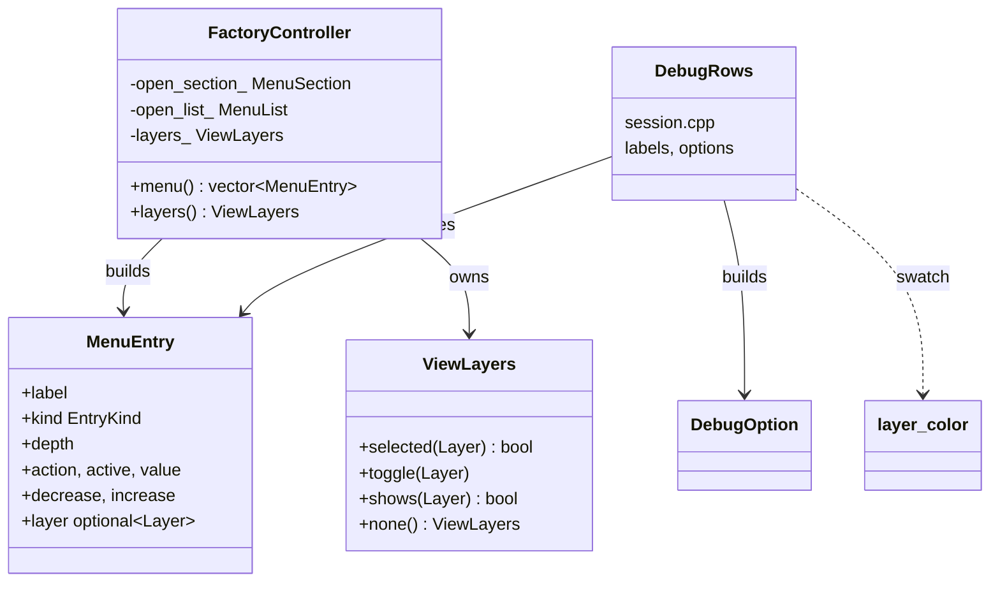

# i4sim debug menu: sections, lists and layer parts

Status: implemented · Branch: `feat/i4sim-debug-menu` · Related: [Kinetra design: debug menu steppers](https://github.com/SMB-M87/Kinetra/blob/feat/debug-menu-steppers/docs/design/2026-11-19-debug-menu-steppers.md), [i4sim](../../labs/i4sim/README.md), [launcher and overlays](../launcher-overlays.md)

The user finds i4sim's debug menu clumsy compared with Dotio, where clicking PATHS opens a list of sub-paths under it. This change rebuilds the i4sim menu into sections that open under their heading, with lists for the settings that have named values, `[-] [+]` buttons next to every number, and parts under the PATHS, FORCES and BORDERS layers, so each one can be turned off on its own. The `[-] [+]` buttons are a Kinetra change that merges first.

## Table of contents

- [Problem](#problem)
- [Goals and non-goals](#goals-and-non-goals)
- [Decisions](#decisions)
- [Design](#design)
- [Affected areas](#affected-areas)
- [Test plan](#test-plan)
- [Review](#review)
- [Verification](#verification)
- [Pull request](#pull-request)
- [Open points](#open-points)

[Directory guide](README.md) · [Project overview](../../README.md) · [Documentation index](../README.md)

## Problem

All evidence is in [controller.cpp](../../labs/i4sim/src/controller.cpp) and [session.cpp](../../labs/i4sim/src/session.cpp) on `main`.

- **Hidden pages.** The menu has a VIEW and a MOTION page, swapped by a `PAGE:` row (`FactoryController::menu`). What is on the other page is invisible, and the split is arbitrary: CORRIDOR TRAFFIC and PREDICTIVE PASS sit on VIEW "so the motion page stays above the statistics on short viewports" (`add_view_entries`).
- **Numbers without values.** `SPEED +`, `SPEED -`, `FORCE +`, `FORCE -`, `HORIZON +`, `HORIZON -`, `UPS +` and `UPS -` are eight rows, and none shows the value. The operator reads it from the HUD statistics, which can be turned off.
- **A cycling profile.** PROFILE moves to the next of four profiles on every click. Going back one takes three clicks, and the choices are never listed.
- **Mixed idioms.** Layers and WORKLOAD are `[X]` check boxes, RECOVERY and the traffic policies show `ON` / `OFF` after the label, PLANNER shows `HEAT A*` / `A*`.
- **A destructive row among switches.** BLUEPRINTS closes the scene and sits between FRAME SCENE and CORRIDOR TRAFFIC.
- **All-or-nothing layers.** FORCES draws six arrows per mover (seek, collision, border, predictive, velocity, acceleration), PATHS draws the route plus the retreat and passing targets, BORDERS draws the walls plus the traffic zones (`world_view.cpp`, `draw_mover_layers`, `draw_world`). None of them can be looked at alone, and the colors of the arrows are explained nowhere on screen.
- **Help text.** DEBUG CONTROLS in the settings panel only says `DEBUG PAGES: VIEW / MOTION`.

## Goals and non-goals

- Goal: every setting is visible from one menu, grouped by what it is about, with its current value on its own row.
- Goal: one click changes a number by a step, and one click per value opens and chooses from a list.
- Goal: the same idiom everywhere: `[X]` for on/off, `[*]` for the chosen value of a list, `+` / `-` before a heading that opens and closes.
- Goal: PATHS, FORCES and BORDERS open a list of their parts while they are on, like PATHS in Dotio, and each part can be turned off, the route itself included.
- Goal: a color swatch beside every layer and part drawn in one color, as an on-screen legend.
- Goal: the menu fits above the HUD in the default 1280 × 800 window.
- Non-goal: Demo and Dotio menus. They keep their flat lists.
- Non-goal: new simulation behavior, new keys, or a change to the blueprint format. Keys 1–6 keep toggling the six top-level layers.
- Non-goal: indentation or sections in the engine's `DebugMenu` (see the Kinetra design's open points).

## Decisions

| Decision | Choice | Why |
| --- | --- | --- |
| Layout | Sections SIMULATION, LAYERS, MOTION, TRAFFIC that open under their heading, instead of two pages | Chosen by the user. Everything is one click away and visible by name |
| Numbers | One row per number with `[-] [+]` buttons: UPS, SPEED, FORCE, HORIZON | Chosen by the user over two rows that open under the value; needs the Kinetra change |
| Layer parts | PATHS: ROUTES, RETREAT TARGETS, PASSING TARGETS. FORCES: SEEK, COLLISION, BORDER, PREDICTIVE, VELOCITY, ACCELERATION. BORDERS: WALLS, TRAFFIC ZONES | Chosen by the user, who asked explicitly that the route itself can be turned off. These are exactly the separately drawn pieces of each layer |
| Parts shown when | While the parent layer is on, as in Dotio | Matches the example the user gave. A part draws only while it and its layer are on, so the keys 3–5 still hide a whole layer |
| Open sections | One at a time; SIMULATION is open at the start | LAYERS with every part is 18 rows. One open section keeps the menu at 24 rows or fewer, which ends above the HUD lines in a 1280 × 800 window (row 16 panel pixels at scale 1.5) |
| Lists | PROFILE (four profiles) and PLANNER (HEAT A*, A*) open a list of `[*]` choices under the row; choosing closes it | One idiom for every named value. Closing after the choice keeps the section short |
| On/off settings | `[X]` check boxes: RUNNING, WORKLOAD, RECOVERY, the four traffic policies | One idiom. PREDICTIVE PASS adds `LEGACY` after the box when the profile has no predictive passing, as before |
| Always visible | FRAME SCENE and BLUEPRINTS below the sections | They are not settings. BLUEPRINTS no longer sits between switches |
| Layer model | `Layer` enum and a `ViewLayers` set with `shows(layer)`, replacing seven `bool` members | 18 flags with a parent relation. One table drives the menu and the keys, and `ViewLayers::none()` replaces the `hidden_layers` constant and its `static_assert` |
| Swatch colors | The world view owns the colors and exposes `layer_color(Layer)`; a menu entry names its layer | Colors stay in the presentation layer; the headless controller says only which layer a row is about |
| Value format | Three significant digits (`SPEED 2.5`, `FORCE 0.6`) | Fits before the `[-]` button even for the largest float, as the rejection test drives speed to |

## Design

### Menu

The full menu with every section open at once; only one is open at a time.

```text
DEBUG MENU
- SIMULATION
  [X] RUNNING
  SINGLE TICK
  UPS 200                [-] [+]
  [X] WORKLOAD
- LAYERS
  [X] GRID
  [X] HEATMAP
  [X] PATHS                    ■
      [X] ROUTES               ■
      [X] RETREAT TARGETS      ■
      [X] PASSING TARGETS      ■
  [X] FORCES
      [X] SEEK                 ■
      [X] COLLISION            ■
      ... BORDER, PREDICTIVE, VELOCITY, ACCELERATION
  [X] BORDERS
      [X] WALLS                ■
      [X] TRAFFIC ZONES
  [X] DETECTION                ■
  [X] CONTACT SHAPES           ■
- MOTION
  - PROFILE IMPROVED
      [*] IMPROVED
      [ ] ORIGINAL
      [ ] RVO EXPERIMENT
      [ ] RECIPROCAL
  + PLANNER HEAT A*
  [ ] RECOVERY
  SPEED 2                [-] [+]
  FORCE 0.6              [-] [+]
  HORIZON 32             [-] [+]
  RESET PARAMETERS
- TRAFFIC
  [ ] CORRIDOR TRAFFIC
  [ ] JUNCTION TRAFFIC
  [ ] PARKING TRAFFIC
  [ ] PREDICTIVE PASS
FRAME SCENE
BLUEPRINTS
```

### Types and flow



*Takeaway:* the headless controller decides which rows exist and what they do; the session only decorates them (indentation, `[X]`, `[*]`, `+` / `-`, swatch) and hands them to the engine menu.

- **`MenuEntry`** (controller.h) gains `EntryKind kind` (`button`, `check`, `choice`, `group`), `active` (on, chosen, or open; replaces `checked`), `depth` (0 heading, 1 entry, 2 part or choice), `decrease` and `increase`, and an optional `Layer`. A row with buttons may have no `action`.
- **`FactoryController`** keeps `MenuSection open_section_` (`none`, `simulation`, `layers`, `motion`, `traffic`) and `MenuList open_list_` (`none`, `profile`, `planner`) instead of `motion_page_`. Clicking a heading opens it and closes the others, or closes it when it was open. Closing MOTION also closes its list. `menu()` builds the headings and the rows of the open section, then FRAME SCENE and BLUEPRINTS.
- **`Layer` and `ViewLayers`** (view.h): `parent_layer(layer)` maps a part to its layer; `ViewLayers` holds a `std::bitset` with every layer selected at the start; `shows(layer)` is true when the layer and its parent are selected. A table of top-level layers with their parts drives both the LAYERS section and the keys 1–6.
- **World view**: every drawing check asks `layers.shows(Layer::...)`. `layer_color(Layer)` returns the swatch color of a layer drawn in one color, using the same constants as the drawing.
- **Session**: `DebugRows` builds each label as two spaces per depth, then the marker of its kind, then the label. A row with a layer color gets a `visualization` that draws a small box at the right edge of the row. Outside Debug Mode the world view gets `ViewLayers::none()`.
- **Help**: DEBUG CONTROLS lists `1 - 6  TOGGLE LAYERS`, `Q / E  HALVE / DOUBLE UPS` and `G WORKLOAD / F FIT`.

### Commits

1. `refactor(i4sim)`: `Layer` and `ViewLayers` for the seven existing layers. No behavior change.
2. `build`: the Kinetra pointer at the stepper branch.
3. `feat(i4sim)`: sections, lists, check boxes and steppers.
4. `feat(i4sim)`: layer parts and swatches.
5. `docs`: module README, architecture page, help text, media if needed.

## Affected areas

- `labs/i4sim/include/view.h`: `Layer`, `parent_layer`, `ViewLayers`.
- `labs/i4sim/include/controller.h`, `labs/i4sim/src/controller.cpp`: `MenuEntry`, `EntryKind`, sections, lists, keys.
- `labs/i4sim/src/world_view.h`, `labs/i4sim/src/world_view.cpp`: `layer_color`, part checks.
- `labs/i4sim/src/session.cpp`: `DebugRows` decoration and swatches, `ViewLayers::none()`, help lines.
- `labs/i4sim/tests/controller_tests.cpp`, `labs/i4sim/tests/presentation_tests.cpp`.
- `labs/i4sim/README.md`, `docs/factory-simulation-architecture.md` if it describes the menu.
- `external/Kinetra`: pointer to the stepper commit.
- Level: Full with graphics (presentation, session and pointer change).

## Test plan

| Behavior | Test (`kinetra_i4sim_controller` unless noted) |
| --- | --- |
| The refactor keeps the layers and keys 1–6 | Existing layer and key cases, adapted to `selected(Layer)` |
| The menu shows the four headings with SIMULATION open, then FRAME SCENE and BLUEPRINTS | "the menu starts with the simulation section open" |
| A heading opens its section and closes the open one; a second click closes it | "a section heading opens its rows and closes the other section" |
| Each section lists its rows in order | One listing case per section |
| UPS, SPEED, FORCE and HORIZON show their value and step with `decrease` / `increase`, within the limits | "the number rows show their value and step it", adapted from the motion-entries case |
| PROFILE and PLANNER open a list with the current value chosen; choosing sets it and closes the list | "the profile list chooses a profile and closes" and the planner equivalent |
| On/off settings are check boxes on the real state | Adapted switch cases |
| A part row appears only while its layer is on; turning off a part hides only that part; keys toggle whole layers | "a layer with parts lists them while it is on", "a part draws only while its layer is on" (`ViewLayers::shows`) |
| Rejected motion settings still show their reason | Existing rejection case, via `increase` |
| The rows draw, steppers and swatches render, and the running-state edits still work through clicks | `kinetra_i4sim_presentation` (graphics), rewritten for the new rows; the i4sim smoke run |

## Review

`/code-review` (high) on `main...feat/i4sim-debug-menu`, three findings:

| Finding | Resolution |
| --- | --- |
| Choosing the value a list already has still ran `change_motion`, which replans every route and clears the message | Fixed in `fix(i4sim)`: the choice only closes the list. Test "choosing the current value only closes the list", which fails without the fix |
| PREDICTIVE PASS returned an empty value, so the engine appended a trailing space | Fixed: the value is set only for a legacy profile |
| The full LAYERS section (24 rows) overflows windows lower than about 650 pixels | Kept: it fits the default 1280 × 800 window and one section is open at a time. Recorded as an open point in the [module README](../../labs/i4sim/README.md#open-points) |

The Kinetra half was reviewed in its own design document.

## Verification

Full level with graphics (presentation, session, launcher test and pointer change), in WSL2 with WSLg, on the final commit with `external/Kinetra` at `d0877b6`:

| Command | Result |
| --- | --- |
| `cmake --build --preset dev --target kinetra_i4sim_controller_tests kinetra_i4sim_presentation kinetra_i4sim` and `ctest --preset dev -R '^kinetra_i4sim_controller'` | 40/40 passed, no warnings (after each commit; 33, 37 and 39 cases on the way) |
| `ctest --preset graphics -R kinetra_i4sim_graphics` | Passed after each feature commit |
| `cmake --workflow --preset ci` | 194/194 passed, no warnings |
| `cmake --workflow --preset headless` | 187/187 passed |
| `cmake --workflow --preset graphics` | 207/207 passed. The first full run failed `kinetra_graphics: demo and i4sim start with every visual debug layer on`, which read the old View page's check boxes; fixed in `test(launcher)` |
| `SDL_VIDEODRIVER=offscreen LIBGL_ALWAYS_SOFTWARE=1 ./build-graphics/kinetra --variant demo --frames 120`, and the same with `--variant i4sim` | Both exit 0 |
| `python3 external/Kinetra/tools/check_docs.py` | All links resolve |
| Visual check | Offscreen captures of the LAYERS and MOTION sections (swatches, indentation, `[*]` list, `[-] [+]` with hover); the LAYERS capture is the new `docs/media/i4sim-debug.png` |

Not run: the Windows cross build (no Windows-specific file changed) and a desktop playtest on real hardware.

## Pull request

Title: `feat(i4sim): sectioned debug menu with lists, [-] [+] buttons and layer parts`

```markdown
## Summary
i4sim's debug menu was clumsy: two hidden pages, eight `+`/`-` rows that never showed their value, a profile that cycled on every click and three idioms for on/off. It now has sections that open below their heading, like PATHS in Dotio, `[-] [+]` buttons next to every number, `[*]` lists for named values, and parts under PATHS, FORCES and BORDERS so each piece, the route included, can be turned off on its own.

## Changes
- **Layer model** (refactor): a `Layer` enum and a `ViewLayers` set replace seven `bool` members and the `hidden_layers` constant.
- **Menu**: SIMULATION, LAYERS, MOTION and TRAFFIC headings, one open at a time (SIMULATION at the start), then FRAME SCENE and BLUEPRINTS. UPS, SPEED, FORCE and HORIZON show their value with `[-] [+]`. PROFILE and PLANNER open a `[*]` list that closes on a choice; choosing the current value only closes it. Every on/off setting is an `[X]` check box.
- **Layer parts**: ROUTES, RETREAT TARGETS, PASSING TARGETS; SEEK, COLLISION, BORDER, PREDICTIVE, VELOCITY, ACCELERATION; WALLS, TRAFFIC ZONES. They are listed while their layer is on and drawn only while both are on; keys 1–6 still toggle whole layers. Each row drawn in one color has a color swatch as a legend.
- **Help**: DEBUG CONTROLS lists the layer keys, Q / E and G / F.
- **Tests**: controller cases for every section, list, number row and part; the i4sim graphics suite clicks the new rows and buttons and checks the swatches; the launcher default-layers case reads the LAYERS section.
- **Docs**: i4sim README, test guide, architecture page, and a fresh `docs/media/i4sim-debug.png`.
- **Pointer**: `external/Kinetra` at the stepper branch.

## Design
[docs/design/2026-11-19-i4sim-debug-menu.md](https://github.com/SMB-M87/Kinetra-Lab/blob/feat/i4sim-debug-menu/docs/design/2026-11-19-i4sim-debug-menu.md); engine half: [Kinetra design](https://github.com/SMB-M87/Kinetra/blob/feat/debug-menu-steppers/docs/design/2026-11-19-debug-menu-steppers.md).

## Verification
- `cmake --workflow --preset ci`: 194/194, no warnings.
- `cmake --workflow --preset headless`: 187/187.
- `cmake --workflow --preset graphics`: 207/207.
- Offscreen smoke runs of `kinetra --variant demo` and `--variant i4sim` (120 frames): exit 0.
- `check_docs.py`: all links resolve.
- Not run: Windows cross build, desktop playtest.

## Review notes
- The menu state (open section, open list) lives in the headless controller, so it is tested without a window; the session only decorates rows.
- With LAYERS open and every layer on, the menu is 24 rows. It fits 1280 × 800; smaller windows are an open point.
- `presentation_tests.cpp` still clicks rows by number, now named in `menu_row`.

## Dependencies and merge order
Depends on SMB-M87/Kinetra#10. **Merge the Kinetra pull request first, with a merge commit** (not a squash), so this branch's `external/Kinetra` pointer (`d0877b6`) stays reachable. Then merge this one.

## Follow-up
- Indentation in the engine's `DebugMenu` rows, so applications need not build it into labels.
- A menu that fits short windows (scrolling or a smaller scale).
```

## Open points

- The full LAYERS section overflows windows lower than about 650 pixels (see Review).
- The graphics suite still clicks rows by number; `menu_row` names them, but they follow the layout by hand.
