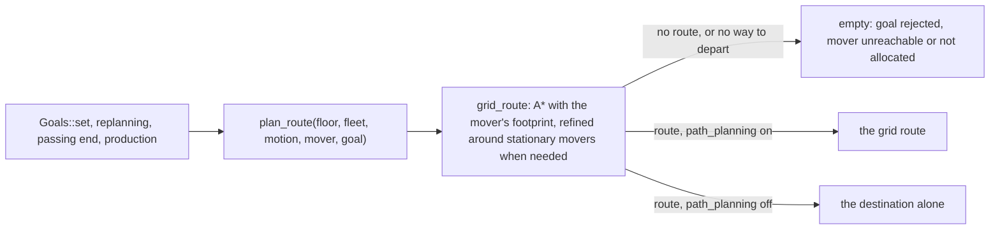

# i4sim: path planning off, and a smooth H crossing

Status: implemented · Branch: `feat/i4sim-h-crossing-motion` · Related: [Kinetra border corner slide](https://github.com/SMB-M87/Kinetra/blob/fix/border-corner-slide/docs/design/2026-11-19-border-corner-slide.md), [showcase shuttle](2026-11-19-i4sim-showcase-shuttle.md), [blueprints](../../labs/i4sim/blueprints/README.md), [i4sim](../../labs/i4sim/README.md)

The h-crossing showcase scene looks rough: its four movers bunch up in the middle bar, back up, loop and take 1721 to 2274 ticks for a leg that is about 1500 mm long. The user wants it to look much smoother, wants to switch path planning off in the settings, and wants the H to run without path planning. This change adds that switch, makes the scenario format carry it and the motion parameters, and gives the H the measured best settings without locks. A new GIF shows the result.

## Table of contents

- [Problem](#problem)
- [Goals and non-goals](#goals-and-non-goals)
- [Decisions](#decisions)
- [Design](#design)
- [Measurements](#measurements)
- [Affected areas](#affected-areas)
- [Test plan](#test-plan)
- [Review](#review)
- [Verification](#verification)
- [Pull request](#pull-request)
- [Open points](#open-points)

[Directory guide](README.md) · [Project overview](../../README.md) · [Documentation index](../README.md)

## Problem

- Every mover follows an A* route over the 240 mm cells ([routing.cpp](../../labs/i4sim/src/routing.cpp)); nothing switches that off. In the H the routes run along cell centers, and predictive passing bends them into lanes.
- The current scene (Improved, no heatmap costs, predictive passing, speed 2, force 0.6, horizon 32) takes 1721 and 2274 ticks per leg. The movers turn 164 radians per meter driven and change velocity by 147 mm/tick per meter: they wobble, stop and back up in the middle (measured with a headless harness, see [Measurements](#measurements)).
- The scenario format cannot set speed, force or horizon ([blueprints README](../../labs/i4sim/blueprints/README.md#scenario-section-format)), so a scene cannot ask for softer steering.
- Without a route, movers steer straight at their goal and slide along the walls. In the H all four stuck for good at the inner corners of the middle bar: Kinetra's `constrain_borders` braked a box sliding flush along a wall when its corner met the end of another wall. That is fixed in Kinetra ([border corner slide](https://github.com/SMB-M87/Kinetra/blob/fix/border-corner-slide/docs/design/2026-11-19-border-corner-slide.md)).

## Goals and non-goals

- Goal: path planning can be switched off in DEBUG → MOTION and in a scenario. Off, each mover steers straight at its goal; local steering and the borders keep it on the floor.
- Goal: a goal without a grid route is still rejected with planning off, so `move_to` and `shuttle` keep their contract.
- Goal: a scenario can set speed, force and horizon.
- Goal: the H runs without path planning, with the settings that measured smoothest without locks, also when a mover starts late.
- Goal: a new h-crossing GIF.
- Non-goal: smoothing A* routes (any-angle paths), or changing the other showcase scenes.
- Non-goal: guaranteeing that every layout works without planning; local steering cannot leave a concave pocket, so OFF suits open layouts such as the H.

## Decisions

| Decision | Choice | Why |
| --- | --- | --- |
| Corner trap | Fixed in Kinetra (`constrain_borders`), with its own pull request that merges first | User's choice. Alternatives measured: planning off with route recovery stands ~120 ticks at every corner before recovery plans a detour; keeping A* in the H leaves planning on, against the user's wish |
| Where the switch lives | A third choice OFF in DEBUG → MOTION → PLANNER (HEAT A*, A*, OFF) | The motion settings live in the debug menu's MOTION section; the SETTINGS panel holds the rows every Lab application shares. PLANNER is where the operator looks for the planner, and the heatmap only matters while routes are planned |
| Model | `MotionSettings::path_planning` (default true) next to `heatmap` | Additive: existing code, tests and scenario files keep their meaning. The menu folds both into one list; OFF keeps the heatmap value, so switching back restores it |
| Meaning of OFF | The route is the destination alone; reachability is still checked on the grid | Keeps `move_to` and `shuttle` rejecting a goal without a route, and keeps everything that reads `Mover::route` (passing, drawing, progress) working unchanged |
| Route recovery with OFF | Independent, as before (off by default) | Recovery is its own switch; turned on, it can still plan a detour for a stalled mover |
| Scenario format | `motion.pathPlanning` (boolean) and `motion.speed`, `motion.force`, `motion.horizon` (numbers), checked with the limits `configure_motion` enforces | Additive, so existing scenes keep their meaning; checked while loading so the error names the file |
| H settings | Improved, path planning off, no predictive passing, speed 2, force 0.5, horizon 16 (heatmap off, so PLANNER → A* gives the old plain A*) | Measured best without locks, see [Measurements](#measurements). Reciprocal is smoother still, but locks when a mover starts late; predictive passing on, or a force below 0.45, gives occasional contacts or locks |
| What "no locks" means | Every leg completes in the scene and under 876 perturbations (one mover starting 2 to 600 ticks late, or held 30 to 300 ticks on the way); also no contacts | User's requirement. The scene alone is periodic, so it says little; perturbations stand for an operator clicking during the scene |

## Design

The takeaway: OFF changes only what `plan_route` returns once a route exists, so every caller keeps its checks, including the departure check of mover allocation.

- `plan_route` takes the `MotionSettings`; its callers already had them, except `PredictivePassing::cancel`, `end` and `restore_routes`, which now receive them.
- The PLANNER list maps three choices onto two settings: HEAT A* (planning, heatmap), A* (planning, no heatmap), OFF (no planning, heatmap kept).
- `load_scenario` reads the new properties; `longest_motion_horizon` (64 ticks) names the limit that `configure_motion`, the menu's HORIZON button and the loader share.

## Measurements

A throwaway harness (not committed) loaded the scene headless, overrode the motion settings, ran up to 30000 ticks and measured per leg: duration, contacts, the share of moving ticks below 30 % of top speed, direction change and velocity change per meter, the smallest gap between movers, and the lateral wobble (distance of a mover from its 15-tick moving average). With the Kinetra fix in place:

| Sweep | Settings | Result |
| --- | --- | --- |
| Broad | 4 profiles × planning on/off × heatmap × passing × recovery × force 0.2–0.6 × horizon 8–64 (720) | Planning off locked every time without the Kinetra fix (only recovery got movers past the corners, after standing); with it, 94 lock-free combinations without recovery |
| Robustness | 504 combinations × 109 runs (each mover 5–395 ticks late) | Reciprocal: smoothest (≈ 4 rad/m), but locked in some late starts in every combination. Improved with planning off: no failure at force 0.45 for every horizon; lower forces gave contacts; passing on gave occasional locks |
| Fine | Improved, planning off, force 0.4–0.55 × horizon 14–20, and the old scene; 876 runs each (2–600 ticks late, or held 30/100/300 ticks from tick 100 to 1200) | Force 0.5 / horizon 16 and force 0.55 / horizon 16: no lock, no contact. The old scene: no lock, contacts in 3 runs |

The chosen settings against the old scene, undisturbed:

| | Old (A*, passing, force 0.6, horizon 32) | New (no planning, force 0.5, horizon 16) |
| --- | --- | --- |
| Ticks per leg | 2273 and 1721, alternating | 1264, every leg |
| Contacts | 0 | 0 |
| Moving ticks below 30 % speed | 31 % | 18 % |
| Wobble, 95th percentile | 1.01 mm | 0.74 mm |
| Path | Cell-center routes, bunching, loops and reversing in the bar | A clean X through the bar, wall slides at both ends |
| Clip | 359 frames (24 s), 1.3 MB | 249 frames (16.6 s), 1.1 MB |

Direction change per meter is not a good smoothness measure here: per-tick sub-millimeter jitter of the predictive term dominates it (the new settings score higher on it than the old scene at full speed, while their wobble is lower).

## Affected areas

- Logic: `labs/i4sim/include/simulation.h` (`path_planning`, `longest_motion_horizon`), `src/routing.{h,cpp}`, `goals.cpp`, `motion_step.cpp`, `production.cpp`, `predictive_passing.{h,cpp}`, `simulation_core.cpp`, `scenario.cpp`.
- Controller: `src/controller.cpp` (PLANNER list).
- Data: `labs/i4sim/blueprints/showcase/h-crossing.json`.
- Engine: the `external/Kinetra` pointer, to the border corner fix.
- Tests: `simulation_tests.cpp`, `controller_tests.cpp`.
- Docs: `labs/i4sim/README.md`, `blueprints/README.md`, `tests/README.md`, [factory simulation architecture](../factory-simulation-architecture.md), [media](../media/README.md).
- Media: `docs/media/i4sim-showcase-h-crossing-clip.gif`.

## Test plan

| Behavior | Test | Level |
| --- | --- | --- |
| With planning off a mover's route is its destination, a goal without a grid route is rejected, and a mover crosses the H past its convex corners | `simulation_tests`: without path planning a mover steers straight at its goal and still needs a route (fails without the Kinetra fix) | Targeted |
| The PLANNER list offers HEAT A*, A* and OFF; OFF keeps the heatmap value | `controller_tests`: the planner list chooses between heat A*, A* and no path planning | Targeted |
| The scenario reads `pathPlanning`, `speed`, `force`, `horizon` case-insensitively and rejects wrong types and out-of-range values with the cause | `simulation_tests`: an invalid scenario is rejected with its cause | Targeted |
| The H scene runs exactly like its hand-built setup | `simulation_tests`: each showcase scene runs exactly like its hand-configured setup | Targeted |
| The H completes its legs without contacts, also when one mover starts late | `simulation_tests`: new case | Targeted |
| The session still loads and runs every scene | `presentation_tests` | Full with graphics |

The Kinetra pointer and several modules change, so the branch ends at the Full level with the graphics preset.

## Review

`/code-review` (high) on `main...HEAD`, five findings:

| Finding | Resolution |
| --- | --- |
| With planning off, `plan_route` returned the destination before the departure check, so mover allocation accepted a mover boxed in by parked movers | Fixed: `plan_route` now runs the full grid check (`grid_route`) and only then replaces a non-empty route by the destination |
| With a direct route, a wall slide away from the goal counts as no progress (STALLED, and recovery when on) | Kept, recorded under [Open points](#open-points); not seen in the H, where every slide shortens the distance |
| A controller comment still spoke of the horizon range | Fixed |
| `parameter` prints the limit as an integer | Kept: the only limit is 64 |
| `heatmap: false` in the H has no effect while planning is off | Kept on purpose: it is the measured setup and decides what PLANNER → A* does |

The Kinetra change was reviewed on its own diff: only the corner region changes, a body at rest or on an exact diagonal keeps the old choice, and the per-segment constraint stays one step. No findings.

## Verification

Full level with graphics, on the branch with `external/Kinetra` at the Kinetra branch.

| Command | Result |
| --- | --- |
| `cmake --workflow --preset ci` | Passed: 203 of 203 tests. The 64 compiler warnings are all in Demo headers (`sandbox_scene.h`, `terrain.h`), none in i4sim |
| `cmake --workflow --preset headless` | Passed: 189 of 189 tests |
| `cmake --workflow --preset graphics` | Passed: 217 of 217 tests, including `kinetra_i4sim_graphics`, the capture tests and the capture smoke test |
| `SDL_VIDEODRIVER=offscreen LIBGL_ALWAYS_SOFTWARE=1 ./build-graphics/kinetra --variant {demo,dotio,i4sim} --frames 120` | All exit 0 |
| `kinetra_i4sim --blueprint …/showcase/h-crossing.json --run --frames 600` (offscreen) | Exit 0 |
| `git ls-files -- '*.h' '*.cpp' \| xargs clang-format --dry-run --Werror` | Clean |
| `python3 external/Kinetra/tools/check_docs.py` | All links resolve |
| `tools/capture/capture_media.sh build-graphics i4sim-showcase-h-crossing-clip` | 249 frames, 1.1 MB; looked at the first, crossing and last frames |
| New direct-steering test without the Kinetra fix | Fails: the mover stops at a corner of the bar |

Kinetra itself: `ci` 223/223, `headless` 201/201, external consumer; see its design document. The departure-check fix came after the GIF; it does not touch the scene (no workload), and the release tests passed after it (126 of 126 i4sim tests) before the three workflows above ran.

Not verified: the Windows build (no Windows-specific code changed) and a look on a desktop; the WSLg desktop renders, but the clip was judged from offscreen frames.

## Pull request

Title: `feat(i4sim): switch path planning off and smooth the H crossing`

**Summary.** The h-crossing showcase now runs without path planning: its four movers steer straight at their diagonal goals and cross the middle bar in a clean X, in 1264 ticks per leg instead of 1721 to 2274, without contacts and without locks, also when a mover starts late or is held on the way. Path planning can be switched off in DEBUG → MOTION → PLANNER (OFF) and in a scenario, which can now also set speed, force and horizon. A Kinetra fix lets movers slide past convex wall corners; without it, every mover stuck on a corner of the bar.

**Changes.**
- Motion: `MotionSettings::path_planning`; off, `plan_route` still checks reachability and departure on the grid but returns the destination alone. `longest_motion_horizon` names the horizon limit.
- Menu: PLANNER offers HEAT A*, A* and OFF; OFF keeps the heatmap value.
- Scenario format: `motion.pathPlanning`, `motion.speed`, `motion.force`, `motion.horizon`, checked while loading.
- Showcase: h-crossing uses Improved, no path planning, force 0.5, horizon 16, chosen from headless sweeps (settings × late starts and holds); new description and GIF.
- Engine: `external/Kinetra` points at the Kinetra branch `fix/border-corner-slide`.
- Tests: direct steering across the H, the PLANNER list, the new scenario properties, the H under 16 late starts; the repeat test asks for coordination only in scenes that enable it.
- Docs: i4sim, blueprints, tests and architecture pages, the README gallery and the media guide.

**Design.** [docs/design/2026-11-19-i4sim-h-crossing-motion.md](https://github.com/SMB-M87/Kinetra-Lab/blob/feat/i4sim-h-crossing-motion/docs/design/2026-11-19-i4sim-h-crossing-motion.md); Kinetra: [border corner slide](https://github.com/SMB-M87/Kinetra/blob/fix/border-corner-slide/docs/design/2026-11-19-border-corner-slide.md).

**Verification.** `cmake --workflow --preset ci` (203/203), `headless` (189/189), `graphics` (217/217), the README smoke runs and the H scene offscreen, clang-format and the docs check. Kinetra: `ci` (223/223), `headless` (201/201), external consumer. Details in the design document.

**Review notes.** `/code-review` found five points: the departure check with planning off is fixed, a comment fixed, three kept with reasons (one is an open point). The measurement harness is not committed; the design document lists what it measured.

**Dependencies and merge order.** Needs the Kinetra pull request for `fix/border-corner-slide`. Merge that first, with a merge commit; then move `external/Kinetra` on this branch to the merge commit before merging this one.

**Follow-up.** Progress measurement for direct routes (see [Open points](#open-points)).

## Open points

- With planning off, progress is measured as the straight distance to the goal, so a long wall slide away from it counts as no progress (STALLED; with RECOVERY on, a detour). Measuring progress along the slide would need a different measure for direct routes.
- OFF suits open floors only; in the large factories, movers would get stuck in concave pockets. That is by design and documented, not checked by a test.
