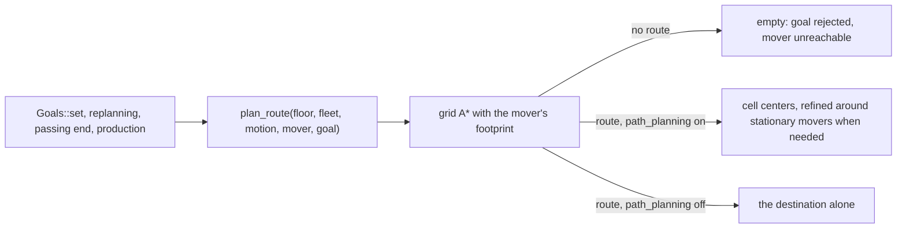

# i4sim: path planning off, and a smooth H crossing

Status: accepted · Branch: `feat/i4sim-h-crossing-motion` · Related: [Kinetra border corner slide](https://github.com/SMB-M87/Kinetra/blob/fix/border-corner-slide/docs/design/2026-11-19-border-corner-slide.md), [showcase shuttle](2026-11-19-i4sim-showcase-shuttle.md), [blueprints](../../labs/i4sim/blueprints/README.md), [i4sim](../../labs/i4sim/README.md)

The h-crossing showcase scene looks rough: its four movers bunch up in the middle bar, back up, loop and take 1721 to 2274 ticks for a leg that is about 1500 mm long. The user wants it to look much smoother, wants to switch path planning off in the settings, and wants the H to run without path planning. This change adds that switch, makes the scenario format carry it and the motion parameters, and gives the H the measured best settings without locks. A new GIF shows the result.

## Table of contents

- [Problem](#problem)
- [Goals and non-goals](#goals-and-non-goals)
- [Decisions](#decisions)
- [Design](#design)
- [Measurements](#measurements)
- [Affected areas](#affected-areas)
- [Test plan](#test-plan)
- [Review](#review)
- [Verification](#verification)
- [Pull request](#pull-request)
- [Open points](#open-points)

[Directory guide](README.md) · [Project overview](../../README.md) · [Documentation index](../README.md)

## Problem

- Every mover follows an A* route over the 240 mm cells ([routing.cpp](../../labs/i4sim/src/routing.cpp)); nothing switches that off. In the H the routes run along cell centers, and predictive passing bends them into lanes.
- The current scene (Improved, no heatmap costs, predictive passing, speed 2, force 0.6, horizon 32) takes 1721 and 2274 ticks per leg. The movers turn 164 radians per meter driven and change velocity by 147 mm/tick per meter: they wobble, stop and back up in the middle (measured with a headless harness, see [Measurements](#measurements)).
- The scenario format cannot set speed, force or horizon ([blueprints README](../../labs/i4sim/blueprints/README.md#scenario-section-format)), so a scene cannot ask for softer steering.
- Without a route, movers steer straight at their goal and slide along the walls. In the H all four stuck for good at the inner corners of the middle bar: Kinetra's `constrain_borders` braked a box sliding flush along a wall when its corner met the end of another wall. That is fixed in Kinetra ([border corner slide](https://github.com/SMB-M87/Kinetra/blob/fix/border-corner-slide/docs/design/2026-11-19-border-corner-slide.md)).

## Goals and non-goals

- Goal: path planning can be switched off in DEBUG → MOTION and in a scenario. Off, each mover steers straight at its goal; local steering and the borders keep it on the floor.
- Goal: a goal without a grid route is still rejected with planning off, so `move_to` and `shuttle` keep their contract.
- Goal: a scenario can set speed, force and horizon.
- Goal: the H runs without path planning, with the settings that measured smoothest without locks, also when a mover starts late.
- Goal: a new h-crossing GIF.
- Non-goal: smoothing A* routes (any-angle paths), or changing the other showcase scenes.
- Non-goal: guaranteeing that every layout works without planning; local steering cannot leave a concave pocket, so OFF suits open layouts such as the H.

## Decisions

| Decision | Choice | Why |
| --- | --- | --- |
| Corner trap | Fixed in Kinetra (`constrain_borders`), with its own pull request that merges first | User's choice. Alternatives measured: planning off with route recovery stands ~120 ticks at every corner before recovery plans a detour; keeping A* in the H leaves planning on, against the user's wish |
| Where the switch lives | A third choice OFF in DEBUG → MOTION → PLANNER (HEAT A*, A*, OFF) | The motion settings live in the debug menu's MOTION section; the SETTINGS panel holds the rows every Lab application shares. PLANNER is where the operator looks for the planner, and the heatmap only matters while routes are planned |
| Model | `MotionSettings::path_planning` (default true) next to `heatmap` | Additive: existing code, tests and scenario files keep their meaning. The menu folds both into one list; OFF keeps the heatmap value, so switching back restores it |
| Meaning of OFF | The route is the destination alone; reachability is still checked on the grid | Keeps `move_to` and `shuttle` rejecting a goal without a route, and keeps everything that reads `Mover::route` (passing, drawing, progress) working unchanged |
| Route recovery with OFF | Independent, as before (off by default) | Recovery is its own switch; turned on, it can still plan a detour for a stalled mover |
| Scenario format | `motion.pathPlanning` (boolean) and `motion.speed`, `motion.force`, `motion.horizon` (numbers), checked with the limits `configure_motion` enforces | Additive, so existing scenes keep their meaning; checked while loading so the error names the file |
| H settings | To be filled in after the measurements | |

## Design

The takeaway: OFF changes only what `plan_route` returns once a route exists, so every caller keeps its checks.

- `plan_route` takes the `MotionSettings`; its callers already had them, except `PredictivePassing::cancel`, `end` and `restore_routes`, which now receive them.
- The PLANNER list maps three choices onto two settings: HEAT A* (planning, heatmap), A* (planning, no heatmap), OFF (no planning, heatmap kept).
- `load_scenario` reads the new properties; `longest_motion_horizon` (64 ticks) names the limit that `configure_motion`, the menu's HORIZON button and the loader share.

## Measurements

To be filled in.

## Affected areas

- Logic: `labs/i4sim/include/simulation.h` (`path_planning`, `longest_motion_horizon`), `src/routing.{h,cpp}`, `goals.cpp`, `motion_step.cpp`, `production.cpp`, `predictive_passing.{h,cpp}`, `simulation_core.cpp`, `scenario.cpp`.
- Controller: `src/controller.cpp` (PLANNER list).
- Data: `labs/i4sim/blueprints/showcase/h-crossing.json`.
- Engine: the `external/Kinetra` pointer, to the border corner fix.
- Tests: `simulation_tests.cpp`, `controller_tests.cpp`.
- Docs: `labs/i4sim/README.md`, `blueprints/README.md`, `tests/README.md`, [factory simulation architecture](../factory-simulation-architecture.md), [media](../media/README.md).
- Media: `docs/media/i4sim-showcase-h-crossing-clip.gif`.

## Test plan

| Behavior | Test | Level |
| --- | --- | --- |
| With planning off a mover's route is its destination, a goal without a grid route is rejected, and a mover crosses the H past its convex corners | `simulation_tests`: without path planning a mover steers straight at its goal and still needs a route (fails without the Kinetra fix) | Targeted |
| The PLANNER list offers HEAT A*, A* and OFF; OFF keeps the heatmap value | `controller_tests`: the planner list chooses between heat A*, A* and no path planning | Targeted |
| The scenario reads `pathPlanning`, `speed`, `force`, `horizon` case-insensitively and rejects wrong types and out-of-range values with the cause | `simulation_tests`: an invalid scenario is rejected with its cause | Targeted |
| The H scene runs exactly like its hand-built setup | `simulation_tests`: each showcase scene runs exactly like its hand-configured setup | Targeted |
| The H completes its legs without contacts, also when one mover starts late | `simulation_tests`: new case | Targeted |
| The session still loads and runs every scene | `presentation_tests` | Full with graphics |

The Kinetra pointer and several modules change, so the branch ends at the Full level with the graphics preset.

## Review

To be filled in after the review.

## Verification

To be filled in after verification.

## Pull request

To be filled in.

## Open points

- None yet.
