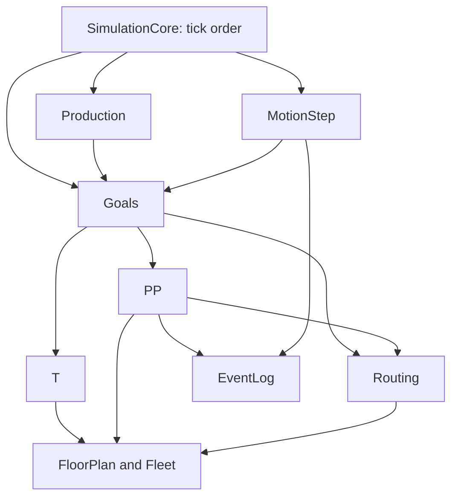
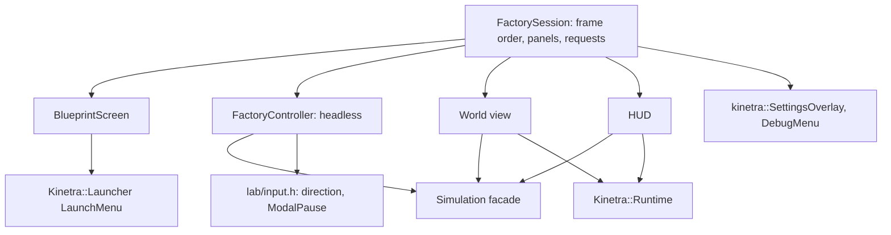

# i4sim restructuring

Status: implemented · Branches: `test/i4sim-passing-safety-net` (step 1, merged), `refactor/i4sim-simulation` (step 2, merged), `refactor/i4sim-session` (step 3) · Related: [quality roadmap, phase 4](2026-11-18-quality-roadmap.md#phase-4-i4sim), [i4sim](../../labs/i4sim/README.md), [factory simulation architecture](../factory-simulation-architecture.md)

Roadmap phase 4. i4sim's `Simulation` is the largest hotspot in Lab, and predictive passing, which phase 7 must make safe under pressure, lives inside it. This phase first pins today's passing behavior with diagnostics and pressure scenarios, and then restructures the simulation and its session without changing behavior.

## Table of contents

- [Problem](#problem)
- [Goals and non-goals](#goals-and-non-goals)
- [Decisions](#decisions)
- [Design](#design)
  - [Steps](#steps)
  - [Step 1: passing safety net](#step-1-passing-safety-net)
  - [Step 2: simulation](#step-2-simulation)
  - [Step 3: session](#step-3-session)
- [Affected areas](#affected-areas)
- [Test plan](#test-plan)
- [Review](#review)
- [Verification](#verification)
- [Pull request](#pull-request)
- [Open points](#open-points)

[Directory guide](README.md) · [Project overview](../../README.md) · [Documentation index](../README.md)

## Problem

Measured at `721cd4a` on 2026-11-19.

- **Passing is a black box.** `Simulation::coordinate_predictive_passing` (`labs/i4sim/src/predictive_passing.cpp:61`, 167 lines) forms, advances and cancels passing plans, but leaves no record. A plan ends for one of six reasons (disabled, participant stopped, participant held, corridor recovery took a participant, 240 ticks without progress, goal changed through `set_goal`), and none of them is observable. A contact reports neither seed nor tick.
- **Passing is tested only in calm situations.** The passing tests (`labs/i4sim/tests/simulation_tests.cpp:788-919`) and the golden case cover two movers. The situations the roadmap names as risky (three oncoming movers, a third mover entering an active lane, several plans at once, little room to give way) have no test, so a refactor can change them unnoticed.
- **The benchmark misses flow.** `kinetra_i4sim_motion_benchmark` (`labs/i4sim/tests/motion_benchmark.cpp`) reports completed products and contacts, but not waiting time or stuck movers. The baseline in the roadmap suspects stuck movers on `MAS-demonstrator` seed 42 but cannot show them.
- **Long functions.** In `simulation.cpp`: `move_agents` 199 lines, `coordinate_traffic` 177, `recover_corridors` 119, the constructor 112, `plan_route` 83, `update_product` 77; in `predictive_passing.cpp`: `coordinate_predictive_passing` 167.
- **One class, eight responsibilities.** `Simulation` (`labs/i4sim/include/simulation.h:60`) owns grid topology, route planning, parking, junction and corridor traffic, corridor recovery, predictive passing, production scheduling, steering and contact resolution: 40 data members and 31 private functions.
- **Hidden state in `Mover`.** `Mover` (`simulation.h:24`) has 12 `bool`s and 6 progress counters. They are not one state machine but several independent axes: lifecycle (`moving`, `unreachable`), operator hold (`blocked`), goal origin (`manual`, `parking_deferred`), route kind (`detour`), per-tick traffic output (`junction_waiting`, `junction_exit_waiting`, `corridor_waiting`, `corridor_retreating`, `passing_detour`, several of which are true together, for example at `simulation.cpp:794-796`) and per-tick observation (`contacting`). `stalled` is written (`simulation.cpp:1104`) but never read. The session decodes the flags with a nested ternary (`labs/i4sim/src/session.cpp:505`).
- **Public mutable run state.** `paused` and `workload` are public fields (`simulation.h:93`). The session sets `paused = true` around `configure_motion` only to get past its guard (`session.cpp:36-47`); `tick` also uses `paused` to report the tick cap.
- **Magic numbers.** `Vec2{2, 2}` clearance, `0.05f` arrival speed, `120` and `240` tick timeouts and `speed * speed / force` braking distance are repeated without names.
- **Large session class.** `FactorySession` (`session.cpp`, 552 lines) mixes input, HUD and world drawing, and is tested only with graphics.

## Goals and non-goals

**Goals:**
- An event log and flow metrics that make passing and traffic flow observable, without changing behavior.
- Pressure scenarios as named doctest cases that record today's outcome, as the baseline for phase 7.
- `Simulation` split by responsibility, each part with its own tests; `Mover` state made explicit.
- `FactorySession` split into a headless, tested controller, a HUD and a world renderer.
- `///` contracts on every i4sim header and a module README that explains traffic, corridor and passing.

**Non-goals:**
- Changing simulation behavior. Predictive passing changes in phase 7.
- Moving mechanisms to Kinetra. Shared passing is phase 8.
- New blueprint fields. Blueprint files are a data format; the scenarios use the existing fields.

## Decisions

Settled with the user on 2026-11-19; every answer matched the agent's recommendation.

| Decision | Choice | Why |
| --- | --- | --- |
| Pull requests | One per step: safety net, simulation, session. Each step starts on the merged previous one | Each step is reviewable on its own, and the safety net is on `main` before the refactor starts |
| Golden values | Bit-identical throughout phase 4, including the trajectory fingerprints and the pressure scenarios. A bug found on the way becomes an open point or its own fix pull request that updates the lines and explains why | A refactor pull request then proves by its tests that it changed nothing; behavior changes stay reviewable on their own |
| `Simulation` split | Component classes that own their state (floor topology, route planning, traffic, passing, production, motion), composed by `Simulation`, which keeps the tick order | Real boundaries with their own tests, instead of one class spread over several files |
| Mover state | Explicit per axis: a lifecycle enum with transitions, a goal kind, the operator hold behind an operation, the per-tick coordination output in one value, and a derived `status()` for the HUD | One enum for all axes would force a priority onto flag combinations that exist today, which changes behavior |
| Event log | Opt-in, stored in the simulation and copied with it; recording never influences a decision | Tests copy simulations (`auto replay = trial;`); a callback would keep pointing at the original's collector |
| Scenario assertions | One recorded line per case: outcome counts plus a fingerprint of trajectory and events, after a check that the situation really occurs | The sharpest safety net for the refactor, and an exact baseline for phase 7 |
| Launcher edge | Presentation may link `Kinetra::Launcher` for its menu widgets; recorded in the layer table | No cycle (Launcher is an engine library); removing it would move or duplicate `LaunchMenu` |
| Agent defaults | Scenarios under Reciprocal and Improved; flow metrics outside `Simulation`; run state as an enum with operations; `configure_motion` allowed while running; constants in an internal header; component headers private; `Simulation` keeps its query API as a facade | Proposed in the chat as cosmetic choices with a recommendation; not contested |
| Stuck definition | A mover is stuck when its distance to its destination does not drop 10 mm below its best value for 2000 ticks, instead of the confirmed "stays within 10 mm of one point for 2000 ticks" | Changed during step 1 and reported at hand-over. The three-oncoming scenario left two movers shuffling back and forth without arriving, and the confirmed definition counted neither. The new one also covers standing still |

Step 2 refinement, agent choices within the decisions above, reported at hand-over:

| Choice | Why |
| --- | --- |
| A `finished` run state for the tick cap | The decided run-state enum needs a value for "stopped by the cap"; today `tick` reuses `paused` for it |
| Progress counters private, with `stalled(mover)` as the observable | Tests must assert observable behavior; the HUD needs only "stalled" |
| `Goals` as a short-lived view instead of an interface | The dependency graph has no cycle, and stored references would break copying a simulation |
| Warnings as errors for all of `labs/i4sim`, not only the logic | The session already compiles without warnings |

Step 3 refinement, agent choices within the decisions above, reported at hand-over:

| Choice | Why |
| --- | --- |
| The controller lives in the headless library and uses `lab/input.h` | "Headless and tested" needs a target that exists without the runtime; Demo's `sandbox_input.h` already sits in its logic library. The layer table now states that logic may use the headless Lab input policy |
| Menu entries as controller data (`MenuEntry`), turned into `kinetra::DebugOption` by the session | The rows are most of the session's commands; as data they are tested without a window, and the logic layer stays free of the engine's drawing types |
| A fourth part, `BlueprintScreen` | Catalog discovery and the `LaunchMenu` are one responsibility; left in the session they were a third of what remained |
| One message, owned by the controller, also for catalog errors | Two owners would change which error shows when the catalog and the initial blueprint both fail |
| Frames compared outside the repository | Pixel-exact lines depend on the OpenGL driver, so they would fail on another machine; as a one-off proof on one machine they are exact |
| `factory-simulation-architecture.md` stays the contract page | The roadmap absorbs the Demo and Dotio pages but not this one; the README explains, the page specifies |

## Design

### Steps

| Step | Branch | Content |
| --- | --- | --- |
| 1 | `test/i4sim-passing-safety-net` | Event log, flow metrics, benchmark columns and a new baseline, pressure scenarios. No behavior change |
| 2 | `refactor/i4sim-simulation` | Mover state, run state, named constants, `Simulation` split, tests on observable behavior, `///` contracts on the simulation headers, warnings as errors for i4sim |
| 3 | `refactor/i4sim-session` | Controller, HUD and world renderer; the launcher edge in the layer table; the module README with the sub-READMEs folded in |

Steps 2 and 3 are refined in this document before their branch starts.

### Step 1: passing safety net

**Event log.** `Simulation::record_events(bool)` turns recording on; `events()` returns the recorded events in order. Recording is off by default, so existing runs pay one branch per event site. The log is a member, so copying a simulation copies its log. `seed()` returns the seed the simulation was built with, so a contact can be replayed from blueprint, seed, motion settings and tick.

| Event | Recorded when | Fields |
| --- | --- | --- |
| `passing_formed` | A plan is accepted | plan id, both movers, entry and exit target per mover |
| `passing_crossing` | Both movers reached their entry targets and stopped | plan id, both movers |
| `passing_ended` | A plan is removed | plan id, both movers, reason |
| `contact` | A mover pair or mover-wall pair starts touching (the moment `collisions()` increases) | both movers, or the mover and the border index; whether a participant was in a passing plan |

The end reasons follow the checks in `coordinate_predictive_passing`, in code order, so the first reason that applies is the one recorded:

| Reason | Condition in today's code |
| --- | --- |
| `completed` | Both movers reached their exit targets after crossing |
| `disabled` | `predictive_enabled()` is false. In practice `configure_motion` ends plans first, because it sets every moving mover's goal again |
| `participant_stopped` | A participant is no longer `moving` |
| `participant_held` | A participant is `blocked` |
| `traffic_control` | Corridor recovery took control of a participant |
| `no_progress` | The summed distance to the targets did not shrink for 240 ticks |
| `goal_changed` | `set_goal` ran for a participant: a manual command, a scheduling or parking decision, or a motion-settings change |

Each plan gets an id from a counter, so the events of one plan can be correlated. The counter advances whether or not recording is on, so it never changes behavior.

**Flow metrics.** A headless `FlowMetrics` class in `kinetra_i4sim_application` observes a simulation after each tick and reads only its public state, so it cannot change behavior. A mover has an *active goal* while it is `moving` and not `blocked`.

| Measure | Definition |
| --- | --- |
| Waiting ticks | Mover-ticks with an active goal, a speed below 0.05 mm/tick and more than 10 mm from the destination. The distance condition excludes the slow final approach |
| Stuck movers | Distinct movers whose straight-line distance to their destination, with an active goal, did not drop 10 mm below its best value for 2000 ticks (10 s at 200 updates per second). Standing still and moving back and forth both count; a detour that leads away from the destination for that long counts too |
| Stuck at end | Movers that are stuck at the last observation |

**Benchmark.** `kinetra_i4sim_motion_benchmark` records events and observes flow metrics. Its CSV gains the columns `waiting_ticks`, `stuck_movers`, `stuck_at_end`, `passing_plans`, `passing_cancelled` and `passing_contacts`; `elapsed_ms` stays last. The new baseline for the four roadmap configurations is in the [i4sim test guide](../../labs/i4sim/tests/README.md#motion-benchmark).

**Pressure scenarios.** A new doctest suite `kinetra_i4sim_pressure_tests` with blueprint fixtures in `labs/i4sim/tests/`. The golden suite's recorder moves to a test-only header shared by both suites; its fingerprint computation stays the same, so the golden lines do not change. Each scenario runs under Reciprocal and Improved with predictive passing on and the heatmap off, first checks that its situation actually occurs, and then compares one recorded line.

| Scenario | Situation | Occurrence check |
| --- | --- | --- |
| Three oncoming movers | One mover meets two oncoming movers that drive in a column on the same line | A plan forms with the first oncoming mover |
| Third mover in an active lane | Two movers pass head-on; a third crosses their path at right angles and reaches the lanes during the maneuver | The third mover comes within 250 mm (center to center) of a participant while their plan is active |
| Simultaneous plans | Two pairs pass head-on on parallel lines 400 mm apart | Two plans are active at once |
| Little room to give way | A 113 mm mover and a 155 by 235 mm mover meet in a vertical aisle two cells (400 mm) wide; vertical, because the grid planner routes through cell centers and the long side does not fit a horizontal two-cell aisle | Both movers are in the aisle at the same time; whether a plan forms is part of the recorded outcome |

The recorded line holds ticks, contacts, contact ticks, contacts during passing, plans formed, plans that reached crossing, ends per reason, movers that arrived, waiting ticks, stuck movers, and one fingerprint over the trajectory and the event log.

### Step 2: simulation

Refined on 2026-11-19 at `e688fea`, before the branch's first code commit. Every commit keeps the ten golden lines and the eight pressure lines bit-identical; a commit that changes one is wrong.

**Run state.** `paused` and `workload` become private. `RunState` has three values: `paused`, `running` and `finished`. `finished` is new: it replaces the `paused = true` that `tick` set at the tick cap, so a caller can tell "stopped by the operator" from "reached the cap".

| Operation | Effect |
| --- | --- |
| `run()` | `paused` → `running`; no effect when `finished` |
| `pause()` | `running` → `paused`; no effect when `finished` |
| `state()`, `running()` | The current state |
| `workload()`, `set_workload(bool)` | Whether `tick` generates products |
| `single_step()` | Unchanged: one tick when `paused` |
| `configure_motion` | Allowed in every state. Callers no longer pause around it, so the session and `apply_scenario` lose their pause round trip |

The HUD keeps its text: anything that is not `running` reads `PAUSED`, as today.

**Mover state.** The flags become one value per axis. Each axis was checked against today's code, so no combination that exists today is lost:

| Axis | Today | After |
| --- | --- | --- |
| Lifecycle | `moving`, `unreachable` (never both true) | `MoverLifecycle { idle, moving, unreachable }` and `Mover::moving()` |
| Goal origin | `manual`, `parking_deferred` (never both true) | `GoalKind { automatic, manual, parking_staging }`. As today, a new goal clears `parking_staging` but keeps `manual`, and arrival clears `manual` but keeps `parking_staging` |
| Operator hold | `blocked` | `held`, changed only by `toggle_mover` |
| Route kind | `detour` | Unchanged: true while the route came from route recovery |
| Coordination, per tick | `junction_waiting`, `junction_exit_waiting`, `corridor_waiting`, `corridor_retreating`, `passing_detour` (several true together) | One `Coordination` value with the same five fields, reset together at the start of traffic coordination. Today `passing_detour` is reset a little later in the same tick, but nothing reads it in between |
| Contact, per tick | `contacting` | Unchanged |
| Progress counters | `replan`, `no_progress`, `best_remaining`, `recovery_attempts`, `stalled` | Private to the simulation. `stalled` is removed (written, never read). `Simulation::stalled(mover)` reports what the HUD shows as `STALLED` |

`mover_status(const Mover &)` derives the HUD status (held, corridor retreat, passing detour, unreachable, allocated, idle) in today's priority order, so the session drops its nested ternary.

**Named constants.** An internal header `src/simulation_constants.h` names the repeated literals, with a comment on what each value means and why it has that value: the 2 mm clearance, the 0.05 mm/tick stop speed, the 0.05 mm same-point tolerance, the 100-tick obstruction threshold, the 120-tick stall threshold and retry delays, the 240-tick passing timeout and the 1000-tick processing time. `braking_distance(speed, force)` computes `speed * speed / force`. Each name replaces the literal with the same floating-point operations, so the results stay bit-identical.

**Components.** `Simulation` keeps the public API as a facade. Because the component headers are private, in `labs/i4sim/src/`, the facade holds a pointer to a private `detail::SimulationCore` (found during implementation: by-value members would pull the private headers into the public one). The core owns one instance of each component and keeps the tick order; copies of a simulation stay deep.

| Component | Owns | Responsibility | Today |
| --- | --- | --- | --- |
| `FloorPlan` | Weighted grid, borders, traffic-zone geometry, zone index, processing cells | Builds the topology from the blueprint; refreshes heatmap weights | Constructor, `update_heatmap` |
| `Fleet` | Movers, their progress counters, per-tick traffic controls and stop lines | Shared data that the components pass to each other explicitly | Members of `Simulation` |
| Routing (functions) | Nothing | Plans grid routes with refinement around stationary movers; plans recovery routes with Navigation | `plan_route`, `recover_route` |
| `Traffic` | Gates, exit reservations, corridor recoveries, retry ticks | Junction and corridor admission, exit pockets, corridor recovery | `coordinate_traffic`, `recover_corridors`, `traffic_exit` |
| `PredictivePassing` | Plans, retry ticks, plan id counter | Forms, advances and ends passing plans | `predictive_passing.cpp` |
| `Goals` (a view of references, built per call) | Nothing | Sets a goal and cancels what depends on the old one; chooses holding places; parking interlock | `set_goal`, `holding_position`, `parking_conflict`, `coordinate_parking` |
| `Production` | Producers, products, completed products, counters, workload generator | Scheduling, queues, processing, recipes | `schedule`, `update_product`, `add_product` |
| `MotionStep` | Contact pairs, contact counters, avoidance count | Route following, steering, integration, arrival, contact resolution | `prepare_route`, `move_agents` |
| `EventLog` | Recording flag, events | Records passing and contact events | `record_passing`, the contact lambda |

*Takeaway:* the dependencies point down to the floor and the fleet. There is no cycle, so no interface is needed: `Goals` depends on `Traffic` and `PredictivePassing` (a new goal cancels a recovery and a passing plan), and `Production` and `MotionStep` reach both only through `Goals`. `MotionStep` also runs the traffic and passing coordination of a tick through that view.

Components store no references to each other. Tests copy simulations (`auto replay = trial;`), and a stored reference would keep pointing into the original. `SimulationCore` passes what a call needs as parameters, and builds `Goals` as a short-lived view for each call.

**Tests.** The cases that read internal counters change to observable behavior: `no_progress < 120` becomes `!stalled(i)`, `no_progress < 100` on the detour becomes `!stalled(0)` (a weaker bound, recorded under Review), and `replan == 80` on the solo trip becomes "never stalls and arrives without contact". The new state values get their own cases: run-state transitions including the tick cap, goal-kind transitions (manual, staging, arrival), and `mover_status` priority.

**Contracts and warnings.** `///` contracts on `simulation.h` and every new component header. The six warnings in `simulation.cpp`, plus the `-Wmaybe-uninitialized` that the `ci` build reports in corridor recovery, are fixed. Then `kinetra_directory_warnings(labs/i4sim RECURSE AS_ERRORS)` keeps i4sim warning-free; the session already compiles without warnings.

**Commit order.** Refactor commits only, each one building and passing the i4sim suites: named constants; run state; mover state and private progress counters; geometry helpers and `FloorPlan`; routing; `Traffic`; `PredictivePassing` and `EventLog`; `Goals`; `Production`; `MotionStep`; contracts; warnings as errors; documentation.

### Step 3: session

Refined on 2026-11-19 at `b7d5f91`, before the branch's first code commit. `FactorySession` (`labs/i4sim/src/session.cpp`, 640 lines) has 29 fields, a 120-line `advance`, a 213-line `render` and a 100-line `options`. Only the graphics suite reaches it, through pixel comparisons.

**Parts.** The session keeps what needs Kinetra's widgets and composes four parts:

| Part | File | Layer | Owns | Responsibility |
| --- | --- | --- | --- | --- |
| `FactoryController` | `include/controller.h`, `src/controller.cpp` | Logic (headless) | The simulation and its scenario, the selection, the debug layers, the message and its expiry, the pending camera fit, the modal pause | Loads, resets and closes a blueprint; maps keys and pointer to commands; pans, zooms and fits the camera; supplies the debug menu's entries; advances the simulation |
| World view | `src/world_view.h`, `.cpp` | Presentation | Nothing | Draws floor, producers, movers, debug layers, traffic zones, borders and name labels |
| HUD | `src/hud.h`, `.cpp` | Presentation | Nothing | Draws statistics, the inspection of the selected mover or producer, the scene description and the message |
| `BlueprintScreen` | `src/blueprint_screen.h`, `.cpp` | Presentation | The catalog directory, its files and the `LaunchMenu` | Discovers blueprints, lists them with the SHOWCASE page, reports the choice, and draws the list or the load-error screen |
| `FactorySession` | `src/session.cpp` | Presentation | The parts above, the settings overlay with its three flags, the debug menu widget | Orders a frame: panels first, then the controller; turns menu entries into `kinetra::DebugOption` rows; reports requests |

*Takeaway:* only the session and the three drawing parts need a window. Everything that decides something, from a key to a command, sits in the controller and is tested without one.

**Controller interface.** A frame of a loaded blueprint runs in this order, which is today's order:

| Step | Call | Today in `advance` |
| --- | --- | --- |
| 1 | `begin_frame(elapsed)`: closes the blueprint when the menu asked for it, and ages the message | `back_to_blueprints_`, `error_remaining_` |
| 2 | Session: `SettingsOverlay::update`; `suspend(open)` pauses while the panel is open and restores the run state after it | `pause_.update` |
| 3 | Session: `menu()` entries become debug-menu rows; a click runs an entry's action | `options()`, `update_debug` |
| 4 | `handle_input(elapsed, input, camera, panels)`: pending camera fit, keys, zoom, pan, pointer, then `Simulation::advance` | The rest of `advance` |
| 5 | Drawing: `update_camera`, then world view, HUD, debug menu, frame times, settings | `render` |

`MenuEntry` describes one debug-menu row without the engine's drawing types: a label, an action, and optionally a value text or a check state. The session builds `kinetra::DebugOption` rows from the entries. A check entry becomes a button labelled `[X] NAME`, which is the text the menu draws for a check box today, so the WORKLOAD row no longer needs a mirrored `bool` that is copied back into the simulation.

**Layer rule.** The controller lives in `kinetra_i4sim_application`, like Demo's `sandbox_input.h` in its logic library, and that library links `kinetra_lab_common` for the headless `lab/input.h` (`direction`, `ModalPause`). It uses `kinetra::Input` and `kinetra::Camera2D` from `kinetra/engine.h`, which are plain data. The [layer table](../../AGENTS.md#lab-boundaries) records both edges of this step: logic may use the headless Lab input policy, and i4sim's presentation links `Kinetra::Launcher` for its blueprint screen (decided before step 1).

**Unchanged behavior.** No key, row, text, color or drawing order changes. Three oddities of today's session are kept and recorded as [open points](#open-points): `R` returns to 200 updates per second instead of the session's `--ups` value; RESET PARAMETERS sets the horizon to 8 ticks while a new simulation starts at 32; and `create_session` ignores its `output` argument.

**Carried from step 2.** `load_blueprint` (99 lines) is split into readers per section. The event counting that the benchmark and the pressure suite both write moves to the shared test header.

**Documentation.** The module README is rewritten on the [module template](../../external/Kinetra/docs/documentation.md#module-readme-template). It explains the structure, the frame flow, and how junction traffic, corridor traffic with its recovery, and predictive passing work, and it links to the [architecture page](../factory-simulation-architecture.md) for the full contracts and limits. `include/README.md` and `src/README.md` are folded into it and removed. `tests/README.md` and `blueprints/README.md` stay, because each has content of its own (suites, demonstrations and the benchmark baseline; the scenario format). The tests README loses its measurement history: the phase 7 baseline replaces the older tables, and what it does not cover (parking traffic) stays as one table. `blueprint.h` gets the `///` contracts it still lacks.

**Commit order.** Refactor commits, each one building with the frame comparison below unchanged: world view; HUD; blueprint screen; controller with its suite; `load_blueprint`; event counting. Then contracts, the layer table, the READMEs and the roadmap status.

## Affected areas

Step 1:
- `labs/i4sim/include/simulation.h`, `labs/i4sim/src/simulation.cpp`, `labs/i4sim/src/predictive_passing.cpp`: event log, plan id, seed.
- `labs/i4sim/include/events.h`, `labs/i4sim/include/flow_metrics.h`, `labs/i4sim/src/flow_metrics.cpp`: new.
- `labs/i4sim/tests/`: recorder header, pressure suite and fixtures, event-log and metrics cases, benchmark.
- `labs/i4sim/CMakeLists.txt`: the pressure suite.
- `labs/i4sim/tests/README.md`, `AGENTS.md` (test mapping): the new suite and benchmark columns.
- `external/Kinetra`: pointer to `d6ffdc6` (Kinetra main after the documentation cleanup; documentation and comments only since `ccb3396`).

Step 2:
- `labs/i4sim/include/simulation.h`, `labs/i4sim/src/simulation.cpp`, `labs/i4sim/src/predictive_passing.cpp`: facade, run state, mover state.
- `labs/i4sim/src/`: new private component headers and sources, `simulation_constants.h`.
- Callers of the run state and mover flags: `labs/i4sim/src/session.cpp`, `scenario.cpp`, `main.cpp`, `flow_metrics.cpp`, and every i4sim test and the benchmark.
- `labs/i4sim/CMakeLists.txt`: new sources. Root `CMakeLists.txt`: warnings as errors for i4sim.
- `docs/factory-simulation-architecture.md`: component structure; `labs/i4sim/src/README.md`: the new files.

Step 3:
- `labs/i4sim/src/session.cpp`: reduced to the composition; new `controller.h`/`.cpp`, `world_view`, `hud` and `blueprint_screen`.
- `labs/i4sim/src/blueprint.cpp`, `labs/i4sim/include/blueprint.h`: section readers, contracts.
- `labs/i4sim/tests/`: `controller_tests.cpp`, the shared event counting in `recorder.h`.
- `labs/i4sim/CMakeLists.txt`: sources, the `kinetra_lab_common` link and the controller suite.
- `AGENTS.md`: layer table and test mapping. `labs/i4sim/README.md` and its sub-READMEs, `docs/factory-simulation-architecture.md`, the roadmap status.

## Test plan

Step 1 adds observation only, so the existing golden lines are the proof that behavior did not change.

| Behavior | Test | Level |
| --- | --- | --- |
| Behavior is unchanged | All ten golden cases pass unchanged | Targeted |
| Recording does not influence decisions | The passing fixture runs with and without recording, under Improved and Reciprocal; every position and velocity is identical, tick for tick | Targeted |
| A passing plan logs its life cycle | Predictive passing fixture: `passing_formed` with the movers and targets that `passing_target` reports, then `passing_crossing`, then `passing_ended` with `completed` | Targeted |
| Cancellation reasons | A manual goal for a participant logs `goal_changed`; holding a participant logs `participant_held` on the next tick | Targeted |
| Contacts are logged with tick and pair | In a contact fixture the number of `contact` events equals `collisions()`, and each event's tick and pair match the run | Targeted |
| Recording is opt-in | A run without `record_events(true)` logs nothing | Targeted |
| Flow metrics | A free solo trip counts no waiting and no stuck mover; the head-on corridor fixture without corridor traffic counts both movers as stuck and waiting; a held mover does not count; invalid limits and a second simulation are rejected | Targeted |
| Pressure scenarios | Eight cases (four scenarios, two profiles), each with its occurrence check and recorded line | Targeted |
| Benchmark columns | Manual run of the benchmark; new baseline recorded below | Manual |
| Whole branch | `cmake --workflow --preset ci`, `cmake --workflow --preset headless`, `cmake --workflow --preset graphics` (pointer change) | Full |

Step 2 changes structure only, so the golden and pressure lines are the proof again. They must stay identical after every commit, not only at the end.

| Behavior | Test | Level |
| --- | --- | --- |
| Behavior is unchanged | The ten golden and eight pressure lines pass unchanged after each commit | Targeted |
| Run state | `run`, `pause` and `single_step` move between `paused` and `running`; the tick cap ends in `finished`, which `run` does not leave; `advance` runs no tick unless `running` | Targeted |
| Motion changes while running | `configure_motion` on a running simulation gives the same run as pausing around it | Targeted |
| Goal kind | A manual goal sets `manual`; arrival returns it to `automatic`; parking staging survives arrival and is cleared by a new goal | Targeted |
| HUD status | `mover_status` follows today's priority: held before corridor retreat before passing detour before unreachable before allocated | Targeted |
| Former counter asserts | Rewritten to `stalled()`, arrival and contacts (see [Step 2](#step-2-simulation)) | Targeted |
| Session still works | The i4sim presentation tests | Full (graphics) |
| Whole branch | `cmake --workflow --preset ci`, `cmake --workflow --preset headless`, `cmake --workflow --preset graphics`, smoke run of `kinetra_i4sim --ticks` | Full |

Step 3 changes structure only. The simulation is untouched, so the golden and pressure lines must not move; the presentation is pinned by comparing frames.

| Behavior | Test | Level |
| --- | --- | --- |
| The simulation is unchanged | The ten golden and eight pressure lines pass unchanged | Targeted |
| The presentation is unchanged | A capture program outside the repository drives a session through a fixed script (loadscreen and SHOWCASE page, selection, manual and rejected goals, holds, running with uneven frame times, UPS and workload keys, pan, zoom and fit, both debug pages with their rows, layers by menu and by key, reset, back to blueprints, the modal settings panel, the four showcase scenes with replay, a missing blueprint and a missing catalog) and saves 54 frames with the session status. The frames of the branch must equal those of `main` byte for byte | Manual |
| Loading | A blueprint loads paused, or running when asked, at the given update rate, with a camera fit pending; a showcase scene arrives with its description, settings and goals; a failed load keeps the loaded blueprint and reports path and cause; an update rate outside 1..10000 is rejected | Targeted |
| Keys | Space and P pause and resume; G toggles the workload; 1 to 6 toggle their layers; Q and E halve and double the update rate within 1..10000; F fits the camera; R restarts paused with the motion settings in use, and replays a scene's goals | Targeted |
| Pointer | A click selects a mover or a producer and clears the selection on empty floor; a right click holds or blocks and keeps the selection on empty floor; Shift-click sends the selected mover; a rejected goal shows a message for four seconds; a captured pointer does nothing | Targeted |
| Camera | The fit centers the floor above the statistics; panning scales with frame time up to 0.1 s and with zoom; the wheel zooms only in debug mode with a free pointer, within the limits | Targeted |
| Modal pause | An open panel pauses a running simulation and restores it; a paused one stays paused | Targeted |
| Debug menu | Both pages list today's rows in order; the WORKLOAD entry switches the workload (step 2 review); PROFILE cycles the four profiles and names them; motion entries apply while running and keep the run state; a setting the simulation rejects shows its message; BLUEPRINTS closes the blueprint at the next frame | Targeted |
| Session composition | The i4sim presentation tests, unchanged | Full (graphics) |
| Whole branch | `cmake --workflow --preset ci`, `headless`, `graphics` and `windows` | Full |

## Review

Step 1, `/code-review` at high effort on `main...HEAD`:

| Finding | Resolution |
| --- | --- |
| The `PassingEnd` documentation claimed enum order, but `completed` is checked last and participant reasons side by side | Fixed: the documentation states the real check order |
| `events()` returns a span that the next recording call may invalidate | Fixed: the contract says how long the span stays valid |
| A mover within the arrival distance never counts as stuck, which was not documented | Fixed: documented in `FlowMetrics::stuck_movers` |
| The lane-intrusion check also passed if movers 0 and 1 were in two different plans | Fixed: it requires them to hold the only plan |
| Event counting is written twice, in the benchmark and the pressure suite | Skipped: two small lambdas in test code; a shared helper fits the API work of step 2 |

Found while implementing: the confirmed stuck definition missed movers that shuffle back and forth (see [decisions](#decisions)); and the warning check caught a missing default initializer for `SimulationEvent::end`, fixed before commit.

Step 2, `/code-review` at high effort on `main...HEAD`; no correctness finding, the golden and pressure lines were identical after every commit:

| Finding | Resolution |
| --- | --- |
| The WORKLOAD debug row now goes through a mirror flag that no test clicks | Skipped: the presentation tests cannot observe the workload. Step 3's headless controller gets a case for it |
| Two counter asserts became weaker (detour: no progress below 100 ticks became "never stalled", 120; solo trip: replan counter) | Accepted: the counters are private now. `stalled()` is the observable the HUD uses |
| The run-state commit also changes behavior: `configure_motion` no longer throws while running, and the tick cap ends in `finished` | Accepted: both are the decided run-state design; the pull request names them. The commit is not rewritten |
| Public declarations without `///` summaries | Fixed: summaries on the remaining facade, `Mover`, `MotionSettings`, `FloorPlan` and `Fleet` members |
| Passing and traffic tuning literals still unnamed | Fixed: named where they are used, with what they mean |
| `restore_routes` reimplements `route_remaining` | Fixed: it calls `route_remaining`; same operations, golden lines unchanged |
| The public API is declared three times (facade, core, forwarders) | Skipped: the cost of keeping component headers private; the core states that its members carry the facade's contracts |
| This design described `Simulation` as the owner of the components | Fixed: it names `SimulationCore` and the facade |

Found while implementing: by-value components in `Simulation` would have pulled the private component headers into the public one, so a facade commit came first; the -Wshadow, missing-initializer and maybe-uninitialized warnings of step 1 disappeared with the split, and the three new ones were fixed before warnings became errors.

Step 3, `/code-review` at high effort on `main...HEAD`. No finding concerned the simulation or the drawing; the golden and pressure lines and all 54 frames were identical after every code commit, also after the fixes:

| Finding | Resolution |
| --- | --- |
| `load` kept a close that BLUEPRINTS requested, so a blueprint loaded right after it would close at the next frame | Fixed: a load drops the request; a case covers it. The session could not reach this, the controller's interface could |
| `handle_input` applied keys, camera and pointer before `Simulation::advance` rejected an invalid frame time | Fixed: it is rejected first; a case covers it |
| The rule "Improved and Reciprocal pass predictively" was written in the policy, the menu entry and the HUD | Fixed: `supports_predictive_passing` in `simulation.h` |
| RESET PARAMETERS set unnamed values | Fixed: named, with the horizon's difference from the default stated |
| The debug rows were built for drawing in every frame | Fixed: only while the menu shows |
| `std::isfinite` without `<cmath>` in the controller suite; two test helpers repeated the blueprint path | Fixed |
| A message that expires (rejected goal) stays on the blueprint screen when the blueprint is closed within its four seconds | Skipped: inherited behavior, and this step preserves behavior. Recorded as an open point |
| The controller's message also carries the blueprint screen's catalog errors | Accepted: see the step 3 choices under Decisions |

Found while implementing: `3 * (1 / zoom)` is not `3 / zoom` in floating point, so the world view divides per use to keep line widths bit-identical; a commit took staged deletions along and was redone before anything was published; and `pkill -f` on the workflow's command line ended the shell that ran it, which only cost a rerun.

## Verification

Step 1, on the final branch state (Full level, because the Kinetra pointer moved and a test target was added):

| Command | Result |
| --- | --- |
| `cmake --workflow --preset ci` | passed: 140/140 tests (engine warnings as errors) |
| `cmake --workflow --preset headless` | passed: 133/133 tests |
| `cmake --workflow --preset graphics` | passed: 152/152 tests |
| `ctest --preset release -R '^kinetra_i4sim'` | 71/71, including the ten unchanged golden lines and the eight pressure cases |
| `clang-format --dry-run --Werror` on every changed C++ file | clean |
| `python3 external/Kinetra/tools/check_docs.py` | all links resolve |
| Lab warnings for i4sim (`dev` and `ci`) | no warning on a changed line. The `ci` log also lists a `-Wmaybe-uninitialized` at `simulation.cpp:786`, an unchanged line in corridor recovery that the `dev` (Debug) build does not report; `main` was not rebuilt in `ci` to compare |
| `kinetra_i4sim_motion_benchmark`, four configurations, 50000 ticks | completed products and contacts equal the roadmap baseline in all 24 runs; table in the [test guide](../../labs/i4sim/tests/README.md#motion-benchmark) |

Not run: a desktop playtest, because the session did not change.

Step 2, on the final branch state (Full level: public API, build configuration and several files changed):

| Command | Result |
| --- | --- |
| `ctest --preset release -R '^kinetra_i4sim'` after every commit | passed; the ten golden and eight pressure lines unchanged throughout (80/80 at the end) |
| `cmake --workflow --preset ci` | passed: 150/150 tests; no Lab warning in `labs/i4sim` |
| `cmake --workflow --preset headless` | passed: 143/143 tests |
| `cmake --workflow --preset graphics` | passed: 163/163 tests, including the i4sim presentation tests |
| `cmake --workflow --preset windows` | passed: 161/161 tests; i4sim builds warning-free with `-Werror` under MinGW |
| `dev` build of every i4sim target | no warning; 19 i4sim compile commands carry `-Werror` |
| `kinetra_i4sim_motion_benchmark --profile reciprocal --ticks 50000` | completed products, contacts, waiting ticks and stuck movers equal the step 1 baseline for all six runs; run time on `8640x4800` 11.2 / 11.4 s against 12.1 / 11.9 s for `main` built the same way on the same machine |
| `kinetra_i4sim --blueprint labs/i4sim/blueprints/MAS-demonstrator.json --ticks 50000 --output ...` | 16 completed products; `summary.json` written. A showcase scene with its scenario also runs |
| `python3 external/Kinetra/tools/check_docs.py` | all links resolve |
| Function length in the simulation sources | longest 68 lines (`MotionStep::resolve_contacts`); `load_blueprint` (99) is outside this step |

Not run: a desktop playtest. The session changed only in how it reads and sets the run state, workload and mover status, and the graphics tests cover those paths.

Step 3, on the final branch state (Full level with graphics: session, presentation, public headers and build configuration changed):

| Command | Result |
| --- | --- |
| `ctest --preset release -R '^kinetra_i4sim'` after every code commit | passed; the ten golden and eight pressure lines unchanged throughout (111/111 at the end, 31 of them the controller suite) |
| Frame comparison after every code commit: a capture program outside the repository, linked against `kinetra_i4sim_presentation`, runs the script of the [test plan](#test-plan) and saves 54 frames of 960 by 600 pixels plus the session status per frame | byte-identical to the frames of `main` (`b7d5f91`) every time. Two baseline runs were identical to each other, and a pan speed of 401 instead of 400 pixels per second was detected in the frame that pans |
| `cmake --workflow --preset ci` | passed: 181/181 tests; no warning in `labs/i4sim` |
| `cmake --workflow --preset headless` | passed: 174/174 tests, including the controller suite without SDL2 and OpenGL |
| `cmake --workflow --preset graphics` | passed: 194/194 tests, including `kinetra_i4sim_graphics`, unchanged |
| `cmake --workflow --preset windows` | passed: 192/192 tests; i4sim builds with `-Werror` under MinGW |
| `dev` build of every i4sim target | no warning (`-Werror`) |
| `kinetra_i4sim_motion_benchmark --predictive-passing --ticks 8000`, before and after the shared event counting | all columns except the run time identical |
| `kinetra_i4sim --blueprint labs/i4sim/blueprints/MAS-demonstrator.json --ticks 50000 --output ...` | 16 completed products, `summary.json` written; a showcase scene also runs in batch mode |
| `kinetra_i4sim --frames 120`, `kinetra_i4sim --blueprint .../predictive-passing.json --run --frames 240`, `kinetra --variant i4sim --frames 120` | exit 0 |
| `clang-format --dry-run --Werror` on every changed C++ file | clean |
| `python3 external/Kinetra/tools/check_docs.py` | all links resolve |
| Function length in `labs/i4sim/src` | longest 68 lines (`main`); `session.cpp` 173 lines in total, down from 640 |

Graphics backend: SDL offscreen with Mesa under WSL2. Mesa reports that it does not force software rendering there, so the frames come from the WSL graphics device; they are deterministic on this machine, which is all the comparison needs.

Not run: a desktop playtest. The frame comparison covers what the session draws and how it reacts to scripted input, but not how it feels.

## Pull request

**Title:** `test(i4sim): passing safety net with event log, flow metrics and pressure scenarios`

**Description:**

> **Summary.** Step 1 of roadmap phase 4 ([design](2026-11-19-i4sim-restructuring.md)). Makes predictive passing and traffic flow observable and records today's passing behavior under pressure, so the coming refactor of `Simulation` cannot change it unnoticed and phase 7 has a baseline. No behavior change: every golden line is unchanged.
>
> **Changes.**
> - `Simulation::record_events` and `events()`: an opt-in log of passing plans (formed, crossing, ended with reason) and contact starts; `seed()` for replay.
> - `FlowMetrics`: waiting mover-ticks and movers without progress toward their destination for 2000 ticks.
> - `kinetra_i4sim_motion_benchmark`: six new columns; new baseline in the i4sim test guide.
> - `kinetra_i4sim_pressure_tests`: four fixtures (three oncoming, lane intrusion, simultaneous pairs, narrow aisle) under Reciprocal and Improved, each with an occurrence check and a recorded line. The golden recorder moved to a shared test header.
> - Kinetra pointer to `d6ffdc6` (documentation-only cleanup, SMB-M87/Kinetra#6, already merged).
>
> **Findings for phase 7.** Under Reciprocal, three oncoming movers leave two movers without a plan and without arrival. Reciprocal on `MAS-demonstrator` ends with a stuck mover for both seeds. With passing on, Improved waits 11–13 times longer on `8640x4800`, but only 17 and 5 of its 767 and 823 contacts start during a plan.
>
> **Verification.** See the design document's Verification section.
>
> **Review notes.** Five findings, four fixed, one deferred to step 2. The stuck definition differs from the one in the original plan; the design document explains why.
>
> **Dependencies and merge order.** None; merge with a merge commit. Step 2 starts on the merged result.
>
> **Follow-up.** Step 2 (`refactor/i4sim-simulation`) and step 3 (`refactor/i4sim-session`).

Step 2:

**Title:** `refactor(i4sim): split the simulation into components with explicit mover state`

**Description:**

> **Summary.** Step 2 of roadmap phase 4 ([design](#step-2-simulation)). Splits `Simulation` (1230 + 197 lines, eight responsibilities) into components with their own state, makes each axis of a mover's state one explicit value, and puts the run state behind operations. The ten golden lines and the eight pressure lines are bit-identical after every commit.
>
> **Changes.**
> - `Simulation` is a facade over a private `detail::SimulationCore`, which composes `FloorPlan`, `Fleet`, routing, `Traffic`, `PredictivePassing`, `Goals`, `Production`, `MotionStep` and `EventLog` and keeps the tick order. Component headers are private in `labs/i4sim/src/`; copies stay deep.
> - `Mover`: twelve flags become `MoverLifecycle`, `GoalKind`, `held` and one `Coordination` value; the progress counters are private; `Simulation::stalled()` and `mover_status()` replace the session's nested ternary.
> - Run state: `paused` and `workload` are private behind `run()`, `pause()`, `state()` and `set_workload()`. **Behavior changes:** the tick cap now ends in `RunState::finished`, and `configure_motion` is allowed while running, so the session and `apply_scenario` drop their pause round trip. The HUD text is unchanged.
> - Named constants in `simulation_constants.h` and at their use; no function in the simulation is over 70 lines.
> - i4sim warnings are errors (`dev`, `ci`, `windows`).
> - Docs: [simulation structure](../factory-simulation-architecture.md#simulation-structure) with component diagram, tick order and mover state diagram; `///` contracts on the facade and every component header.
>
> **Verification.** See the design document's Verification section: `ci`, `headless`, `graphics` and `windows` workflows, golden and pressure lines, benchmark and smoke run.
>
> **Review notes.** `/code-review` at high effort found no correctness issue; four cleanup findings were fixed, four were recorded with a reason (design document, Review).
>
> **Dependencies and merge order.** None; Lab only, no Kinetra change. Merge with a merge commit. Step 3 starts on the merged result.
>
> **Follow-up.** Step 3 (`refactor/i4sim-session`): headless controller with a test for the WORKLOAD row, HUD, world renderer, the launcher edge in the layer table, and the module README. `load_blueprint` (99 lines) and the shared event counting from step 1's review are carried there.

Step 3:

**Title:** `refactor(i4sim): split the session into a headless controller, world view and HUD`

**Description:**

> **Summary.** Step 3 of roadmap phase 4 ([design](#step-3-session)), which completes the phase. `FactorySession` (640 lines, 29 fields, tested only through pixels) becomes a headless `FactoryController` with its own suite, a world view, a HUD and a blueprint screen; the session only orders a frame. No key, row, text, color or drawing order changes: 54 captured frames are byte-identical to `main`, and the golden and pressure lines are unchanged.
>
> **Changes.**
> - `FactoryController` (`include/controller.h`, in the headless library): owns the loaded simulation, the selection, the debug layers, the message and the camera fit; maps keys and pointer to commands; supplies the debug menu as `MenuEntry` data. `kinetra_i4sim_controller_tests` covers it with 31 cases, also with `KINETRA_LAB_BUILD_RUNTIME=OFF`.
> - `draw_world`, `draw_hud` and `BlueprintScreen` (private, presentation); `session.cpp` shrinks from 640 to 173 lines.
> - Carried from step 2: `load_blueprint` is split into section readers; the benchmark and the pressure suite share their event counting.
> - `AGENTS.md`: logic may use the headless `lab/input.h`, and a presentation may link `Kinetra::Launcher` for its menu widgets (the open point on the launcher edge is closed). The test mapping lists the controller suite.
> - Docs: the [i4sim README](../../labs/i4sim/README.md) is rewritten on the module template and explains the frame flow and the junction, corridor, recovery and passing algorithms; the `include/` and `src/` READMEs are folded in; the test guide gains coverage tables and loses its measurement history; `blueprint.h` has its contracts. The roadmap marks phase 4 implemented.
>
> **Verification.** See the design document's Verification section: the `ci`, `headless`, `graphics` and `windows` workflows, the frame comparison, and smoke runs.
>
> **Review notes.** `/code-review` at high effort: nine findings, seven fixed, two recorded with a reason (design document, Review). Three points deserve your judgement, because I chose them within the earlier decisions: the controller sits in the logic library and the layer table says so; menu entries are controller data; and four session oddities are documented as open points instead of fixed (`R` drops `--ups`, RESET PARAMETERS sets horizon 8 against the default 32, `create_session` ignores `output`, and an expiring message stays on the blueprint screen).
>
> **Dependencies and merge order.** None; Lab only, no Kinetra change. Merge with a merge commit.
>
> **Follow-up.** A decision on the four oddities, each with its own fix. Then phases 5 (Demo) and 6 (Dotio) in either order, and phase 7 (predictive passing under pressure) on this structure.

## Open points

- Resolved in step 2: the unread `stalled` counter in `Mover` is gone.
- Resolved in [blueprint copy race](2026-11-19-blueprint-copy-race.md): parallel `POST_BUILD` copies of the blueprints into one `i4sim-blueprints` directory raced, and a `cmake --workflow --preset ci` run failed once with "Error copying directory" while linking `kinetra`. The catalog is now copied once per build.
- Resolved in step 3: `load_blueprint` is split into section readers, and the benchmark and the pressure suite share their event counting in `tests/event_counts.h`.
- The path where a scene cannot be replayed after `R` has no test; it needs a scenario that applies on load and fails later.
- Resolved in [motion changes keep routes](2026-11-20-i4sim-tuning-stall.md): `configure_motion` replans only for a PLANNER change, and turning passing off ends plans as `disabled`.
- Found in step 3 and left unchanged, because the step preserves behavior: `R` builds a new simulation at the default 200 updates per second, so a session started with `--ups N` loses its rate on a reset. RESET PARAMETERS in the debug menu sets the horizon to 8 ticks, while a new simulation starts at 32. `create_session` takes an `output` directory and ignores it, although the README describes an export for graphical sessions. Each needs a decision on the intended behavior, and then its own fix. A fourth, from the review: a message that should expire stays on the blueprint screen when the blueprint is closed within its four seconds, because the message ages only while a blueprint is loaded.
