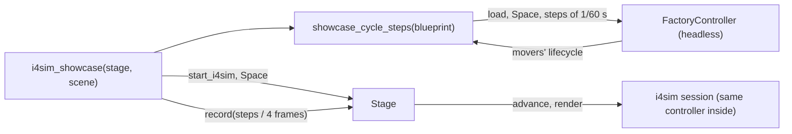

# i4sim showcase clips

Status: accepted · Branch: `feat/i4sim-showcase-clips` · Related: [media capture tool](2026-11-19-media-capture.md), [i4sim showcase shuttle](2026-11-19-i4sim-showcase-shuttle.md), [media guide](../media/README.md), [capture tool](../../tools/capture/README.md)

The gallery shows i4sim only on the MAS demonstrator. The five showcase scenes on the loadscreen's SHOWCASE page (junction crossing, corridor passing, corridor recovery, predictive passing, H crossing) are what make the traffic policies visible, and they have no clip. The user wants a video of them. This change adds five `kinetra_capture` clips, one per scene, each one full cycle of the scene, and shows them in the README gallery.

## Table of contents

- [Problem](#problem)
- [Goals and non-goals](#goals-and-non-goals)
- [Decisions](#decisions)
- [Design](#design)
- [Affected areas](#affected-areas)
- [Test plan](#test-plan)
- [Review](#review)
- [Verification](#verification)
- [Pull request](#pull-request)
- [Open points](#open-points)

[Directory guide](README.md) · [Project overview](../../README.md) · [Documentation index](../README.md)

## Problem

- The i4sim clips in [docs/media](../media/README.md#files) show `MAS-demonstrator.json` at 800 ticks per second ([scenes.cpp](../../tools/capture/src/scenes.cpp)). No capture loads a file from [blueprints/showcase/](../../labs/i4sim/blueprints/showcase/).
- Every capture clip lasts a fixed 60 frames (four seconds). A showcase scene repeats on its own cycle: a shuttle scene drives out, pauses 400 ticks, drives back and pauses again; corridor recovery runs, pauses and restarts ([blueprint guide](../../labs/i4sim/blueprints/README.md#showcase-scenes)). The cycles take between 11 and 27 seconds at 200 ticks per second, and differ per scene. A fixed length cuts a scene off, or shows a jump when the GIF loops.
- The capture tool drives the session through `kinetra::Session` and cannot see the simulation, so a script cannot tell when the movers have come back.

## Goals and non-goals

- Goal: one looping GIF per showcase scene in `docs/media`, rendered by `kinetra_capture` like the other clips.
- Goal: each clip shows exactly one cycle, so the loop looks the same as the application repeating the scene.
- Goal: the clip length follows the scene. A change in the simulation or in a blueprint needs only a refresh, not a new length by hand.
- Non-goal: an MP4 of the scenes. Not chosen by the user; GitHub does not play repository MP4 files inside the README.
- Non-goal: changing the scenes, the HUD layout or the i4sim session.

## Decisions

| Decision | Choice | Why |
| --- | --- | --- |
| Form | Five GIF clips, one per scene, in the README gallery | Chosen by the user over one MP4 or both |
| View | Debug Mode on with every visual layer, as the session starts; debug menu closed | Chosen by the user: paths, forces, borders and detection show why a mover waits, gives way or backs out |
| Length and speed | One full cycle per scene at the session's 200 ticks per second | Chosen by the user over a fixed, faster length or a single leg |
| How the length is found | Measured headless before recording: a `FactoryController`, the session's own headless half, runs the scene with the stage's seed, rate and step until the movers set off again after their last standstill | Same steps as the captured session, so the count is exact, and it follows any change to the scenes. Hard-coded lengths would go stale silently |
| End of a cycle | A shuttle cycle ends at the second departure after a standstill (out, pause, back, pause); a restarting cycle at the first (run, pause, restart) | The clip's last frame is in the final pause, and its first frame has the movers just setting off, as after the pause in the application |
| Scene names | `i4sim-showcase-<file>-clip` | Groups the files in `docs/media` and keeps the `-clip` suffix the tool requires |
| Update rate | A named `i4sim_updates_per_second` (200) in the stage, passed to `create_session` and used by the measurement | The measurement and the captured session must run at the same rate; before, the capture relied on `create_session`'s default argument |
| Clip size and rate | 960 × 540 at 15 frames per second, as the other clips | One encoding for all clips; the five GIFs are about 2.7 MB together |

## Design

*Takeaway:* the measurement replays the scene headless with the same inputs and steps, so the recording knows its length before it starts.

- **`showcase.h`**: `int showcase_cycle_steps(const std::filesystem::path &blueprint)`. It reads the scenario (`load_scenario`), rejects a blueprint without a repeating scenario, loads the blueprint into a `FactoryController(capture_seed, paused, i4sim_updates_per_second)`, advances one step with Space and then steps without input, as the session's frame does (`begin_frame`, `suspend(false)`, `handle_input`). After each step it checks whether any mover is `moving()`. A departure is a step with a moving mover after a step in which every mover stood still; the function returns the step of the second departure for a shuttle and of the first for a restart. It gives up after 120 seconds of steps.
- **Script** `i4sim_showcase(stage, scene)`: starts `showcase/<scene>.json` with `Stage::start_i4sim`, measures, presses Space and records `steps / Stage::steps_per_frame` frames without input. The last frame therefore falls in the final standstill.
- **Scenes**: five clip entries in `scenes()`, after the i4sim clips, each a captureless lambda that names its file.
- **Script and encoding**: unchanged. `capture_media.sh` encodes every clip directory it finds.

## Affected areas

- `tools/capture/src/`: new `showcase.h` and `showcase.cpp`; `scenes.cpp` (five scenes and their script), `stage.h` and `stage.cpp` (the named update rate).
- `tools/capture/CMakeLists.txt`: the new source; `tests/capture_tests.cpp` and `tests/smoke.cmake`.
- `docs/media/`: five new GIFs, the media guide.
- `README.md` gallery, `tools/capture/README.md`, `labs/i4sim/blueprints/README.md` (link to the clips).
- Level: Full with graphics (a graphics tool and its smoke test change).

## Test plan

| Behavior | Test | Level |
| --- | --- | --- |
| A shuttle cycle holds both pauses, a restart cycle one; the count is the same on every run | `kinetra_capture_tests`: `showcase_cycle_steps` for every file in `blueprints/showcase/`, at least two (shuttle) or one (restart) pause of 120 steps, and equal on a second call | Targeted |
| A blueprint without a repeating scenario, or a missing file, is rejected | `kinetra_capture_tests`: `MAS-demonstrator.json` throws `std::invalid_argument`, a missing file `std::runtime_error` | Targeted |
| The five scenes exist, are clips, and have their GIFs in `docs/media`, the media guide and the gallery | The scene-list cases in `kinetra_capture_tests`, with the five names added | Targeted |
| A showcase scene renders end to end and starts from the catalog's subdirectory | `kinetra_capture_smoke` also runs `i4sim-showcase-junction-crossing-clip` and checks its frames | Full with graphics |
| The clips show one full cycle and loop cleanly | Run `capture_media.sh` for the five scenes; inspect the first, middle and last frames of each | Manual, recorded below |

## Review

To be filled in after the review.

## Verification

To be filled in after verification.

## Pull request

To be filled in at the end.

## Open points

- At 960 × 540 the HUD's description and statistics lines overlap the lower edge of the fitted floor, and in the H crossing the producers below it. This is the session's layout at that window size, not the capture's; the camera fit does not leave room for the HUD.
