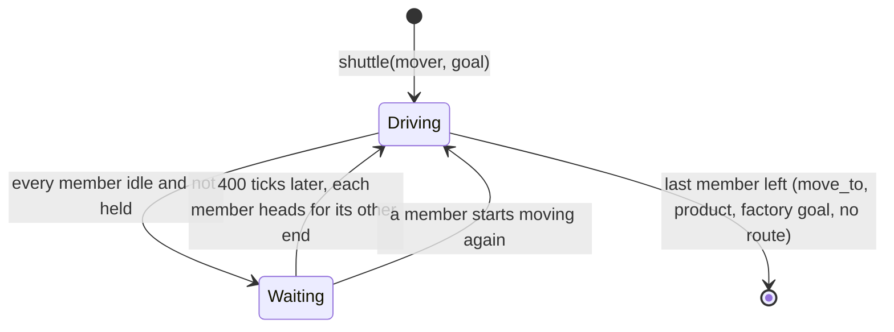

# i4sim showcase shuttle and a smaller catalog

Status: accepted · Branch: `feat/i4sim-showcase-shuttle` · Related: [i4sim showcase scenes](2026-11-19-i4sim-showcase.md), [blueprints](../../labs/i4sim/blueprints/README.md), [i4sim](../../labs/i4sim/README.md)

A showcase scene shows its traffic situation once: both movers reach their goals and stand still. The user wants the movers to drive back and forth, so one scene shows the situation again and again. The user also wants seven city blueprints removed from the catalog. This change adds a shuttle mode to the simulation, a `shuttle` property to the scenario section, and removes the seven blueprints.

## Table of contents

- [Problem](#problem)
- [Goals and non-goals](#goals-and-non-goals)
- [Decisions](#decisions)
- [Design](#design)
- [Affected areas](#affected-areas)
- [Test plan](#test-plan)
- [Review](#review)
- [Verification](#verification)
- [Pull request](#pull-request)
- [Open points](#open-points)

[Directory guide](README.md) · [Project overview](../../README.md) · [Documentation index](../README.md)

## Problem

- `apply_scenario` ([scenario.cpp](../../labs/i4sim/src/scenario.cpp)) sends each goal once through `Simulation::move_to`. On arrival the motion step makes the mover idle and its goal automatic ([motion_step.cpp](../../labs/i4sim/src/motion_step.cpp)); with the workload off nothing sends it anywhere again. A scene therefore ends after one encounter; the viewer has to press `R` to see it again.
- The catalog holds fourteen top-level blueprints. Seven of them are city aliases (`Istanbul`, `London`, `Madrid`, `Moskou`, `New York`, `Paris`, `Rijn-Ruhrgebied`) that the user no longer wants listed.

## Goals and non-goals

- Goal: in a showcase scene, the movers drive back and forth between their start and their goal for as long as the scene runs, so the encounter repeats.
- Goal: every repetition looks like the first one, so the movers stay in step.
- Goal: deterministic, like the rest of the simulation: the same blueprint, seed, settings and commands give the same run, regardless of frame rate.
- Goal: the catalog holds the seven remaining originals: `1680x960+`, `1680x960-`, `3840x2400`, `4320x2400`, `8640x4800`, `H` and `MAS-demonstrator`.
- Non-goal: shuttling in the debug menu or with the mouse; only a scenario starts it.
- Non-goal: more than two ends per mover, or a pause per scene.

## Decisions

| Decision | Choice | Why |
| --- | --- | --- |
| When movers turn | Together: a mover that arrives waits until every shuttling mover has arrived; then all turn at once | User's choice. Turning one by one lets the movers drift out of step, so the encounter could stop happening |
| Pause at an end | 400 ticks: two seconds at the default 200 ticks per second | User's choice (2 s). Counted in ticks, so it scales with the update rate like every other duration and stays deterministic |
| How a scene turns it on | Optional `"shuttle": true` in the `scenario` section, default `false` | User's choice. Existing scenario files keep their meaning; a scene that cannot repeat can leave it off |
| Where the turning happens | In the simulation tick (`Simulation::shuttle`), not in the session | The session advances by frame time, many ticks per call; turning there would depend on the frame rate and break deterministic replay |
| The other end | The mover's position when `shuttle` is called | In a scenario that is the start position from the blueprint; no second coordinate in the format |
| Leaving the shuttle | A new manual goal (`move_to`), a product, a factory goal, or a leg without a route removes that mover; the others carry on | The operator stays in control, and a mover that cannot complete a leg must not hold the others forever |
| A held mover | The group waits until it is released | Holding is a temporary operator action; the scene resumes in step afterwards |
| City blueprints | Deleted from `labs/i4sim/blueprints/` | User's choice |

## Design

- A private `Shuttle` component ([src/shuttle.h](../../labs/i4sim/src/shuttle.h)) holds the members (mover index, both ends, the end it heads for) and the tick at which all members were last seen arrived. `SimulationCore` owns it and updates it as the last step of every tick.
- `Simulation::shuttle(index, destination)` sends the mover like `move_to` and, on success, adds it with its current position as the other end. `Simulation::move_to` removes the mover from the shuttle first. `Simulation::shuttling(index)` reports membership.
- Each tick, the update first removes members that left: unreachable, carrying a product, or moving under a goal that is not manual. When every remaining member is idle and not held, it notes the tick; 400 ticks later it sends each member to its other end through the same checks as `move_to`. A member whose leg is rejected leaves.
- `Scenario::shuttle` makes `apply_scenario` call `shuttle` instead of `move_to`. `R` re-applies the scenario, so a replay shuttles again.
- `shuttle_pause_ticks` is public in [simulation.h](../../labs/i4sim/include/simulation.h), so tests and docs name the pause.

## Affected areas

- Logic: `labs/i4sim/include/simulation.h`, `scenario.h`; `labs/i4sim/src/simulation.cpp`, `simulation_core.{h,cpp}`, new `shuttle.{h,cpp}`, `scenario.cpp`; `labs/i4sim/CMakeLists.txt`.
- Data: the four `blueprints/showcase/*.json` get `"shuttle": true` where the scene can repeat; seven top-level blueprints are deleted.
- Tests: `simulation_tests.cpp` (shuttle cases, scenario cases, catalog count), `relocation_tests.cmake` (case name).
- Docs: `labs/i4sim/README.md`, `blueprints/README.md`, `tests/README.md`, `src/README.md`, `blueprint.cpp` comment, [factory simulation architecture](../factory-simulation-architecture.md) if it lists the tick order.

## Test plan

| Behavior | Test | Level |
| --- | --- | --- |
| Shuttling movers wait for each other, pause 400 ticks, turn together and reach their start | `simulation_tests`: shuttling movers turn together after the pause | Targeted |
| `move_to` ends shuttling for that mover only; a rejected `shuttle` changes nothing | `simulation_tests`: a manual goal ends shuttling | Targeted |
| `"shuttle"` is read, defaults to false and rejects a non-boolean | `simulation_tests`: invalid scenario and scenario-load cases | Targeted |
| Each shuttling scene still runs exactly like its hand-built setup, now past a turn | `simulation_tests`: each showcase scene runs exactly like its hand-configured setup | Targeted |
| Each shuttling scene repeats: every mover reaches both ends several times | `simulation_tests`: new case over the showcase files | Targeted |
| Seven originals load; relocated bundle still found | `simulation_tests` catalog case, `relocation_tests.cmake` | Targeted |
| Session: SHOWCASE scene loads, runs, `R` replays | `presentation_tests` (unchanged) | Full with graphics |

The session changes no code, but the loadscreen rows change; the branch ends at the Full level with the graphics preset.

## Review

To be filled in.

## Verification

To be filled in.

## Pull request

To be filled in.

## Open points

- None yet.
