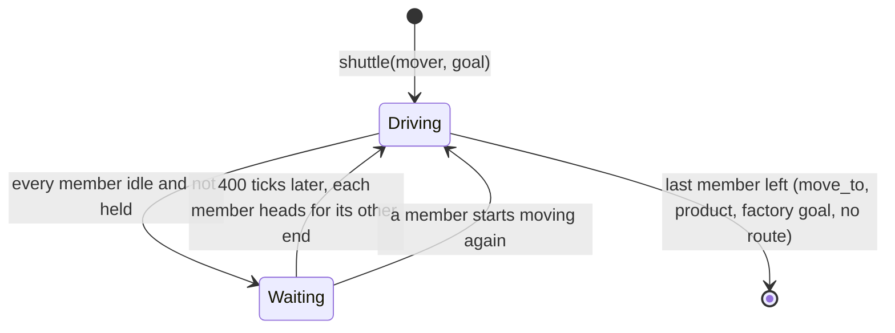

# i4sim showcase shuttle and a smaller catalog

Status: implemented · Branch: `feat/i4sim-showcase-shuttle` · Related: [i4sim showcase scenes](2026-11-19-i4sim-showcase.md), [blueprints](../../labs/i4sim/blueprints/README.md), [i4sim](../../labs/i4sim/README.md)

A showcase scene shows its traffic situation once: both movers reach their goals and stand still. The user wants the movers to drive back and forth, so one scene shows the situation again and again. The user also wants seven city blueprints removed from the catalog. This change adds a shuttle mode to the simulation, a `repeat` property to the scenario section (shuttle, or restart for the one scene that cannot drive back), and removes the seven blueprints.

## Table of contents

- [Problem](#problem)
- [Goals and non-goals](#goals-and-non-goals)
- [Decisions](#decisions)
- [Design](#design)
- [Affected areas](#affected-areas)
- [Test plan](#test-plan)
- [Review](#review)
- [Verification](#verification)
- [Pull request](#pull-request)
- [Open points](#open-points)

[Directory guide](README.md) · [Project overview](../../README.md) · [Documentation index](../README.md)

## Problem

- `apply_scenario` ([scenario.cpp](../../labs/i4sim/src/scenario.cpp)) sends each goal once through `Simulation::move_to`. On arrival the motion step makes the mover idle and its goal automatic ([motion_step.cpp](../../labs/i4sim/src/motion_step.cpp)); with the workload off nothing sends it anywhere again. A scene therefore ends after one encounter; the viewer has to press `R` to see it again.
- The catalog holds fourteen top-level blueprints. Seven of them are city aliases (`Istanbul`, `London`, `Madrid`, `Moskou`, `New York`, `Paris`, `Rijn-Ruhrgebied`) that the user no longer wants listed.

## Goals and non-goals

- Goal: in a showcase scene, the movers drive back and forth between their start and their goal for as long as the scene runs, so the encounter repeats.
- Goal: every repetition looks like the first one, so the movers stay in step.
- Goal: deterministic, like the rest of the simulation: the same blueprint, seed, settings and commands give the same run, regardless of frame rate.
- Goal: the catalog holds the seven remaining originals: `1680x960+`, `1680x960-`, `3840x2400`, `4320x2400`, `8640x4800`, `H` and `MAS-demonstrator`.
- Non-goal: shuttling in the debug menu or with the mouse; only a scenario starts it.
- Goal: corridor recovery, whose movers cannot drive back, repeats its retreat by starting again from its blueprint.
- Non-goal: more than two ends per mover, or a pause per scene.

## Decisions

| Decision | Choice | Why |
| --- | --- | --- |
| When movers turn | Together: a mover that arrives waits until every shuttling mover has arrived; then all turn at once | User's choice. Turning one by one lets the movers drift out of step, so the encounter could stop happening |
| Pause at an end | 400 ticks: two seconds at the default 200 ticks per second | User's choice (2 s). Counted in ticks, so it scales with the update rate like every other duration and stays deterministic |
| How a scene turns it on | Optional `"repeat"` in the `scenario` section: `"none"` (default), `"shuttle"` or `"restart"` | User's choice of a per-scene JSON field. One value with three states instead of two booleans that would exclude each other; existing scenario files keep their meaning |
| Corridor recovery | `"repeat": "restart"`: after the same pause the session rebuilds the scene from its blueprint | User's choice. Measured: shuttling deadlocks on the return leg, because both start places lie inside the corridor and the first mover admitted parks there. Swapping priority does not help; the retreat only arises from the start state |
| Where the restart happens | In the session, as `R` does, but keeping speed and run state; `RestartTimer` in the logic decides when | A restart needs a new simulation, which only the session owns. The decision stays headless and testable. The batch mode does not restart |
| Where the turning happens | In the simulation tick (`Simulation::shuttle`), not in the session | The session advances by frame time, many ticks per call; turning there would depend on the frame rate and break deterministic replay |
| The other end | The mover's position when `shuttle` is called | In a scenario that is the start position from the blueprint; no second coordinate in the format |
| Leaving the shuttle | A new manual goal (`move_to`), a product, a factory goal, or a leg without a route removes that mover; the others carry on | The operator stays in control, and a mover that cannot complete a leg must not hold the others forever |
| A held mover | The group waits until it is released | Holding is a temporary operator action; the scene resumes in step afterwards |
| City blueprints | Deleted from `labs/i4sim/blueprints/` | User's choice. Each was, apart from its name, identical to a remaining blueprint (Istanbul = 3840x2400, London = 4320x2400, Madrid = H, Moskou = 1680x960+, New York = 8640x4800, Paris = 1680x960-, Rijn-Ruhrgebied = MAS-demonstrator) |
| Stale catalog copies | The build copy and the relocation test remove their old copy first | Without it, deleted blueprints stayed in every existing build directory and the catalog test still counted fourteen |

## Design

- A private `Shuttle` component ([src/shuttle.h](../../labs/i4sim/src/shuttle.h)) holds the members (mover index, both ends, the end it heads for) and the tick at which all members were last seen arrived. `SimulationCore` owns it and updates it as the last step of every tick.
- `Simulation::shuttle(index, destination)` sends the mover like `move_to` and, on success, adds it with its current position as the other end. `Simulation::move_to` removes the mover from the shuttle first. `Simulation::shuttling(index)` reports membership.
- Each tick, the update first removes members that left: unreachable, carrying a product, or moving under a goal that is not manual. When every remaining member is idle and not held, it notes the tick; 400 ticks later it sends each member to its other end through the same checks as `move_to`. A member whose leg is rejected leaves.
- `Scenario::repeat == ScenarioRepeat::shuttle` makes `apply_scenario` call `shuttle` instead of `move_to`. `R` re-applies the scenario, so a replay shuttles again.
- For `ScenarioRepeat::restart`, the session asks a `RestartTimer` after every advance whether every mover has stood idle for `shuttle_pause_ticks`; then it runs the same reset as `R` (extracted to `FactorySession::reset`), restores the update rate and keeps the scene running.
- `shuttle_pause_ticks` is public in [simulation.h](../../labs/i4sim/include/simulation.h), so tests and docs name the pause.

## Affected areas

- Logic: `labs/i4sim/include/simulation.h`, `scenario.h`; `labs/i4sim/src/simulation.cpp`, `simulation_core.{h,cpp}`, new `shuttle.{h,cpp}`, `scenario.cpp`.
- Presentation: `labs/i4sim/src/session.cpp` (reset extracted, automatic restart).
- Build: `labs/i4sim/CMakeLists.txt` (new source, catalog mirrored), `tests/relocation_tests.cmake`.
- Data: three showcase scenes get `"repeat": "shuttle"`, corridor recovery `"repeat": "restart"`; seven top-level blueprints are deleted.
- Tests: `simulation_tests.cpp` (shuttle, repeat and restart cases, catalog count), `presentation_tests.cpp` (restart in the session).
- Docs: `labs/i4sim/README.md`, `blueprints/README.md`, `tests/README.md`, `src/README.md`, `blueprint.cpp` comment, [factory simulation architecture](../factory-simulation-architecture.md) (component table, tick order), [media](../media/README.md).

## Test plan

| Behavior | Test | Level |
| --- | --- | --- |
| Shuttling movers wait for each other, pause 400 ticks, turn together and reach their start | `simulation_tests`: shuttling movers turn together after the pause | Targeted |
| `move_to` ends shuttling for that mover only; a rejected `shuttle` changes nothing | `simulation_tests`: a manual goal ends shuttling | Targeted |
| `"repeat"` is read case-insensitively, defaults to `none` and rejects a non-string or unknown value | `simulation_tests`: invalid scenario case | Targeted |
| Corridor recovery shows its retreat and its restart is due exactly one pause after its movers settle | `simulation_tests`: a restarting scene is due once its movers have stood still for the pause | Targeted |
| The session restarts corridor recovery by itself and keeps it running | `presentation_tests` | Full with graphics |
| Each shuttling scene still runs exactly like its hand-built setup, now past a turn | `simulation_tests`: each showcase scene runs exactly like its hand-configured setup | Targeted |
| Each shuttling scene repeats: every mover reaches both ends several times | `simulation_tests`: new case over the showcase files | Targeted |
| Seven originals load; relocated bundle still found | `simulation_tests` catalog case, `relocation_tests.cmake` | Targeted |
| Session: SHOWCASE scene loads, runs, `R` replays | `presentation_tests` | Full with graphics |

The session, the build and several modules change, so the branch ends at the Full level with the graphics preset.

## Review

`/code-review` (high) on `main...HEAD` reported six findings:

| Finding | Resolution |
| --- | --- |
| `cmake -E rm` needs CMake 3.17; the minimum is 3.16 | Fixed: `cmake -E remove_directory` |
| The manual-goal shuttle test assumed both movers arrive within one pause of each other | Fixed: each mover is checked from its own arrival |
| A restart scene with the workload on never restarts, because every mover must settle | Fixed in the docs (`RestartTimer`, blueprint README); all scenes disable the workload |
| `RestartTimer` counts the pause from the first frame that sees the movers settled, so it can run up to one frame long | Kept and documented: the restart itself is a fresh simulation, so the run stays deterministic; only the moment of the restart varies by a frame |
| The automatic restart clears the selected mover and producer | Kept: a restart is a new scene, as with `R` |
| The presentation check uses measured ticks (settle near 2200, restart at 2600) | Kept: the comment states them; the headless restart case pins the exact timing |

## Verification

Full level, on the final branch state (the last commit only reformats; the i4sim suites ran again after it).

| Command | Result |
| --- | --- |
| `cmake --workflow --preset ci` | Passed: 154 of 154 tests; no compiler warnings in the log |
| `cmake --workflow --preset headless` | Passed: 147 of 147 tests |
| `cmake --workflow --preset graphics` | Passed: 167 of 167 tests, including `kinetra_i4sim_graphics` with the restart check |
| `ctest --preset release -R '^kinetra_i4sim'` after the review and format commits | Passed: 84 of 84 |
| Smoke runs from the [README](../../README.md#tests-and-resources) with `SDL_VIDEODRIVER=offscreen LIBGL_ALWAYS_SOFTWARE=1`, plus `kinetra_i4sim --blueprint …/showcase/corridor-recovery.json --run --frames 600` and the same for junction-crossing | All exit 0 |
| `git ls-files -- '*.h' '*.cpp' \| xargs clang-format --dry-run --Werror` | Clean |
| `python3 external/Kinetra/tools/check_docs.py` | All links resolve |

Run outside CTest, the presentation test fails its pixel checks in WSLg (also on the unchanged code), because it then renders to the desktop instead of offscreen. A temporary log line in the session confirmed the restart there: corridor recovery restarts at tick 2600, running, at the same rate.

Not verified: the Windows build (no Windows-specific code changed) and a visual check on a desktop.

## Pull request

Title: `feat(i4sim): repeat the showcase scenes and trim the blueprint catalog`

**Summary.** The i4sim showcase scenes now repeat. In junction crossing, corridor passing and predictive passing the movers drive back and forth between start and goal; they wait for each other, stand two seconds (400 ticks) and turn together, so the traffic situation repeats on every leg. Corridor recovery cannot drive back (its movers start inside the corridor), so it restarts from its blueprint after the same pause. The seven city blueprints (Istanbul, London, Madrid, Moskou, New York, Paris, Rijn-Ruhrgebied), each identical to a remaining layout, are removed.

**Changes.**
- Simulation: `Simulation::shuttle` and `shuttling`, `shuttle_pause_ticks`; a private `Shuttle` component turns the movers at the end of each tick, so replays stay deterministic. `move_to` ends shuttling for that mover.
- Scenario format: optional `"repeat": "none" | "shuttle" | "restart"`; `RestartTimer` decides when a restarting scene starts again.
- Session: the `R` reset is extracted (refactor commit); a restarting scene resets itself and keeps its speed and run state.
- Catalog: seven blueprints deleted; the build copy and the relocation test now mirror the catalog instead of adding to an old copy.
- Tests and docs: shuttle, repeat and restart cases; module, blueprint, tests, sources and architecture docs.

**Design.** [docs/design/2026-11-19-i4sim-showcase-shuttle.md](2026-11-19-i4sim-showcase-shuttle.md)

**Verification.** `cmake --workflow --preset ci` (154/154), `headless` (147/147), `graphics` (167/167), README smoke runs, clang-format, docs check. Details in the design document.

**Review notes.** `/code-review` found six points; three fixed (CMake 3.16 compatibility, an order-dependent test, a documented restart precondition), three kept with reasons in the design document. The loadscreen screenshot predates the smaller catalog.

**Dependencies and merge order.** None; Lab only, no Kinetra change.

**Follow-up.** Refresh `docs/media/launcher-loadscreen.png`; decide whether `R` should keep the update rate as the automatic restart does.

## Open points

- `R` resets the update rate to 200 ticks per second (the new simulation is not given the session's rate); the automatic restart keeps it. Pre-existing, not changed here.
- [launcher-loadscreen.png](../media/launcher-loadscreen.png) predates the smaller catalog; refresh it with the next media pass.
- Measured while designing: shuttling corridor recovery deadlocks on the return leg (one leg done in 40000 ticks); the restart mode exists for this reason.
