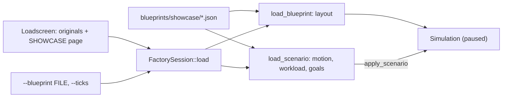

# i4sim showcase scenarios

Status: accepted · Branch: `feat/i4sim-showcase` · Related: [i4sim](../../labs/i4sim/README.md), [blueprints](../../labs/i4sim/blueprints/README.md), [i4sim verification](../../labs/i4sim/tests/README.md)

The i4sim presentation test drives four traffic scenes (a junction crossing, corridor passing, a corridor retreat and predictive passing) by clicking through the debug menu and setting goals with the mouse. The user wants to show these scenes in the application itself. This change lets a blueprint carry a `scenario` section (steering profile, coordination features, workload and mover goals) and adds a SHOWCASE entry to the loadscreen that opens the four scenes ready to run.

## Table of contents

- [Problem](#problem)
- [Goals and non-goals](#goals-and-non-goals)
- [Decisions](#decisions)
- [Design](#design)
- [Affected areas](#affected-areas)
- [Test plan](#test-plan)
- [Review](#review)
- [Verification](#verification)
- [Pull request](#pull-request)
- [Open points](#open-points)

[Directory guide](README.md) · [Project overview](../../README.md) · [Documentation index](../README.md)

## Problem

- The scenes exist only as test fixtures in [labs/i4sim/tests/](../../labs/i4sim/tests/): `junction-crossing.json`, `corridor-passing.json`, `corridor-recovery.json` and `predictive-passing.json`. They are not copied next to the executables.
- A fixture holds only the factory layout. The setup lives in test code: [presentation_tests.cpp](../../labs/i4sim/tests/presentation_tests.cpp) cycles the PROFILE row three times, toggles a coordination row, presses G and shift-clicks a goal for each mover; [golden_tests.cpp](../../labs/i4sim/tests/golden_tests.cpp) calls `configure_motion`, sets `workload = false` and calls `move_to`.
- Loading a fixture with `--blueprint` therefore shows two idle movers; reproducing the scene by hand needs about fifteen exact clicks.

## Goals and non-goals

- Goal: the four presentation-test scenes open from the loadscreen, ready to run with Space.
- Goal: the fourteen original blueprints stay unchanged, and the catalog still shows them as before.
- Goal: one copy of each scene. The tests and the showcase read the same file.
- Goal: `R` replays a scene, keeping the motion settings in use, so a setting can be compared against the original run.
- Non-goal: the four `pressure-*` fixtures. They need per-profile variants; see [Open points](#open-points).
- Non-goal: timed steps inside a scenario, such as the golden corridor-recovery run that switches corridor traffic on after 1500 ticks.
- Non-goal: speed, force and horizon in the scenario; every scene uses the defaults.

## Decisions

| Decision | Choice | Why |
| --- | --- | --- |
| Where the setup lives | An optional `scenario` section in the blueprint JSON | User's choice. One file per scene; the format stays readable by `load_blueprint`, which ignores the section |
| How the scenes appear | A SHOWCASE row on the loadscreen whose second page lists the scenes; the originals stay untouched | User's choice. `LaunchMenu` already offers a second page per row (`LaunchChoice::configurations`), so no engine change is needed |
| Position of the SHOWCASE row | Last, after the originals | Keeps the original catalog pages and the loadscreen screenshot unchanged; the Up key wraps to it in one press |
| Files | Move the four fixtures from `tests/` to `blueprints/showcase/`; tests read them there | One copy; CMake already copies `blueprints/` recursively next to the executables. Discovery is not recursive, so the catalog keeps fourteen entries |
| Goal reference | The mover `id` as written in the `movers` array | The loader prefixes IDs with the model (`APM4220_west`); authors write `west`. Ambiguous IDs are rejected |
| Goal coordinates | Center of the goal, in millimeters | That is what `Simulation::move_to` and the existing tests use. Blueprint positions are top-left corners, so the docs state the difference |
| Unknown properties in `scenario` | Rejected | A misspelled `junctionTraffic` would silently produce a different scene. The rest of the blueprint keeps its lenient original behavior |
| Scenario in batch mode (`--ticks`) | Applied | A scene behaves the same with and without a window |
| `R` on a scene | New simulation, motion settings in use, the scenario's goals and workload | Lets the viewer turn a feature off and replay; without a scenario `R` behaves as before |
| Presentation test | Loads copies without the `scenario` section | The test checks the debug-menu and Shift-click setup; a scenario applied first would change what the clicks do |

## Design

*Takeaway:* the scenario is applied once after the layout is loaded; the simulation itself knows nothing about scenarios.

- `scenario.h` declares `Scenario`, `load_scenario(path)` (std::nullopt without a section) and `apply_scenario(scenario, simulation)`. `scenario.cpp` reuses the JSON readers that move from `blueprint.cpp` to the private `json_fields.h`.
- `FactorySession` keeps the catalog files and the showcase files apart. `choices()` appends one SHOWCASE row whose configurations are the scene names; a selection on that row loads `showcase_files_[configuration]`.
- `load()` applies the scenario before the simulation replaces the current one, so a bad goal leaves the previous state and shows the error.
- The scene's description is drawn above the statistics lines.

## Affected areas

- New: [scenario.h](../../labs/i4sim/include/scenario.h), [scenario.cpp](../../labs/i4sim/src/scenario.cpp), [json_fields.h](../../labs/i4sim/src/json_fields.h), [tests/showcase.h](../../labs/i4sim/tests/showcase.h).
- [blueprint.cpp](../../labs/i4sim/src/blueprint.cpp), [session.cpp](../../labs/i4sim/src/session.cpp), [main.cpp](../../labs/i4sim/src/main.cpp), [CMakeLists.txt](../../labs/i4sim/CMakeLists.txt).
- Moved: the four fixtures to [blueprints/showcase/](../../labs/i4sim/blueprints/showcase/), each with a `scenario` section.
- Tests: [simulation_tests.cpp](../../labs/i4sim/tests/simulation_tests.cpp), [golden_tests.cpp](../../labs/i4sim/tests/golden_tests.cpp), [presentation_tests.cpp](../../labs/i4sim/tests/presentation_tests.cpp).
- Docs: [blueprints README](../../labs/i4sim/blueprints/README.md) (the format), [i4sim README](../../labs/i4sim/README.md), [tests README](../../labs/i4sim/tests/README.md), the `include/` and `src/` READMEs.

The blueprint format is a contract ([AGENTS.md](../../AGENTS.md#lab-boundaries)). The change is additive: existing files load as before, and `load_blueprint` ignores the new section.

## Test plan

| Behavior | Test | Level |
| --- | --- | --- |
| Moving the fixtures changes no run | The ten golden lines stay identical | Targeted (`^kinetra_i4sim`) |
| The bundle holds four scenes; each has a description, disables the workload, sends both goals and leaves the simulation paused | `kinetra_i4sim:the bundled showcase holds four scenes whose scenarios load and apply` | Targeted |
| An original blueprint has no scenario | `kinetra_i4sim:an original blueprint has no scenario` | Targeted |
| Each scene equals the hand-built setup of the tests, tick for tick | `kinetra_i4sim:each showcase scene runs exactly like its hand-configured setup` (2000 ticks, Recorder summary) | Targeted |
| Unknown keys, an unknown profile, a non-boolean, an unknown mover and a rejected goal fail with their cause; names are case-insensitive | `kinetra_i4sim:an invalid scenario is rejected with its cause` | Targeted |
| The SHOWCASE page loads a scene paused with its setup; it runs with corridor traffic; `R` restarts it | `kinetra_i4sim_graphics`, new block at the end | Graphics |
| The clicked setup of the existing presentation checks still works | `kinetra_i4sim_graphics`, unchanged checks on scenario-free copies | Graphics |
| The catalog still holds fourteen originals, also when relocated | `kinetra_i4sim:the bundled catalog holds fourteen blueprints that all load`, `kinetra_i4sim_relocation` | Targeted |

Session and `main.cpp` change, so the level is Full with graphics.

## Review

To be filled after the review.

## Verification

To be filled after verification.

## Pull request

Title: `feat(i4sim): showcase the presentation-test scenes from the loadscreen`

**Summary.** The four traffic scenes of the i4sim presentation test (junction crossing, corridor passing, corridor retreat, predictive passing) now open from a SHOWCASE page on the loadscreen and play with Space. A blueprint may carry an optional `scenario` section with the steering profile, coordination features, workload and mover goals; the fourteen original blueprints are unchanged.

**Changes.**
- i4sim logic: `scenario.h`/`scenario.cpp` (`load_scenario`, `apply_scenario`); JSON readers moved to `json_fields.h`.
- Blueprints: the four fixtures move from `tests/` to `blueprints/showcase/` and gain a `scenario` section.
- Session: SHOWCASE row with the scenes as its second page; scenes load with their setup, show their description, and `R` replays them with the motion settings in use. Batch mode applies scenarios too.
- Tests: scenario contract cases, a tick-for-tick comparison with the hand-built setup, a loadscreen check; the presentation test sets up scenario-free copies by hand as before.
- Docs: the `scenario` format in the blueprints README; i4sim, tests, include and src READMEs.

**Design.** [docs/design/2026-11-19-i4sim-showcase.md](2026-11-19-i4sim-showcase.md).

**Verification.** See the design document.

**Review notes.** The blueprint format gains an optional section; existing files are unaffected. Unknown properties inside `scenario` are rejected on purpose. The two refactor commits (JSON readers, fixture move) change no behavior; the golden lines prove the move.

**Dependencies and merge order.** None; Lab only.

**Follow-up.** Showcase versions of the four `pressure-*` fixtures.

## Open points

- The `pressure-*` fixtures run under both Reciprocal and Improved in their tests; as showcase scenes they need one file per profile, or a profile choice on the scene page.
- The corridor-recovery golden run switches corridor traffic on after 1500 ticks. A scenario has no timed steps; the showcase scene enables it from the start, as the presentation test does.
