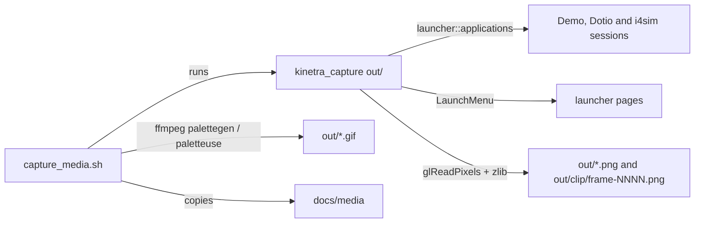

# Media capture tool

Status: accepted · Branch: `feat/media-capture` · Related: [media guide](../media/README.md), [i4sim debug menu](2026-11-19-i4sim-debug-menu.md)

The screenshots in the README gallery are hand-made window captures from different days, and only the i4sim debug capture is current. The user wants a recent screenshot of every application and short demo clips. This change adds `kinetra_capture`, a graphics tool that runs each application offscreen with a fixed seed and scripted input and writes every screenshot plus the frames of six short clips. A script assembles the clips into looping GIFs with ffmpeg and puts everything into `docs/media`, so a refresh is one command.

## Table of contents

- [Problem](#problem)
- [Goals and non-goals](#goals-and-non-goals)
- [Decisions](#decisions)
- [Design](#design)
- [Affected areas](#affected-areas)
- [Test plan](#test-plan)
- [Review](#review)
- [Verification](#verification)
- [Pull request](#pull-request)
- [Open points](#open-points)

[Directory guide](README.md) · [Project overview](../../README.md) · [Documentation index](../README.md)

## Problem

- `launcher.png`, `launcher-difficulty.png`, `demo.png`, `demo-debug.png`, `dotio.png`, `dotio-debug.png`, `dotio-settings.png` and `i4sim.png` date from 2026-11-15 ([media guide](../media/README.md#capture-details)). They were taken by hand at about 1915 × 1055, with seeds and options not recorded, so nobody can reproduce or refresh them exactly.
- `i4sim-debug.png` and `launcher-loadscreen.png` were rendered offscreen by one-off code that was not kept.
- There are no short clips. The only video is the 2 min 14 s tour (62 MB), which GitHub does not play inside the README.

## Goals and non-goals

- Goal: one command refreshes every screenshot and clip from the current code, deterministically (fixed seed, fixed frame time, offscreen software rendering).
- Goal: a screenshot of the normal and the debug view of Demo, Dotio and i4sim, plus the launcher, the Dotio difficulty page, the i4sim loadscreen and the Dotio settings panel, as today.
- Goal: six looping GIFs that play inside the README: normal and debug view of each application, a few seconds each.
- Goal: the tool keeps compiling and running, because CI builds it and a graphics test runs one scene.
- Non-goal: replacing the tour video.
- Non-goal: a screenshot or recording feature inside the applications or the launcher.
- Non-goal: Windows support for the tool. It builds wherever zlib is found; the script needs bash and ffmpeg.

## Decisions

| Decision | Choice | Why |
| --- | --- | --- |
| Clips | Looping GIFs in the README gallery, one per view (six) | Chosen by the user. GitHub plays GIFs inline, not MP4 files from the repository |
| Approach | A tool in the repository, not one-off captures | Chosen by the user: the next refresh is one command |
| GIF encoding | ffmpeg (two-pass `palettegen` / `paletteuse`) in a script | Chosen by the user, who updates the system to install ffmpeg (the package database was too old for a plain install). The tool stays free of video code |
| PNG writing | The tool writes PNGs with zlib | Chosen by the user. zlib is on every Linux system; without it the tool is not built and nothing else changes |
| Where | `tools/capture/` in Lab, target `kinetra_capture`, a composition root | It drives all three applications through the launcher's registrations, so it belongs next to the launcher, not in an application or in Kinetra |
| Frame read-back | `glReadPixels` from the front buffer after the session's `render`, as the graphics tests do | Same method the tests already rely on with SDL offscreen and software Mesa. A `Runtime` read-back helper in Kinetra is an open point |
| Sizes | Screenshots 1920 × 1080; clips rendered at 960 × 540, 15 frames per second | The bitmap font stays sharp when rendered at the final size instead of scaled down. Size budget: about 5 MB per GIF; the six are about 2 MB together |
| Time steps | 1/60 s per step, four steps per clip frame | With 1/15 s steps the statistics showed "FPS 15", which is wrong for a gallery |
| Offscreen | The tool sets `SDL_VIDEODRIVER=offscreen` and `LIBGL_ALWAYS_SOFTWARE=1` unless the caller set them | Front-buffer reads are only reliable offscreen, and software Mesa gives the same pixels on every machine |
| Scripts | Each scene is a short function of scripted `Input` frames, through the same `advance` / `render` calls the launcher makes | The captures show the real sessions; clicks on settings and debug rows use the overlays' public layout, as the graphics tests do |

## Design

*Takeaway:* the C++ tool only drives sessions and writes PNG files; the script owns ffmpeg and the copy into the repository.

- **`kinetra_capture <output-dir> [scene...]`** creates one `Runtime` per scene (only one may exist at a time) at the scene's size, runs its script and writes `<scene>.png` for a screenshot or `<scene>/frame-0001.png` onwards for a clip. Without scene names it runs all. Unknown names are an error.
- **Scenes**: `launcher`, `launcher-difficulty`, `launcher-loadscreen`, `demo`, `demo-debug`, `dotio`, `dotio-debug`, `dotio-settings`, `i4sim`, `i4sim-debug` as screenshots, and `demo-clip`, `demo-debug-clip`, `dotio-clip`, `dotio-debug-clip`, `i4sim-clip`, `i4sim-debug-clip` as clips. Sessions come from `launcher::applications` with seed 42 and the default Demo agent count and Dotio difficulty, so they match the bundled launcher.
- **Script helpers**: key presses, clicks at screen points, a click on a settings row (located through a mirror `SettingsOverlay` with the same Lab rows) and on a debug-menu row (`DebugMenu::row_top`). Every step advances by a fixed 1/60 s, as a 60 Hz display does, so the statistics show real rates; a clip frame is four steps, so clips play at 15 frames per second. The tool writes the rate next to the frames for the encoder.
- **Normal and debug view**: Demo and i4sim start in Debug Mode, so their normal scenes turn DEBUG MODE off in the settings panel first; Dotio's debug scenes turn it on and select the visual layers in its debug menu.
- **`png.h`**: `write_png(path, width, height, rgb)`, eight-bit RGB, one zlib stream; throws on I/O or zlib errors.
- **`tools/capture/capture_media.sh [build-dir]`**: runs the tool into a temporary directory, turns each clip directory into `<clip>.gif` with ffmpeg, and copies the PNGs and GIFs into `docs/media`. It stops with a clear message when ffmpeg or the tool is missing.
- **CMake**: `tools/capture` is added when `KINETRA_LAB_BUILD_RUNTIME` is on and `find_package(ZLIB)` succeeds; otherwise a status message says the tool is skipped.

## Affected areas

- New: `tools/capture/` (tool sources, `CMakeLists.txt`, `capture_media.sh`, README), its tests.
- `CMakeLists.txt` (root): `add_subdirectory(tools/capture)`.
- `docs/media/`: every PNG refreshed, six GIFs added, the guide rewritten around the tool.
- `README.md`: the gallery shows the GIFs and links the screenshots.
- `AGENTS.md`: `kinetra_capture` in the composition roots, the verification table row for the tool.
- Level: Full with graphics (new target, CMake).

## Test plan

| Behavior | Test | Level |
| --- | --- | --- |
| `write_png` writes a valid PNG whose pixels decompress to the input | `kinetra_capture_tests` (window-free): signature, IHDR fields, CRCs, inflated scanlines | Targeted |
| The scene list is complete and names are unique; an unknown name is rejected | `kinetra_capture_tests` | Targeted |
| The tool renders a screenshot and a clip end to end | Graphics test `kinetra_capture_smoke`: runs `launcher` and a short clip into a temporary directory and checks the files | Full with graphics |
| The real captures look right | Run `capture_media.sh`, inspect every PNG and GIF | Manual, recorded below |

## Review

`/code-review` (xhigh) on `main...feat/media-capture`, eleven findings:

| Finding | Resolution |
| --- | --- |
| The Demo clip script moved the pointer with `point_at()`, which also advances a step, so two clip frames ran five steps | Fixed: `Stage::aim()` moves the pointer without a step |
| Run directly, the tool rendered in a real window and read its front buffer | Fixed: the tool defaults to the offscreen driver and software Mesa |
| The design document still described 1/15 s steps | Fixed (Design and Decisions) |
| The clip frame rate was written in three places | Fixed: `Stage::clip_fps` is derived from the step constants, and the tool writes it next to the frames for the script |
| The smoke test hard-coded the clip length | Fixed: it counts the frames |
| The scene-list test never looked at `docs/media` | Fixed: a case checks every scene's file in `docs/media`, the media guide and the README gallery |
| The script resolved a relative build directory against the repository | Fixed: relative to the current directory |
| The GIF width repeated the clip width | Fixed: the script no longer scales |
| `Scene::kind` had no summary | Fixed |
| `start_i4sim()` repeats the launcher's camera reset | Kept: the reset is private to the launcher's registrations, and the launcher has no entry that loads a blueprint |
| On a scaled display the PNGs would be larger than documented | Kept: the tool now always renders offscreen, where there is no display scaling, unless the caller overrides the driver |

## Verification

Filled in after verification.

## Pull request

Filled in when the branch is complete.

## Open points

- A frame read-back helper on Kinetra's `Runtime` would replace the `glReadPixels` code in the tool and the graphics tests.
