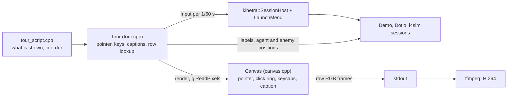

# Generated tour video

Status: implemented · Branch: `feat/generated-tour` · Related: [debug workbench](2026-11-19-debug-workbench.md), [media capture](2026-11-19-media-capture.md), [capture tool](../../tools/capture/README.md)

The tour video in the README was recorded by hand before the debug workbench existed: it shows the old panels, Backquote and the settings zoom. The user wants a new one that shows every function at length and plays smoothly, as if a person were using the program. This is phase 2 of the [debug workbench](2026-11-19-debug-workbench.md): the capture tool learns to play a scripted tour through the launcher and the three applications and to write it as video frames.

## Table of contents

- [Problem](#problem)
- [Goals and non-goals](#goals-and-non-goals)
- [Decisions](#decisions)
- [Design](#design)
- [Affected areas](#affected-areas)
- [Test plan](#test-plan)
- [Review](#review)
- [Verification](#verification)
- [Pull request](#pull-request)
- [Open points](#open-points)

[Directory guide](README.md) · [Project overview](../../README.md) · [Documentation index](../README.md)

## Problem

- [kinetra-lab-tour.mp4](../media/kinetra-lab-tour.mp4) is out of date and cannot be reproduced: nobody recorded what was clicked, and every change to a panel makes it wrong again. Its audio track is silent.
- The capture tool renders screenshots and short clips, but its sessions are driven by clicks that jump from point to point, without a pointer on screen. A viewer cannot see what is clicked or which keys are held.
- The capture scripts click debug-menu rows by number. A tour of some hundred clicks written that way would break with every menu change.

## Goals and non-goals

- Goal: `tools/capture/capture_tour.sh` writes `docs/media/kinetra-lab-tour.mp4` from the current code, at 1920 × 1080 and 60 frames per second.
- Goal: the tour runs through the real launcher and sessions: the launcher menu, Demo, Dotio with its difficulty page, i4sim with its loadscreen, a showcase scene and a floor.
- Goal: it shows the settings panel, the debug menu with every section of every application, a value of each tuning section changing the scene, pause, single tick, speed, zoom, the ghost camera, and each application's own controls.
- Goal: the pointer is visible and moves like a hand does: along a slight curve, speeding up and slowing down, with a pause before a click. Clicks, held keys and the wheel are shown on screen, and a caption says what is being shown.
- Goal: menu rows are found by their label.
- Non-goal: sound, or recording a person. The file has no audio track.
- Non-goal: the same pixels on every run. Dotio's enemies still use unseeded randomness, so its part differs per run; the scripted player reacts to the world.

## Decisions

| Decision | Choice | Why |
| --- | --- | --- |
| How the video is made | Generated by the capture tool, not recorded | User: a demonstration of everything that looks hand-operated but is scripted. A script can be run again after every change |
| Where pointer, captions and key hints are drawn | On the frame after it is read back, in the tool | The applications must not know they are filmed, and a session presents its frame itself, so nothing can be drawn into it afterwards |
| Pointer motion | A quadratic curve with a random sideways bend of up to 12 % of the distance, traversed with a minimum-jerk profile; duration from the distance (Fitts' law) | Straight constant-speed moves are what makes a scripted pointer look scripted. The random source is seeded |
| Rows by label | `lab::Session::debug_rows()` (label and depth); the tour looks a row's number up when it clicks | A tour written against row numbers would not survive a menu change, and the label says in the script what is clicked |
| Agents to click on in Demo | `sandbox::Session::application()`, like Dotio's | The tour selects an agent, and only the scene knows where one is |
| Frames to the encoder | Raw RGB through a pipe to ffmpeg | About 15,000 frames of 6 MB each; PNG files would take minutes and a gigabyte of disk |
| Launcher in the tour | The engine's `SessionHost` and `LaunchMenu`, driven frame by frame as `run_launcher` drives them | The tour shows the menu, the switch between applications and LAUNCHER and EXIT, with the launcher's own code |
| Captions | English, as the interface | The interface and the documentation are English |
| Encoding | H.264, `yuv420p`, CRF 20, fast start, no audio | As the [media guide](../media/README.md) asks. Flat colors compress well, so the file is far smaller than the 64 MB recording |

## Design

*Takeaway:* the script says what a viewer should see; the tour turns that into the input a person would give and draws what a screen recording would show on top.

- **`Canvas`** is a frame as RGB bytes with a few drawing functions: a blended rectangle, text in the engine's bitmap font, a ring, the arrow pointer and a keycap.
- **`PointerPath`** plans one move of the pointer and gives its position at a time.
- **`Tour`** owns the launcher host and menu and a virtual pointer. Every `frame()` advances the host by 1/60 s with the current input, renders, reads the frame back, draws the overlays and hands the frame to a sink. Its verbs are what the script is written in: `move_to`, `click_at`, `click_on`, `hold`, `tap`, `scroll`, `wait`, `caption`, `title`, `click_row(label)`, `step_row(label, up, times)`, `open_settings`, `click_setting(row)`.
- **Row lookup.** `click_row("MOTION")` asks the session for its rows, takes the row with that label and clicks its label in the engine's public menu layout, indented by the row's depth. A label that is missing stops the tour with the labels that were there.
- **Script.** One function per chapter: launcher, Demo, Dotio, i4sim. Dotio's player aims with the existing scripted player (`dotio_aim`), but the pointer follows the aim point smoothly instead of jumping to it.
- **Output.** `kinetra_capture --tour <file>` writes raw frames to a file, or to standard output for `-`; `capture_tour.sh` pipes them into ffmpeg. `--tour-check <frames>` plays the start without writing, for the smoke test, and `--tour-format` prints the frame size and rate the encoder needs.

## Affected areas

- Capture tool: new `canvas`, `pointer_path`, `tour` and `tour_script` sources, `main.cpp`, new `capture_tour.sh`, tests, README.
- [lab/session.h](../../labs/shared/include/kinetra_lab/session.h): `DebugRow` and `debug_rows()`; the three sessions implement it.
- [labs/demo/include/session.h](../../labs/demo/include/demo/presentation/session.h): `sandbox::Session` with `application()`.
- [docs/media](../media/README.md): the video, the media guide; [README](../../README.md); [AGENTS.md](../../AGENTS.md) (the video is no longer recorded by hand).

## Test plan

| Behavior | Test | Level |
| --- | --- | --- |
| Canvas: blending, clipping at the edges, text pixels, pointer tip, ring, keycap size | `kinetra_capture`: canvas cases | Targeted |
| Pointer path: starts and ends on its points, moves forward only, stays near the straight line, lasts longer for a longer way, repeats for a seed | `kinetra_capture`: pointer path cases | Targeted |
| A row is found by its label; a missing label is reported with the labels present | `kinetra_capture`: row lookup case | Targeted |
| `debug_rows()` lists each session's rows, follows an opened section, and is empty on i4sim's blueprint screen | `kinetra_graphics`: every session reports the rows of its debug menu | Graphics |
| The tour starts, plays its first seconds and writes whole frames | `kinetra_capture_smoke` with a frame limit | Graphics |
| The whole tour plays to its end and the video shows what its captions say | `capture_tour.sh`, then looking at frames from every chapter | Manual |

Sessions change (one accessor each): Full level with graphics.

## Review

`/code-review` at high effort over `git diff feat/debug-workbench...HEAD`. A full preview render came before it: the tour plays through all four chapters to EXIT, and frames from each match their captions. Findings and their resolution:

| Finding | Resolution |
| --- | --- |
| The title card covered the launcher's menu rows (seen in the preview) | Drawn below the middle of the picture |
| After CLICK SETS GOAL, every Demo agent walked to one point for twenty seconds, which made the MOTION and SIMULATION parts look restless (seen in the preview) | Moved to the end of the chapter, before the zoom-out, where the crowd on its way is the point |
| A ghost teleport was judged by searching the session's status text | Read from `SandboxApplication::last_action()` |
| A 6 MB read-back buffer was allocated for every frame | One buffer, reused |
| `click_on` put the pointer straight onto a target it had not reached in time, a visible jump | Finishes with one planned move |
| Three sessions repeated the conversion from `DebugEntry` to `DebugRow` | `lab::debug_rows_of` |
| The tour knows how many help lines each settings section has, so a changed help line would move its clicks below an open section | Not changed: the tour opens a section and closes it again before clicking below it, and the smoke test and a look at the video catch a miss. An [open point](#open-points) |
| The mirror panel assumes the session's panel opened on the Ctrl tap | Not changed, for the same reason |

## Verification

| Command | Result |
| --- | --- |
| `git ls-files -- '*.h' '*.cpp' \| xargs clang-format --dry-run --Werror` | Clean |
| `python3 external/Kinetra/tools/check_docs.py` | All links resolve |
| `cmake --workflow --preset graphics` after merging `main` | 295/295 passed |
| `cmake --workflow --preset headless` and `cmake --workflow --preset ci` | 241/241; 279/279 passed |
| `tools/capture/capture_tour.sh` | 18,715 frames rendered and encoded in 9 min 13 s: 5 min 12 s, H.264 `yuv420p` 1920 × 1080 at 60 fps, no audio, 93 MB |
| Frames of every chapter, from a contact sheet of 16 frames over the whole video and single frames of the title, Demo and the H crossing | Each scene matches its caption; the title is clear of the launcher's menu and EXIT |

Before the final render, two previews were rendered with fast encoder settings and looked at: the first 30 s, and the whole tour. The second is the file `main` received as `kinetra-lab-tour.mp4` in `e53330b`; this branch replaces it.

`cmake --build --preset windows`: builds; that preset has no zlib, so it builds no capture tool, and the session changes compile with MinGW. Not verified: how the video plays on YouTube; that copy is uploaded by hand.

## Pull request

Title: `feat(tools): generate the tour video with a scripted user`

**Summary.** The tour video is now rendered by the capture tool: the real launcher and Demo, Dotio and i4sim played by a scripted user, with a pointer that moves like a hand, click rings, the keys that are down, and a caption for every step. It shows every section of every debug menu, the settings panel, pause, single tick, speed, zoom, the ghost camera and each application's own controls. One command renders it again after a change.

**Changes.**
- Capture tool: `Tour` (the launcher host driven frame by frame, the script's verbs, the overlays), `tour_script.cpp` (four chapters), `Canvas`, `PointerPath`; `--tour`, `--tour-check` and `--tour-format`; `capture_tour.sh`.
- `lab::Session::debug_rows()` and `lab::debug_rows_of`, implemented by the three sessions, so the tour clicks rows by label; `sandbox::Session::application()` so it can click an agent.
- Tests: canvas, pointer path and row lookup cases; every session reports its rows; the smoke test plays the first seven seconds of the tour.
- `docs/media/kinetra-lab-tour.mp4` rendered anew; media guide, capture tool README, AGENTS.md.

**Design.** [docs/design/2026-11-19-tour-video.md](2026-11-19-tour-video.md).

**Verification.** `graphics` 295/295, `headless` 241/241, `ci` 279/279 after merging `main`; format and docs checks clean; Windows cross build compiles. The video was rendered with `capture_tour.sh` and looked at chapter by chapter.

**Review notes.**
- This replaces the `kinetra-lab-tour.mp4` committed in `e53330b`. That file was my preview render: its title covers the launcher's menu, and its Demo part has all agents walking to one point for twenty seconds. The README links a YouTube copy of that preview; upload the new file there to keep the two the same.
- Dotio's part differs per run, because its enemies are not seeded.
- The tour reads the session's debug rows, Demo's agents and Dotio's world; it changes nothing but input.

**Dependencies and merge order.** None; built on `main` after the debug workbench and the H crossing change.

**Follow-up.** Settings rows reported by the session, so the tour needs no help-line counts.

## Open points

- Dotio's part of the tour differs per run until its randomness is seeded.
- The tour mirrors the settings panel from help-line counts it keeps itself; a session that reported its settings rows, as it reports its debug rows, would remove that.
