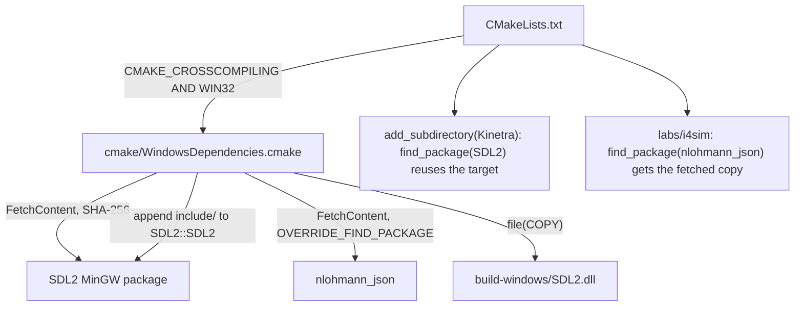

# Windows build with MinGW-w64

Status: implemented · Branch: `build/windows-mingw` · Related: [Windows guide](../windows.md), [tooling and CI](2026-11-18-tooling-and-ci.md)

The applications run in WSL through WSLg, which the user experiences as slow. This branch adds native Windows executables, cross-compiled from Arch Linux in WSL with MinGW-w64, runnable from WSL through interop, plus a CI job that builds and tests on Windows.

## Table of contents

- [Problem](#problem)
- [Goals and non-goals](#goals-and-non-goals)
- [Decisions](#decisions)
- [Design](#design)
- [Affected areas](#affected-areas)
- [Test plan](#test-plan)
- [Review](#review)
- [Verification](#verification)
- [Pull request](#pull-request)
- [Open points](#open-points)

[Directory guide](README.md) · [Project overview](../../README.md) · [Documentation index](../README.md)

## Problem

- Lab builds only for Linux. The README says "Linux is supported", and the only Linux-specific code is `default_blueprint_directory()`, which reads `/proc/self/exe` ([blueprint.cpp](../../labs/i4sim/src/blueprint.cpp)).
- In WSL, frames go through Mesa's `d3d12` driver and then the WSLg compositor (RDP). Measured on the user's machine (Intel Arc 140T, 60 Hz): the Linux build renders 205 frames per second without VSync, and the compositor decides what reaches the screen.
- The engine itself is portable: SDL2 and OpenGL 3.3, GLAD with a `_WIN32` branch, no POSIX calls.

## Goals and non-goals

- Goal: build Windows executables from Arch WSL with one preset, and run them and the tests from WSL.
- Goal: a CI job that keeps Windows building and passing.
- Non-goal: MSVC or clang-cl support; the warning set and `-static` are GCC flags.
- Non-goal: making golden trajectories identical across C runtimes.
- Non-goal: a Windows installer or GUI-subsystem executables.

## Decisions

| Decision | Choice | Why |
| --- | --- | --- |
| Toolchain | MinGW-w64 GCC, cross-compiled from Arch WSL | User's requirement: build from Arch WSL. Same compiler family and flags as the Linux build. Arch ships `mingw-w64-gcc` in its official repository |
| Scope | Local build and a CI job | User's choice |
| Windows SDL2 | Official `SDL2-devel-2.32.10-mingw.tar.gz`, pinned by SHA-256 through FetchContent | Not in Arch's official repositories (only AUR). The digest is GitHub's published one. `SDL2_DIR` overrides it |
| nlohmann_json | Official `json.tar.xz` 3.12.0, pinned, with `OVERRIDE_FIND_PACKAGE` | The host package's target adds `/usr/include`, whose glibc headers then break MinGW's C library (seen as conflicting `div_t`, `time_t`) |
| GCC runtime | Linked statically (`-static` in the toolchain file) | Executables then need only `SDL2.dll` and the Windows UCRT |
| CI | `windows-latest` with MSYS2 UCRT64, native build with the `ci` settings | Cross-built tests cannot run on a Linux runner (doctest discovery executes the test binaries at build time, and CTest runs them). A native MinGW build is the same compiler family and runs the tests where they belong |
| Golden cases that differ on Windows | Excluded by name in the Windows test presets, documented | Two summaries hash exact trajectories and differ in the last bit through the C runtime's transcendental functions. Per-platform golden values would double the maintenance; Linux CI still runs them |
| Graphics tests in the local Windows preset | Included | Through interop they run on the real GPU and pass |

## Design

*Takeaway:* only the root CMake and one module know about the cross build; Kinetra and the applications use their usual `find_package` calls.

- **Toolchain file** `cmake/toolchains/x86_64-w64-mingw32.cmake`: compilers, sysroot-only search, `-static`.
- **Presets:** `windows` (cross: Release, applications, graphics tests compiled, Lab and engine warnings reported; tests include graphics) and `windows-native` (inherits `ci`, for MSYS2 and CI; tests exclude graphics). Both test presets exclude the two last-bit golden cases.
- **Executable path:** `executable_path()` in `blueprint.cpp` uses `GetModuleFileNameW` behind `#ifdef _WIN32`, growing the buffer until the path fits, and `/proc/self/exe` otherwise.

## Affected areas

- New: [cmake/toolchains/x86_64-w64-mingw32.cmake](../../cmake/toolchains/x86_64-w64-mingw32.cmake), [cmake/WindowsDependencies.cmake](../../cmake/WindowsDependencies.cmake), [docs/windows.md](../windows.md).
- [CMakeLists.txt](../../CMakeLists.txt): includes the module when cross-compiling for Windows.
- [CMakePresets.json](../../CMakePresets.json): `windows` and `windows-native`.
- [labs/i4sim/src/blueprint.cpp](../../labs/i4sim/src/blueprint.cpp), [blueprint.h](../../labs/i4sim/include/blueprint.h): executable path on Windows; contract comment.
- [.github/workflows/ci.yml](../../.github/workflows/ci.yml): `windows` job.
- Docs: [README](../../README.md), [docs index](../README.md), [AGENTS.md](../../AGENTS.md) verification table.

## Test plan

| Behavior | Test | Level |
| --- | --- | --- |
| The blueprint catalog is found beside the executable on Windows | `kinetra_i4sim:the bundled catalog …` and `kinetra_i4sim_relocation`, run as Windows processes | `ctest --preset windows` |
| Every suite passes on Windows | All 150 non-excluded cases, graphics included, through interop | `cmake --workflow --preset windows` |
| The applications start and render on Windows | `kinetra.exe --variant demo/dotio/i4sim --frames 120` and the menu | Smoke runs |
| Only `SDL2.dll` and system DLLs are imported | `x86_64-w64-mingw32-objdump -p` | Manual |
| The Linux build is unchanged | `ci`, `headless`, `graphics` workflows | Full |
| Windows builds and tests natively | CI `windows` job | CI on the pull request |

No new test case: the Windows-specific behavior is the existing catalog and relocation tests running on Windows.

## Review

Self-review of `git diff main...HEAD`:

- `return()` in the included module returns to the root `CMakeLists.txt`, so a logic-only cross build skips SDL2 as intended.
- A failed earlier search leaves `SDL2_DIR` as `SDL2_DIR-NOTFOUND`, which `if(NOT SDL2_DIR)` treats as unset, so the download still happens.
- `GetModuleFileNameW` returns the buffer size when it truncates; the loop only accepts a strictly shorter result.
- Found during the build: `NOMINMAX` is predefined by MinGW's C++ headers, so the define is guarded. Fixed before committing.
- Found during the build: the host nlohmann_json target leaked `/usr/include` (see decisions). Fixed by fetching the release.
- No new Lab warnings in the changed file on either platform; the engine has none on Windows.

## Verification

| Command | Result |
| --- | --- |
| `cmake --workflow --preset windows` (clean `build-windows/`, downloads included) | 150/150 passed through WSL interop, graphics included |
| `kinetra.exe --variant demo\|dotio\|i4sim --frames 120`, menu for 60 frames | All exit 0 |
| `x86_64-w64-mingw32-objdump -p kinetra.exe` | Imports `SDL2.dll`, `KERNEL32.dll` and the UCRT `api-ms-win-crt-*` sets only |
| 600 frames of i4sim, Windows build | About 60 frames per second: VSync at the 60 Hz monitor. The WSLg build renders 205 per second without VSync |
| `cmake --workflow --preset ci` | 140/140 passed |
| `cmake --workflow --preset headless` | 133/133 passed |
| `cmake --workflow --preset graphics` | 152/152 passed |
| `clang-format --dry-run --Werror`, `python3 external/Kinetra/tools/check_docs.py` | Clean; all links resolve |
| CI `windows` job (MSYS2 UCRT64, `windows-native`) | 138/138 passed; engine warnings as errors held. The Linux `checks` job passed too |
| After merging `main` (window titles): `cmake --workflow --preset windows`, `cmake --workflow --preset ci` | 150/150, 140/140 |

## Pull request

Title: `build: cross-compile Windows executables with MinGW-w64`

**Summary.** Lab now builds native Windows executables from Arch Linux in WSL (`cmake --workflow --preset windows`), runs them and every test on Windows through WSL interop, and checks Windows in CI with a native MSYS2 build.

**Changes.**
- Build: MinGW-w64 toolchain file; `cmake/WindowsDependencies.cmake` fetches SDL2 2.32.10 (MinGW) and nlohmann_json 3.12.0, pinned by SHA-256; `windows` and `windows-native` presets.
- i4sim: `default_blueprint_directory()` resolves the executable with `GetModuleFileNameW` on Windows.
- CI: `windows` job on `windows-latest` with MSYS2 UCRT64.
- Docs: new [Windows guide](../windows.md), README, docs index, AGENTS verification table.

**Design.** [docs/design/2026-11-19-windows-mingw.md](2026-11-19-windows-mingw.md).

**Verification.** Windows (cross, through interop): 150/150 including graphics; smoke runs of every variant. CI `windows` job: 138/138. Linux: `ci` 140/140, `headless` 133/133, `graphics` 152/152.

**Review notes.** Two golden cases are excluded on Windows only (last-bit floating-point differences of the C runtime; Linux still runs them). The build downloads two pinned archives at configure time, cross builds only.

**Dependencies and merge order.** Independent of other pull requests; no Kinetra change.

**Follow-up.** Whether the `windows` job becomes a required status check; cross-platform golden trajectories (open points).

## Open points

- The two excluded golden cases. Cross-platform identical trajectories would need the simulations to avoid C-runtime transcendental functions on hashed paths.
- The Windows CI job is not a required status check; the repository owner decides whether to add it.
