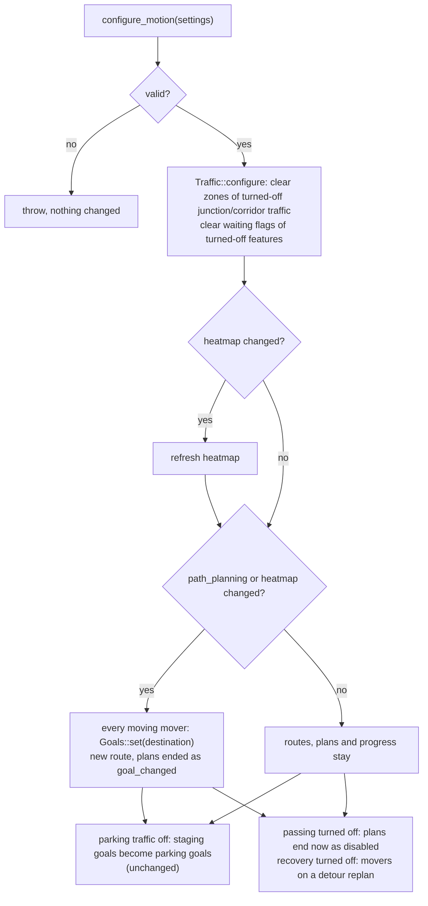

# i4sim motion changes keep routes

Status: implemented · Branch: `fix/i4sim-tuning-stall` · Related: [i4sim debug menu](2026-11-19-i4sim-debug-menu.md), [i4sim restructuring, open points](2026-11-19-i4sim-restructuring.md#open-points), [quality roadmap, phase 7](2026-11-18-quality-roadmap.md#phase-7-predictive-passing-under-pressure), [i4sim](../../labs/i4sim/README.md)

The user reported that changing a mover parameter in the i4sim debug menu sometimes leaves a few movers standing still while the rest drive on. Every motion change replanned every moving mover from wherever it stood, with the heatmap of that moment, and reset its progress tracking. A SPEED step could therefore send a mover into another aisle, head-on into traffic. `configure_motion` now replans only when a setting that shapes routes changes.

## Table of contents

- [Problem](#problem)
- [Goals and non-goals](#goals-and-non-goals)
- [Decisions](#decisions)
- [Design](#design)
- [Affected areas](#affected-areas)
- [Test plan](#test-plan)
- [Review](#review)
- [Verification](#verification)
- [Pull request](#pull-request)
- [Open points](#open-points)

[Directory guide](README.md) · [Project overview](../../README.md) · [Documentation index](../README.md)

## Problem

The SPEED, FORCE and HORIZON rows of the debug menu step their value while the blueprint runs. Each step calls `FactoryController::change_motion`, which calls `Simulation::configure_motion` ([simulation_core.cpp](../../labs/i4sim/src/simulation/simulation_core.cpp)). That function, for every moving mover:

1. called `Goals::set(m, m.destination)`, which plans a fresh route from the mover's current position, ends its passing plan (`goal_changed`), cancels its corridor recovery and resets its progress tracking (`no_progress`, `best_remaining`, recovery attempts, detour);
2. refreshed the heatmap, whose route costs depend on where movers stand at that moment.

The first version of i4sim only accepted motion settings while paused, and replanning made sense for the settings that change routes. The debug menu made changes possible while running, several times a second.

Evidence, measured with the MAS-demonstrator blueprint, seed 42, Improved profile:

- Without changes no mover stalls in 12,000 ticks. Stepping FORCE or HORIZON every 250 ticks between tick 2000 and 8000 leaves one mover stuck for good: mover 9 slides back and forth around (809, 882) until the end, 4000 ticks after the last change.
- The replanned routes are the cause. At tick 5000 mover 4's remaining route `(840,600) (1080,600) (1320,600) (1550,785)` became `(1080,360) (1320,600) (1550,785)`: another aisle, because the heatmap had moved. In a test build that kept the routes but still reset the counters, or that skipped replanning altogether, the MAS runs ended without a stuck mover. A build that replanned but kept the counters still stranded mover 9.
- Calling `configure_motion` with *unchanged* settings every 250 ticks also stalled movers on MAS and on 3840x2400, where the same runs without the calls did not.

Over a larger sample (four blueprints, six seeds, Improved and Reciprocal: 48 runs per variant, 12,000 ticks, changes every 250 ticks from tick 2000 to 8000) the runs that ended with a stuck mover were:

| Variant | Before this change | After |
| --- | --- | --- |
| No changes | 2 / 48 | 2 / 48 |
| Same settings again | 1 / 48 | 2 / 48, identical to no changes |
| SPEED steps | 2 / 48 | 5 / 48 |
| FORCE steps | 3 / 48 | 2 / 48 |
| HORIZON 16 ↔ 32 | 5 / 48 | 1 / 48 |

Summed over the four change variants, 11 of 192 runs ended with a stuck mover before and 10 after. The fix removes the mechanism `configure_motion` added (the MAS case, the no-op calls, the delayed recovery); it does not remove deadlocks the simulation reaches without any change. A different speed, force or horizon changes how movers move, so a run can still be steered into one. The runs that remain stuck are almost all Reciprocal, mostly on 4320x2400: two movers blocking each other about 120 mm from a destination, with the other mover 130 to 150 mm away. With RECOVERY on, more runs end stuck (7 of 48 without changes), so RECOVERY does not resolve them either.

One measurement artifact was excluded: 1680x960- has a tick cap of 10,000, after which a stopped simulation looked stuck to the 12,000-tick harness.

## Goals and non-goals

- Goal: changing SPEED, FORCE, HORIZON, PROFILE, RECOVERY or a traffic setting keeps every mover's route, goal and progress tracking.
- Goal: setting the same motion settings again changes nothing at all.
- Goal: changing PLANNER (path planning or heatmap) still replans every moving mover, as before.
- Goal: features that are turned off still drop their state: junction and corridor state in `configure_motion` as before, a passing plan at the next tick with its own end reason `disabled`.
- Non-goal: resolving deadlocks that happen without any change. That is roadmap [phase 7](2026-11-18-quality-roadmap.md#phase-7-predictive-passing-under-pressure) and the RECOVERY setting.
- Non-goal: changing how a parameter affects steering. A new speed or horizon still changes how movers move from the next tick on.

## Decisions

| Decision | Choice | Why |
| --- | --- | --- |
| Which changes replan | Only `path_planning` and `heatmap`, the two inputs of `plan_route` besides positions | The other settings do not change what a route is, so a new route is only a side effect, and the measurements show that side effect strands movers |
| Heatmap refresh | Only when `heatmap` changes | The tick refreshes it every ten ticks anyway. Refreshing it on every change made an unrelated change alter later routes too |
| Passing plans when passing is turned off | End them at once in `configure_motion`, with `PassingEnd::disabled` (`PredictivePassing::disable`) | The reason existed but was unreachable, because `configure_motion` ended every plan first as `goal_changed`; the [restructuring](2026-11-19-i4sim-restructuring.md#open-points) left this for a decision. Ending at once, not at the next tick, keeps the existing guarantee that turning passing off leaves no pair, also while paused (changed while building, after an existing test caught it) |
| A recovery detour when RECOVERY is turned off | Replan that mover | Found in review: a kept detour skips the mover's own obstruction replanning, and with recovery off nothing else frees it |
| Corridor recovery golden line | Accept the new fingerprint | Totals are unchanged; with the stall counters kept, the recovery starts at tick 1501 instead of 1620 when corridor traffic is switched on, and both movers arrive 119 ticks earlier |
| Passing plans and corridor recoveries on other changes | Keep them | They are coordination between two movers that a new speed does not invalidate; the plan's own checks still end it when it stalls |

## Design

*Takeaway:* only a change of what a route is produces new routes; everything else changes how movers steer from the next tick on.

## Affected areas

- `labs/i4sim/src/simulation/simulation_core.cpp`: `SimulationCore::configure_motion`.
- `labs/i4sim/include/i4sim/simulation/simulation.h`: the `configure_motion` contract.
- `labs/i4sim/src/simulation/predictive_passing.cpp`, `include/i4sim/simulation/detail/predictive_passing.h`: `PredictivePassing::disable`.
- `labs/i4sim/include/i4sim/simulation/events.h`: the `disabled` end reason, now reachable.
- `labs/i4sim/tests/golden_tests.cpp`: the corridor recovery fingerprint.
- `labs/i4sim/tests/simulation_tests.cpp`: new cases.
- `labs/i4sim/README.md`: debug menu and passing text, open points.
- `docs/design/2026-11-19-i4sim-restructuring.md`: the open point about `disabled`.

## Test plan

| Behavior | Test | Level |
| --- | --- | --- |
| A SPEED, FORCE, HORIZON, PROFILE, RECOVERY or traffic change keeps every mover's route, lifecycle and stall state on the 3840x2400 factory after 3000 ticks | `kinetra_i4sim:a motion change that does not shape routes keeps every route and its progress` (fails before the fix) | Targeted |
| Setting the same motion settings again every 250 ticks leaves the run identical to one without the calls | `kinetra_i4sim:setting the same motion settings again changes nothing` (fails before the fix) | Targeted |
| Switching path planning off still replans: every moving mover then heads straight for its destination | `kinetra_i4sim:a planner change replans every moving mover` | Targeted |
| Turning predictive passing off ends a plan at once as `disabled` | `kinetra_i4sim:turning predictive passing off ends a plan as disabled` (fails before the fix, with `goal_changed`) | Targeted |
| Turning RECOVERY off replans a mover on a recovery detour | `kinetra_i4sim:turning recovery off replans a mover on a recovery detour` (fails before the review fix) | Targeted |
| Golden runs, pressure scenarios and the controller keep their behavior | The existing i4sim suites | Targeted, then Full |

Only i4sim logic changes, which is the Targeted level of the [i4sim row](../../AGENTS.md#verification-in-lab). The branch ends at the Full level.

## Review

`/code-review` (high) on the branch diff:

| Finding | Resolution |
| --- | --- |
| Turning RECOVERY off kept a mover's recovery detour, which skips its obstruction replanning for good | Fixed: such a mover replans; new test |
| The route-keeping test's `stalled()` comparison can pass trivially when no mover is stalled | Kept: the lockstep test and the corridor golden line cover lost progress |
| The heatmap toggle has no replanning test | Kept: a replanned route can equal the old one, so there is no simple observable check; heatmap behavior is unchanged |
| Disabling passing and changing PLANNER in one call plans the participants twice | Kept: rare and cheap, no behavior difference |

## Verification

| Check | Result |
| --- | --- |
| New tests before the fix | Three of the four bug tests failed: routes changed, the lockstep runs diverged (up to 563 mm), passing ended as `goal_changed`; the PLANNER test passed, as intended. The recovery-detour test failed before its review fix |
| `ctest --preset release -R '^kinetra_i4sim'` | 134/134 |
| Measurement harness (48 seeded runs per variant, see [Problem](#problem)) | Same settings again: identical to no changes; HORIZON 5 → 1, FORCE 3 → 2, SPEED 2 → 5 runs with a stuck mover |
| `cmake --workflow --preset graphics` (Mesa D3D12 on WSLg) | 300/300, no compiler warning |
| Smoke runs, offscreen, 120 frames: `kinetra --variant demo/dotio/i4sim`, `kinetra_demo`, `kinetra_dotio`, `kinetra_i4sim` | All exit 0 |
| `clang-format --dry-run --Werror` on the changed sources, `check_docs.py` | Clean |
| CI (format, docs, `headless`, `ci`, native Windows) | On the pull request |

The new tests use the 3840x2400 factory, not MAS-demonstrator: `main` deleted `MAS-demonstrator.json` (#39, #40) while this branch was built, and the measurements above were taken before that. Not verified: how the change feels on screen. Stepping SPEED, FORCE or HORIZON in the debug menu should no longer reroute movers; deadlocks that need no change can still appear.

## Pull request

Title: `fix(i4sim): keep routes when a motion change does not shape them`

**Summary.** Every SPEED, FORCE or HORIZON step in the debug menu replanned all moving movers from where they stood, with the heatmap of that moment, and reset their progress. That could send a mover into another aisle, head-on into traffic, where it stayed. Now only a PLANNER change (path planning or heatmap) replans; every other change keeps routes, passing plans, corridor recoveries and progress.

**Changes.**
- `SimulationCore::configure_motion`: replans only for `path_planning` or `heatmap`, refreshes the heatmap only when it is switched, ends passing plans at once as `disabled` when passing is turned off (`PredictivePassing::disable`), and replans movers on a recovery detour when RECOVERY is turned off.
- Contracts in `simulation.h` and `events.h`; `disabled` is now a reachable end reason.
- Five new simulation cases; the corridor recovery golden fingerprint (totals unchanged, both movers arrive 119 ticks earlier).
- i4sim README: what a motion change keeps, and a new open point on deadlocks without any change.

**Design.** `docs/design/2026-11-20-i4sim-tuning-stall.md`

**Verification.** i4sim suites 134/134, graphics 300/300, six smoke runs exit 0, format and docs clean. The measurement over 48 seeded runs per variant is in the design document.

**Review notes.** The golden change is deliberate and explained in the Decisions table. The fix removes what `configure_motion` added; deadlocks that happen without any change (2 of 48 runs, mostly Reciprocal on 4320x2400) remain, and a parameter change can still steer a run into one.

**Dependencies and merge order.** None; independent of the Kinetra navigation fix.

**Follow-up.** Roadmap phase 7, or a separate analysis of the Reciprocal standstills near destinations.

## Open points

- Deadlocks without any change remain (2 of 48 runs in the sample above), mostly two Reciprocal movers near a destination. RECOVERY does not resolve them; roadmap phase 7 or its own analysis.
