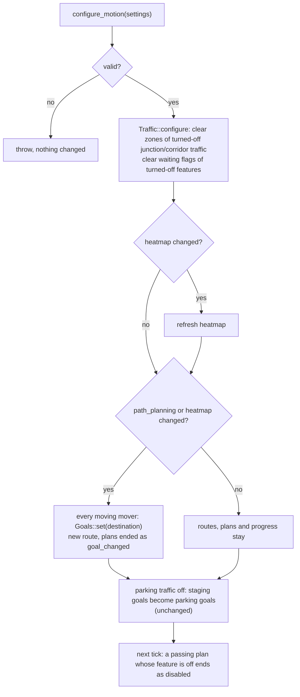

# i4sim motion changes keep routes

Status: draft · Branch: `fix/i4sim-tuning-stall` · Related: [i4sim debug menu](2026-11-19-i4sim-debug-menu.md), [i4sim restructuring, open points](2026-11-19-i4sim-restructuring.md#open-points), [quality roadmap, phase 7](2026-11-18-quality-roadmap.md#phase-7-predictive-passing-under-pressure), [i4sim](../../labs/i4sim/README.md)

The user reported that changing a mover parameter in the i4sim debug menu sometimes leaves a few movers standing still while the rest drive on. Every motion change replanned every moving mover from wherever it stood, with the heatmap of that moment, and reset its progress tracking. A SPEED step could therefore send a mover into another aisle, head-on into traffic. `configure_motion` now replans only when a setting that shapes routes changes.

## Table of contents

- [Problem](#problem)
- [Goals and non-goals](#goals-and-non-goals)
- [Decisions](#decisions)
- [Design](#design)
- [Affected areas](#affected-areas)
- [Test plan](#test-plan)
- [Review](#review)
- [Verification](#verification)
- [Pull request](#pull-request)
- [Open points](#open-points)

[Directory guide](README.md) · [Project overview](../../README.md) · [Documentation index](../README.md)

## Problem

The SPEED, FORCE and HORIZON rows of the debug menu step their value while the blueprint runs. Each step calls `FactoryController::change_motion`, which calls `Simulation::configure_motion` ([simulation_core.cpp](../../labs/i4sim/src/simulation/simulation_core.cpp)). That function, for every moving mover:

1. called `Goals::set(m, m.destination)`, which plans a fresh route from the mover's current position, ends its passing plan (`goal_changed`), cancels its corridor recovery and resets its progress tracking (`no_progress`, `best_remaining`, recovery attempts, detour);
2. refreshed the heatmap, whose route costs depend on where movers stand at that moment.

The first version of i4sim only accepted motion settings while paused, and replanning made sense for the settings that change routes. The debug menu made changes possible while running, several times a second.

Evidence, measured with the MAS-demonstrator blueprint, seed 42, Improved profile:

- Without changes no mover stalls in 12,000 ticks. Stepping FORCE or HORIZON every 250 ticks between tick 2000 and 8000 leaves one mover stuck for good: mover 9 slides back and forth around (809, 882) until the end, 4000 ticks after the last change.
- The replanned routes are the cause. At tick 5000 mover 4's remaining route `(840,600) (1080,600) (1320,600) (1550,785)` became `(1080,360) (1320,600) (1550,785)`: another aisle, because the heatmap had moved. In a test build that kept the routes but still reset the counters, or that skipped replanning altogether, the MAS runs ended without a stuck mover. A build that replanned but kept the counters still stranded mover 9.
- Calling `configure_motion` with *unchanged* settings every 250 ticks also stalled movers on MAS and on 3840x2400, where the same runs without the calls did not.

Over a larger sample (four blueprints, six seeds, Improved and Reciprocal: 48 runs per variant, 12,000 ticks, changes every 250 ticks from tick 2000 to 8000) the runs that ended with a stuck mover were:

| Variant | Before this change | After |
| --- | --- | --- |
| No changes | 2 / 48 | 2 / 48 |
| Same settings again | 1 / 48 | see [Verification](#verification) |
| SPEED steps | 2 / 48 | see [Verification](#verification) |
| FORCE steps | 3 / 48 | see [Verification](#verification) |
| HORIZON 16 ↔ 32 | 5 / 48 | see [Verification](#verification) |

The two baseline runs show that the simulation can deadlock without any change. Recovery is off by default, so nothing resolves it.

## Goals and non-goals

- Goal: changing SPEED, FORCE, HORIZON, PROFILE, RECOVERY or a traffic setting keeps every mover's route, goal and progress tracking.
- Goal: setting the same motion settings again changes nothing at all.
- Goal: changing PLANNER (path planning or heatmap) still replans every moving mover, as before.
- Goal: features that are turned off still drop their state: junction and corridor state in `configure_motion` as before, a passing plan at the next tick with its own end reason `disabled`.
- Non-goal: resolving deadlocks that happen without any change. That is roadmap [phase 7](2026-11-18-quality-roadmap.md#phase-7-predictive-passing-under-pressure) and the RECOVERY setting.
- Non-goal: changing how a parameter affects steering. A new speed or horizon still changes how movers move from the next tick on.

## Decisions

| Decision | Choice | Why |
| --- | --- | --- |
| Which changes replan | Only `path_planning` and `heatmap`, the two inputs of `plan_route` besides positions | The other settings do not change what a route is, so a new route is only a side effect, and the measurements show that side effect strands movers |
| Heatmap refresh | Only when `heatmap` changes | The tick refreshes it every ten ticks anyway. Refreshing it on every change made an unrelated change alter later routes too |
| Passing plans when passing is turned off | End them at the next tick with `PassingEnd::disabled`, through the existing check in `advance_plans` | That code existed but was unreachable, because `configure_motion` ended every plan first as `goal_changed`. The [restructuring](2026-11-19-i4sim-restructuring.md#open-points) left this for a decision; this change makes `disabled` mean what its name says. While paused the plan stays until the next tick |
| Passing plans and corridor recoveries on other changes | Keep them | They are coordination between two movers that a new speed does not invalidate; the plan's own checks still end it when it stalls |

## Design

*Takeaway:* only a change of what a route is produces new routes; everything else changes how movers steer from the next tick on.

## Affected areas

- `labs/i4sim/src/simulation/simulation_core.cpp`: `SimulationCore::configure_motion`.
- `labs/i4sim/include/i4sim/simulation/simulation.h`: the `configure_motion` contract.
- `labs/i4sim/include/i4sim/simulation/events.h`: the `disabled` end reason, now reachable.
- `labs/i4sim/tests/simulation_tests.cpp`: new cases.
- `labs/i4sim/README.md`: debug menu and passing text, open points.
- `docs/design/2026-11-19-i4sim-restructuring.md`: the open point about `disabled`.

## Test plan

| Behavior | Test | Level |
| --- | --- | --- |
| A SPEED, FORCE, HORIZON or PROFILE change keeps every mover's route, lifecycle and stall state | `kinetra_i4sim:a motion change that does not shape routes keeps every route and its progress` (fails before the fix) | Targeted |
| Setting the same motion settings again every 250 ticks leaves the run identical to one without the calls | `kinetra_i4sim:setting the same motion settings again changes nothing` (fails before the fix) | Targeted |
| Switching path planning off still replans: every moving mover then heads straight for its destination | `kinetra_i4sim:a planner change replans every moving mover` | Targeted |
| Turning predictive passing off ends a plan at the next tick as `disabled` | `kinetra_i4sim:turning predictive passing off ends a plan as disabled` (fails before the fix, with `goal_changed`) | Targeted |
| Golden runs, pressure scenarios and the controller keep their behavior | The existing i4sim suites | Targeted, then Full |

Only i4sim logic changes, which is the Targeted level of the [i4sim row](../../AGENTS.md#verification-in-lab). The branch ends at the Full level.

## Review

To be filled in after the review.

## Verification

To be filled in after verification.

## Pull request

To be filled in at the end.

## Open points

- Deadlocks without any change remain (2 of 48 runs in the sample above): roadmap phase 7, or RECOVERY on.
