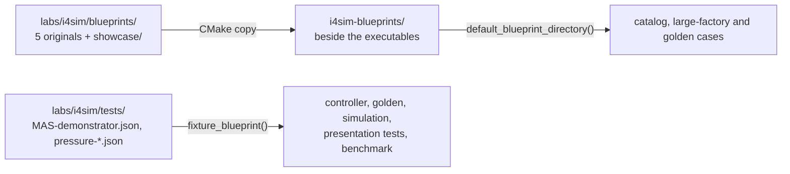

# MAS demonstrator as a test fixture

Status: accepted · Branch: `fix/i4sim-mas-test-fixture` · Related: [i4sim tests](../../labs/i4sim/tests/README.md), [blueprint guide](../../labs/i4sim/blueprints/README.md)

Pull request #40 removed `MAS-demonstrator.json` from the i4sim catalog so it no longer shows on the blueprint screen. The i4sim and capture tests still loaded that file, so `main` fails in CI. This change keeps the file out of the catalog and moves it to `labs/i4sim/tests/` as a test fixture, so the tests and their recorded outcomes stay as they were.

## Table of contents

- [Problem](#problem)
- [Goals and non-goals](#goals-and-non-goals)
- [Decisions](#decisions)
- [Design](#design)
- [Affected areas](#affected-areas)
- [Test plan](#test-plan)
- [Review](#review)
- [Verification](#verification)
- [Pull request](#pull-request)
- [Open points](#open-points)

[Directory guide](README.md) · [Project overview](../../README.md) · [Documentation index](../README.md)

## Problem

Commit `c99aa6f` (pull request #40) deleted `labs/i4sim/blueprints/MAS-demonstrator.json`. Pull request #40 was merged 14 seconds after its CI started. On `main` (`9c46303`), the CI fails: 44 tests in the `headless` job, and the same cases plus `kinetra_capture_tests` in the native Windows job. Every failure is the missing file, for example `labs/i4sim/blueprints\MAS-demonstrator.json: No such file or directory` (CI run 44657152391). The file was also the shared test fixture:

- `controller_tests.cpp:27` loads it for almost every controller case.
- `golden_tests.cpp:101,110` compare the factory runs on it with recorded summaries.
- `simulation_tests.cpp` loads it in four cases (`:1120`, `:1467`, `:1836`, `:1872`), and its catalog case requires six files (`:1432`). `relocation_tests.cmake` runs that catalog case by name.
- `presentation_tests.cpp:270` copies it into a repaired catalog.
- `tools/capture/tests/capture_tests.cpp:225` uses it as a blueprint without a scenario.
- `motion_benchmark.cpp:75` measures it, and the baseline tables in the [test README](../../labs/i4sim/tests/README.md#motion-benchmark) list its numbers.

The same pull request raised `tickCap` of the showcase scenes from 100000 to 3600000. That change is not part of the failure: pull request #39 made it for two scenes and passed CI, and no showcase case fails.

## Goals and non-goals

Goals:

- Make `main` green again without putting MAS back on the blueprint screen.
- Keep the tests and their recorded outcomes unchanged: same file, same seeds, same summaries.
- Make the docs state that the catalog holds five originals and where MAS now lives.

Non-goals:

- No change to the simulation or the remaining blueprints. The new `tickCap` values stay.
- No move of the four `pressure-*.json` fixtures, which already live in `labs/i4sim/tests/`.
- No rewrite of earlier design documents; they record what was true when they were written.

## Decisions

| Decision | Choice | Why |
| --- | --- | --- |
| Fix | Move MAS to a test fixture, rather than restore it to the catalog or move the tests to another blueprint | User's choice. It keeps MAS off the blueprint screen, and the golden summaries and benchmark baseline stay valid without new recordings |
| Location | `labs/i4sim/tests/MAS-demonstrator.json`, beside the `pressure-*.json` fixtures | The tests directory already holds the i4sim JSON fixtures, and it is not copied next to the executables |
| File content | Byte-identical to the deleted file (blob `517bfdb`) | The golden summaries and the semantics case compare against exactly this content |
| Path helper | `i4sim::test::fixture_blueprint(name)` in `showcase.h`, through a new `KINETRA_I4SIM_TEST_FIXTURE_DIR` definition; `original_blueprint` goes, because MAS was its only user | One helper per location, just like `showcase_blueprint`. A definition rather than `__FILE__`, so the path does not depend on where the header is |
| "An original blueprint has no scenario" | Check every original in the catalog rather than one named file | The case is about the catalog's originals, and no single file is guaranteed to stay there |
| Capture test without a scenario | `labs/i4sim/blueprints/3840x2400.json` | The capture tool tests shipped data; an i4sim test fixture would couple it to another module's tests |
| README commands | `3840x2400.json` instead of MAS | The examples should load a blueprint the catalog ships |

## Design

The blueprint copy is unchanged: CMake copies `labs/i4sim/blueprints/` to `i4sim-blueprints/` beside the executables, now with five originals and the showcase directory. Tests that need MAS read it from the source tree:

Takeaway: the catalog and the fixtures are separate sources; only the catalog reaches users.

`kinetra_i4sim_testing` passes `KINETRA_I4SIM_TEST_FIXTURE_DIR="${CMAKE_CURRENT_SOURCE_DIR}/tests"`. `golden_tests.cpp`'s `run_factory` and the benchmark take a path instead of a catalog name, so a MAS run and a catalog run use the same code.

## Affected areas

- `labs/i4sim/tests/MAS-demonstrator.json` (new, the restored file).
- `labs/i4sim/CMakeLists.txt`: the new compile definition on `kinetra_i4sim_testing`.
- `labs/i4sim/tests/include/i4sim/testing/showcase.h`: `fixture_blueprint` replaces `original_blueprint`.
- `labs/i4sim/tests/`: `controller_tests.cpp`, `golden_tests.cpp`, `simulation_tests.cpp`, `presentation_tests.cpp`, `motion_benchmark.cpp`, `relocation_tests.cmake`.
- `tools/capture/tests/capture_tests.cpp`.
- Docs: `labs/i4sim/README.md`, `labs/i4sim/blueprints/README.md`, `labs/i4sim/tests/README.md`.

## Test plan

| Behavior | Test | Level |
| --- | --- | --- |
| The catalog holds five originals that all load, also from a relocated bundle | `kinetra_i4sim:the bundled catalog holds five blueprints that all load`, `kinetra_i4sim_relocation` | Targeted |
| The catalog's originals have no scenario | `kinetra_i4sim:the original blueprints have no scenario` | Targeted |
| MAS runs exactly as before from its new location | `kinetra_i4sim_golden` factory cases (unchanged summaries), the MAS cases of `kinetra_i4sim` | Targeted |
| The controller loads the fixture | All of `kinetra_i4sim_controller` | Targeted |
| Capture rejects a blueprint without a scenario | `kinetra_capture_tests` | Targeted |
| The session recovers a repaired catalog | `kinetra_i4sim_graphics` | Full (graphics) |
| The benchmark still runs MAS | `kinetra_i4sim_motion_benchmark --ticks 2000` by hand | Targeted |

The failing state is CI run 44657152391 on `main`; the branch must make the same suites pass. Because `presentation_tests.cpp` changes, the branch ends at the Full level.

## Review

To be filled after review.

## Verification

To be filled after verification.

## Pull request

To be filled before the pull request.

## Open points

- Pull request #40 was merged while its CI still ran. The ruleset "Protect main" requires the `checks` status, but the Admin role may bypass it in a pull request, and the merge used that bypass. Whether to drop the bypass is the user's decision.
