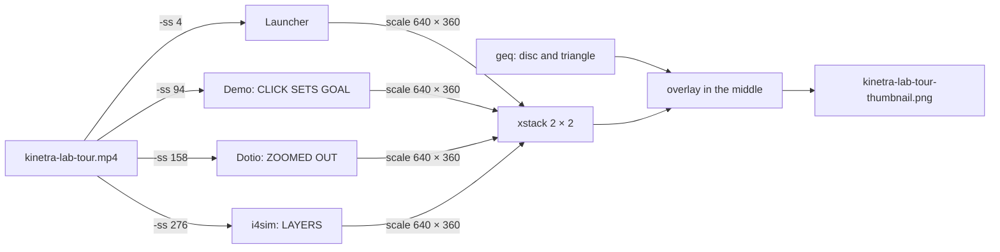

# Tour thumbnail in the README

Status: implemented · Branch: `feat/tour-thumbnail` · Related: [generated tour video](2026-11-19-tour-video.md), [media guide](../media/README.md), [capture tool](../../tools/capture/README.md)

The README links the tour video with one line of text below the gallery, which is easy to miss. The user asked whether the video could play in the README itself. On a free GitHub plan it cannot, so the README now opens its gallery with a clickable thumbnail of the tour. The thumbnail is generated from the video, like every other image in `docs/media`.

## Table of contents

- [Problem](#problem)
- [Goals and non-goals](#goals-and-non-goals)
- [Decisions](#decisions)
- [Design](#design)
- [Affected areas](#affected-areas)
- [Test plan](#test-plan)
- [Review](#review)
- [Verification](#verification)
- [Pull request](#pull-request)
- [Open points](#open-points)

[Directory guide](README.md) · [Project overview](../../README.md) · [Documentation index](../README.md)

## Problem

- The only way into the tour is `[Watch the full tour](https://youtu.be/jkPwx831MOU).` below the launcher screenshots ([README.md:80](../../README.md)). A reader who skims the gallery does not see that a five-minute video exists.
- GitHub shows a video player in a README only for a video uploaded as an attachment (`https://github.com/user-attachments/assets/...` on a line of its own). The limit is 10 MB on a free plan and 100 MB on a paid plan ([GitHub Docs: attaching files](https://docs.github.com/en/get-started/writing-on-github/working-with-advanced-formatting/attaching-files)). The tour is 93 MB ([media guide](../media/README.md#files)), and the repository is on a free plan. GitHub also removes `<iframe>`, so the YouTube player cannot be embedded either.

## Goals and non-goals

- Goal: the gallery opens with a picture of the tour that links to the YouTube copy and looks like a video, with a play button.
- Goal: the picture is generated from the video by a script, so a new render of the tour brings a matching thumbnail.
- Non-goal: a short teaser video under 10 MB. That would need an upload in the browser for every new render, and the user chose the thumbnail.
- Non-goal: changes to the tour itself or to `kinetra_capture`.

## Decisions

| Decision | Choice | Why |
| --- | --- | --- |
| Video in the README or a thumbnail | A thumbnail that links to YouTube | Settled with the user: the free plan's 10 MB limit rules out the 93 MB tour, and a teaser under 10 MB would lose too much of it. |
| What the thumbnail shows | A 2 × 2 mosaic: the launcher, Demo, Dotio and i4sim | Settled with the user out of three rendered candidates (the mosaic, one Demo frame, one i4sim frame). The tour shows the launcher and all three applications, and the mosaic says that at a glance. |
| Where it goes | At the top of *Screenshots and demo*, instead of the text link at the bottom | Settled with the user: the first thing in the gallery, while the README still opens with its introduction and table of contents. |
| Source of the picture | Generated from `kinetra-lab-tour.mp4` with ffmpeg, committed as a PNG | Every image in `docs/media` comes from a script. YouTube's own thumbnail URL would be an outside image that the repository does not control. |
| Script | A separate `tools/capture/tour_thumbnail.sh`, run by `capture_tour.sh` after it encodes the video | The thumbnail can be refreshed from the existing video in seconds, without rendering the tour again for minutes. |
| Which frames | Four fixed times in the tour, named in the script | The tour's timing comes from its script and only changes when the script does; its maintainers already look at frames of every chapter after a change. A caption-to-frame index from `kinetra_capture` would be more robust, but is more code than four timestamps need. |
| Play button | A dark translucent disc with a white triangle, drawn by ffmpeg's `geq` filter | No font and no image file are needed, and the tour's video stays untouched. |
| Size and format | PNG at 1280 × 720, 586 KB | Sharp on high-density screens at GitHub's README width; PNG like the other screenshots. |

## Design

`tour_thumbnail.sh [video] [output-file]` reads the video's length with ffprobe and stops with a message when a moment lies past its end. It then runs one ffmpeg command:

*Takeaway:* four frames of the existing video become one picture; nothing is rendered again.

- The script stops when `moments` does not hold exactly four times, because the filter graph stacks four tiles.
- The output defaults to the video's file name with `-thumbnail.png`, in the video's directory, so `capture_tour.sh` with a custom output file puts the thumbnail next to it.
- ffmpeg writes to a temporary file, which replaces the output only when it is not empty. A failed run therefore never leaves a stale or broken thumbnail.
- The README shows the picture as a Markdown image inside a link to `https://youtu.be/jkPwx831MOU`, with a sentence below it that names the length and contents, for readers who do not see images.

## Affected areas

- New: [tools/capture/tour_thumbnail.sh](../../tools/capture/tour_thumbnail.sh) and [docs/media/kinetra-lab-tour-thumbnail.png](../media/kinetra-lab-tour-thumbnail.png).
- [tools/capture/capture_tour.sh](../../tools/capture/capture_tour.sh): runs the thumbnail script after encoding.
- [README.md](../../README.md#screenshots-and-demo): the thumbnail at the top of the gallery; the text link at the bottom goes.
- [docs/media/README.md](../media/README.md) and [tools/capture/README.md](../../tools/capture/README.md): the new file and script, and why the README shows a thumbnail.
- This document and the [design index](README.md#index).
- No C++ code, CMake or public API changes.

## Test plan

| Behavior | How it is checked | Level |
| --- | --- | --- |
| The script makes the mosaic with the play button from the committed video | Run `tools/capture/tour_thumbnail.sh` and look at the PNG | By hand |
| A moment past the end of the video stops the script, and an existing thumbnail stays as it was | Run it on a short cut of the video and check the exit status and the file | By hand |
| `capture_tour.sh` calls the script with its output file | Read the diff, then `bash -n` and shellcheck on both scripts. A full tour render takes minutes and would replace the committed video with a new Dotio take, so it is not run | By hand |
| The README and media guide still name every captured file, which `kinetra_capture_tests` reads | `cmake --build --preset dev --target kinetra_capture_tests kinetra_capture` and `ctest --preset dev -R '^kinetra_capture'` | Targeted (tools/capture) |
| Links and paths in the changed Markdown | `python3 external/Kinetra/tools/check_docs.py` | Docs |

The graphics smoke test (`kinetra_capture_smoke`) runs `kinetra_capture` itself and not the scripts, so this change does not touch it.

## Review

`/code-review` on `feat/tour-thumbnail`, four findings:

| Finding | Resolution |
| --- | --- |
| A new render rewrites the thumbnail, but the README links the YouTube copy, which only changes with a manual upload | Fixed in the [media guide](../media/README.md#refreshing-the-media): upload a new render too, and replace the link in the README and the guide |
| The filter graph stacks four tiles, while the loop over `moments` takes any number | Fixed: the script stops unless there are exactly four moments |
| `${video%.*}` strips from the last dot anywhere in the path, so a directory such as `out.v2/` lost its suffix | Fixed: the default is built from the video's file name and directory; checked with `dot.v2/tour` |
| This document still had placeholder sections | Filled in before the pull request |

## Verification

- `tools/capture/tour_thumbnail.sh`: writes `docs/media/kinetra-lab-tour-thumbnail.png` (576 K, 1280 × 720) in under a second; looked at: the launcher, Demo's CLICK SETS GOAL, Dotio zoomed out and i4sim's layers, with the play button in the middle. A second run gives the same bytes.
- On a 60 s cut of the video: `moment 94 s lies past the end`, exit 1, and the existing output file kept its contents. On a missing video: a message and exit 1. On `dot.v2/tour` without an output: `dot.v2/tour-thumbnail.png`.
- `bash -n` on both scripts: no errors. shellcheck is not installed here, so it did not run.
- `cmake --build --preset dev --target kinetra_capture_tests kinetra_capture` and `ctest --preset dev -R '^kinetra_capture'`: 31/31 passed (they read the README and the media guide).
- `python3 external/Kinetra/tools/check_docs.py`: all links resolve in 61 Markdown files.
- Not run: `capture_tour.sh` end to end. It renders for minutes and would replace the committed video with a new Dotio take; its change is the one call to `tour_thumbnail.sh` with its output file. The graphics smoke test does not run the scripts.

## Pull request

**Title:** `feat(tools): show a thumbnail of the tour in the README`

**Summary:** the README gallery opens with a clickable picture of the tour that links to the YouTube copy, instead of a text link below the gallery. GitHub plays a README video only as an uploaded attachment of at most 10 MB on a free plan, and the tour is 93 MB.

**Changes:**
- `tools/capture/tour_thumbnail.sh`: four moments of the tour video (the launcher, Demo, Dotio, i4sim) in a 1280 × 720 mosaic with a play button, with ffmpeg; checks its moments against the video's length and replaces the PNG only on success.
- `capture_tour.sh` runs it after encoding, so a new video brings a matching thumbnail.
- `docs/media/kinetra-lab-tour-thumbnail.png` (586 KB) at the top of *Screenshots and demo* in the README, with a sentence on the tour below it.
- The media guide and the capture tool README describe the file, the script and why it is a picture and not the video.

**Design:** [docs/design/2026-11-20-tour-thumbnail.md](https://github.com/SMB-M87/Kinetra-Lab/blob/feat/tour-thumbnail/docs/design/2026-11-20-tour-thumbnail.md)

**Verification:** the script on the committed video (looked at the result, same bytes on a second run), on a too-short video and on a missing one; `bash -n` on both scripts; `ctest --preset dev -R '^kinetra_capture'` 31/31 passed; `check_docs.py` passed. Not run: a full `capture_tour.sh` render (minutes, and it would replace the committed video); shellcheck is not installed.

**Review notes:** `/code-review` found four points, all fixed (see the design document). The thumbnail's moments are fixed times in the tour, so a tour change needs a look at the thumbnail; the guides say so.

**Dependencies and merge order:** no Kinetra change and no pointer change. Open PR SMB-M87/Kinetra-Lab#34 also edits `README.md`, in other lines (repository layout and tests); the two should merge without conflict in either order.

**Follow-up:** none.

## Open points

- The thumbnail's moments are fixed times in the tour. A caption-to-frame index from `kinetra_capture` would let the script find its moments by caption, if the tour changes often.
