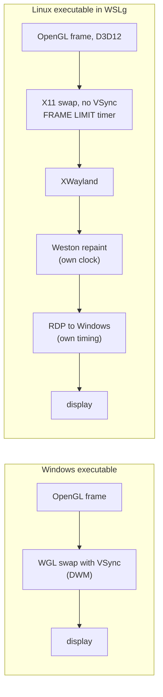

# Frame pacing in WSLg

Status: draft, decision open · Branch: `docs/wslg-frame-pacing` · Related: [smooth rendering](2026-11-19-smooth-rendering.md), [debug workbench](2026-11-19-debug-workbench.md), [Kinetra debug workbench, open points](../../external/Kinetra/docs/design/2026-11-19-debug-workbench.md#open-points), [Windows limits](../windows.md#limits)

The Linux build stutters on screen when it runs in WSLg; the Windows build of the same commit runs smoothly on the same machine. This document records what was measured on 2026-11-20, why it happens, and three ways forward, so the decision can be taken later. Nothing is implemented yet.

## Table of contents

- [Problem](#problem)
- [Cause](#cause)
- [Options](#options)
- [Recommendation](#recommendation)
- [Decisions](#decisions)
- [Affected areas](#affected-areas)
- [Test plan](#test-plan)
- [Measurement probes](#measurement-probes)
- [Open points](#open-points)

[Directory guide](README.md) · [Project overview](../../README.md) · [Documentation index](../README.md)

## Problem

The user sees motion stutter in the Linux applications started inside WSL, and not in the Windows executables. The user wondered whether drawing a world that is generated while it streams in is the cause, and why the Windows executable would not have the same problem.

Measured environment:

| Part | Value |
| --- | --- |
| GPU and display | Intel Arc 140T, Windows display at 60 Hz, 1920 × 1200 |
| WSLg | 1.0.71 |
| SDL | SDL3 3.4.20 behind sdl2-compat 2.32.74 |
| OpenGL | Mesa 26.3.1, D3D12 driver |
| Builds the user runs | `build/` from `build.sh` and `build-windows/`, both Release |

Findings:

- **No VSync in WSLg.** SDL chooses its `x11` video driver (XWayland). `SDL_GL_SetSwapInterval` fails with "That operation is not supported", and the runtime logs `VSync unavailable (...); pacing frames at 60 per second`. FRAME LIMIT then paces frames with a timer at the 60 Hz that SDL reports.
- **No Wayland driver.** With `SDL_VIDEODRIVER=wayland`, SDL reports "wayland not available": SDL loads `libxkbcommon` at runtime, and the package is not installed. SDL 3 also prefers X11 over Wayland on compositors without the FIFO protocol; whether WSLg's Weston offers it was not checked, because the Wayland driver could not start.
- **The application loop is steady.** The real Demo session, with the player walking so terrain streams in, measured over 869 frames with FRAME LIMIT on: frame interval median 16.67 ms, 99th percentile 17.81 ms, one frame over 25 ms (28.6 ms). Advancing the simulation, streaming included, takes at most 12.9 ms (99th percentile 10.9 ms). Without the limit the loop runs at about 8.6 ms per frame. Terrain streaming is therefore not what the user sees.

## Cause



*Takeaway:* the Windows executable presents on the display's own clock; in WSLg three clocks run side by side, and nothing ties them together.

The Windows executable swaps with VSync, so every frame lands on one refresh of the display. In WSLg the frame leaves the application on its own 60 Hz timer, is composited by Weston on Weston's repaint clock, and travels over RDP to the Windows desktop. When two of these clocks drift past each other, a frame is shown twice or skipped. Interpolation between ticks cannot hide that, because the error happens after the frame left the application. The [Kinetra debug workbench](../../external/Kinetra/docs/design/2026-11-19-debug-workbench.md#open-points) already noted that the limiter cannot lock to the compositor's phase.

A native Linux desktop has real VSync through Mesa's own drivers; this document is about WSLg only. The [smooth rendering](2026-11-19-smooth-rendering.md) work mentioned uneven motion on a Linux desktop too, but that was before interpolation and was not measured again here.

## Options

| # | Option | What it takes | Expected effect | Cost and risk |
| --- | --- | --- | --- | --- |
| 1 | **Wayland with frame callbacks** | Install `libxkbcommon` (`pacman -S libxkbcommon`); make the Kinetra runtime prefer the Wayland driver under WSLg | A swap then waits for Weston's frame callback, so frames follow Weston's repaint and one clock disappears. RDP keeps its own timing | Needs a system package. SDL avoids Wayland without the FIFO protocol because a hidden window can block its swap; that has to be checked in WSLg. Whether it helps enough is unknown until measured |
| 2 | **Render faster than the display** | FRAME LIMIT off (possible today), or a limiter at a multiple of the refresh rate | Weston always takes the newest frame, which is a few milliseconds old instead of a whole frame repeated, so the jumps get smaller | Keeps one CPU core and the GPU busy; the stutter becomes smaller, not gone |
| 3 | **Document as a WSLg limit** | A line in the [Windows guide](../windows.md#limits); recommend the Windows executable for smooth viewing | None on screen | No code; the Linux build in WSLg keeps stuttering |

## Recommendation

Start with option 1 as a measurement, before any code changes:

1. With the user's consent, install `libxkbcommon`.
2. Run the [VSync probe](#measurement-probes) with `SDL_VIDEODRIVER=wayland`: does `SDL_GL_SetSwapInterval(1)` succeed, and do the frame intervals settle at Weston's pace?
3. Run an application with `SDL_VIDEODRIVER=wayland` and judge on screen, with FRAME TIMES on, against the default driver.

If that is clearly smoother, the runtime change is small: a video-driver hint before `SDL_Init` when running under WSLg, with its own Kinetra design document. If it is not, compare option 2 on screen (FRAME LIMIT off), and otherwise fall back to option 3. Option 2 can be tried today without any change.

## Decisions

| Decision | Choice | Why |
| --- | --- | --- |
| Which option | Open, for the user | Option 1 needs a system package and an on-screen judgment; options 2 and 3 trade smoothness for load or for nothing |

## Affected areas

Only when option 1 is chosen and helps:

- Kinetra `src/runtime/runtime.cpp`: the video-driver hint under WSLg; Kinetra `docs/engine/runtime.md`.
- Lab `docs/windows.md` and the README's dependency list: `libxkbcommon` for WSLg.

## Test plan

- Option 1: the VSync probe's numbers with both drivers, then the user's on-screen comparison; `cmake --workflow --preset graphics` with the Wayland driver.
- Option 2: the user's on-screen comparison with FRAME LIMIT off and on, and the CPU load.
- Option 3: the docs check.

## Measurement probes

Both programs were built outside the repository. They need no change to it.

**VSync probe.** Opens a 960 × 540 OpenGL window, asks for swap interval 1 and reports the driver, the refresh rate SDL reports, whether the interval was accepted, and frame-interval statistics. Build with `g++ -O2 -std=c++20 vsync_probe.cpp -o vsync_probe $(pkg-config --cflags --libs sdl2) -lGL` and run `./vsync_probe 600`, then `SDL_VIDEODRIVER=wayland ./vsync_probe 600`.

```cpp
#include <SDL.h>
#include <GL/gl.h>
#include <algorithm>
#include <chrono>
#include <cmath>
#include <cstdio>
#include <cstdlib>
#include <vector>
int main(int argc, char **argv) {
    const int frames = argc > 1 ? std::atoi(argv[1]) : 600;
    if (SDL_Init(SDL_INIT_VIDEO) != 0) { std::printf("init: %s\n", SDL_GetError()); return 1; }
    SDL_GL_SetAttribute(SDL_GL_CONTEXT_MAJOR_VERSION, 3);
    SDL_GL_SetAttribute(SDL_GL_CONTEXT_MINOR_VERSION, 3);
    SDL_GL_SetAttribute(SDL_GL_CONTEXT_PROFILE_MASK, SDL_GL_CONTEXT_PROFILE_CORE);
    SDL_Window *w = SDL_CreateWindow("vsync probe", SDL_WINDOWPOS_CENTERED, SDL_WINDOWPOS_CENTERED, 960, 540,
                                     SDL_WINDOW_OPENGL | SDL_WINDOW_SHOWN);
    SDL_GLContext c = w ? SDL_GL_CreateContext(w) : nullptr;
    if (!c) { std::printf("window: %s\n", SDL_GetError()); return 1; }
    SDL_DisplayMode mode{};
    SDL_GetCurrentDisplayMode(SDL_GetWindowDisplayIndex(w), &mode);
    const int set = SDL_GL_SetSwapInterval(1);
    std::printf("driver=%s refresh=%d Hz swap_interval=%s renderer=%s\n", SDL_GetCurrentVideoDriver(),
                mode.refresh_rate, set == 0 ? "ok" : SDL_GetError(), (const char *)glGetString(GL_RENDERER));
    std::vector<double> dt;
    auto last = std::chrono::steady_clock::now();
    for (int f = 0; f < frames; ++f) {
        SDL_Event e;
        while (SDL_PollEvent(&e)) {}
        const float t = float(f % 120) / 120.f;
        glClearColor(t, 0.2f, 1 - t, 1);
        glClear(GL_COLOR_BUFFER_BIT);
        SDL_GL_SwapWindow(w);
        const auto now = std::chrono::steady_clock::now();
        if (f > 30) dt.push_back(std::chrono::duration<double, std::milli>(now - last).count());
        last = now;
    }
    std::sort(dt.begin(), dt.end());
    double mean = 0;
    for (double v : dt) mean += v;
    mean /= double(dt.size());
    auto pct = [&](double p) { return dt[std::size_t(p * double(dt.size() - 1))]; };
    std::printf("frames=%zu mean=%.2f p50=%.2f p99=%.2f max=%.2f ms\n", dt.size(), mean, pct(0.5), pct(0.99),
                dt.back());
}
```

**Demo frame probe.** Runs the real Demo session in a window while the player walks right (and diagonally every three seconds), so terrain streams in, and reports how long advancing, drawing and the whole frame took. Compile it with the include directories and libraries of `kinetra_demo` in `build-graphics` (see `build-graphics/compile_commands.json` and the `kinetra_demo` link line in `build-graphics/build.ninja`). The second argument switches FRAME LIMIT: `./frame_probe 900 1` and `./frame_probe 1800 0`.

```cpp
#include "demo/presentation/session.h"
#include "demo/zoom.h"
#include <algorithm>
#include <chrono>
#include <cstdio>
#include <cstdlib>
#include <kinetra/runtime/engine.h>
#include <kinetra/runtime/session.h>
#include <vector>
namespace {
void report(const char *label, std::vector<double> v, double refresh_ms) {
    std::sort(v.begin(), v.end());
    double mean = 0;
    for (double x : v) mean += x;
    mean /= double(v.size());
    auto pct = [&](double p) { return v[std::size_t(p * double(v.size() - 1))]; };
    const auto over = std::count_if(v.begin(), v.end(), [&](double x) { return x > refresh_ms * 1.5; });
    std::printf("  %-9s mean=%6.2f p50=%6.2f p99=%6.2f max=%6.2f ms, over 1.5 refresh: %ld of %zu\n", label, mean,
                pct(0.5), pct(0.99), v.back(), long(over), v.size());
}
} // namespace
int main(int argc, char **argv) {
    const int frames = argc > 1 ? std::atoi(argv[1]) : 900;
    kinetra::Runtime runtime("Probe");
    runtime.limit_frames(argc > 2 ? std::atoi(argv[2]) != 0 : true);
    runtime.camera.pixels_per_unit = demo::initial_zoom;
    auto session = demo::create_session(demo::default_agent_count, 12345);
    using Clock = std::chrono::steady_clock;
    std::vector<double> advance_ms, render_ms, interval_ms;
    auto previous = Clock::now();
    for (int f = 0; f < frames && runtime.poll(true); ++f) {
        auto input = runtime.input();
        input.held[std::size_t(kinetra::Key::d)] = true;
        input.held[std::size_t(kinetra::Key::w)] = (f / 180) % 2 == 1;
        const auto start = Clock::now();
        session->advance(std::chrono::duration<double>(start - previous).count(), input, runtime.camera);
        const auto advanced = Clock::now();
        session->render(runtime);
        const auto rendered = Clock::now();
        if (f > 30) {
            advance_ms.push_back(std::chrono::duration<double, std::milli>(advanced - start).count());
            render_ms.push_back(std::chrono::duration<double, std::milli>(rendered - advanced).count());
            interval_ms.push_back(std::chrono::duration<double, std::milli>(start - previous).count());
        }
        previous = start;
    }
    const double refresh_ms = runtime.frame_interval() * 1000;
    report("advance", advance_ms, refresh_ms);
    report("render", render_ms, refresh_ms);
    report("interval", interval_ms, refresh_ms);
}
```

`render` includes the swap and, with FRAME LIMIT on, the limiter's wait; `interval` is the time from one frame's start to the next.

## Open points

- The decision between the options above.
- Whether WSLg's Weston offers the FIFO protocol, and whether a hidden or minimized window blocks a Wayland swap there.
- A native Linux desktop was not measured again since interpolation was added.
