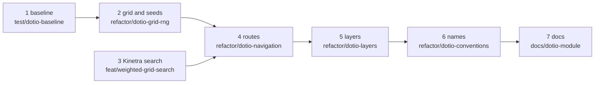
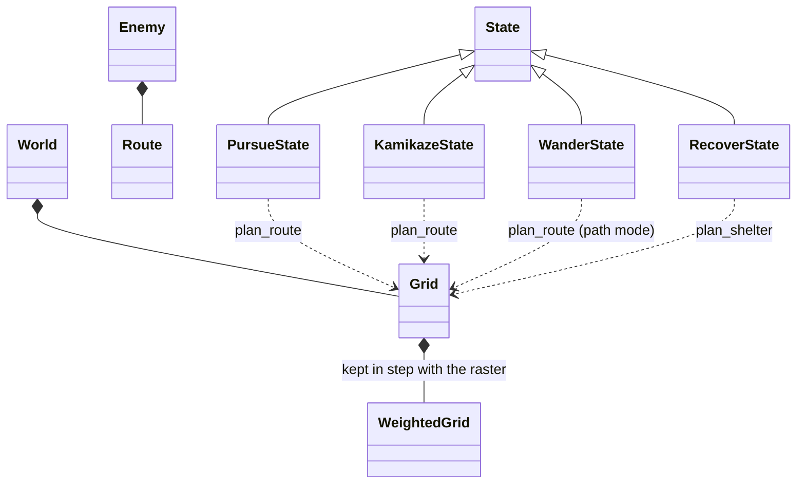

# Dotio restructuring

Status: accepted · Branches: `test/dotio-baseline` (step 1), `refactor/dotio-grid-rng` (step 2), Kinetra `feat/weighted-grid-search` (step 3), `refactor/dotio-navigation` (step 4), `refactor/dotio-layers` (step 5), `refactor/dotio-conventions` (step 6), `docs/dotio-module` (step 7) · Related: [quality roadmap, phase 6](2026-11-18-quality-roadmap.md#phase-6-dotio), [Dotio](../../labs/dotio/README.md), [Dotio architecture](../dotio-architecture.md), [Kinetra navigation](../../external/Kinetra/docs/engine/navigation.md)

Roadmap phase 6. Dotio still runs on the code it was ported with: a static occupancy grid, randomness that no seed controls, its own A*, priority queue, stack and graph, a logic header that includes a runtime header, and the naming of the original game. This phase first records how enemies behave today, then makes runs reproducible, moves route planning onto Kinetra's weighted grid, fixes the layers and names, and documents the module.

The user asked for this phase on 2026-11-21 and was not available for questions while it ran. Every decision below that the user did not make is marked *agent*; they are collected under [open points](#open-points) for review.

## Table of contents

- [Problem](#problem)
- [Goals and non-goals](#goals-and-non-goals)
- [Decisions](#decisions)
- [Design](#design)
  - [Steps](#steps)
  - [Step 1: baseline](#step-1-baseline)
  - [Step 2: one grid per world, one seed per run](#step-2-one-grid-per-world-one-seed-per-run)
  - [Step 3: goal search in Kinetra's weighted grid](#step-3-goal-search-in-kinetras-weighted-grid)
  - [Step 4: routes on the weighted grid](#step-4-routes-on-the-weighted-grid)
  - [Step 5: layers and dead code](#step-5-layers-and-dead-code)
  - [Step 6: conventions](#step-6-conventions)
  - [Step 7: documentation](#step-7-documentation)
- [Baseline](#baseline)
- [Affected areas](#affected-areas)
- [Test plan](#test-plan)
- [Review](#review)
- [Verification](#verification)
- [Pull request](#pull-request)
- [Playtest checklist](#playtest-checklist)
- [Open points](#open-points)

[Directory guide](README.md) · [Project overview](../../README.md) · [Documentation index](../README.md)

## Problem

Checked against `main` at `2cd2c8a` on 2026-11-21. The roadmap's relevance check holds; two of its findings are fixed already.

- **Global state.** `dotio::Grid` keeps its raster (`Array[155][155]`), `Origin` and `CellSize` in static members (`labs/dotio/include/dotio/navigation/grid.h:9-15`). Every world, test and the capture tool write the same array, so at most one Dotio session may exist (`labs/dotio/include/dotio/presentation/session.h:36`), and tests must call `open_map()` to undo what an earlier case left behind. `Origin` and `CellSize` never change after their definition (`grid.cpp:15-16`).
- **Randomness no seed controls.** `std::rand` jitters path-mode wander every update (`src/ai/state.cpp:36`). `std::random_device` picks wander targets (`grid.cpp:179`), the player's respawn and the ghost's start (`grid.cpp:196`), every enemy's fear on spawn and reload (`enemy.cpp:281`, `state.cpp:211`, `world.cpp:38`), and is the default seed of `World::Initialize` and `Application` (`world.h:64`, `application.h:242`). Measured with the [baseline](#baseline) harness: the same 24 seeds give different statistics and different fingerprints on every run.
- **Own navigation.** `Graph` (`src/navigation/graph.cpp`, 184 lines) holds A* and the shelter search `HideStar`, which repeats a 20-line quadrant condition twice. `Vertex` stores its own adjacency and a hand-written copy constructor; `PriorityQueue` wraps `std::priority_queue`; `priority_queue.cpp` is empty. `Stack` holds at most 50 cells: `Graph::GetPath` keeps the 50 nearest the start, so a longer route ends short of the player, and `PursueState` then replans on every decision tick because the route's end never matches the player's cell (`GridEntry::PathRefresh`). Kinetra has `kinetra::WeightedGrid` with the same eight-neighbor rule and no corner cutting.
- **Layers.** `application.h`, which the headless target `kinetra_dotio_logic` exposes, includes `<kinetra/runtime/debug_view.h>` for one member, the `kinetra::DebugMenu` panel (`application.h:8`, `:173`); the panel is presentation state. `dotio/math/gmath.h` includes `portable.h`, which puts `using std::max; using std::min;` in the global namespace of every Dotio file. *Fixed already:* the launcher no longer names `dotio::Difficulty`; it passes `dotio::difficulty_names()` and an index (`launcher/src/applications.cpp:24`). `<kinetra/runtime/timing.h>` is header-only and headless, and Demo and i4sim logic include it too; it is out of this phase's scope ([open points](#open-points)).
- **Conventions.** 17 Dotio headers use include guards; members and functions are PascalCase (`Position`, `Update()`), private members `_x` (`_cooldown`); `Vec2` and `GridEntry` alias their fields through unions (`X`/`Width`/`Left`/…), which reads inactive union members. `GridEntry::operator!=` returns true only when *both* row and column differ (`gmath.cpp:398`).
- **Dead code.** `Commands::pause`, `help`, `debug`, `ghost` and `paths` are never set by `read_commands` (`src/presentation/presentation.cpp:17-29`), only by tests; `Application::help` has no reader outside tests. `priority_queue.cpp` is empty. `GridEntry::ActivatePath`, `Grid::GridIntersection` and `enum class Variable` have no callers; `World::AddEnemy` ignores its last argument.
- **Tests.** 38 headless cases cover rules and the debug menu, but none checks that routes stay clear of walls, that pursuers reach the player, that no enemy gets stuck, or that a seed reproduces a run.

## Goals and non-goals

**Goals:**
- A seeded statistics baseline of today's enemy behavior at Easy, Medium and Hard, recorded before any behavior changes, and the same statistics after.
- One grid per world and every random value drawn from streams of the world seed: the same seed and the same input give the same run.
- Enemy routes and shelter search on `kinetra::WeightedGrid`, with Kinetra extended where Dotio needs more; Dotio's `Graph`, `Vertex`, `PriorityQueue` and `Stack` removed.
- Invariant tests: routes clear of walls, pursuers reach the player, no stuck enemies within a bounded time, determinism per seed; then a golden fingerprint that pins behavior for the remaining refactors.
- Logic without runtime-only headers, no global `using`, Lab naming and `#pragma once`, dead code removed, Dotio warning-free with warnings as errors.
- `///` contracts on every Dotio header and a module README that explains how the AI states use navigation.

**Non-goals:**
- New enemy behavior: steering wander, the fuzzy rules, combat, spawning and the difficulty presets stay as they are. Route-following details change only where the new planner forces it ([step 4](#step-4-routes-on-the-weighted-grid)).
- Replacing `dotio::math::Vec2` with `kinetra::Vec2` throughout ([open points](#open-points)).
- `kinetra::Navigation`, predictive passing and shared steering: phase 8.
- A new tour video: the existing tour is the recording of the old behavior (user decision).

## Decisions

| Decision | Choice | Why |
| --- | --- | --- |
| Recording of the old behavior | No new video; the tour video (`docs/media/kinetra-lab-tour.mp4`, linked from the root README) is the recording. The seeded statistics baseline is still made first | User decision, 2026-11-21 |
| Playtest | The user's job after the pull requests; this document lists what to check | User decision, 2026-11-21 |
| Pull requests | One per step, stacked: each Lab step starts on the previous one; the Kinetra step is its own pull request in SMB-M87/Kinetra, merged before step 4 | User decision (one pull request per logical step), with the cut into seven steps by the *agent* |
| Baseline harness | `kinetra_dotio_behavior_benchmark`: a scripted player walks to random cells and shoots at the nearest enemy in sight; the harness counts what enemies do. 24 seeds × 300 simulated seconds per difficulty, steering and path wander, run twice | *Agent.* A real game loop exercises pursuit, recovery and kamikaze; observing from outside keeps the harness valid for old and new code. The player plans with `kinetra::WeightedGrid`, independent of the A* under test. Two runs show the spread of today's unseeded code |
| Planner | `kinetra::WeightedGrid`, not `kinetra::Navigation` | *Agent.* Dotio's world is a raster of square cells. The weighted grid takes it cell by cell (`block`), applies the same eight-neighbor rule without corner cutting, and follows a streaming change by updating the cells that changed. `Navigation` plans around body geometry: 24,025 box bodies and a full `rebuild` for every residency change |
| Shelter search | Kinetra gains `WeightedGrid::search`: the cheapest route to the first cell, in order of route cost, that a predicate accepts, through cells a second predicate admits. Dotio keeps the hiding rule (sight blocked, away from the player, the fear count) as policy | *Agent.* Searching for the nearest cell with a property (cover, a free spot, an exit) is a reusable mechanism; what makes a cell a shelter is game rule. The old search ordered cells by route cost plus the distance back to the start; the new one by route cost alone, so shelters can be slightly different cells |
| Route length | Whole routes; the 50-cell cap goes | *Agent.* The cap stopped long pursuits short and made them replan every decision tick |
| Footprint | Routes for a point (zero half extents), as the old cell graph | *Agent.* Contact leaves an enemy touching a wall; a footprint test at its start point would then reject every route |
| Random streams | Per purpose, each seeded from the world seed and a fixed tag: population (spawn placement, exists), wander (steering heading, exists), behavior (fear, path-wander target and jitter), placement (player respawn, ghost start). Values from raw generator bits, not standard distributions | *Agent.* Separate streams keep one feature from shifting another's sequence; standard distributions differ between standard libraries, raw bits do not (as `wander.cpp` already does) |
| Seeds at the edge | `World` and `Application` take a seed without a default. `kinetra_dotio` gains `--seed`, and draws one from `std::random_device` only when it is absent; both it and the bundled launcher print the seed they play | *Agent.* The executables are composition roots, not simulation logic; a printed seed lets the user replay a playtest |
| Golden fingerprint | From step 4 on, a doctest case pins a seeded run (positions, states, kills) to one value. Steps 5 and 6 keep it unchanged | *Agent.* The strongest safety net for the renames; the same pattern as i4sim's golden test |
| Debug panel | `kinetra::DebugMenu` moves from `Application` to the session; the rows (`debug_entries()`) stay in logic | *Agent.* AGENTS.md puts debug rows in logic; the panel that draws them is presentation |
| Naming | Lab conventions throughout Dotio, `gmath` included: `snake_case` members and functions, `x_` private members, `#pragma once`, no field aliases | *Agent.* The roadmap asks for it; renames are mechanical and compiler-checked, with the fingerprint as proof |
| Warnings | Dotio warning-free, then `kinetra_directory_warnings(labs/dotio RECURSE AS_ERRORS)` | Lab rule for a module whose phase is done |
| Media | The tour stays. The Dotio screenshots and clips are refreshed with `capture_media.sh` in step 7 if the debug drawings of paths change visibly, and looked at before committing | Lab media rule; the tour part is the user's decision |

## Design

### Steps



*Takeaway:* behavior changes only in steps 2 (seeded randomness) and 4 (planner); every later step proves with the golden fingerprint that it changed nothing.

### Step 1: baseline

`labs/dotio/tests/behavior_benchmark.cpp` builds `kinetra_dotio_behavior_benchmark` (an explicit target, like i4sim's motion benchmark); CTest runs a 10-second smoke of it. Per run it creates an `Application` at a seed and difficulty, a 1280×720 camera at the initial zoom, and drives it with `advance()` at 60 Hz, as a session does:

- **Player.** Walks to a random free cell 6 to 16 cells away along a `kinetra::WeightedGrid` route through the current raster; picks a new walk when the window moves, the player respawns, or it makes no progress for 1.5 s. Shoots at the nearest enemy within 900 legacy pixels in sight. Mortal: deaths count.
- **Observer.** Reads each enemy slot every tick: spawns, removals (contact, kill, eviction), state and state changes, the route, position. *Stuck* means an enemy in a moving state (all but attack) stays within 25 legacy pixels of one point for 2 s. A fingerprint hashes player and enemy positions once a second.
- **Report.** One Markdown table per run: rates per minute of simulated time, or per enemy-minute (one simulated enemy for 60 s), and the fingerprint per difficulty.

The access to the world sits in three small functions at the top of the file, so later steps change only those when Dotio's interface changes.

### Step 2: one grid per world, one seed per run

- `Grid` becomes a value owned by `World` (`World::grid()`). `rows`, `columns`, `cell_size` and the origin become `constexpr` constants. Every user (AI states, wander, enemy, player, presentation, capture tool, tests) reaches the raster through its world. Pure refactor commit; the behavior stays as unseeded as before.
- Separate commit for the behavior change: the four random streams of [decisions](#decisions), drawn through raw-bit helpers. `Grid::GenerateGridEntry` and `Grid::GeneratePosition` take the generator they draw from.
- The seed defaults go; `kinetra_dotio --seed` is added. `session.h` drops "at most one session".
- Tests: two worlds from one seed and one command sequence stay identical for a minute of play; two seeds differ; two worlds coexist without touching each other's raster.

### Step 3: goal search in Kinetra's weighted grid

Kinetra branch `feat/weighted-grid-search` with its own [design document](../../external/Kinetra/docs/design/2026-11-21-weighted-grid-search.md) and pull request SMB-M87/Kinetra#17:

```cpp
/// Cheapest route from `start` to the first cell `accept` takes, offering cells in order of
/// route cost; a route enters only cells `enter` admits (all free cells when empty).
std::vector<Vec2> search(Vec2 start, const std::function<bool(int)> &accept,
                         const std::function<bool(int)> &enter = {}, Vec2 half_extents = {}) const;
```

It returns waypoints after `start`, ending at the accepted cell's center; empty when no admitted, reachable cell is accepted. `accept` is called once per settled cell, start first, in nondecreasing route cost, which makes a counting predicate well defined. `path()` and `search()` share one expansion loop. Additive API, no boundary change, so no ADR.

### Step 4: routes on the weighted grid



*Takeaway:* the grid is the only owner of walls for collision and for planning, so the planner can never disagree with what an enemy collides with.

- `Grid` owns a `kinetra::WeightedGrid` with one cell per raster cell, in legacy pixels (its corner is the raster origin). Every write to the raster goes through `Grid::set(row, column, value)`, which also blocks or frees the planning cell; residency changes call it for the cells that change, and the per-cell graph refresh disappears.
- `Route` (`navigation/route.h`) holds the waypoints an enemy follows: `next()`, `advance()`, `destination()`, `remaining()`, `clear()`. It replaces `Stack` in `Enemy`; the debug drawing walks `remaining()`.
- `plan_route(grid, from, to)` and `plan_shelter(grid, from, player, fear)` replace `Graph::AStar`, `Graph::HideStar` and `Graph::GetPath`. The shelter predicates keep the old rules: a cell is admitted when it lies in the half-planes away from the player that the old quadrant condition allowed and more than one cell from the player; a cell is accepted when the line from its center to the player hits a wall and more than `fear` such cells came before it.
- Following keeps the old rules: a waypoint is passed within 0.666 cells (0.1 cells for the last waypoint of a shelter route), and a pursuit replans when the player is no longer in the route's destination cell. Kinetra's route does not start with the enemy's own cell, and ends at the exact goal; the old one began at the own cell and ended at the goal cell's center.
- `Graph`, `Vertex`, `PriorityQueue`, `Stack` and the empty `priority_queue.cpp` are removed; `GridEntry::PathRefresh` moves into the route rule.
- The submodule pointer moves to the Kinetra branch commit, and after the Kinetra merge to its merge commit ([submodule rules](../../AGENTS.md#git-with-the-engine-submodule)).

### Step 5: layers and dead code

- `kinetra::DebugMenu` moves into the session; `application.h` no longer includes `<kinetra/runtime/debug_view.h>`.
- `portable.h` goes; each file includes what it uses and calls `std::min`/`std::max`.
- `Commands` keeps only what `read_commands` sets; `Application::help` and the toggles behind the removed fields go, and the tests drive pause and Ghost through the rows and flags the session uses.
- `GridEntry::ActivatePath`, `Grid::GridIntersection`, `enum class Variable` and `AddEnemy`'s ignored argument go. `GridEntry::operator!=` becomes the negation of `==` (it has no caller that depends on the old result; checked with `grep`).

### Step 6: conventions

Mechanical, compiler-checked renames, one commit per kind: `#pragma once`; `snake_case` functions and members; `x_` private members; no union aliases in `Vec2`, `Vec4` and `GridEntry` (each keeps one name per field). The capture tool, presentation and tests follow. `gmath.h` splits into `math/vector.h` (vectors, colors, segments) and `math/cell.h` (grid cells and partitions). The golden fingerprint stays identical.

### Step 7: documentation

`///` contracts on every Dotio header; the module README rewritten with the [module template](../../external/Kinetra/docs/documentation.md#module-readme-template), absorbing `docs/dotio-architecture.md`, with a section on how each AI state uses the planner. Warnings as errors for `labs/dotio`. Roadmap status updated.

## Baseline

Measured on 2026-11-21 at `2cd2c8a` (today's behavior) with `kinetra_dotio_behavior_benchmark --seeds 24 --seconds 300` (Release, seeds 1 to 24, 300 simulated seconds per run, 72 runs per table). Each table was produced twice; the second run's value follows the slash. They differ because today's code draws fear and respawn positions from `std::random_device`.

**Steering wander (default):**

| Statistic | Easy | Medium | Hard |
| --- | --- | --- | --- |
| Simulated enemies (mean) | 36.80 / 37.06 | 13.26 / 13.77 | 10.42 / 10.39 |
| Spawns / min | 44.94 / 44.46 | 49.42 / 50.12 | 71.50 / 70.86 |
| Player kills / min | 17.03 / 16.41 | 15.20 / 14.93 | 11.74 / 11.53 |
| Contacts with the player / min | 0.06 / 0.06 | 1.29 / 1.10 | 0.78 / 0.63 |
| Damage to player / min | 59.1 / 50.3 | 294.3 / 292.0 | 467.6 / 480.5 |
| Player deaths / 10 min | 0.00 / 0.00 | 15.83 / 15.58 | 34.67 / 35.75 |
| Arrows / enemy-min | 0.65 / 0.64 | 4.57 / 4.37 | 9.00 / 9.21 |
| Time in wander / attack / pursue (%) | 97.2 / 0.9 / 1.9 | 84.3 / 6.4 / 9.1 | 76.5 / 10.6 / 12.5 |
| Time in recover / kamikaze (%) | 0.0 / 0.0 | 0.0 / 0.2 | 0.1 / 0.3 |
| Sightings from wander / enemy-min | 0.53 / 0.53 | 1.84 / 1.75 | 2.86 / 2.93 |
| Pursuits / enemy-min | 0.38 / 0.39 | 2.12 / 2.11 | 3.59 / 3.59 |
| Pursuits that find the player (%) | 73.0 / 69.0 | 91.8 / 92.0 | 98.7 / 98.6 |
| Pursuit duration (s) | 3.84 / 4.09 | 2.86 / 2.85 | 2.11 / 2.02 |
| Recoveries / enemy-min | 0.00 / 0.00 | 0.01 / 0.00 | 0.02 / 0.02 |
| Kamikaze entries / enemy-min | 0.08 / 0.08 | 0.36 / 0.32 | 0.45 / 0.43 |
| Route-following ticks without a route (%) | 5.3 / 5.2 | 5.8 / 5.7 | 6.2 / 6.2 |
| Stuck episodes / enemy-min | 0.000 / 0.000 | 0.004 / 0.002 | 0.006 / 0.002 |
| Ticks overlapping a wall (%) | 0.00 / 0.00 | 0.00 / 0.00 | 0.00 / 0.00 |
| Attack distance (cells) | 8.19 / 8.31 | 5.19 / 5.08 | 4.78 / 4.70 |

**Path wander** (`--wander path`, the original game's wander along A* routes):

| Statistic | Easy | Medium | Hard |
| --- | --- | --- | --- |
| Simulated enemies (mean) | 39.32 / 40.15 | 13.00 / 12.70 | 9.95 / 10.20 |
| Player kills / min | 17.33 / 16.63 | 15.60 / 15.48 | 11.64 / 11.43 |
| Damage to player / min | 52.7 / 48.8 | 292.6 / 296.1 | 482.3 / 468.7 |
| Player deaths / 10 min | 0.00 / 0.00 | 15.00 / 15.92 | 36.17 / 34.83 |
| Time in wander / attack / pursue (%) | 97.3 / 0.8 / 1.8 | 83.9 / 6.5 / 9.3 | 77.8 / 11.0 / 10.9 |
| Pursuits / enemy-min | 0.34 / 0.32 | 2.26 / 2.17 | 3.42 / 3.47 |
| Pursuits that find the player (%) | 72.1 / 72.8 | 93.2 / 91.7 | 99.1 / 98.9 |
| Kamikaze entries / enemy-min | 0.09 / 0.07 | 0.37 / 0.40 | 0.43 / 0.42 |
| Route-following ticks without a route (%) | 5.2 / 5.3 | 5.8 / 5.9 | 6.4 / 6.4 |
| Stuck episodes / enemy-min | 0.017 / 0.018 | 0.001 / 0.006 | 0.003 / 0.002 |

Reading the baseline:
- Difficulty separates clearly: damage to the player per minute roughly doubles from Easy to Medium and grows by half again to Hard; harder enemies pursue more often, find the player more often and sooner, and keep closer when they attack.
- Easy has many simulated enemies because its player never dies: survival widens the spawn area to the whole activity window, where enemies wander out of the player's way.
- Recovery is rare (an enemy must fire ten arrows first): too rare for statistics to compare shelter searches, so [step 4](#test-plan) tests the shelter search directly.
- About 5–6% of route-following ticks have no route: the tick that enters a state clears the route, and the plan follows at the next decision tick (20 Hz).
- Nothing overlaps walls; stuck episodes are rare (at most one per 50 enemy-minutes).

### After step 2

Same command, at `refactor/dotio-grid-rng`. Runs are now reproducible: the fingerprints repeat (steering: `ad3797a3279b4837 8eef746b9f417f93 da172c588d995951`). The statistics stay within the baseline's run-to-run spread, as a change of where random values come from should; the largest move is path wander on Medium, a tenth fewer sightings and pursuits, from one seeded sample of a chaotic game.

| Statistic | Easy | Medium | Hard |
| --- | --- | --- | --- |
| Damage to player / min, steering / path | 51.5 / 54.1 | 288.8 / 285.0 | 470.3 / 464.5 |
| Player deaths / 10 min, steering / path | 0.00 / 0.00 | 14.92 / 13.33 | 35.08 / 34.92 |
| Pursuits / enemy-min, steering / path | 0.39 / 0.35 | 2.16 / 1.86 | 3.48 / 3.40 |
| Pursuits that find the player (%), steering / path | 70.9 / 69.0 | 91.9 / 91.1 | 98.4 / 98.9 |
| Kamikaze entries / enemy-min, steering / path | 0.08 / 0.08 | 0.33 / 0.34 | 0.40 / 0.42 |
| Route-following ticks without a route (%), steering / path | 5.2 / 5.2 | 6.0 / 5.9 | 6.1 / 6.2 |
| Stuck episodes / enemy-min, steering / path | 0.000 / 0.017 | 0.003 / 0.004 | 0.003 / 0.002 |
| Ticks overlapping a wall (%) | 0.00 | 0.00 | 0.00 |

### After step 4

Same command, at `refactor/dotio-navigation`; both baseline runs, then the new value in bold. Steering-wander fingerprints `3755ca3a6a2422e7 06c7e8afcc466887 7cca05806d2ffdb7`.

| Statistic | Easy | Medium | Hard |
| --- | --- | --- | --- |
| Damage to player / min | 59.1 / 50.3 → **51.9** | 294.3 / 292.0 → **293.6** | 467.6 / 480.5 → **474.5** |
| Player deaths / 10 min | 0.00 / 0.00 → **0.00** | 15.83 / 15.58 → **15.17** | 34.67 / 35.75 → **35.50** |
| Time in pursue (%) | 1.9 / 2.1 → **2.1** | 9.1 / 8.9 → **9.3** | 12.5 / 12.0 → **13.0** |
| Pursuits / enemy-min | 0.38 / 0.39 → **0.37** | 2.12 / 2.11 → **2.19** | 3.59 / 3.59 → **3.74** |
| Pursuits that find the player (%) | 73.0 / 69.0 → **69.2** | 91.8 / 92.0 → **91.7** | 98.7 / 98.6 → **98.8** |
| Pursuit duration (s) | 3.84 / 4.09 → **4.25** | 2.86 / 2.85 → **2.79** | 2.11 / 2.02 → **2.05** |
| Recoveries / enemy-min | 0.00 / 0.00 → **0.00** | 0.01 / 0.00 → **0.00** | 0.02 / 0.02 → **0.01** |
| Kamikaze entries / enemy-min | 0.08 / 0.08 → **0.07** | 0.36 / 0.32 → **0.33** | 0.45 / 0.43 → **0.38** |
| Route-following ticks without a route (%) | 5.3 / 5.2 → **5.2** | 5.8 / 5.7 → **5.8** | 6.2 / 6.2 → **6.1** |
| Stuck episodes / enemy-min | 0.000 / 0.000 → **0.000** | 0.004 / 0.002 → **0.002** | 0.006 / 0.002 → **0.003** |
| Ticks overlapping a wall (%) | 0.00 / 0.00 → **0.00** | 0.00 / 0.00 → **0.00** | 0.00 / 0.00 → **0.00** |
| Attack distance (cells) | 8.19 / 8.31 → **8.39** | 5.19 / 5.08 → **5.25** | 4.78 / 4.70 → **4.73** |

Path wander, baseline run 1 → after step 4:

| Statistic | Easy | Medium | Hard |
| --- | --- | --- | --- |
| Damage to player / min | 52.7 → **52.9** | 292.6 → **288.6** | 482.3 → **466.8** |
| Pursuits / enemy-min | 0.34 → **0.34** | 2.26 → **2.07** | 3.42 → **3.59** |
| Pursuits that find the player (%) | 72.1 → **71.6** | 93.2 → **92.2** | 99.1 → **99.2** |
| Route-following ticks without a route (%) | 5.2 → **5.3** | 5.8 → **6.1** | 6.4 → **6.2** |
| Stuck episodes / enemy-min | 0.017 → **0.012** | 0.001 → **0.006** | 0.003 → **0.001** |
| Ticks overlapping a wall (%) | 0.00 → **0.00** | 0.00 → **0.00** | 0.00 → **0.00** |

Reading it:
- The new planner keeps every statistic within, or within a few percent of, the baseline's run-to-run spread: difficulty separates as before, pursuits find the player as often, and no enemy overlaps a wall.
- Whole routes did not make pursuits find the player more often in the benchmark: its player walks only 6 to 16 cells, so few pursuits needed more than 50 cells. The [pursuit case](#test-plan) shows the difference directly: a far pursuer now follows one route instead of replanning every decision tick.
- Route-following ticks without a route stay at 5–6%: they are the decision tick between entering a state and its first plan, not failed plans.
- Stuck episodes stay rare and inside the baseline's range in both wander modes.

## Affected areas

- `labs/dotio/` (all of it), `labs/dotio/CMakeLists.txt`, the root `CMakeLists.txt` (warnings as errors).
- `tools/capture/src/dotio_player.cpp` and its tests (grid access).
- `launcher/src/applications.cpp` only if the session factory signature changes (it does not in the plan).
- Kinetra: `include/kinetra/simulation/weighted_grid.h`, `src/simulation/weighted_grid.cpp`, `tests/weighted_navigation_tests.cpp`, `docs/engine/navigation.md`; the `external/Kinetra` pointer.
- Docs: `labs/dotio/README.md`, `docs/dotio-architecture.md` (absorbed), `docs/README.md`, `docs/architecture.md`, this document, the roadmap's phase 6 row.

## Test plan

| Behavior | Test | Level |
| --- | --- | --- |
| The baseline harness runs | CTest `kinetra_dotio_behavior_smoke` (10 s, one seed) | Targeted |
| Grid refactor changes nothing | The 38 existing cases, unchanged apart from fixture plumbing | Targeted |
| One seed, one run | New case: two applications, same seed and commands, identical positions, states and kills for 60 s; other seed differs | Targeted |
| Worlds are independent | New case: two worlds with different rasters do not change each other | Targeted |
| `WeightedGrid::search` | Kinetra cases: nearest accepted cell, enter filter, unreachable, counting predicate order, start accepted | Kinetra targeted, then Full |
| Routes are clear of walls | New case: on generated terrain of several seeds, routes between random free cells pass `segment_grid` between every two waypoints | Targeted |
| Pursuers reach the player | New case: an enemy pursuing a hidden, standing player in a generated maze gets sight of it within a bounded time, for several seeds | Targeted |
| Shelter search | Updated cases: the shelter is out of the player's sight, away from the player and the fear count holds; failure at one health starts kamikaze | Targeted |
| No stuck enemies | New case: a seeded population around a standing player for 60 s; no enemy in a moving state stays within 25 pixels of one point for 2 s | Targeted |
| Long routes | New case: a pursuit longer than 50 cells reaches its destination without replanning every decision tick | Targeted |
| Refactors after step 4 change nothing | Golden fingerprint case | Targeted |
| Whole phase | `cmake --workflow --preset graphics`, smoke runs, pull request CI | Full |
| Behavior after | The benchmark again, compared with the [baseline](#baseline) | Report |

## Review

### Step 4

- `plan_shelter` reduces the old 20-line quadrant condition to its two factors (same side along one axis including the player's line, strictly along the other) and keeps "more than one cell from the player".
- A failed replan keeps the old route, as `Graph::AStar` failing left `Path` untouched before.
- Kinetra's route starts after the enemy's own cell, so a pursuer no longer first returns to its cell center; the pursuit case checks routes stay clear of walls from the exact start.
- The golden fingerprint is skipped on Windows like the other trajectory fingerprints (`CMakePresets.json`), and recorded only after the behavior change.

### Step 2

- `Grid::TerrainCell` kept a `static thread_local` district cache; it is now a member of the grid (a memo of a pure function, but still shared state across worlds).
- `GridEntry::operator!=` is still the buggy `&&` form; it has no caller (`grep`), and step 5 fixes it.
- `wander.cpp`'s `signed_unit` now uses the shared `math::unit`; `unit * 2 - 1` and the old `bits / 2^23 - 1` give the same float for every 24-bit value, so steering wander is unchanged (its tests pass unchanged).

## Verification

### Step 4

| Check | Result |
| --- | --- |
| `cmake --build --preset dev` (everything, Kinetra branch pointer) | passed |
| `ctest --preset dev -R 'capture\|dotio\|menu'` | 83/83 passed before the fingerprint case; then `ctest --test-dir build-release -R '^kinetra_dotio'` 45/45 |
| Golden fingerprint, Debug and Release | identical (`0x9d126f5dc5068339`) |
| `ctest --preset dev -R '^kinetra_i4sim_(golden\|pressure)'` | 17/18; the RVO golden case fails identically with Kinetra `main` in this Debug build (pre-existing, platform-sensitive, already excluded on Windows) |
| Kinetra `cmake --workflow --preset graphics` on `feat/weighted-grid-search` | passed |
| Benchmark | see [after step 4](#after-step-4) |

### Step 2

| Check | Result |
| --- | --- |
| `cmake --build --preset dev` (everything, warnings on) | passed; no new warnings in changed files |
| `ctest --preset dev -R 'capture\|dotio\|menu'` | 82/82 passed (two new cases) |
| `kinetra_dotio --seed 7 --frames 30` (offscreen) | exit 0, prints `World seed: 7` |
| Benchmark twice with the same seeds | identical fingerprints |
| `python3 external/Kinetra/tools/check_docs.py` | passed |
| Pull request CI | see the pull request |

Local Full (`cmake --workflow --preset graphics`) runs once on the top of the stack, after step 7.

## Pull request

Filled in per step.

## Playtest checklist

Filled in at the end of the phase.

## Open points

- **For the user's review: every *agent* decision above**, in particular the planner choice (weighted grid, not `Navigation`), the Kinetra `search` API, whole routes without the 50-cell cap, and the four random streams.
- `<kinetra/runtime/timing.h>` (`FixedClock`, `RateCounter`) is header-only and headless but sits under `runtime/`; Demo, Dotio and i4sim logic include it. Moving it to `view/` or `simulation/` is a Kinetra include-layout change for later.
- `dotio::math::Vec2` duplicates `kinetra::Vec2` with extra operators (length comparisons, component products). Replacing it is a larger change than renaming and is left for later.
