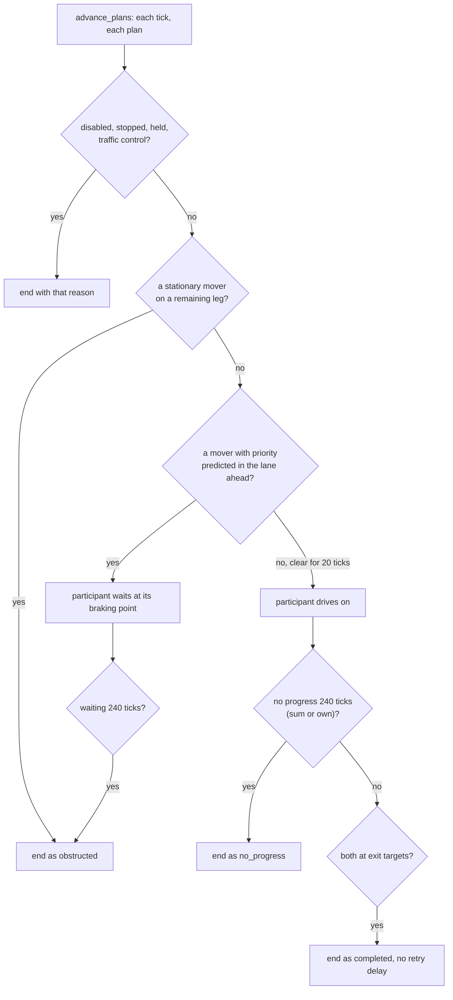

# i4sim passing under pressure

Status: accepted · Branches: `test/i4sim-passing-causes` (step 1), `fix/i4sim-guarded-passing` (steps 2 and 3), `fix/i4sim-destination-standstill` (step 4) · Related: [quality roadmap, phase 7](2026-11-18-quality-roadmap.md#phase-7-predictive-passing-under-pressure), [i4sim motion changes keep routes](2026-11-20-i4sim-tuning-stall.md), [i4sim restructuring](2026-11-19-i4sim-restructuring.md), [i4sim tests](../../labs/i4sim/tests/README.md), [factory simulation architecture](../factory-simulation-architecture.md#predictive-passing)

Roadmap phase 7. Predictive passing in i4sim must stay safe and keep traffic flowing under pressure, with Reciprocal as the reference profile, and the standstills near a destination found on 2026-11-20 must be explained. This document first establishes the causes from recorded runs, then changes behavior in two steps, each on its own branch and pull request, stacked in that order.

The user asked for the phase while away and asked not to wait for answers: every decision the agent took on its own is marked ✱ in [Decisions](#decisions) and listed for review under [Open points](#open-points).

## Table of contents

- [Problem](#problem)
  - [Baseline at the start](#baseline-at-the-start)
  - [Step 1: why Improved has more contacts with passing](#step-1-why-improved-has-more-contacts-with-passing)
  - [Where a plan goes wrong](#where-a-plan-goes-wrong)
  - [Step 4: why two movers stand still near a destination](#step-4-why-two-movers-stand-still-near-a-destination)
- [Goals and non-goals](#goals-and-non-goals)
- [Decisions](#decisions)
- [Design](#design)
  - [Steps](#steps)
  - [Step 1: diagnostics and a new pressure case](#step-1-diagnostics-and-a-new-pressure-case)
  - [Step 2: guarded maneuvers](#step-2-guarded-maneuvers)
  - [Step 4: a way out for a boxed-in mover](#step-4-a-way-out-for-a-boxed-in-mover)
- [Affected areas](#affected-areas)
- [Test plan](#test-plan)
- [Review](#review)
- [Verification](#verification)
- [Pull requests](#pull-requests)
- [Measurement harness](#measurement-harness)
- [Open points](#open-points)

[Directory guide](README.md) · [Project overview](../../README.md) · [Documentation index](../README.md)

## Problem

### Baseline at the start

Measured on 2026-11-21 at `2cd2c8a` (Lab `main`, Kinetra `7d3e586`) with `kinetra_i4sim_motion_benchmark`, Release, 50,000 ticks, recovery and traffic policies off. Each cell is passing **off / on**.

| Profile | Blueprint | Seed | Completed | Contacts | Contact episodes | Waiting ticks | Stuck (at end) | Plans (cancelled) | Contacts in a plan |
| --- | --- | --- | --- | --- | --- | --- | --- | --- | --- |
| Reciprocal | MAS-demonstrator | 42 | 10 / 10 | 0 / 0 | 0 / 0 | 24006 / 25041 | 1 (1) / 1 (1) | 4 (1) | 0 |
| Reciprocal | MAS-demonstrator | 915839214 | 16 / 16 | 0 / 0 | 0 / 0 | 12872 / 10842 | 2 (1) / 1 (1) | 5 (0) | 0 |
| Reciprocal | 3840x2400 | 42 | 59 / 59 | 0 / 0 | 0 / 0 | 1583 / 3095 | 0 / 0 | 11 (5) | 0 |
| Reciprocal | 3840x2400 | 915839214 | 61 / 61 | 0 / 0 | 0 / 0 | 651 / 3177 | 0 / 0 | 7 (3) | 0 |
| Reciprocal | 8640x4800 | 42 | 95 / 99 | 0 / 0 | 0 / 0 | 48187 / 45668 | 6 (0) / 6 (0) | 244 (87) | 0 |
| Reciprocal | 8640x4800 | 915839214 | 93 / 103 | 0 / 0 | 0 / 0 | 64702 / 58203 | 15 (1) / 10 (2) | 219 (74) | 0 |
| Improved | MAS-demonstrator | 42 | 16 / 14 | 53 / 60 | 9 / 10 | 278 / 5452 | 0 / 1 (1) | 3 (2) | 0 |
| Improved | MAS-demonstrator | 915839214 | 16 / 14 | 204 / 212 | 12 / 16 | 288 / 2019 | 0 / 1 (0) | 4 (4) | 0 |
| Improved | 3840x2400 | 42 | 54 / 58 | 1 / 0 | 1 / 0 | 853 / 1573 | 1 (0) / 2 (0) | 7 (4) | 0 |
| Improved | 3840x2400 | 915839214 | 60 / 56 | 18 / 0 | 4 / 0 | 1055 / 1538 | 1 (0) / 2 (0) | 4 (3) | 0 |
| Improved | 8640x4800 | 42 | 98 / 96 | 384 / 767 | 71 / 81 | 2595 / 34343 | 2 (0) / 4 (0) | 242 (96) | 17 |
| Improved | 8640x4800 | 915839214 | 99 / 101 | 726 / 823 | 78 / 71 | 2953 / 33940 | 4 (1) / 6 (0) | 224 (89) | 5 |

The Reciprocal rows and the Improved `8640x4800` rows equal the [phase 4 baseline](../../labs/i4sim/tests/README.md#motion-benchmark). The Improved `MAS-demonstrator` and `3840x2400` rows differ: changes merged since 2026-11-19 (motion changes keep routes, MAS as a test fixture, the Kinetra navigation rebuild) moved them; which one was not bisected. *Contact episodes* is a new column of this phase: contacts of one pair grouped while less than 500 ticks lie between them.

### Step 1: why Improved has more contacts with passing

Replayed from the recorded runs of `8640x4800` (seed and tick from the event log; harness in [Measurement harness](#measurement-harness)). Every contact of the passing-on run was replayed from a copy of the simulation taken at most 300 ticks before it, with passing switched off at that copy:

| Seed | Contacts with passing | Also without passing, from 300 ticks before | Only with passing | Of those: in a plan | Within 400 ticks after a plan ended | Later |
| --- | --- | --- | --- | --- | --- | --- |
| 42 | 767 | 564 | 203 | 17 | 23 | 163 |
| 915839214 | 823 | 769 | 54 | 5 | 6 | 43 |

- **Most contacts do not need passing.** 74% and 93% of the contacts happen just the same when passing is turned off 300 ticks before. Passing changes *which* situations a run reaches, not how often Improved touches in them.
- **The count is driven by a few jostling pairs.** Improved's contacts come in episodes: one pair touches, separates and touches again, for hundreds or thousands of ticks, usually a moving mover beside a parked or processing one in a parking area (442 of 767 and 604 of 823 contacts involve a mover slower than 0.05 mm/tick). The number of episodes barely changes with passing (71 → 81 and 78 → 71); the ten largest episodes hold 489 of 767 and 596 of 823 contacts. With seed 42 the largest single episode is movers 81 and 87 at ticks 18595 to 21243: 191 contacts while 81 leaves its parking place at (2168, 2808) and 87 arrives at the next one, 300 ticks after both left their plans. Without passing the largest episode has 49 contacts (movers 28 and 29, ticks 25937 to 26568).
- So the doubling with seed 42 is mostly one long episode that passing happened to steer the run into, and the same profile without passing has episodes of the same kind. **This is a limit of the Improved profile** (seek-and-avoid steering that keeps re-touching a stationary neighbor), not of passing. Reciprocal has no contact in any of the twelve runs.

### Where a plan goes wrong

The contacts *in* a plan (17 and 5) and the pressure scenarios show what passing itself gets wrong. Every case below was replayed tick by tick from its seed:

1. **The lanes are checked only when the plan forms.** Plan 216 (movers 7 and 25, seed 42) formed at tick 45829 with clear lanes. Mover 9 then parked at (2225, 1780), on the far side of mover 7's exit leg. Mover 7 pressed against it from tick 46432, ten contacts in 120 ticks, until the plan ended at tick 46550 for lack of progress. Movers 81 (plan 91, tick 23390) and 37 (plan 149, tick 34899) touched movers that drove into their lanes after formation. The new pressure case below reproduces this with three movers.
2. **The progress check sums both participants.** A plan only ends after 240 ticks in which the *summed* distance to both targets did not shrink. Plan 216 crossed for 620 ticks: its partner's progress kept it alive while mover 7 stood against mover 9.
3. **A completed plan blocks the next one.** In `pressure-three-oncoming` under Reciprocal, mover 0 completes its pass with mover 1 at tick 558 and is then 480 mm from mover 2, enough room for a new plan (at least 258 mm). But both participants of any ended plan wait `passing_retry_ticks` (120) before they may join a new one; by tick 678 they are 117 mm apart, too close to form a plan, and Reciprocal holds both in front of each other until the end (both creep at 0.052 mm/tick, `stuck=1`).
4. **A participant drives on through a mover that stopped on its target.** In the new case under Reciprocal, mover 0 completes its pass and then pushes the mover standing on its exit target ahead of it through reciprocal avoidance for about 2000 ticks.

### Step 4: why two movers stand still near a destination

The [measurement harness of the tuning-stall work](2026-11-20-i4sim-tuning-stall.md#measurement-harness) (48 runs: four blueprints, six seeds, Improved and Reciprocal, 12,000 ticks, no change) ends with a stuck mover in 2 runs: `4320x2400` under Reciprocal with seeds 915839214 and 2026. Both end in the same place. Replayed with seed 2026:

- The parking places of movers 22 to 27 lie in the bottom row of `4320x2400` (cells 240 mm high, y 2160 to 2400), below the producer cells at (2520, 2040) and (3240, 2040). A parked APM4220 (127 mm) leaves a strip of 108 mm above it, too low for another 127 mm mover, so a mover enters and leaves this row only through the free cells above it, (2760, 2040), (3000, 2040) and (3480, 2040).
- At tick 7800 mover 25 leaves its parking place (3359.5, 2331.5) with a product for (3039.5, 1839.5). It drives up into the strip, cannot pass parked mover 26 to the east, and a replanned route sends it west along the strip. At tick 8400 it stands at (3085, 2223.5): the producer cell's corner (3120, 2160) is 100.5 mm to its right and parked mover 22's corner (3019.5, 2268) 108 mm below it, so its 127 mm body fits neither up nor west. The only way out is back east.
- Its two routes, (2760, 2040) and (2760, 2280), both lead west. Every 100 ticks without progress `MotionStep::follow_route` replans, and `grid_route` refines the grid route around stationary movers (`labs/i4sim/src/simulation/routing.cpp`), but the refinement only adds the corners of obstacles near the grid route to its nodes. Both grid routes lead west, so no refined route leads east; the refinement fails and the mover keeps the obstructed route. It slides back and forth for 1900 ticks, a stuck mover on its own.
- At tick 10340 mover 23 returns to its parking place (3090.5, 2331.5), which mover 25's body overlaps by 19 mm. Reciprocal avoidance stops it at (3214, 2336.5), 123.6 mm from its destination, and now mover 23 also closes the way east. Neither moves again: the *two movers blocking each other about 120 mm from a destination* of the roadmap. Mover 23's route is its destination alone, so it has nothing to replan.
- RECOVERY (route recovery with `kinetra::Navigation` around blocked cells and movers) frees mover 25 in this run, but the 48 runs with RECOVERY on end with 7 stuck runs. Six of them are mover 18 on `4320x2400` under Improved at (800.5, 1757.5): its recovery detour runs straight to (800.5, 1359.5), past the corner of the blocked cell at (600, 1560) with 3 mm to spare, and the border constraint stops it there. That is a separate failure of route recovery, recorded under [Open points](#open-points).

The trap is not caused by Reciprocal: under Improved the same runs take other paths. A blueprint with a narrower aisle or a different seed can lead any profile into it.

## Goals and non-goals

**Goals:**
- Name the causes of Improved's extra contacts and of the standstills from replayed runs, with seed and tick, and keep the tools that found them.
- Passing that rechecks its maneuver while it runs: a mover that enters, crosses or stops in a lane makes the participant wait, and an obstruction that does not clear ends the plan, under one fixed priority.
- The pressure scenarios end without contacts and with every mover arrived, under Reciprocal and Improved, and become required outcomes.
- With passing on, Reciprocal shows no regression in the benchmark against passing off.
- A mover boxed in by stationary movers on its route finds the way out that exists.

**Non-goals:**
- Making Improved contact-free. Its jostling episodes happen without passing; they are a profile limit.
- Turning passing on by default, unless the measurements justify it.
- Changing route recovery (RECOVERY) or its corner failure.
- Moving passing to Kinetra (phase 8).

## Decisions

✱ marks a decision the agent took without the user, recorded for review under [Open points](#open-points).

| Decision | Choice | Why |
| --- | --- | --- |
| Pull requests ✱ | Three, stacked: diagnostics and causes; guarded passing with the measured result; the standstill | Each changes behavior for one reason, so a changed golden or pressure line has one explanation. The standstill happens without passing, but stacking avoids conflicts in the same files |
| Improved's extra contacts ✱ | Documented as a profile limit; no change to Improved steering | 74–93% of them recur without passing, and their count follows a few long jostling episodes that also occur without passing |
| Contact episodes ✱ | A new benchmark column, contacts of one pair grouped while less than 500 ticks lie between them | Contact starts overstate how often Improved meets a new conflict; episodes show it |
| Event log export ✱ | `kinetra_i4sim_motion_benchmark --events <directory>` writes each run's events as CSV | A contact or plan can be replayed from blueprint, seed and tick without a debugger |
| Retry after a completed plan ✱ | None; the 120-tick retry applies only after a plan that ended without completing | The retry protects against thrashing after a failure. After a completed pass it only delays the next pass until the movers are too close for one (cause 3) |
| Who yields ✱ | A participant yields to every mover outside its plan and to participants of older plans (lower id); it never yields to a younger plan | One fixed order, so two plans cannot wait for each other and a decision does not flip back and forth |
| How a participant yields ✱ | It stops at its braking point and waits until the lane ahead has been clear for 20 ticks; a mover that stands still on a remaining leg, or an obstruction that lasts 240 ticks, ends the plan as `obstructed` | Waiting suits a mover that passes by; a stationary one will not clear. The braking point keeps the stop within the acceleration limit |
| Progress check ✱ | A plan also ends when a participant on its way does not get closer to its own target for 240 ticks | Cause 2: the summed check hid a participant pressed against an obstacle |
| New end reason ✱ | `PassingEnd::obstructed`, after `traffic_control` and before `no_progress` in the order of checks | The event log must say why a plan was abandoned; `no_progress` would hide the guard |
| Passing default ✱ | Stays off unless the measurements of step 3 show no regression for both profiles | The roadmap's condition; Improved is mixed already |
| Boxed-in mover ✱ | When the stall replanning finds the route still obstructed by stationary movers, plan a `Navigation` route around the bodies, as route recovery does, even with RECOVERY off | The existing refinement cannot leave the grid route's topology; Navigation plans in free space and finds the way back east |

## Design

### Steps

| Step | Branch | Behavior change |
| --- | --- | --- |
| 1 Causes | `test/i4sim-passing-causes` | None: diagnostics, a new pressure case that records today's outcome, this document |
| 2–3 Guarded passing, measured | `fix/i4sim-guarded-passing` | Passing only: retry, guard, progress per participant; pressure lines become required outcomes; benchmark before and after |
| 4 Standstill | `fix/i4sim-destination-standstill` | Stall replanning of a boxed-in mover |

### Step 1: diagnostics and a new pressure case

- `test::contact_episodes` in `event_counts.h` groups contact starts per pair (or mover and border) while less than `contact_episode_gap_ticks` (500) lie between two of them. The benchmark prints it as `contact_episodes`.
- `--events <directory>` makes the benchmark write `<blueprint>-<seed>.csv` per run: tick, kind, plan, both movers, end reason, border and passing flags.
- A fifth pressure scenario on the `pressure-lane-intrusion` fixture: movers 0 and 1 pass head-on, and mover 2 drives to (1330, 636), mover 0's exit target, and stops there after the plan formed. The case first checks that mover 2 stands within 130 mm of an active passing target, then compares its recorded line. Today: under Reciprocal mover 2 is stuck for more than 2000 ticks (cause 4); under Improved the plan ends for lack of progress.

### Step 2: guarded maneuvers

Planned; refined on its branch.



*Takeaway:* a plan is checked against the movers around it in every tick, not only when it forms; a passing mover makes a participant wait, a standing one ends the plan.

- *Remaining legs:* before crossing, the participant's position to its entry target and on to its exit target; while crossing, its position to its exit target. Swept with the footprint plus `clearance_mm`, as at formation.
- *Lane ahead:* the part of the remaining legs a participant can reach within the steering horizon plus its braking distance (`speed * horizon + braking_distance(speed, force)`). Another mover is *predicted in it* when its footprint, swept from its position along its velocity for the same horizon, overlaps.
- *Priority:* movers outside every plan, then plans by id. A participant ignores participants of younger plans.
- *Stationary:* idle, unreachable or held. A moving mover that only stands still is handled by waiting and the 240-tick limit.

### Step 4: a way out for a boxed-in mover

Planned; refined on its branch. In `MotionStep::follow_route`, after the stall replanning: if the planned route is still obstructed by a stationary mover (the same test `grid_route` uses), the mover gets a route from `recover_route`, which plans with `kinetra::Navigation` around blocked cells and all other bodies. A found route is a detour, as with RECOVERY; without one the mover keeps its route and tries again after the next replanning period.

## Affected areas

- Step 1: `labs/i4sim/tests/include/i4sim/testing/event_counts.h`, `labs/i4sim/tests/motion_benchmark.cpp`, `labs/i4sim/tests/pressure_tests.cpp`, `labs/i4sim/tests/simulation_tests.cpp`, `labs/i4sim/tests/README.md`, this document and the design index.
- Step 2: `labs/i4sim/src/simulation/predictive_passing.cpp`, `include/i4sim/simulation/detail/predictive_passing.h`, `include/i4sim/simulation/events.h`, `simulation_constants.h`, the pressure and simulation suites, golden lines if they change, `labs/i4sim/README.md`, `docs/factory-simulation-architecture.md`, the roadmap's Status row.
- Step 4: `labs/i4sim/src/simulation/motion_step.cpp`, `routing.cpp` and `detail/routing.h`, the simulation suite, golden lines if they change, the i4sim README.

## Test plan

| Behavior | Test | Level |
| --- | --- | --- |
| Contact episodes group repeated contacts per pair, by the gap | `kinetra_i4sim:contact episodes group the repeated contacts of one pair` | Targeted |
| A mover stopping on a passing target: today's outcome recorded | `kinetra_i4sim_pressure:a mover stopping on a passing target under {reciprocal,improved} steering ...` | Targeted |
| Measuring changes nothing | The benchmark with the new column reproduces every count of the baseline above | Manual |
| Step 2: all five pressure scenarios end with every mover arrived, no contact and no stuck mover | The pressure suite, renamed to required outcomes | Targeted |
| Step 2: a completed plan lets its movers form a new plan at once; a cancelled one still waits | New simulation cases | Targeted |
| Step 2: a mover that stops on a remaining leg ends the plan as `obstructed`; a crossing mover makes the participant wait and the plan completes | New simulation cases | Targeted |
| Step 2: no regression for Reciprocal with passing on | Benchmark, both seeds, three layouts | Manual, recorded here |
| Step 4: the trapped mover of `4320x2400` seed 2026 leaves; the 48-run harness ends without the standstill | A simulation case on a small fixture; the harness | Targeted, manual |
| Everything else keeps its behavior | Golden, simulation, controller suites; changed lines explained | Targeted, then Full |

## Review

To be filled per step.

## Verification

### Step 1

| Check | Result |
| --- | --- |
| `cmake --build --preset release --target kinetra_i4sim_tests kinetra_i4sim_pressure_tests kinetra_i4sim_motion_benchmark` | Built, no warning |
| `ctest --preset release -R '^kinetra_i4sim'` | See the pull request |
| Benchmark with `contact_episodes` | Every count of the baseline unchanged |

## Pull requests

### Step 1

Title: `test(i4sim): replay the causes of passing contacts and standstills`

**Summary.** Roadmap phase 7, step 1. Establishes from replayed runs why Improved has more contacts with predictive passing on, where a passing plan goes wrong, and why two movers stand still near a destination on `4320x2400`. No behavior change.

**Changes.**
- Benchmark: a `contact_episodes` column and `--events <directory>`, which writes each run's event log as CSV.
- `test::contact_episodes` in the shared event counts, with a test.
- A fifth pressure scenario: a mover stopping on a passing target, recorded with today's (failing) outcome under both profiles.
- Design document with the causes, the plan for steps 2 to 4, and the decisions taken without the user.
- i4sim test guide: the new column, option and case.

**Design.** `docs/design/2026-11-21-i4sim-passing-under-pressure.md`

**Verification.** i4sim suites pass; the benchmark reproduces every count of the baseline.

**Review notes.** The causes are in the design document's Problem section, with seed and tick. Decisions marked ✱ were taken without the user, as asked, and are listed under Open points.

**Dependencies and merge order.** None. Steps 2–3 and 4 are stacked on this branch.

**Follow-up.** `fix/i4sim-guarded-passing`, then `fix/i4sim-destination-standstill`.

## Measurement harness

The replay table of [step 1](#step-1-why-improved-has-more-contacts-with-passing) comes from this program. It links `kinetra_i4sim_logic` and `kinetra_simulation` from a Release build; run it as `causes 8640x4800 42` (about two minutes). It takes a copy of the simulation every 250 ticks, and for each contact starts from the latest copy at least 300 ticks before, turns passing off and runs to 50 ticks after the contact. A contact counts as *also without passing* when the same pair starts a contact within 50 ticks of the original tick.

```cpp
#include "i4sim/simulation/simulation.h"
#include <iostream>
#include <map>
using namespace i4sim;
int main(int argc, char **argv) {
    const std::string name = argv[1];
    Simulation s(load_blueprint(default_blueprint_directory() / (name + ".json")), std::stoul(argv[2]));
    auto motion = s.motion_settings();
    motion.predictive_passing = true; // Improved, the default profile
    s.configure_motion(motion);
    s.record_events(true);
    s.run();
    std::map<std::uint64_t, Simulation> copies;
    std::vector<SimulationEvent> contacts;
    for (std::size_t seen = 0; s.ticks() < 50000;) {
        if (s.ticks() % 250 == 0)
            copies.emplace(s.ticks(), s);
        s.tick();
        for (const auto events = s.events(); seen < events.size(); ++seen)
            if (events[seen].kind == EventKind::contact)
                contacts.push_back(events[seen]);
    }
    int also = 0;
    for (const auto &c : contacts) {
        auto from = copies.upper_bound(c.tick > 300 ? c.tick - 300 : 0);
        Simulation replay = std::prev(from)->second;
        auto off = replay.motion_settings();
        off.predictive_passing = false;
        replay.configure_motion(off);
        bool found = false;
        for (std::size_t seen = replay.events().size(); replay.ticks() < c.tick + 50;) {
            replay.tick();
            for (const auto events = replay.events(); seen < events.size(); ++seen)
                found = found || (events[seen].kind == EventKind::contact && events[seen].movers == c.movers &&
                                  events[seen].border == c.border && events[seen].tick + 50 >= c.tick);
        }
        also += found;
    }
    std::cout << contacts.size() << " contacts, " << also << " also without passing\n";
}
```

The episode counts come from the benchmark's `contact_episodes` column; the largest episodes from its `--events` files, grouped the same way. The standstill was found with the [tuning-stall harness](2026-11-20-i4sim-tuning-stall.md#measurement-harness) and replayed by printing the movers within 300 mm of mover 25 every 30 ticks from tick 7800.

## Open points

For the user's review (decisions taken without the user):
- The three stacked pull requests, and Improved's extra contacts documented as a profile limit rather than changed.
- The yield order (outside movers, then older plans), the 20-tick resume and the 240-tick limit before a plan ends as `obstructed`; the new end reason; no retry delay after a completed plan.
- A boxed-in mover gets a `Navigation` detour even with RECOVERY off.

Known and not addressed here:
- Route recovery (RECOVERY) can plan a detour that passes a blocked cell's corner with 3 mm to spare, which the border constraint then refuses: mover 18 on `4320x2400` under Improved, six of the 48 runs with RECOVERY on.
- Improved's jostling episodes beside parked movers, with or without passing.
