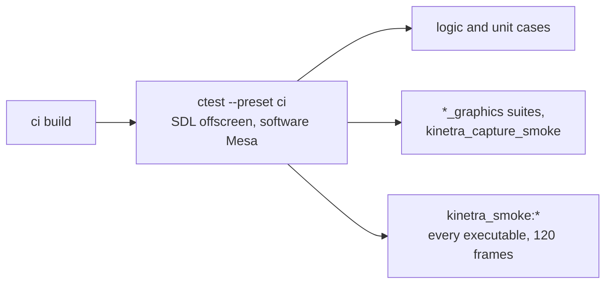

# Graphics tests in CI

Status: implemented · Branch: `ccr-ad794af0-y32jzm` · Related: Kinetra design `2026-11-22-graphics-tests-in-ci.md` (the shared rule, on Kinetra `build/graphics-in-ci`, [Kinetra #30](https://github.com/SMB-M87/Kinetra/pull/30)), [verification in Lab](../../AGENTS.md#verification-in-lab), [tests and resources](../../README.md#tests-and-resources)

CI compiled Lab's graphics tests but did not run them, and the smoke runs of the executables were a manual step. The `graphics` preset renders without a GPU, with SDL's offscreen driver and software Mesa. This change makes CI run the graphics cases and the smoke runs on that backend. The user decided on 2026-11-22 that CI is then the whole Full level, in Kinetra and in Lab: no local graphics run or smoke runs are required any more.

## Table of contents

- [Problem](#problem)
- [Goals and non-goals](#goals-and-non-goals)
- [Decisions](#decisions)
- [Design](#design)
- [Affected areas](#affected-areas)
- [Test plan](#test-plan)
- [Review](#review)
- [Verification](#verification)
- [Pull request](#pull-request)
- [Open points](#open-points)

[Directory guide](README.md) · [Project overview](../../README.md) · [Documentation index](../README.md)

## Problem

- The `ci` test preset inherited `no-graphics` (`CMakePresets.json`), so CI built `kinetra_runtime_tests`, the three `*_presentation_tests` and the capture smoke test, and skipped all 16 cases. `ci.yml` gave "no GPU" as the reason, but the `graphics` preset never used one.
- The smoke runs (`--frames 120` of `kinetra`, `kinetra_demo`, `kinetra_dotio` and `kinetra_i4sim`) existed only as commands in the [README](../../README.md#quick-start). The Full level asked for them by hand on every presentation change (`AGENTS.md`).
- Agents in cloud sessions therefore ran checks that CI could have run, and the roadmap's *Agent inspector overlay* needs presentation changes to be checked on GitHub.
- Measured on 2026-11-22 in a cloud session (Ubuntu 24.04, SDL 2.30, Mesa 25.2 llvmpipe, no GPU, no display): all 16 graphics cases pass in 11 s, most of it the capture smoke test, and every smoke run passes in under a second.

## Goals and non-goals

- Goal: CI runs every Lab test, the graphics cases included, on every pull request.
- Goal: every graphical executable has a smoke run in CTest, so the `graphics` preset and CI run it without a manual step.
- Goal: Lab's rules copy Kinetra's new Full level.
- Non-goal: graphics on Windows. The `windows-native` test preset keeps excluding the `graphics` label ([Windows](../windows.md#continuous-integration)); the WSL cross build still runs them on a Windows desktop.
- Non-goal: desktop feel and performance, which software rendering cannot prove; they stay a playtest by the user.

## Decisions

| Decision | Choice | Why |
| --- | --- | --- |
| The local rule once CI runs graphics | CI is the Full level; locally the targeted builds and tests, graphics cases only as quick feedback or to reproduce a CI failure | The user's choice of 2026-11-22, in the Kinetra design |
| Smoke runs | CTest entries `kinetra_smoke:<name>`, label `graphics`, registered next to each executable with `kinetra_lab_add_smoke` | The user's choice of 2026-11-22: no manual step, and the local `graphics` preset runs exactly what CI runs |
| Kinetra and Lab | Both, Kinetra first; Lab's pointer follows Kinetra's branch | The user's choice of 2026-11-22 |
| The reviewer | `pr-review` reviews code and comments only, and starts once CI is green; a screenshot of a changed scene is the author's | The user's choice of 2026-11-22, a Kinetra rule ([Kinetra `AGENTS.md`](../../external/Kinetra/AGENTS.md#git)); Lab has no copy of it |
| Wheel input | Kinetra's runtime reads `wheel.preciseY`, so the mouse-input case passes under `sdl2-compat` and smooth wheels zoom in fractional steps in every application | The user's choice of 2026-11-22, in Kinetra #30; Lab's sessions pass `Input::wheel` to `zoom` unchanged |
| How CI runs them | The `ci` test preset runs everything with the offscreen environment, from a hidden `software-gl` preset shared with `graphics`, as in Kinetra | `build-ci` already builds the graphics tests; no second build |
| Smoke prefix | One prefix, `kinetra_smoke:`, for every smoke run, not one per module | `ctest -R '^kinetra_smoke:'` selects every executable's start at once, as the README documents. The exception to the module-prefix convention means an area's regex does not pick up its smoke run, so the presentation row in `AGENTS.md` names `kinetra_smoke:<name>` (agent review) |
| Seeds | `dotio` passes `--seed 42`, and `i4sim-run` uses i4sim's default seed 42. `launcher-*` and `demo` vary their world, because `kinetra` and `kinetra_demo` have no `--seed` (the launcher's open point) | A seed-dependent failure should replay where it can; where it cannot, the run prints its `World seed:` line on failure (agent review) |
| A failed blueprint load | `kinetra_smoke:i4sim-run` fails on `i4sim: ` in its output | A blueprint that does not load leaves the session on the blueprint screen and still exits with 0; `FactoryController::report_error` prints that line (agent review) |
| Smoke names | Without spaces (`launcher-demo`, `i4sim-run`) | Spaces in `add_test` names need policy CMP0110, which `cmake_minimum_required(VERSION 3.16)` leaves unset; CTest then refused to run them |
| Which smoke runs | `launcher` (the menu), `launcher-demo` (`--agents 12`), `launcher-dotio` (`--difficulty medium`), `launcher-i4sim`, `demo`, `dotio` (`--difficulty medium`), `i4sim` (blueprint screen), `i4sim-run` (`3840x2400.json` with `--run --ups 200`) | The README's commands, plus the launcher menu and a running factory, so every executable and every session starts once |

## Design

*Takeaway:* the same `ctest --preset ci` step now runs the graphics suites and the smoke runs, which it skipped before.

- `CMakeLists.txt`: `kinetra_lab_add_smoke(name target args...)` adds `kinetra_smoke:<name>` running `<target> <args> --frames 120`, labels `graphics;unit`, a 120-second timeout; a no-op unless `BUILD_TESTING`, `KINETRA_LAB_BUILD_RUNTIME` and `KINETRA_TEST_GRAPHICS` are on. A failed start exits with 1 (checked: an unknown `--variant`, and `SDL_VIDEODRIVER=x11` without a display), so the test catches a crash or a failed context.
- `launcher/`, `labs/demo/`, `labs/dotio/`, `labs/i4sim/` `CMakeLists.txt`: the registrations, next to each executable.
- `CMakePresets.json`: hidden test preset `software-gl`; `graphics` and `ci` inherit it.
- `.github/workflows/ci.yml`: the header comment and the step name.
- `AGENTS.md`: the Full row, and the `tools/capture/` and presentation rows of the targeted table.
- READMEs: [tests and resources](../../README.md#tests-and-resources), and the test tables of the launcher, Demo, Dotio and i4sim.

## Affected areas

`CMakeLists.txt`, `CMakePresets.json`, `launcher/CMakeLists.txt`, `labs/{demo,dotio,i4sim}/CMakeLists.txt`, `.github/workflows/ci.yml`, `AGENTS.md`, `README.md`, `launcher/README.md`, `labs/{demo,dotio,i4sim}/README.md`, `docs/windows.md`, `external/README.md`, `docs/review-lessons.md`, `docs/roadmap.md` (*Graphics tests in CI* removed, *Smooth-wheel zoom on a desktop* added, *Golden tests on every toolchain* reworded), the `external/Kinetra` pointer, this document and the design index.

## Test plan

| Behavior | Check | Level |
| --- | --- | --- |
| Every smoke run starts, draws 120 frames and exits with 0 | `ctest --preset graphics -R '^kinetra_smoke:'`: 8 entries pass | Full |
| `ctest --preset ci` runs the graphics cases and smoke runs | `ctest --preset ci -N -L graphics` lists 24 entries; this pull request's `checks` job runs them in the pinned Arch image | Full |
| Headless builds register no smoke run, and Windows-native runs none | `headless` has no runtime. `windows-native` inherits `ci`'s configure preset, so it registers them, and its test preset's `graphics` exclusion keeps them from running; this pull request's CI | Full |
| `i4sim-run` fails when its blueprint does not load | Locally, with the path changed to a missing file: *Error regular expression found in output*; with the real path it passes | Full |
| Desktop zoom with a mouse wheel and touchpad (from Kinetra #30) | Desktop playtest by the user | Playtest |
| Docs | `python3 external/Kinetra/tools/check_docs.py` | Docs |

## Review

The agent review on 5183c35 (*Fix first*, code review `high`) found:

| Finding | Resolution |
| --- | --- |
| `kinetra_smoke:i4sim-run` passed when its blueprint did not load | `FAIL_REGULAR_EXPRESSION "i4sim: "`; checked to fail on a missing file. A lesson |
| `external/README.md` still ran `headless`, `ci` and `graphics` locally for engine changes | The targeted level, and the Full level as the pull requests' CI |
| The user's zoom playtest was on no roadmap | Roadmap item *Smooth-wheel zoom on a desktop* under *Next*, and *Follow-up* |
| `docs/windows.md` gave "no GPU" as the reason Windows skips graphics | No OpenGL 3.3 driver and no software Mesa there; the smoke runs are named |
| Nits: Windows-native wording, *Verification*, the regex cell, the smoke prefix, seeds | Fixed, or recorded in *Decisions* |
| The reviewer's session effort | It was started at `xhigh`, as the levels give for a change across Kinetra and Lab |

## Verification

| Command | Result |
| --- | --- |
| `cmake --preset graphics && cmake --build --preset graphics && ctest --preset graphics -L graphics -j4` (Ubuntu 24.04, GCC 13.3, SDL 2.30, Mesa 25.2 llvmpipe, offscreen) | passed, 24 of 24: 16 graphics cases and 8 smoke runs |
| `cmake --preset ci && cmake --build --preset ci`; `ctest --preset ci -L graphics` | passed, 24 of 24; 0 warnings |
| `ctest --preset ci -LE 'graphics\|soak'` | 287 of 292; the 5 failures are the known GCC 13 golden cases (*Golden tests on every toolchain*) |
| `ctest --preset graphics -R '^kinetra_smoke:'` on the review fixes | passed, 8 of 8 |
| `python3 external/Kinetra/tools/check_docs.py` | passed |
| CI on 97db948 and 5183c35 (pinned Arch, `sdl2-compat`; Windows) | passed: `ctest --preset ci` 321 of 321, 24 `graphics`, the 8 smoke runs included; `windows` green |
| CI on the review fixes | see the pull request |
| Desktop zoom with a mouse wheel and a touchpad | The user confirmed both worked on 2026-11-23 |

## Pull request

**Title:** `build(ci): run the graphics tests and smoke runs in CI`

**Summary.** CI compiled Lab's graphics tests and skipped them. The `ci` test preset now runs them with SDL's offscreen driver and software Mesa, as the `graphics` preset does. Every graphical executable gets a smoke run in CTest (`kinetra_smoke:*`), so CI runs it too. With Kinetra #30, the pull request's CI becomes the whole Full level.

**Changes.** See [Design](#design).

**Verification.** See [Verification](#verification).

**Dependencies and merge order.** Kinetra #30 merges first, with a merge commit. This pull request records its branch commit; the move to the Kinetra merge commit follows in a pointer-only pull request. It changes CI, presets and agent rules, and names a playtest by the user, so it waits for the user.

**Follow-up.** The user's desktop zoom check passed with a mouse wheel and a touchpad on 2026-11-23.

## Open points

- The four Demo crowd characterization cases and i4sim's RVO golden case still fail with GCC 13 in a cloud session (*Golden tests on every toolchain*); CI is not affected, because it uses the pinned Arch toolchain.
