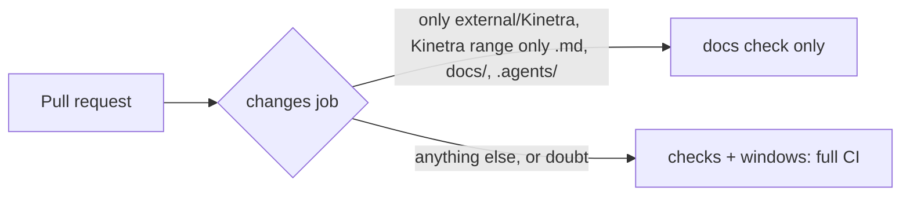

# Pointer-only pull requests in Lab

Status: implemented · Branch: `ccr-cc3e854a-v10cnx` · Related: Kinetra design `2026-11-22-pointer-only-prs.md` (the shared rules, on Kinetra `docs/pointer-only-prs`), [Git with the engine submodule](../../AGENTS.md#git-with-the-engine-submodule), [external dependencies](../../external/README.md)

The user decided on 2026-11-22 how a Kinetra-Lab pull request that only moves the submodule pointer is handled. It gets no agent review, and the agent merges it. A pointer move always goes in a pull request of its own. CI skips build and tests for it when Kinetra changed only Markdown, docs or skills. This change gives Lab's CI that skip and rewrites Lab's submodule rules; the shared rules are in Kinetra.

## Table of contents

- [Problem](#problem)
- [Goals and non-goals](#goals-and-non-goals)
- [Decisions](#decisions)
- [Design](#design)
- [Affected areas](#affected-areas)
- [Test plan](#test-plan)
- [Review](#review)
- [Verification](#verification)
- [Pull request](#pull-request)
- [Open points](#open-points)

[Directory guide](README.md) · [Project overview](../../README.md) · [Documentation index](../README.md)

## Problem

- #66 and #68 changed one line each and still ran the full CI, about ten minutes on Linux and Windows. #68 also ran an agent review.
- Lab's rule moved the pointer as the last commit of the Lab pull request, which ran that pull request's CI again, or needed a pointer pull request anyway when the user merged first (#65, #67).

## Goals and non-goals

- Goal: CI on a pointer-only pull request runs only the docs check when Kinetra changed only Markdown, `docs/` or `.agents/` between the two pointers.
- Goal: Lab's rules, the manual steps and the lessons page describe the separate pointer pull request.
- Non-goal: skipping CI when the pointer brings engine sources or CMake; then the full CI runs, because only Lab's CI builds Lab against them.

## Decisions

| Decision | Choice | Why |
| --- | --- | --- |
| When CI skips | Only `external/Kinetra` changed in the pull request, and the Kinetra range holds no file outside `*.md`, `docs/` and `.agents/` (an identical tree included) | The user's choice (see the Kinetra design) |
| How | A `changes` job decides; `checks` and `windows` need it and run unless it says to skip; the docs check runs in `changes` for a skipped pull request | `main` requires `CI / checks`: a skipped job reports success, a workflow skipped by a path filter never reports at all |
| Doubt | Any failure to decide (no merge base, a failed Kinetra clone or diff) means a full run; `checks` and `windows` also run when `changes` failed (`!cancelled()`) | A broken decision must never skip CI by accident |
| Kinetra diff | A blobless clone of Kinetra in the job, from the URL in `.gitmodules`, with `--no-renames` | The diff needs only trees. A rename must list its old path too, or a source moved into `docs/` or renamed to `.md` would skip the build (found by the agent review) |
| A failed `changes` job | `checks` and `windows` run whenever `changes` did not succeed | The docs check of a skipped pull request runs in `changes`, which is not required; without this, a failing docs check would leave the required status green (found by the agent review) |
| Pointer not on Kinetra `main` | `changes` fails with an error, and the full CI runs | Pointer-only pull requests merge without review, so CI is the only check of the rule; a failed `changes` job keeps "CI passes" from being true |

## Design

*Takeaway:* CI skips only what it can prove harmless; everything else runs as before.

- `.github/workflows/ci.yml`: the `changes` job and the conditions on `checks` and `windows`.
- `AGENTS.md`: the submodule order (Kinetra, then the Lab pull request at the verified branch commit, then the pointer-only pull request), the pointer-only rule, and the verification row for a docs-only pointer range.
- `external/README.md`: the manual steps for the pointer pull request.
- `docs/review-lessons.md`: the lesson of #65 becomes "move the pointer in a pointer-only pull request of its own".

## Affected areas

`.github/workflows/ci.yml`, `AGENTS.md`, `external/README.md`, `docs/review-lessons.md`, this document and the design index.

## Test plan

- The decision script, extracted from `ci.yml`, run locally on real history:
  - #68 (base `143d509`, head `02158d3`, pointer only, Kinetra range Markdown only) gives `skip_build=true`;
  - #67 (base `9280bac`, head `d70f695`, docs and pointer) gives `skip_build=false`.
- Its file filter: Markdown and skills only give a skip, while a `.cpp` file or `CMakeLists.txt` gives a full run, and an empty range gives a skip.
- After the agent review, against a local Kinetra copy and a synthetic Lab repository: a docs-only range on `main` gives a skip; the same range not on `main` fails `changes` with *Pointer not on Kinetra main*; `git mv src/runtime/launcher.cpp docs/launcher.cpp` gives a full run (it skipped before `--no-renames`); a code change gives a full run; a bad URL gives a warning and a full run. #68 and #67 still give `true` and `false`.
- This pull request's own CI: it changes more than the pointer, so `changes` decides on a full run, and `checks` and `windows` run as before.
- The skip path itself runs on the next pointer-only pull request.

## Review

- The decision script falls back to a full run on every error path, and the build jobs use `!cancelled()`, so a failed `changes` job does not skip them.
- The agent review of this pull request (on c0f0a54, *Fix first*) found that a rename could skip the build, that a failing docs check on the skip path left the required status green, that the merge order with Kinetra #27 was missing, and that CI did not check the pointer is on Kinetra `main`. All fixed in the next commits, with two lessons.
- The agent review of the Kinetra rules found the ban on pointer commits wider than intended, and the squash case open. Lab's `AGENTS.md` and `external/README.md` now say what Kinetra says: only the move to the Kinetra merge commit goes in a pointer-only pull request; following a Kinetra branch during review stays a pointer commit on the Lab branch; a squash is not allowed, and if one happened, the Lab pull request's pointer moves to the squashed commit before it merges.

## Verification

- `python3 -c "import yaml; …"` parses the workflow; `bash -n` accepts the decision script.
- The local runs of the test plan, with the results above.
- `python3 external/Kinetra/tools/check_docs.py`: all links resolve.

## Pull request

**ci: pointer-only pull requests run only the docs check**

- **Summary:** a pull request that only moves the Kinetra pointer runs only the docs check when Kinetra changed only Markdown, docs or skills; otherwise the full CI runs. Lab's rules and manual steps put a pointer move in a pointer-only pull request of its own, merged by the agent.
- **Changes:** `ci.yml` (`changes` job, conditions); `AGENTS.md` (submodule order, pointer-only rule, verification row); `external/README.md`; the lesson of #65; this document.
- **Design:** this document; the shared rules in Kinetra's pull request of the same date.
- **Verification:** the decision script on #68 and #67, the filter cases, YAML and `bash -n`, the docs check; this pull request's CI.
- **Dependencies and merge order:** Kinetra #27 first, because Lab's rules point to Kinetra's and must not contradict them; then this pull request; then a pointer-only pull request that records Kinetra `main` and is the first run of the skip. Both change rules or CI, so the user merges them.
- **Follow-up:** none.

## Open points

- The skip path is first exercised by the next pointer-only pull request.
