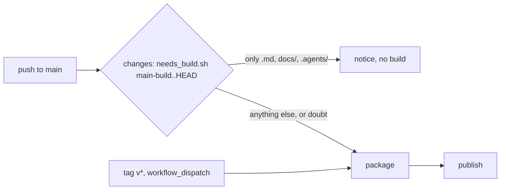

# Skip the release build when the zip cannot change

Status: implemented · Branch: `ccr-62c1f8b8-uzk87w` · Related: [Windows release zip](2026-11-21-windows-release-zip.md), [Pointer-only pull requests in Lab](2026-11-22-pointer-only-ci.md), [release tool](../../tools/release/README.md)

The user asked on 2026-11-22 that the release is not rebuilt in every case. The release workflow cross-builds the Windows zip on every push to `main`, also when a merge changed only documentation or moved the Kinetra pointer over documentation. This change skips that build when nothing that goes into the zip changed.

## Table of contents

- [Problem](#problem)
- [Goals and non-goals](#goals-and-non-goals)
- [Decisions](#decisions)
- [Design](#design)
- [Affected areas](#affected-areas)
- [Test plan](#test-plan)
- [Review](#review)
- [Verification](#verification)
- [Pull request](#pull-request)
- [Open points](#open-points)

[Directory guide](README.md) · [Project overview](../../README.md) · [Documentation index](../README.md)

## Problem

- #67, #68, #69 and #70 each rebuilt and republished the zip on their merge. #67, #68 and #70 changed only Markdown, Lab docs or a Kinetra pointer over Kinetra docs and skills; the zip they produced differs from the one before only in the commit in `README.txt`.
- Each rebuild takes a cross build of the four application targets and deletes and recreates `main-build`, so the download is briefly missing.

## Goals and non-goals

- Goal: a push to `main` that changes only Markdown, `docs/` or `.agents/`, in Lab and in a moved Kinetra range, builds and publishes nothing.
- Goal: every other push to `main` builds as before; any doubt builds.
- Non-goal: skipping a tag `v*` or `workflow_dispatch`. A tag is a version of its own, and a manual run is an explicit request.
- Non-goal: skipping on finer grounds, such as a change to `ci.yml` or to tests only. Those paths are not proven harmless as simply, and the gain is small.

## Decisions

| Decision | Choice | Why |
| --- | --- | --- |
| When to skip | Only on a push to `main`, when every changed path is `*.md`, `docs/` or `.agents/`, in Lab and in the Kinetra range of a moved pointer | The same filter as CI's pointer-only skip, so one definition of "documentation"; no file of the zip is read from these paths (checked: CMake reads none, the zip's README is `README-windows.txt`) |
| Compared with what | The commit of the `main-build` tag, not the push's `before` | `main-build` points at the commit its zip was built from. If a build failed or was skipped wrongly, the next push still compares with the last zip that was published, so no change is lost |
| Doubt | No tag, a base that is not an ancestor, a failed diff or Kinetra clone, or a failed `changes` job: build | A wrong skip ships an outdated zip; a wrong build costs only minutes |
| Where the decision lives | `tools/release/needs_build.sh`, called by a `changes` job in `release.yml` | It can be run locally on real history, as the test plan does |
| `main-build` after a skip | Left on the commit it was built from | The zip is the same apart from that commit, and `README.txt` and the release notes then name the commit truthfully |
| `publish` condition | Explicit `!cancelled() && needs.package.result == 'success'` | The default `success()` also looks at `changes`, which is skipped for a tag; that would skip publishing a tagged release |

## Design

*Takeaway:* only a push to `main` that provably leaves the zip unchanged is skipped.

- `tools/release/needs_build.sh <base> <head>` prints `false` or `true` on stdout and the reason on stderr. It diffs Lab with `--no-renames`, and for a moved `external/Kinetra` pointer clones Kinetra blobless from the URL in the head's `.gitmodules` and diffs the range the same way.
- `release.yml`: the `changes` job (push to `main` only) with a checkout of full history and tags; `package` runs unless `changes` succeeded with `false`; `publish` runs when `package` succeeded. A skip shows the notice *Release not rebuilt*.

## Affected areas

`.github/workflows/release.yml`, `tools/release/needs_build.sh` (new), `tools/release/README.md`, this document and the design index.

## Test plan

The script on real Lab history, and on a synthetic clone for the other cases:

- #68 (`143d509..02158d3`, pointer over Kinetra skills and docs), #67 (`9280bac..d70f695`) and #70 (`8c0798c..c738ec6`): `false`.
- #69 (`863004e..8c0798c`, changes `ci.yml`): `true`.
- The same commit: `false`. A base that is not an ancestor, or not a commit: `true`.
- Synthetic: a Markdown rename gives `false`; a `.cpp` moved into `docs/`, a change to `README-windows.txt`, a change to `LICENSE`, and a pointer over a Kinetra `src/` change give `true`.
- A Kinetra clone that fails (URL rewritten to an unknown host): `true` with the reason.
- The workflow's decide step, extracted and run locally: with the `main-build` tag at `HEAD`, `build=false` and the notice; without a tag, `build=true`.

## Review

- Every error path of the script ends in `true`; the step runs under `bash -e`, so a script that fails without output fails `changes`, and `package` then builds.
- The CI and release change waits for the user's merge (Kinetra's merge rule).

## Verification

- `bash -n tools/release/needs_build.sh`; `release.yml` parses with `python3 -c "import yaml; …"`.
- The test plan above, all with the expected results.
- `python3 external/Kinetra/tools/check_docs.py`: all links resolve.
- Not run: the local cross build and `package_windows.sh` from `AGENTS.md`'s release row, because neither the package script nor the build steps changed and the container has no MinGW-w64. The workflow itself first runs on the merge of this pull request; it changes `release.yml`, so that merge builds.

## Pull request

**ci(release): skip the Windows build when only docs changed**

- **Summary:** a push to `main` that changes only Markdown, `docs/` or `.agents/` since the `main-build` commit, in Lab and in a moved Kinetra range, no longer rebuilds and republishes the zip. Tags, manual runs and every other push build as before; any doubt builds.
- **Changes:** `release.yml` (`changes` job, conditions on `package` and `publish`); `tools/release/needs_build.sh`; the release tool README; this document.
- **Design:** this document.
- **Verification:** the script on #67, #68, #69 and #70 and on synthetic cases, the decide step locally, YAML and `bash -n`, the docs check.
- **Dependencies and merge order:** none; it changes the release workflow, so the user merges it.
- **Follow-up:** none.

## Open points

- The filter is written twice, in `needs_build.sh` and in `ci.yml`'s `changes` job. If it changes, both change together; a shared script is worth it once a third user appears.
- The skip path first runs on the first documentation-only merge after this one.
