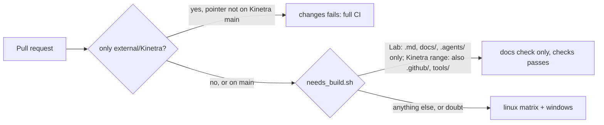

# Leaner agentic cycle: the measurement and its first step

Status: implemented · Branch: `ccr-6e6399fb-049f2v` · Related: roadmap item *Leaner agentic cycle* ([Lab](../roadmap.md#now), [Kinetra](../../external/Kinetra/docs/roadmap.md#now)), [Kinetra design](../../external/Kinetra/docs/design/2026-11-23-docs-only-pull-requests.md) (docs-only pull requests without agent review), [Pointer-only pull requests in Lab](2026-11-22-pointer-only-ci.md)

On 2026-11-23 the user reported that the CI skip for documentation and for a pointer move to Kinetra `main` no longer worked: those pull requests still waited for the full Linux and Windows builds. The user also wants no agent review on them, and asked to pick up the roadmap step of *Leaner agentic cycle* at the same time. This branch measures both repositories' pull requests, fixes the skip, and leaves the further measures to the user.

## Table of contents

- [Problem](#problem)
- [Measurement](#measurement)
- [Goals and non-goals](#goals-and-non-goals)
- [Decisions](#decisions)
- [Design](#design)
- [Affected areas](#affected-areas)
- [Test plan](#test-plan)
- [Review](#review)
- [Verification](#verification)
- [Pull request](#pull-request)
- [Open points](#open-points)

[Directory guide](README.md) · [Project overview](../../README.md) · [Documentation index](../README.md)

## Problem

Two causes, both visible in the last two pull requests:

- **Documentation.** CI's `changes` job only knew pointer-only pull requests. A Lab pull request with only Markdown ran the whole matrix: #82 (one line in `AGENTS.md`) and #80 (the roadmap) waited 7 to 10 minutes for `linux (arch)`, `linux (ubuntu)` and `windows`. The release workflow had skipped such changes since #71, with `tools/release/needs_build.sh`; CI never used that script.
- **Pointer to Kinetra `main`.** #81 moved the pointer from Kinetra #33's head to Kinetra `main`, which added Kinetra #35 (its CI workflow) and #36 (`tools/check_copies.py`). The filter allowed only Markdown, `docs/` and `.agents/`, so `.github/workflows/ci.yml` and `tools/check_copies.py` started the full run, although Lab's build reads neither. The earlier pointer-only pull requests #68, #70, #77 and #79 brought only documentation and were skipped.

And every docs-only pull request waited for a separate review session: since the agent review started on 22 November, Kinetra #26 to #29 and Lab #67 each got one, for a diff that cannot change what is built.

## Measurement

All pull requests merged from 18 to 23 November: 57 of Lab's 81 merged into `main` (the others into the branch below them in a stack) and all 36 of Kinetra's. The kind comes from the merge commit's file list, the CI time from the last run on the pull request's head (GitHub Actions, wall clock), and *review fixes* counts commits named after a review round.

| Repository | Kind | Pull requests | Median open to merge | Last CI run, median | Review fixes |
| --- | --- | --- | --- | --- | --- |
| Lab | code | 31 | 1.5 h | 8.9 min | 19 commits in 5 pull requests |
| Lab | docs-only | 9 | 0.1 h | 7.3 min | none |
| Lab | docs and pointer | 6 | 0.5 h | 8.3 min | 2 commits in 1 |
| Lab | pointer-only | 6 | 0.02 h | 2.5 min (3 skipped, 3 full runs) | none |
| Lab | CI or release, with docs | 5 | 1.0 h | 7.2 min | 3 commits in 2 |
| Kinetra | code | 18 | 0.1 h | 1.6 min | 12 commits in 3 |
| Kinetra | docs-only | 15 | 0.2 h | 1.8 min | 4 commits in 4 |
| Kinetra | CI, with docs | 3 | 4.1 h | 1.8 min | 6 commits in 2 |

What it says:

- Documentation is the most frequent kind: 30 of the 93 pull requests changed only Markdown, `docs/` or `.agents/`, 6 more with a pointer beside them. In Lab each waited about 8 minutes for CI; in Kinetra the full run takes under 2.5 minutes, so a skip there would save little.
- 12 of Lab's 57 pull requests moved the pointer, 6 of them with nothing else. Kinetra holds 35 design documents and Lab 55; 12 topics have one in each repository.
- Lab ran CI 195 times for 81 pull requests, 2.4 runs each; Kinetra 107 times for 36, push runs on `main` included.
- *Open to merge* includes the time a pull request waited for the user, and several docs-only and pointer-only pull requests were merged by the user before their CI finished. It shows where the waiting is, not the agent's working time.

With this branch's filter, 18 of the 21 docs-only, docs-and-pointer and pointer-only pull requests of Lab skip the build; the old filter skipped 4. The three that still build moved the pointer over engine sources (#27, #29, #43).

## Goals and non-goals

- Goal: a Lab pull request that cannot change the build runs only the docs check: only Markdown, `docs/` or `.agents/` in Lab, and a pointer range of Kinetra that Lab's build does not read.
- Goal: such a pull request needs no agent review (the rule changes in the Kinetra pull request of the same branch).
- Goal: the measurement above, as the ground for the next measures.
- Non-goal: the other candidate measures of the roadmap item; the user picks them (see [open points](#open-points)).
- Non-goal: a CI skip in Kinetra (see the [Kinetra design](../../external/Kinetra/docs/design/2026-11-23-docs-only-pull-requests.md#goals-and-non-goals)).

## Decisions

| Decision | Choice | Why |
| --- | --- | --- |
| Which Lab paths skip | Markdown, `docs/` (media included) and `.agents/`, as before; Lab's `.github/` does not | Lab's `.github/` is its own CI, which a pull request must run to test |
| Which Kinetra paths skip | Also `.github/` and `tools/` | Kinetra's CI does not run in Lab, and no build step runs `tools/`: Lab builds Kinetra with `BUILD_TESTING` off and never calls its Python helpers. The docs check, which runs on every pull request, uses `tools/check_docs.py` from the new pointer |
| One decision for CI and the release | ci.yml's `changes` job runs `tools/release/needs_build.sh`, the release workflow's script | The filter was written twice, in `ci.yml` and the script, with a note to change both together; #81 showed how a filter falls behind. The script stays in `tools/release/` to keep the release tool's links |
| Docs together with a pointer | Skips when the pointer range passes the filter, also when the pointer is on a Kinetra branch | A Lab pull request that follows a Kinetra docs pull request cannot change the build either. The check that the pointer is on Kinetra `main` stays for pointer-only pull requests, which merge without review |
| Doubt | A full run, as before: no merge base, a failed Kinetra clone or diff, a failed `changes` job. An empty `skip_build` counts as a full run | A broken decision must never skip CI |
| Review | Docs-only pull requests need none ([Kinetra rule](../../external/Kinetra/AGENTS.md#git)) | The user's request of 2026-11-23 |

## Design

*Takeaway:* CI skips only what the release workflow's script proves cannot change the build; everything else runs as before.

- `.github/workflows/ci.yml`: the `changes` job keeps the pointer-on-`main` check for pointer-only pull requests and asks `needs_build.sh` for the rest; it writes `skip_build` once, at the end, and a notice *Build and tests skipped*. The docs-check step is named *Documentation links (no build needed)*.
- `tools/release/needs_build.sh`: a second filter for the Kinetra range, with `.github/` and `tools/`; its header names both callers and why these paths are safe.
- `AGENTS.md`: the Docs row and a paragraph on docs-only pull requests in [verification in Lab](../../AGENTS.md#verification-in-lab); the pointer range in the verification table and in the submodule rules. `external/README.md` and `tools/release/README.md` follow.
- `docs/roadmap.md`: *Leaner agentic cycle* moves to *Now*.

## Affected areas

`.github/workflows/ci.yml`, `tools/release/needs_build.sh`, `tools/release/README.md`, `AGENTS.md`, `external/README.md`, `docs/roadmap.md`, this document and the design index; the Kinetra pointer moves to the Kinetra branch of the same name.

## Test plan

- The decision step, extracted from `ci.yml`, on real history and on synthetic commits in a scratch clone of Lab whose `.gitmodules` points to a local Kinetra:
  - #81 (pointer to Kinetra `main` over `.github/` and `tools/`): skip; it ran the full CI before;
  - #82 (one line in `AGENTS.md`): skip; it ran the full CI before;
  - #78 (code): full run;
  - pointer-only to Kinetra `main` over engine sources: full run;
  - pointer-only to a Kinetra commit not on `main`: `changes` fails with *Pointer not on Kinetra main*;
  - Markdown and a pointer to a Kinetra branch commit with only docs: skip; with engine sources: full run;
  - only `docs/roadmap.md`, or only a new GIF in `docs/media/`: skip;
  - a line in Lab's `ci.yml`: full run;
  - a source moved into `docs/` with `git mv`: full run;
  - a Kinetra URL that does not answer: warning *Pointer not checked*, empty `skip_build`, full run.
- `needs_build.sh` before and after on every Lab pull request merged into `main` since 19 November: only #81 changes, from build to skip.
- This pull request's own CI: it changes `ci.yml`, so the full CI runs. The skip runs on the next docs-only or pointer-only pull request.

## Review

- The author's review of the diff, and the copies check (`check_copies.py` with `--term 'Markdown, docs or skills'`, `--term 'Markdown, \`docs/\` or \`.agents/\`'`, `--term 'only the docs check'`, `--term 'needs no agent review'` and the review rule's old wording): every hit follows in this pull request or the Kinetra one, or is a dated design document or review lesson.
- The agent review runs on this pull request, which changes CI; the Kinetra pull request is docs-only and gets none.

## Verification

- `python3 -c "import yaml; …"` parses the workflow; `bash -n` accepts the decision step and `needs_build.sh`.
- The test plan's runs, with the results above.
- `python3 external/Kinetra/tools/check_docs.py`: all links resolve.
- `python3 external/Kinetra/tools/check_copies.py` with the terms above.

## Pull request

**ci: skip the build of docs-only pull requests, and of pointer moves Lab's build does not read**

- **Summary:** CI runs only the docs check when Lab changed only Markdown, `docs/` or `.agents/` and a moved pointer brings only Markdown, `docs/`, `.agents/`, `.github/` or `tools/` of Kinetra; such pull requests need no agent review. Fixes #81 and #82 running the full Linux and Windows builds, and records the measurement for *Leaner agentic cycle*.
- **Changes:** `ci.yml` (`changes` job on `needs_build.sh`); `needs_build.sh` (Kinetra filter, header); `AGENTS.md`, `external/README.md`, `tools/release/README.md`; roadmap; this document.
- **Design:** this document; the [Kinetra design](https://github.com/SMB-M87/Kinetra/blob/main/docs/design/2026-11-23-docs-only-pull-requests.md) for the review rule.
- **Verification:** the decision step on real and synthetic history, `needs_build.sh` over all merged pull requests, YAML and `bash -n`, the docs check; this pull request's CI.
- **Review notes:** the paths the Kinetra filter now lets through, and the merge of the two decisions into one script.
- **Dependencies and merge order:** the Kinetra pull request of the same branch first, with a merge commit; then this one, with its pointer at that Kinetra branch commit; then a pointer-only pull request to the Kinetra merge commit, the first run of the new skip. Both change agent rules or CI, so the user merges them.
- **Follow-up:** the measures the user chooses below.

## Open points

Candidate measures for the user, from the measurement and the roadmap item; each becomes a roadmap item or a branch once chosen:

1. **Automatic pointer pull request.** A workflow opens the pointer-only pull request after a Kinetra merge and merges it when CI passes. 6 of Lab's 57 pull requests were nothing else. Needs a token or GitHub App with write access to Lab, stored as a Kinetra secret, and auto-merge on Lab.
2. **One design document per change across both repositories.** 12 topics have one in each; the second could be a link and a few lines.
3. **No design document for a docs-only change.** The pull request description holds the problem and decisions, as the design document's *Pull request* section does now; 30 of 93 pull requests were docs-only.
4. **A CI skip in Kinetra as well.** Saves about 2 minutes per docs-only pull request, 15 of Kinetra's 36; it would need the decision script there too.
5. **Kinetra and Lab in one repository.** Ends pointer pull requests and double design documents, at the cost of Kinetra as a repository of its own (*Repositories per lab*).
6. **A check for stale GIFs.** Waits for *README media as GIFs*.
