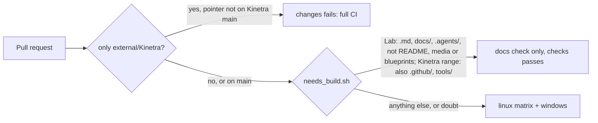

# Leaner agentic cycle: the measurement and its first step

Status: implemented · Branch: `ccr-6e6399fb-049f2v` · Related: roadmap item *Leaner agentic cycle* ([Lab](../roadmap.md#now), [Kinetra](../../external/Kinetra/docs/roadmap.md#now)), [Kinetra design](../../external/Kinetra/docs/design/2026-11-23-docs-only-pull-requests.md) (the rules and Kinetra's CI skip), [Pointer-only pull requests in Lab](2026-11-22-pointer-only-ci.md)

On 2026-11-23 the user reported that the CI skip for documentation and for a pointer move to Kinetra `main` no longer worked: those pull requests still waited for the full Linux and Windows builds. The user also wants no agent review on them, and asked to pick up the roadmap step of *Leaner agentic cycle* at the same time. This branch measures both repositories' pull requests, fixes the skip, and carries out the measures the user then chose; it also takes the tour video out of the repository and stops agents from reading design documents they do not need, after the user noticed that the agents' context keeps growing.

This change spans both repositories and has a design document in each, against the rule it adds: both were written before the user chose that rule, halfway through the branch. Lab's holds the measurement and Lab's CI, Kinetra's the rules and Kinetra's CI.

## Table of contents

- [Problem](#problem)
- [Measurement](#measurement)
- [Goals and non-goals](#goals-and-non-goals)
- [Decisions](#decisions)
- [Design](#design)
- [Affected areas](#affected-areas)
- [Test plan](#test-plan)
- [Review](#review)
- [Verification](#verification)
- [Pull request](#pull-request)
- [Open points](#open-points)

[Directory guide](README.md) · [Project overview](../../README.md) · [Documentation index](../README.md)

## Problem

Two causes, both visible in the last two pull requests:

- **Documentation.** CI's `changes` job only knew pointer-only pull requests. A Lab pull request with only Markdown ran the whole matrix: #82 (one line in `AGENTS.md`) and #80 (the roadmap) waited 7 to 10 minutes for `linux (arch)`, `linux (ubuntu)` and `windows`. The release workflow had skipped such changes since #71, with `tools/release/needs_build.sh`; CI never used that script.
- **Pointer to Kinetra `main`.** #81 moved the pointer from Kinetra #33's head to Kinetra `main`, which added Kinetra #35 (its CI workflow) and #36 (`tools/check_copies.py`). The filter allowed only Markdown, `docs/` and `.agents/`, so `.github/workflows/ci.yml` and `tools/check_copies.py` started the full run, although Lab's build reads neither. The earlier pointer-only pull requests #68, #70, #77 and #79 brought only documentation and were skipped.

Every docs-only pull request also waited for a separate review session: since the agent review started on 22 November, Kinetra #26 to #29 and Lab #67 each got one, for a diff that cannot change what is built.

And the user noticed that the agents' loaded context keeps growing while the repository holds little.

## Measurement

### Pull requests

All pull requests merged from 18 to 23 November: 57 of Lab's 81 merged into `main` (the others into the branch below them in a stack) and all 36 of Kinetra's. The kind comes from the merge commit's file list, the CI time from the last run on the pull request's head (GitHub Actions, wall clock), and *review fixes* counts commits named after a review round.

| Repository | Kind | Pull requests | Median open to merge | Last CI run, median | Review fixes |
| --- | --- | --- | --- | --- | --- |
| Lab | code | 31 | 1.5 h | 8.9 min | 19 commits in 5 pull requests |
| Lab | docs-only | 9 | 0.1 h | 7.3 min | none |
| Lab | docs and pointer | 6 | 0.5 h | 8.3 min | 2 commits in 1 |
| Lab | pointer-only | 6 | 0.02 h | 2.5 min (3 skipped, 3 full runs) | none |
| Lab | CI or release, with docs | 5 | 1.0 h | 7.2 min | 3 commits in 2 |
| Kinetra | code | 18 | 0.1 h | 1.6 min | 12 commits in 3 |
| Kinetra | docs-only | 15 | 0.2 h | 1.8 min | 4 commits in 4 |
| Kinetra | CI, with docs | 3 | 4.1 h | 1.8 min | 6 commits in 2 |

What it says:

- Documentation is the second most frequent kind, after code (49): 24 of the 93 pull requests changed only Markdown, `docs/` or `.agents/`, 30 with the 6 that moved a pointer beside them. In Lab each waited about 8 minutes for CI; Kinetra's full run takes under 2.5 minutes.
- 22 of Lab's 57 pull requests moved the pointer, 6 of them with nothing else. Kinetra holds 35 design documents and Lab 55; 12 topics have one in each repository.
- Lab ran CI 195 times for 81 pull requests, 2.4 runs each; Kinetra 107 times for 36, push runs on `main` included.
- *Open to merge* includes the time a pull request waited for the user, and several docs-only and pointer-only pull requests were merged by the user before their CI finished. It shows where the waiting is, not the agent's working time.

With this branch's filter, 16 of the 21 docs-only, docs-and-pointer and pointer-only pull requests of Lab skip the build; the old filter skipped 4. Five still build: #27, #29 and #43 moved the pointer over engine sources, and #28 and #36 changed the README, which `kinetra_capture_tests` reads.

### What agents read

Sizes in tokens, at about four characters per token, on 2026-11-23:

| What | Size | Read when |
| --- | --- | --- |
| C++ (`.h`, `.cpp`) | about 300k in Lab (27,900 lines), 110k in Kinetra (10,400 lines) | The files a task touches |
| All Markdown | 249k in Lab, 150k in Kinetra | — |
| Design documents | 168k in Lab (56 files), 70k in Kinetra (35 files) | The routing tables sent agents to them for planning and for current work |
| Rules a code task reads first | about 40k: both `AGENTS.md` (9k), workflow (4k), conventions, testing and documentation guide (9k), both review-lessons pages (3k), both roadmaps (9k), both design indexes (4.5k), `feature` and `verify` (3k) | Every task |
| Tour video | 0: agents do not read video | — |

The documentation is as large as the code, and the design documents are 60 % of it. They are history once implemented, yet a task could start by reading them. The tour video costs no context, but it is most of every clone: 245 MB of a 265 MB clone are three renders of `docs/media/kinetra-lab-tour.mp4` (61, 89 and 94 MB), and every cloud session clones fresh; CI's checkouts download the current 89 MB render each time.

## Goals and non-goals

- Goal: a Lab pull request that cannot change the build or a test runs only the docs check.
- Goal: such a pull request needs no agent review and no design document; a change across both repositories has one design document; Kinetra's CI skips docs-only pull requests too (the rules and Kinetra's CI change in the Kinetra pull request of the same branch).
- Goal: agents read a design document only when something links it, or a search for the topic finds it.
- Goal: the tour video leaves the repository's tree, and a new render cannot enter it by accident.
- Goal: the measurement above, as the ground for these measures.
- Non-goal: rewriting the history to remove the old renders from clones; that needs a force-push of every branch and tag, which only the user may do (see [open points](#open-points)).
- Non-goal: moving or deleting the existing design documents; the user keeps them.
- Non-goal: the automatic pointer pull request, a roadmap item of its own.

## Decisions

| Decision | Choice | Why |
| --- | --- | --- |
| Which Lab paths skip | Markdown, `docs/` and `.agents/`, as before, but not `README.md`, `docs/media/` and `labs/i4sim/blueprints/`; Lab's `.github/` does not skip | `kinetra_capture_tests` reads the README and the media guide and checks the files in `docs/media/`; the blueprint directory, its README included, is copied next to every executable and into the zip. Lab's `.github/` is its own CI, which a pull request must run to test |
| Which Kinetra paths skip | Also `.github/` and `tools/` | Kinetra's CI does not run in Lab, and no build step runs `tools/`: Lab builds Kinetra with `BUILD_TESTING` off and never calls its Python helpers. The docs check, which runs on every pull request, uses `tools/check_docs.py` from the new pointer |
| One decision for CI and the release | ci.yml's `changes` job runs `tools/release/needs_build.sh`, the release workflow's script | The filter was written twice, in `ci.yml` and the script, with a note to change both together; #81 showed how a filter falls behind. The script stays in `tools/release/` to keep the release tool's links |
| Docs together with a pointer | Skips when the pointer range passes the filter, also when the pointer is on a Kinetra branch | A Lab pull request that follows a Kinetra docs pull request cannot change the build either. The check that the pointer is on Kinetra `main` stays for pointer-only pull requests, which merge without review |
| Doubt | A full run, as before: no merge base, a failed Kinetra clone or diff, a failed `changes` job. An empty `skip_build` counts as a full run | A broken decision must never skip CI |
| A failed `changes` job | Also fails `checks`; the full run still runs | Found by the agent review: a pointer-only pull request off Kinetra `main` failed only `changes`, which is not required, and `checks` passed on `linux` alone. Auto-merge, planned in *Automatic pointer pull request*, reads only the required status |
| The release on a README or media change | Rebuilds the zip and moves `main-build`, although the zip cannot differ | One script for both workflows is worth a rare rebuild; a release mode would make the filter differ again |
| Merge order of a docs-and-pointer pull request | Kinetra's merge rule: every pull request below it merged, in Lab including the Kinetra pull request its pointer records; CI does not check it | A CI check would fail every Lab pull request that follows a Kinetra branch in review, which the workflow asks for |
| A check that names the GIFs a diff makes stale | Not decided; carried to *README media as GIFs* as an open question | A candidate of the roadmap item that the user's form did not offer |
| History in the `changes` job | A blobless checkout (`filter: blob:none`) | The decision needs commits and trees; the old renders stay out of the job |
| Review, design document, cross-repository changes, reading | As the [Kinetra design](../../external/Kinetra/docs/design/2026-11-23-docs-only-pull-requests.md#decisions) decides; Lab's `AGENTS.md` and design index point to that rule | The user's choices of 2026-11-23; the rules live in Kinetra |
| Tour video | Removed from `docs/media`; `capture_tour.sh` renders into `.docs/` and refreshes the thumbnail in `docs/media`; `.gitignore` ignores `.docs/` and `*.mp4` | The user's request of 2026-11-23, ahead of the YouTube video the roadmap waited for, and the folder the user asked for. The README already links the YouTube copy |
| Kinetra and Lab in one repository | Not pursued | The user's decision of 2026-11-23 |
| A code index or search server for agents | Not now | For 38,000 lines of C++, the functionality indexes and a text search find code; a server would add its own tool descriptions to every session. The context grows from documentation that is read without need, which the reading rule addresses |

## Design

*Takeaway:* CI skips only what the release workflow's script proves no build, test or zip reads; everything else runs as before.

- `.github/workflows/ci.yml`: the `changes` job checks out without old blobs, keeps the pointer-on-`main` check for pointer-only pull requests and asks `needs_build.sh` for the rest; it writes `skip_build` once, at the end, with a notice *Build and tests skipped*. The docs-check step is named *Documentation links (no build needed)*. `checks` fails when `changes` failed.
- `tools/release/needs_build.sh`: the three Lab paths that always build, and a second filter for the Kinetra range with `.github/` and `tools/`; its header names both callers and why the paths are safe.
- `AGENTS.md`: the routing table sends a task to its own design document only; the Docs row and a paragraph on docs-only pull requests in [verification in Lab](../../AGENTS.md#verification-in-lab); the pointer range in the verification table and in the submodule rules; the design-document and media rules. `external/README.md`, `tools/release/README.md` and the design index follow.
- Tour video: `docs/media/kinetra-lab-tour.mp4` deleted; `capture_tour.sh` and `tour_thumbnail.sh` default to `.docs/kinetra-lab-tour.mp4` and write the thumbnail to `docs/media`; `.gitignore` (`.docs/`, `*.mp4`); the README, the media guide and the capture tool's README; the old tour design document no longer links the file.
- `docs/roadmap.md`: *Leaner agentic cycle* leaves the roadmap, since this design document is its record and its last measure is *Automatic pointer pull request* in *Next*; *Tour video for YouTube* and *Repositories per lab* record the user's decisions; *README media as GIFs* takes the stale-GIF question. `.github/workflows/release.yml` names the new filter.

## Affected areas

`.github/workflows/ci.yml`, `tools/release/needs_build.sh`, `tools/release/README.md`, `tools/capture/capture_tour.sh`, `tools/capture/tour_thumbnail.sh`, `tools/capture/README.md`, `docs/media/` (the video and its guide), `.gitignore`, `README.md`, `AGENTS.md`, `external/README.md`, `docs/roadmap.md`, `docs/design/README.md`, `docs/design/2026-11-19-tour-video.md` (one link), this document; the Kinetra pointer moves to the Kinetra branch of the same name.

## Test plan

- The decision step, extracted from `ci.yml`, on real history and on synthetic commits in a scratch clone of Lab whose `.gitmodules` points to a local Kinetra:
  - #81 (pointer to Kinetra `main` over `.github/` and `tools/`): skip; it ran the full CI before;
  - #82 (one line in `AGENTS.md`): skip; it ran the full CI before;
  - #78 (code): full run; #36 (the README): full run;
  - pointer-only to Kinetra `main` over engine sources: full run;
  - pointer-only to a Kinetra commit not on `main`: `changes` fails with *Pointer not on Kinetra main*;
  - Markdown and a pointer to a Kinetra branch commit with only docs: skip; with engine sources: full run;
  - only `docs/roadmap.md`: skip;
  - a line in Lab's `ci.yml`: full run;
  - a source moved into `docs/` with `git mv`: full run;
  - a Kinetra URL that does not answer: warning *Pointer not checked*, empty `skip_build`, full run.
- The same step in a blobless clone of Lab from GitHub, as the job now checks out: #81 and #82 skip, #78 and #36 build.
- `needs_build.sh` on every docs-only, docs-and-pointer and pointer-only pull request merged into Lab's `main` since 19 November: 16 skip, 5 build, as listed under [measurement](#pull-requests).
- `bash -n` on the two tour scripts; the capture tests keep passing in CI (the tour is not a scene, and the gallery still shows the thumbnail).
- This pull request's own CI: it changes `ci.yml`, so the full CI runs. The skip runs first on the pointer-only pull request after the merge.

## Review

- The author's review of the diff, and the copies check (`check_copies.py` with `--term 'Markdown, docs or skills'`, `--term 'Markdown, \`docs/\` or \`.agents/\`'`, `--term 'only the docs check'`, `--term 'needs no agent review'`, `--term 'Lab design documents'`, `--term 'kinetra-lab-tour.mp4'` and the review rule's old wording): every hit follows in this pull request or the Kinetra one, or is a dated design document or review lesson.
- The author's review found that `kinetra_capture_tests` reads the README and `docs/media/`, which the docs-only filter would have skipped; the three paths now always build.
- `check_copies.py` stopped with a `UnicodeDecodeError` on the deleted video; the Kinetra pull request fixes it, and the copies check then ran.
- The agent review runs on this pull request and on the Kinetra one, which both change CI.
- Agent review, round 1 (on 5dae4e0, *Fix first*, eight points to fix and a nit), all carried out:
  - The docs-only paragraph treated docs-only and a skipped build as one set and gave only part of the merge conditions: it now defines docs-only as Kinetra does, says the three always-built paths need no review either, and links Kinetra's merge rule; the Docs row follows. The optional CI check of the merge order is not taken (*Decisions*).
  - A pointer-only pull request off Kinetra `main` left `checks` green: `checks` now fails when `changes` failed, tested on seven combinations of job results.
  - Copies: `release.yml`'s header and notice, the release README (the three paths, and the extra rebuild as an accepted cost), the routing row (now a link to Kinetra's rule), `docs/README.md` and `README.md`.
  - The roadmap kept *Leaner agentic cycle* in *Now* after the merge: removed here and in Kinetra; the dropped stale-GIF candidate went to *README media as GIFs*.
  - The measurement's headline figures: documentation is the second kind after code, and 22 of 57 pull requests moved the pointer.
  - The line on the two design documents, as in Kinetra's.
  - Nit: the media guide's thumbnail row carries the YouTube link again.
  - The pointer follows Kinetra #37's head after its review round.
  - The lesson on *Now* went to the [review lessons](../review-lessons.md#roadmap-and-decisions).
- Kinetra #37's second review round reached Lab's copies: the roadmap's lead now names a docs-only change's pull request as its record, and the pointer follows Kinetra's head to 2008388.

## Verification

- `python3 -c "import yaml; …"` parses the workflow; `bash -n` accepts the decision step, `needs_build.sh`, `capture_tour.sh` and `tour_thumbnail.sh`.
- The test plan's runs, with the results above.
- `python3 external/Kinetra/tools/check_docs.py`: all links resolve.
- `python3 external/Kinetra/tools/check_copies.py` with the terms above.

## Pull request

**Leaner cycle: skip the build of docs-only pull requests and pointer moves, measure the cycle, drop the tour video**

- **Summary:** CI runs only the docs check when no build, test or zip can change: Lab changed only Markdown, `docs/` or `.agents/` (not the README, `docs/media/` or the blueprints) and a moved pointer brings only Markdown, `docs/`, `.agents/`, `.github/` or `tools/` of Kinetra. Such pull requests need no agent review or design document. Fixes #81 and #82 running the full Linux and Windows builds, records the measurement for *Leaner agentic cycle*, and removes the 89 MB tour video from the tree.
- **Changes:** `ci.yml` (`changes` job on `needs_build.sh`, blobless checkout); `needs_build.sh` (paths that always build, Kinetra filter); the tour video and its scripts, `.gitignore`, the README and media guides; `AGENTS.md`, `external/README.md`, `tools/release/README.md`, the design index; roadmap; this document.
- **Design:** this document; the [Kinetra design](https://github.com/SMB-M87/Kinetra/blob/main/docs/design/2026-11-23-docs-only-pull-requests.md) for the rules and Kinetra's skip.
- **Verification:** the decision step on real and synthetic history and in a blobless clone, `needs_build.sh` over the merged docs and pointer pull requests, YAML and `bash -n`, the docs check; this pull request's CI.
- **Review notes:** the paths the filters let through and the three that always build; the merge of CI's and the release's decision into one script; the tour scripts' new defaults.
- **Dependencies and merge order:** the Kinetra pull request of the same branch first, with a merge commit; then this one, with its pointer at that Kinetra branch commit; then a pointer-only pull request to the Kinetra merge commit, the first run of the new skip. Both change agent rules or CI, so the user merges them.
- **Follow-up:** *Automatic pointer pull request*.

## Open points

- **The old renders in every clone.** Deleting the file stops new renders, and a cloud session's shallow clone (50 commits) stops downloading the old ones once the commits that hold them fall out of its depth. A full clone keeps all three until the history is rewritten. That rewrite is the user's call and the user's command, since it force-pushes `main`, every branch and the `main-build` tag, changes every commit hash that design documents quote, and requires every existing clone to be cloned again. Best after all open pull requests have merged, with `git filter-repo --invert-paths --path docs/media/kinetra-lab-tour.mp4` in a fresh clone of every branch and tag, followed by a force-push of each; GitHub keeps the old objects of its pull request references on its side, which clones do not fetch.
- **The design index below the template.** Writing a new design document still loads the index of every older one. If that weighs, the index can move to a page of its own.
- **The roadmap's length.** Lab's roadmap is 6.7k tokens and most of it is *Later* and *Ideas*; an agent that looks up one item reads it all. A search for the item's title reads less.
