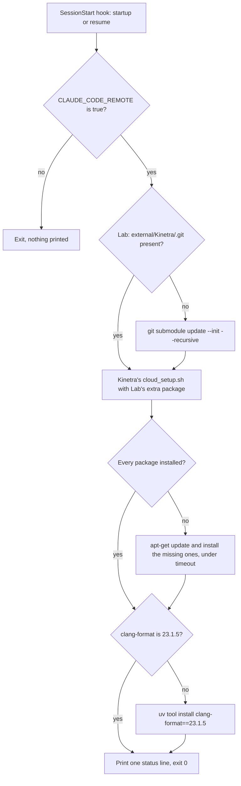

# Ready-to-build cloud sessions

Status: draft · Branch: `ccr-d6ebceac-13bzfb` (Lab), `build/cloud-session-setup` (Kinetra) · Related: [roadmap](../roadmap.md), [Kinetra tools](../../external/Kinetra/tools/README.md#cloud_setupsh)

A cloud session of Kinetra-Lab or Kinetra starts without SDL2, nlohmann JSON, ccache and CI's clang-format, and in Lab without the Kinetra submodule, so every code task installs them first. A SessionStart hook in each repository now runs one setup script at the start of every cloud session, so a session builds, tests and checks formatting as CI does at once.

## Table of contents

- [Problem](#problem)
- [Goals and non-goals](#goals-and-non-goals)
- [Decisions](#decisions)
- [Design](#design)
- [Affected areas](#affected-areas)
- [Test plan](#test-plan)
- [Review](#review)
- [Verification](#verification)
- [Pull request](#pull-request)
- [Open points](#open-points)

[Directory guide](README.md) · [Project overview](../../README.md) · [Documentation index](../README.md)

## Problem

Measured on 2026-11-23 in this branch's own cloud session (Ubuntu 24.04.5, the *Default* environment):

- **Packages.** `libsdl2-dev`, `nlohmann-json3-dev`, `ccache` and `libgl-dev` were missing, so `cmake --preset dev` could not configure. `clang-format` was Ubuntu's 18.1.3; CI formats with 23.1.5, the version of its pinned Arch snapshot ([Kinetra's ci.yml](../../external/Kinetra/.github/workflows/ci.yml)), so a session could not reproduce the format check.
- **Submodule.** `git submodule status` showed `-bc17b4f external/Kinetra`: the checkout had no engine sources. `.claude/skills` links into the submodule, so the repository skills (`feature`, `roadmap`, `verify` and the rest) were missing too until the session ran `git submodule update --init --recursive`.
- **The environment does not hold a setup script.** On 2026-11-22 the *Linux beyond Arch* session created a cloud environment *Kinetra-Lab* whose setup script installed the packages; on 2026-11-23 the account lists only *Default*, and that day's i4sim session (#92) and this one installed packages by hand. A setup script lives in the environment's settings, outside both repositories: nobody reviews it, and a session in another environment does not get it.
- **Where clang-format 23 comes from.** Under the default *Limited* network access, `apt.llvm.org` and `archive.archlinux.org` do not answer; `pypi.org` does, and PyPI's `clang-format` package has 23.1.5. `uv`, which the cloud image includes, installs it in under a second.
- **Cost.** `apt-get update` took 2 s and installing the missing packages (52 downloads, `--no-install-recommends`, as CI's Ubuntu run installs them) 6 s. With them and clang-format 23.1.5, CI's format command passes on both repositories, `cmake --preset dev` configures, and `kinetra_lab_tests` builds and passes.

## Goals and non-goals

Goals:

- Every Claude Code cloud session of Kinetra-Lab or Kinetra starts with the Debian and Ubuntu package set of the README and [development](../../external/Kinetra/docs/development.md#dependencies-and-options) (Lab adds nlohmann JSON), clang-format 23.1.5 first on `PATH`, and, in Lab, the Kinetra submodule checked out.
- A resumed session, or one that already has everything, spends well under a second on it.
- A failed install does not block the session; the agent learns what is missing and how to install it.
- The package set and the clang-format version are written once for both repositories.

Non-goals:

- The environment's setup script: the user chose the hook (below). An environment script can still call the same script later, for caching.
- Sessions with several repositories and threads of a project: Claude Code loads no repository hooks there ([cloud environments](https://code.claude.com/docs/en/cloud-environments#limitations-in-cloud-sessions)).
- Local machines: the script does nothing outside a cloud session. Developers keep installing from the README.
- Arch parity beyond clang-format: a session builds with Ubuntu's GCC 13, so CI's `linux (arch)` run stays the reference for warnings, as on Ubuntu CI.
- The Windows cross toolchain: Windows is verified by CI's `windows` job.

## Decisions

| Decision | Choice | Why |
| --- | --- | --- |
| Mechanism | A SessionStart hook in each repository's `.claude/settings.json`, which runs a script under `tools/` | The user's choice on 2026-11-23: the hook is versioned and reviewed, works in every environment, *Default* included, and needs no step in the settings. The environment's setup script, which Claude Code caches, lives outside the repositories and was lost once |
| Repositories | Kinetra and Kinetra-Lab in this change | The user's choice on 2026-11-23 |
| One script | Kinetra's `tools/cloud_setup.sh` holds the package set and the clang-format version and takes extra packages as arguments; Lab's `tools/cloud_setup.sh` loads the submodule and calls it with `nlohmann-json3-dev` | One copy of the set and the version for both repositories. Lab needs a script of its own because Kinetra's does not exist until the submodule is loaded |
| clang-format | `uv tool install clang-format==23.1.5` from PyPI, into `~/.local/bin` | The exact CI version, from a host the default network access allows; LLVM's apt repository is not reachable. `uv` is in the cloud image |
| Only in cloud sessions | The script exits at once unless `CLAUDE_CODE_REMOTE` is `true` | Hooks run in local sessions too; installing system packages on a developer's machine is not the hook's business |
| Synchronous | The hook runs before the session takes its first message, on `startup` and `resume` | No race with the first build. A first start costs seconds; a resumed VM keeps its files, and one that was reclaimed needs the install again |
| Failure | The script always exits 0 and prints one status line | Claude Code adds a SessionStart hook's output to the agent's context only when it exits 0; a failure should inform the agent, not block the session |
| Submodule | Loaded only when `external/Kinetra/.git` is missing | On a resumed session the agent may have moved the submodule on purpose; `git submodule update` would reset it |
| Time limits | `apt-get update` and `apt-get install` each run under `timeout` | A stalled mirror would otherwise hold the session start until the hook's own limit; CI once saw `archive.ubuntu.com` still downloading after an hour |
| Version copies | Kinetra's `ci.yml` comment, which says to bump the Arch snapshot deliberately, names the script's version too | The script's pin must follow the snapshot; the person who bumps it reads that comment |

## Design

The takeaway: a session that already has everything only runs the checks, and every path ends in one line for the agent.

- **Kinetra's script** checks each package with `dpkg-query` and installs only the missing ones, with `--no-install-recommends` like CI's Ubuntu run. It then compares `clang-format --version` with its pin and installs the pin with `uv` when they differ. When `~/.local/bin` is not first on the session's `PATH`, it adds it through `CLAUDE_ENV_FILE`, so the pinned clang-format wins over Ubuntu's. Output of apt and uv goes to a log file; standard output carries one line, such as `Cloud setup: installed libsdl2-dev ccache; clang-format 23.1.5 ready.` or `Cloud setup failed: … see <log>`.
- **Lab's script** loads the submodule when it is missing and then runs Kinetra's script with `nlohmann-json3-dev`. When the submodule cannot be loaded, it prints that and the command to retry.
- **The hooks** call `bash "$CLAUDE_PROJECT_DIR"/tools/cloud_setup.sh`, so they find the script from any working directory.

## Affected areas

| Repository | Files |
| --- | --- |
| Kinetra | `tools/cloud_setup.sh` (new), `.claude/settings.json` (new), [tools README](../../external/Kinetra/tools/README.md#cloud_setupsh), [development](../../external/Kinetra/docs/development.md#dependencies-and-options), the comment at the top of `.github/workflows/ci.yml` |
| Kinetra-Lab | `tools/cloud_setup.sh` (new), `.claude/settings.json` (new), [README](../../README.md#quick-start), [roadmap](../roadmap.md), this document and the [index](README.md), the `external/Kinetra` pointer |

No C++ source, CMake file or preset changes.

## Test plan

| Behavior | Proof | Level |
| --- | --- | --- |
| A fresh session gets everything | Remove the packages (`apt-get remove`), the uv tool and the submodule's checkout, then run `CLAUDE_CODE_REMOTE=true tools/cloud_setup.sh` in Lab: every package is installed, `clang-format --version` says 23.1.5, the submodule is checked out, one status line, exit 0 | Targeted |
| A second run does nothing | Run it again: under a second, no apt or uv call in the log | Targeted |
| Outside a cloud session | Run it without `CLAUDE_CODE_REMOTE`: no output, nothing installed, exit 0 | Targeted |
| A moved submodule stays | Check out another commit in `external/Kinetra`, run the script: the submodule's `HEAD` is unchanged | Targeted |
| A failure is reported | Run Kinetra's script with a package name that does not exist: the status line says it failed and names the log, exit 0 | Targeted |
| The format check | CI's clang-format command on both repositories with the installed clang-format | Targeted |
| Build and tests | `cmake --preset dev` and the targeted build and test of `kinetra_lab_tests` in Lab; in Kinetra, `cmake --preset dev` and a targeted test | Targeted |
| The hooks themselves | `.claude/settings.json` parses (`python3 -m json.tool`); then a new cloud session on each pushed branch reports the hook's status line, `clang-format --version`, `git submodule status` and a `cmake --preset dev` that configures without installing anything | Full |
| Pull request CI | Lab's CI builds in full for these paths; Kinetra's CI as usual | Full |

## Review

Filled in after review.

## Verification

Filled in after verification.

## Pull request

Filled in when the branch is complete.

## Open points

- An environment setup script that calls the same script would let Claude Code cache the result, and would cover sessions with several repositories and project threads, where repository hooks do not run. Only the user can add it, in the environment's settings.
