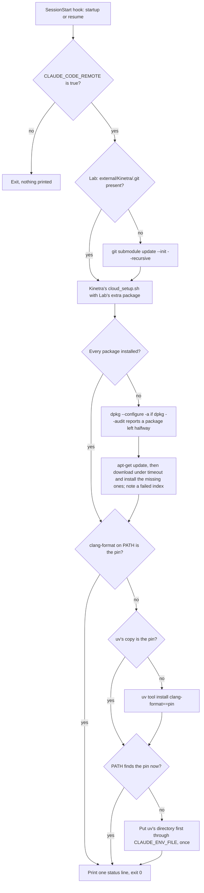

# Ready-to-build cloud sessions

Status: implemented · Branch: `ccr-d6ebceac-13bzfb` (Lab), `build/cloud-session-setup` (Kinetra) · Related: [roadmap](../roadmap.md), [Kinetra tools](../../external/Kinetra/tools/README.md#cloud_setupsh)

A cloud session of Kinetra-Lab or Kinetra starts without SDL2, nlohmann JSON, ccache and CI's clang-format, and in Lab without the Kinetra submodule, so every code task installs them first. A SessionStart hook in each repository now runs one setup script at the start of every cloud session, so a session builds, tests and checks formatting as CI does at once.

## Table of contents

- [Problem](#problem)
- [Goals and non-goals](#goals-and-non-goals)
- [Decisions](#decisions)
- [Design](#design)
- [Affected areas](#affected-areas)
- [Test plan](#test-plan)
- [Review](#review)
- [Verification](#verification)
- [Pull request](#pull-request)
- [Open points](#open-points)

[Directory guide](README.md) · [Project overview](../../README.md) · [Documentation index](../README.md)

## Problem

Measured on 2026-11-23 in this branch's own cloud session (Ubuntu 24.04.5, the *Default* environment):

- **Packages.** `libsdl2-dev`, `nlohmann-json3-dev`, `ccache` and `libgl-dev` were missing, so `cmake --preset dev` could not configure. `clang-format` was Ubuntu's 18.1.3; CI formats with 23.1.5, the version of its pinned Arch snapshot ([Kinetra's ci.yml](../../external/Kinetra/.github/workflows/ci.yml)), so a session could not reproduce the format check.
- **Submodule.** `git submodule status` showed `-bc17b4f external/Kinetra`: the checkout had no engine sources. `.claude/skills` links into the submodule, so the repository skills (`feature`, `roadmap`, `verify` and the rest) were missing too until the session ran `git submodule update --init --recursive`.
- **The environment does not hold a setup script.** On 2026-11-22 the *Linux beyond Arch* session created a cloud environment *Kinetra-Lab* whose setup script installed the packages; on 2026-11-23 the account lists only *Default*, and that day's i4sim session (#92) and this one installed packages by hand. A setup script lives in the environment's settings, outside both repositories: nobody reviews it, and a session in another environment does not get it.
- **Where clang-format 23 comes from.** Under the default *Limited* network access, `apt.llvm.org` and `archive.archlinux.org` do not answer; `pypi.org` does, and PyPI's `clang-format` package has 23.1.5. `uv`, which the cloud image includes, installs it in under a second.
- **Cost.** `apt-get update` took 2 s and installing the missing packages (52 downloads, `--no-install-recommends`, as CI's Ubuntu run installs them) 6 s. With them and clang-format 23.1.5, CI's format command passes on both repositories, `cmake --preset dev` configures, and `kinetra_lab_tests` builds and passes.

## Goals and non-goals

Goals:

- Every Claude Code cloud session of Kinetra-Lab or Kinetra starts with the Debian and Ubuntu package set of the README and [development](../../external/Kinetra/docs/development.md#dependencies-and-options) (Lab adds nlohmann JSON), clang-format 23.1.5 first on `PATH`, and, in Lab, the Kinetra submodule checked out.
- A resumed session, or one that already has everything, spends well under a second on it.
- A failed install does not block the session; the agent learns what is missing and how to install it.
- The package set and the clang-format version are written once for both repositories.

Non-goals:

- The environment's setup script: the user chose the hook (below). An environment script can still call the same script later, for caching.
- Sessions with several repositories and threads of a project: Claude Code loads no repository hooks there ([cloud environments](https://code.claude.com/docs/en/cloud-environments#limitations-in-cloud-sessions)).
- Local machines: the script does nothing outside a cloud session. Developers keep installing from the README.
- Arch parity beyond clang-format: a session builds with Ubuntu's GCC 13, so CI's `linux (arch)` run stays the reference for warnings, as on Ubuntu CI.
- The Windows cross toolchain: Windows is verified by CI's `windows` job.

## Decisions

| Decision | Choice | Why |
| --- | --- | --- |
| Mechanism | A SessionStart hook in each repository's `.claude/settings.json`, which runs a script under `tools/` | The user's choice on 2026-11-23: the hook is versioned and reviewed, works in every environment, *Default* included, and needs no step in the settings. The environment's setup script, which Claude Code caches, lives outside the repositories and was lost once |
| Repositories | Kinetra and Kinetra-Lab in this change | The user's choice on 2026-11-23 |
| One script | Kinetra's `tools/cloud_setup.sh` holds the package set and the clang-format version and takes extra packages as arguments; Lab's `tools/cloud_setup.sh` loads the submodule and calls it with `nlohmann-json3-dev` | One copy of the set and the version for both repositories. Lab needs a script of its own because Kinetra's does not exist until the submodule is loaded |
| clang-format | `uv tool install clang-format==23.1.5` from PyPI, into uv's tool directory (`~/.local/bin` by default), only when neither the clang-format that `PATH` finds nor uv's copy is that version | The exact CI version, from a host the default network access allows; LLVM's apt repository is not reachable. `uv` is in the cloud image. A resumed session reuses its copy instead of downloading it again |
| Only in cloud sessions | The script exits at once unless `CLAUDE_CODE_REMOTE` is `true` | Hooks run in local sessions too; installing system packages on a developer's machine is not the hook's business |
| Synchronous | The hook runs before the session takes its first message, on `startup` and `resume` | No race with the first build. A first start costs seconds; a resumed VM keeps its files, and one that was reclaimed needs the install again |
| Failure | The script always exits 0 and prints one status line | Claude Code adds a SessionStart hook's output to the agent's context only when it exits 0; a failure should inform the agent, not block the session |
| Submodule | Loaded only when `external/Kinetra/.git` is missing | On a resumed session the agent may have moved the submodule on purpose; `git submodule update` would reset it |
| Time limits | The submodule fetch gets 3 minutes, `apt-get update` 2, the package downloads 5 and the uv install 2, each under `timeout -k 10`; the install from the downloaded files has none; the hook's own limit is 900 s | A stalled mirror would otherwise hold the session start until the hook's limit, and a killed hook prints nothing; CI once saw `archive.ubuntu.com` still downloading after an hour. Stopping dpkg halfway would break the next run. With the 10 s grace of each `timeout`, the limits add up to 760 s and leave 140 s for the install within 900 s |
| Interrupted dpkg | Before an install, `dpkg --configure -a` runs when `dpkg --audit` reports a package left halfway | The hook's limit, or a VM reclaimed during an install, can stop dpkg; every later install would then fail with advice that does not help |
| Version copies | The version is written only in Kinetra's script; prose names it through the script (`clang_format_version`). The comments of both `ci.yml` files and [testing](../../external/Kinetra/docs/testing.md#continuous-integration), which say how to bump the Arch snapshot, name the script; both Ubuntu steps name it as a copy of the package set | The script's pin must follow the snapshot, and the person who bumps it reads those places; a number in prose would go stale at the next bump (agent review, round 1) |
| Index errors | `apt-get update` without `APT::Update::Error-Mode=any`; when its output reports a failed fetch, the line says `an apt index did not download` | The cloud image lists `download.docker.com` next to Ubuntu's sources, and every package is in Ubuntu's archive, so one source that does not answer must not stop the install. CI's Ubuntu step can fail on it because its container lists only Ubuntu's sources and falls back to the image's (agent review, round 1, replacing the option the code review had added) |

## Design

The takeaway: a session that already has everything only runs the checks, and every path ends in one line for the agent.

- **Kinetra's script** checks each package with `dpkg-query` and installs only the missing ones, with `--no-install-recommends` like CI's Ubuntu run, after configuring a dpkg that an earlier run left halfway. An index that does not download stops nothing and is named in the line. It then compares `clang-format --version` with its pin; when they differ, it looks at the copy in uv's tool directory (`uv tool dir --bin`) and installs the pin with `uv` only when that copy is missing or another version. When `PATH` still finds another clang-format first, it puts uv's directory first for the session through `CLAUDE_ENV_FILE`, once, so the pinned clang-format wins over Ubuntu's. Output of apt and uv goes to a log file; standard output carries one line, such as `Cloud setup: installed libsdl2-dev ccache; installed clang-format 23.1.5.`, `Cloud setup: packages present; clang-format 23.1.5 present.` or `Cloud setup failed: apt-get did not install libsdl2-dev. Log: <log>. By hand: apt-get update && apt-get install --no-install-recommends libsdl2-dev.`, whose advice names only what failed.
- **Lab's script** loads the submodule when it is missing and then runs Kinetra's script with `nlohmann-json3-dev`. When the submodule cannot be loaded, or its commit has no `tools/cloud_setup.sh`, it prints that and what to do by hand.
- **The hooks** call `bash "$CLAUDE_PROJECT_DIR"/tools/cloud_setup.sh`, so they find the script from any working directory.

## Affected areas

| Repository | Files |
| --- | --- |
| Kinetra | `tools/cloud_setup.sh` (new), `.claude/settings.json` (new), [tools README](../../external/Kinetra/tools/README.md#cloud_setupsh), [development](../../external/Kinetra/docs/development.md#dependencies-and-options), [testing](../../external/Kinetra/docs/testing.md#continuous-integration), comments in `.github/workflows/ci.yml` (the snapshot bump and the Ubuntu step), [review lessons](../../external/Kinetra/docs/review-lessons.md#ci-and-tooling) |
| Kinetra-Lab | `tools/cloud_setup.sh` (new), `.claude/settings.json` (new), [README](../../README.md#quick-start), comments in `.github/workflows/ci.yml`, [roadmap](../roadmap.md), this document and the [index](README.md), the `external/Kinetra` pointer |

No C++ source, CMake file or preset changes.

## Test plan

| Behavior | Proof | Level |
| --- | --- | --- |
| A fresh session gets everything | Remove the packages (`apt-get remove`), the uv tool and the submodule's checkout, then run `CLAUDE_CODE_REMOTE=true tools/cloud_setup.sh` in Lab: every package is installed, `clang-format --version` says 23.1.5, the submodule is checked out, one status line, exit 0 | Targeted |
| A second run does nothing | Run it again: under a second, no apt or uv call in the log | Targeted |
| A resumed session reuses clang-format | Run with a `PATH` that finds Ubuntu's clang-format first and a `CLAUDE_ENV_FILE`, twice: no uv install, the `PATH` line written once | Targeted |
| An old Kinetra commit | Check out a Kinetra commit without the script in the submodule and run Lab's script: one line that says so, exit 0 | Targeted |
| Outside a cloud session | Run it without `CLAUDE_CODE_REMOTE`: no output, nothing installed, exit 0 | Targeted |
| A moved submodule stays | Check out another commit in `external/Kinetra`, run the script: the submodule's `HEAD` is unchanged | Targeted |
| A failure is reported | Run Kinetra's script with a package name that does not exist: the status line says it failed, names the log and advises `apt-get update && apt-get install` of that package only, exit 0 | Targeted |
| An index that does not download | Add an apt source that does not answer and remove one package: the package is installed and the line says `an apt index did not download` | Targeted |
| dpkg left halfway | Unpack a package with `dpkg --unpack` without configuring it: the script configures it and reports it installed; `dpkg --audit` is empty after | Targeted |
| The format check | CI's clang-format command on both repositories with the installed clang-format | Targeted |
| Build and tests | `cmake --preset dev` and the targeted build and test of `kinetra_lab_tests` in Lab; in Kinetra, `cmake --preset dev` and a targeted test | Targeted |
| The hooks themselves | `.claude/settings.json` parses (`python3 -m json.tool`); then a new cloud session on each pushed branch reports the hook's status line, `clang-format --version`, `git submodule status` and a `cmake --preset dev` that configures without installing anything | Full |
| Pull request CI | Lab's CI builds in full for these paths; Kinetra's CI as usual | Full |

## Review

The branch's own code review (the agent's `code-review`, on both repositories' diffs) found:

| Finding | Resolution |
| --- | --- |
| A resumed session whose hook `PATH` finds Ubuntu's clang-format first reinstalled the pinned one with `--force` each time and appended the `PATH` line again | Kinetra's script checks uv's copy first, installs only when it is missing or another version, and writes the line once (Kinetra 3b0fdf6) |
| An empty answer from `uv tool dir --bin` would have put the working directory on `PATH` | Reported as a failure instead (3b0fdf6) |
| The time limits (300 + 120 + 300 + 120 s) plus dpkg could exceed the hook's 900 s, and a killed hook prints nothing | The submodule fetch gets 180 s (Lab 408cb18); the limits add up to 760 s with `timeout`'s grace |
| A submodule whose checkout was interrupted got the message for an old Kinetra commit | The message names both causes and the command (408cb18) |
| `apt-get update` succeeded with a missing index, so the failure named the wrong step | `-o APT::Update::Error-Mode=any`, as in CI (3b0fdf6); the agent review replaced it (below) |
| Lab's `ci.yml` stated the snapshot rule without the script's version, and its Ubuntu step did not name the script as a copy | Both comments name it (408cb18) |
| The tools README said `~/.local/bin` where the script uses uv's tool directory | Reworded (3b0fdf6) |
| The roadmap item says "with Kinetra" but Kinetra's roadmap has no item | Kept: the item closes with this pair of pull requests, so a Kinetra item would be added and removed in the same change |
| The pointer recorded a Kinetra commit not yet pushed | Kinetra's branch was pushed and its pull request opened before Lab's push |

Testing Lab's script on a clone found that a submodule at a Kinetra commit without the script made it fail without a status line; it now says so (a0a06b8).

**Agent review, round 1** (Kinetra#47 and Kinetra-Lab#105 together, at level high; conclusion *Fix first* on both):

| Finding | Resolution |
| --- | --- |
| Should fix: with `APT::Update::Error-Mode=any` and no fallback, one apt source that does not answer, such as the image's `download.docker.com`, stopped every install | The option is gone; a failed fetch in the update's output goes into the line as `an apt index did not download` (Kinetra fd9be64) |
| Should fix: the snapshot bump procedure had copies without the script (`testing.md`, Kinetra's Ubuntu step comment), and `23.1.5` was written into prose in `development.md`, the tools README and Lab's README | `testing.md` and both Ubuntu step comments name the script; the prose names the version only through `clang_format_version`, and the README's example lines show `<version>` (Kinetra fd9be64, 689c789; Lab's README in this round's commit) |
| Should fix: `docs/roadmap.md` conflicted with `main` after #106 | `main` merged; its new items kept, only this item dropped (Lab 1476e5c) |
| Nit: the by-hand advice left out `apt-get update` and named apt and uv whatever failed | The advice names only the commands for what failed, `apt-get update &&` first (fd9be64) |
| Nit: a dpkg left halfway would make every later install fail | `dpkg --configure -a` runs first when `dpkg --audit` reports it (fd9be64) |
| Nit: `timeout -k 10` makes the limits 760 s, not 720 s | *Decisions* says 760 s and the 140 s left for dpkg |
| Nit: this document's example line and flowchart did not match the script | The examples are the script's lines; the flowchart shows the dpkg, index, uv-copy and `CLAUDE_ENV_FILE` steps |
| Nit: Lab's message for a Kinetra commit without the script named only the README's packages | It names CI's clang-format version too, through Kinetra's development page |
| Lesson proposed: when a script reuses an option from CI, check that CI's conditions hold where it runs | Added to Kinetra's [review lessons](../../external/Kinetra/docs/review-lessons.md#ci-and-tooling) (ebd6c84) |

## Verification

In this branch's cloud session (Ubuntu 24.04.5, *Default* environment):

| Check | Result |
| --- | --- |
| Lab's script on a fresh local clone, after `apt-get remove` of `libsdl2-dev`, `nlohmann-json3-dev`, `ccache`, `libgl-dev` and `libegl-dev` and `uv tool uninstall clang-format` | Loaded the submodule, installed the five packages and clang-format 23.1.5 in 6 s, one line, exit 0 |
| Second run | 0.11 s, no apt or uv call |
| Kinetra's script alone, fresh | Installed four packages and clang-format 23.1.5 in 9 s; nlohmann JSON left out |
| Without `CLAUDE_CODE_REMOTE` | No output, nothing installed, exit 0 (both scripts) |
| Submodule moved to another commit | Its `HEAD` stayed; at a Kinetra commit without the script, Lab's script said so and exited 0 |
| Failures | A package that does not exist, a submodule URL that does not answer, no `uv`, and a uv that names no directory each gave a `Cloud setup failed:` line and exit 0; after round 1 the advice names only what failed, for example `apt-get update && apt-get install --no-install-recommends kinetra-no-such-package` |
| An apt source that does not answer (round 1) | With `deb http://127.0.0.1:9/ubuntu noble main` added and `ccache` removed: `Cloud setup: installed ccache; an apt index did not download; clang-format 23.1.5 present.` in 54 s, within the update's 120 s |
| dpkg left halfway (round 1) | `ccache` unpacked with `dpkg --unpack` and not configured: the script configured it and reported `installed ccache`; `dpkg --audit` was empty after |
| Resume with a `PATH` that finds Ubuntu's clang-format first | Twice: no uv install, the `CLAUDE_ENV_FILE` line written once, 0.2 s |
| CI's format command | Clean on Lab and on Kinetra (with its exclusions), with the installed clang-format 23.1.5 |
| Build and tests | Lab: a fresh `cmake --preset dev` found nlohmann JSON 3.11.3 and ccache; `kinetra_lab_tests` and `kinetra_i4sim_controller_tests` built, 52 of 52 passed. Kinetra: `cmake --preset dev`, `kinetra_runtime`, `kinetra_launcher_tests` and `kinetra_settings_view_tests` built, 38 of 38 non-graphics tests passed |
| `shellcheck`, `python3 -m json.tool`, `check_docs.py` in both repositories, `check_copies.py` | Clean; the copies check's hits are the package lists and clang-format names that stay valid, and Lab's `ci.yml` comments, which now name the script |

**The hooks themselves.** A new cloud session on each pushed branch, started from this session in the *Default* environment, reported without installing anything by hand:

| Session | Hook's line | Then |
| --- | --- | --- |
| Kinetra-Lab, `ccr-d6ebceac-13bzfb` | `Cloud setup: installed ccache libsdl2-dev libgl-dev libegl-dev libegl-mesa0 nlohmann-json3-dev; installed clang-format 23.1.5.` | Submodule at Kinetra 3b0fdf6; `feature`, `roadmap` and `verify` available; `cmake --preset dev` configured, the two suites built, 52 of 52 passed; format check rc 0. The hook held the first message for about 15 s |
| Kinetra, `build/cloud-session-setup` | `Cloud setup: installed ccache libsdl2-dev libgl-dev libegl-dev libegl-mesa0; installed clang-format 23.1.5.` | Configured, built `kinetra_runtime` and the two suites, 38 of 38 passed; format check rc 0. About 14 s |

The pull requests' CI is the Full level: Kinetra's builds and tests as usual, and Lab's builds in full for these paths.

## Pull request

`build(tools): set up a cloud session with a SessionStart hook`

### Summary

A cloud session of Kinetra-Lab started without SDL2, nlohmann JSON, ccache, CI's clang-format and the Kinetra submodule, so every code task installed them by hand first. A SessionStart hook in `.claude/settings.json` now runs `tools/cloud_setup.sh` at every start and resume of a cloud session: it loads the submodule when the checkout lacks it and runs Kinetra's `tools/cloud_setup.sh` with nlohmann JSON, which installs the missing Ubuntu packages and clang-format 23.1.5 from PyPI. A new session on this branch built and tested at once.

### Changes

- `tools/cloud_setup.sh` (new) and `.claude/settings.json` (new): the hook, on `startup` and `resume`, synchronous, 900 s limit; only when `CLAUDE_CODE_REMOTE=true`; always one status line and exit 0, with advice for only what failed.
- `README.md`: a paragraph on what a cloud session sets up itself. `.github/workflows/ci.yml`: comments name the script as a copy of the package set and of the clang-format version.
- `external/Kinetra`: the pointer records Kinetra `build/cloud-session-setup`, which adds Kinetra's script, hook and docs.
- Design document, index, and the roadmap item *Ready-to-build cloud sessions*, removed as finished.

### Design

[Ready-to-build cloud sessions](2026-11-23-ready-to-build-cloud-sessions.md). The user chose a hook in the repository over the environment's setup script, and both repositories in this change.

### Verification

Fresh install, rerun, local, resume and failure paths of both scripts, and after review round 1 an apt source that does not answer and a dpkg left halfway; CI's format check on both repositories with clang-format 23.1.5; Lab's `kinetra_lab_tests` and `kinetra_i4sim_controller_tests` (52 passed) and Kinetra's runtime and launcher suites (38 passed). A new cloud session on each branch reported the hook's line and configured, built, tested and checked formatting without installing anything by hand. Details in the design document's [Verification](2026-11-23-ready-to-build-cloud-sessions.md#verification). CI is the Full level.

### Review notes

The branch's code review found a reinstall on every resume, a possible empty `PATH` entry, time limits that could exceed the hook's, a misleading message for an interrupted submodule, and copies of the snapshot rule. The agent review's round 1 found that `APT::Update::Error-Mode=any` let one unreachable apt source stop every install, more copies of the procedure and of the version, and the roadmap conflict with #106; all are fixed ([Review](2026-11-23-ready-to-build-cloud-sessions.md#review)). The hook holds a session's first message for about 15 s on a fresh VM.

### Dependencies and merge order

Kinetra pull request SMB-M87/Kinetra#47 merges first, with a merge commit; this pull request then merges with its pointer at the Kinetra branch commit it was verified with, and Kinetra's `lab-pointer` workflow moves the pointer to the merge commit afterwards. Both wait for the user: each changes a `ci.yml` comment.

### Follow-up

An environment setup script that calls `tools/cloud_setup.sh` would let Claude Code cache the result and cover sessions with several repositories and project threads; only the user can add it ([open points](2026-11-23-ready-to-build-cloud-sessions.md#open-points)).

## Open points

- An environment setup script that calls the same script would let Claude Code cache the result, and would cover sessions with several repositories and project threads, where repository hooks do not run. Only the user can add it, in the environment's settings.
