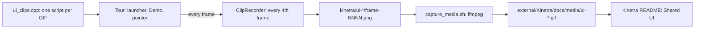

# The shared UI in GIFs in Kinetra's README

Status: accepted · Branch: `ccr-39f927ff-5hqodj`, Kinetra `feat/shared-ui-gifs` · Related: [roadmap](../roadmap.md), [Kinetra roadmap](../../external/Kinetra/docs/roadmap.md), [capture tool](../../tools/capture/README.md), [media guide](../media/README.md)

Kinetra's README describes a launcher and overlays that every lab shares, but shows none of them. This change renders five GIFs of that shared UI from Demo with Lab's capture tool, with a visible pointer, into Kinetra's `docs/media/`, and adds a rule to both `AGENTS.md` files: a change to what a capture shows refreshes the affected captures in the same pull request. So that the frame-time graph looks the same in every capture, the Kinetra runtime gets a fixed frame time for programs that render into files.

## Table of contents

- [Problem](#problem)
- [Goals and non-goals](#goals-and-non-goals)
- [Decisions](#decisions)
- [Design](#design)
- [Affected areas](#affected-areas)
- [Test plan](#test-plan)
- [Review](#review)
- [Verification](#verification)
- [Pull request](#pull-request)
- [Open points](#open-points)

[Directory guide](README.md) · [Project overview](../../README.md) · [Documentation index](../README.md)

## Problem

- Kinetra's [README](../../external/Kinetra/README.md) has no media, though `Kinetra::Launcher` and the runtime's overlays (settings panel, debug menu, agent inspector, frame-time graph) are what every lab looks like ([roadmap item](../../external/Kinetra/docs/roadmap.md#next), *Shared UI in the README*). Kinetra has no applications of its own, so the pictures have to come from Lab.
- Lab's `kinetra_capture` renders every capture into Lab's `docs/media` only (`tools/capture/capture_media.sh`, `media=`), and its clips have no pointer: a menu changes without showing what was clicked. Only the tour draws a pointer, click rings and keycaps (`tools/capture/src/tour/canvas.cpp`), at 1920 × 1080 for a video.
- `Runtime::end()` records wall-clock time in `frame_times()` (`external/Kinetra/src/runtime/runtime.cpp:421`). In a capture these are software-render times: the graph differs on every run and does not look like a 60 Hz run.
- GIF bytes are not reproducible between machines. Re-rendering `demo-clip.gif` in this session gave frames that differ from the committed ones in a few pixels (PSNR 98 to 108 dB), while `launcher.png`, `launcher-demo-scenarios.png`, `demo.png`, `demo-gravity.png` and `dotio-settings.png` came out byte for byte the same. Refreshing every capture after each change would add GIFs to the history that changed through the machine alone.
- Lab's [AGENTS.md](../../AGENTS.md#documentation-in-lab) asks for refreshed media after a visible change; Kinetra's has no such rule, and neither says which captures a change makes stale.

## Goals and non-goals

- Goal: Kinetra's README shows the launcher menu with Demo's configuration page, the settings panel, the debug menu, the agent inspector with the frame-time graph, and the debug layers, in GIFs rendered from the real Demo by `kinetra_capture`.
- Goal: the GIFs show the pointer, the clicks and the keys, as a screen recording would.
- Goal: a refresh gives the same frames on the same machine, the frame-time graph included.
- Goal: both `AGENTS.md` files and the review checklist state the rule, and the media guides say which captures a change makes stale.
- Goal: Lab's CI builds and runs `kinetra_capture_tests` when Kinetra's README or `docs/media/` changes, since the test now reads them.
- Non-goal: Lab's own README as a page about the labs, with more GIFs. That half of Lab's item *README media as GIFs* stays on the roadmap.
- Non-goal: refreshing Lab's existing captures, or byte-identical GIFs across machines.
- Non-goal: the frame read-back helper on `Runtime` (Kinetra roadmap, *Frame read-back on `Runtime`*).

## Decisions

| Decision | Choice | Why |
| --- | --- | --- |
| Frame times in a capture | `Runtime::fix_frame_times(std::optional<double>)`: `frame_times()` records the given time for every frame instead of the measured one; `std::nullopt` measures again | The user's choice on 2026-11-23. A program that renders into files has frames that stand for one display refresh, not for the time they took; `limit_frames(false)` already serves the same kind of program. Pacing stays as it is, and the offscreen driver reports VSync, so the graph reads 16.7 ms with VSYNC |
| GIF set | One GIF per topic, 5 to 10 s each: `ui-launcher`, `ui-settings`, `ui-debug-menu`, `ui-inspector` (with the frame-time graph), `ui-debug-layers` | The user's choice on 2026-11-23: a short GIF per overlay can be refreshed and placed on its own |
| Pointer | Visible pointer, click rings and keycaps, drawn by the tour's `Canvas`; no captions | The user's choice on 2026-11-23. The README's text says what each GIF shows, so the picture stays free |
| Which captures a change makes stale | A table per media guide, from a changed area to the scenes that show it; only those are refreshed and committed | The user's choice on 2026-11-23: no history from machine differences alone |
| How the GIFs are driven | The tour's `Tour` drives the real launcher and Demo session; a `ClipRecorder` keeps every fourth frame as a PNG, so the clips play at 15 frames per second and go through the same GIF step as the other clips | The tour already clicks rows by label and draws the pointer; one GIF step for all clips |
| Size and rate | 960 × 540 at 15 frames per second, as Lab's clips; about 1 MB per GIF at most | The bitmap font stays sharp and the overlays large; GitHub shows a README image at about this width |
| Location | Kinetra's `docs/media/`, with a media guide there; `kinetra_capture` writes the Kinetra scenes into a `kinetra/` subdirectory of its output, and `capture_media.sh` copies them to `external/Kinetra/docs/media` | The proposal in both roadmap items: Kinetra's README links its own files, and Kinetra's docs check resolves them |
| Scenarios | Doorway for the launcher, settings, debug menu and inspector GIFs; Maze, with a planned route, for the debug layers | Doorway has a few agents on a calm background that change little between frames, so its GIFs stay small; Maze shows a route |
| A Lab change that alters only Demo in Kinetra's GIFs | Does not require a Kinetra pull request; the Kinetra GIFs are refreshed with the next Kinetra change to what they show | A Kinetra pull request for every Demo detail would couple the repositories for pictures whose subject is the shared UI. A renamed row that a script clicks stops the capture, so the script follows in Lab |
| Name prefix | `ui-` | Unique across both galleries (Lab already has `launcher.png`) and says what the GIF is about |
| Lab's CI | `needs_build.sh` treats Kinetra's `README.md` and `docs/media/` as read by the build | `kinetra_capture_tests` reads them now; a pointer move that changes them must run it |
| Pull requests | One Kinetra pull request (the runtime change, the GIFs, the README, the media guide, the rule) and one Lab pull request | The runtime change is small and serves the GIFs; both wait for the user anyway, because both change `AGENTS.md` |

## Design

*Takeaway:* the UI clips reuse the tour's driving and drawing and the clips' GIF step; only the destination is new.

**Runtime.** `Runtime::fix_frame_times(std::optional<double> seconds)` stores the time; `end()` records it instead of the measured time, from the second frame on as before. A negative or non-finite value throws `std::invalid_argument`. `kinetra_capture` calls it with 1/60 s for every runtime it opens, so any graph in any capture reads one 60 Hz refresh per frame.

**Scenes.** `Scene` gets a `Gallery` (`lab` or `kinetra`). `main.cpp` writes a Kinetra scene into `<output>/kinetra/`. A UI clip is a `SceneKind::clip` whose script builds a `Tour` on the stage's runtime with a `ClipRecorder` as its frame sink. The recorder writes nothing until the script starts it, so a script can go through the launcher to its scenario first; then it keeps frames 0, 4, 8 and so on as `frame-0001.png` onwards and writes `framerate`. The tour's pointer starts in the bottom-right corner; the scripts:

| Scene | Shows |
| --- | --- |
| `ui-launcher` | The menu with hover on each entry, DEMO, the configuration page with hover on the scenarios, DOORWAY, and the first second of the scenario |
| `ui-settings` | Ctrl opens the panel and pauses Demo; STATISTICS off and on; SIM CONTROLS and DEBUG CONTROLS open their help and close; RESUME |
| `ui-debug-menu` | Shift+Ctrl opens the menu; SPEED steps up; MOTION opens and MAX SPEED steps up; AVOIDANCE switches to LEGACY and back; Shift+Ctrl closes it |
| `ui-inspector` | A click on an agent opens the inspector; FRAME TIMES on in the settings panel puts the graph below it; a click on another agent; the inspector's X closes it |
| `ui-debug-layers` | In Maze, with a planned route: the menu's LAYERS section, each layer off and on again, HOME RANGE, and the wheel zooming out and in |

**Script.** `capture_media.sh` encodes the clips of `<work>/` and `<work>/kinetra/` and copies the first into `docs/media` and the second into `external/Kinetra/docs/media`.

**Rule.** Kinetra's [AGENTS.md](../../external/Kinetra/AGENTS.md#repository-documentation) gets a *Media* bullet, Lab's *Media* bullet says the same for both galleries, the [workflow's review list](../../external/Kinetra/docs/workflow.md#6-review) and the `pr-review` checklist check it, and the `verify` skill refreshes the captures. Each media guide gets the table of changed areas and their scenes.

## Affected areas

- Kinetra: `include/kinetra/runtime/engine.h`, `src/runtime/runtime.cpp`, `tests/runtime_tests.cpp`, `docs/engine/runtime.md`; `docs/media/` (five GIFs and a README), `README.md`, `docs/README.md`, `AGENTS.md`, `docs/workflow.md`, the `pr-review` and `verify` skills and their READMEs, `docs/roadmap.md`.
- Lab: `tools/capture/` (`scenes.h`, `scenes.cpp`, a new `scenes/ui_clips.{h,cpp}` and `tour/clip_recorder.{h,cpp}`, `stage.h`, `main.cpp`, `capture_media.sh`, `CMakeLists.txt`, tests, smoke test, README), `tools/release/needs_build.sh` and its README, `docs/media/README.md`, `AGENTS.md`, `docs/roadmap.md`, this document and the design index, and the `external/Kinetra` pointer.

## Test plan

| Behavior | Test | Level |
| --- | --- | --- |
| `fix_frame_times` records the given time, measures again after `std::nullopt`, and rejects a negative or non-finite time | A graphics case in Kinetra's `runtime_tests.cpp` | Full (public header) |
| Every Kinetra scene has its GIF in Kinetra's `docs/media`, its media guide and its README; every Lab scene stays as before | The scene-list case in `capture_tests.cpp`, split by gallery | Targeted, `^kinetra_capture` |
| `ClipRecorder` writes nothing before it starts, then every fourth frame from the first, numbered from 1, and the frame rate | A new case in `capture_tests.cpp` with hand-made canvases | Targeted |
| A UI clip runs in a real runtime and writes its frames into the Kinetra subdirectory | `kinetra_capture_smoke` also renders `ui-settings` | Full (graphics in CI) |
| `needs_build.sh` builds when a pointer move changes Kinetra's `README.md` or `docs/media/` | Read against the filter; CI runs the decision on this pull request | Full |
| The GIFs show what their rows say | Looking at the frames of each GIF | Manual |

## Review

To be filled in after the review.

## Verification

To be filled in.

## Pull request

To be filled in.

## Open points

- Lab's README as a page about the labs with more GIFs remains Lab's item *README media as GIFs*.
