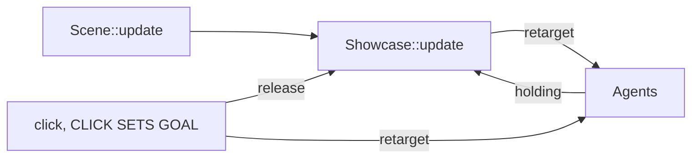

# Demo showcases

Status: implemented · Branch: `ccr-7a5a80b7-9dw7ja` · Related: [Demo](../../labs/demo/README.md#scenarios), [i4sim showcase scenes](../../labs/i4sim/blueprints/README.md#showcase-scenes), roadmap idea *Motion lab*

Demo's authored scenarios become showcases that repeat on their own, as i4sim's showcase scenes do: Doorway's two groups shuttle through the opening, Maze becomes a real labyrinth with a few agents travelling through it, and seven new scenarios show what Kinetra's steering, avoidance and route planning do with many movers.

## Table of contents

- [Problem](#problem)
- [Goals and non-goals](#goals-and-non-goals)
- [Decisions](#decisions)
- [Design](#design)
- [Affected areas](#affected-areas)
- [Test plan](#test-plan)
- [Review](#review)
- [Verification](#verification)
- [Pull request](#pull-request)
- [Open points](#open-points)

[Directory guide](README.md) · [Project overview](../../README.md) · [Documentation index](../README.md)

## Problem

- Doorway commands its six agents across once (`labs/demo/src/world/scenarios.cpp`, the `retarget` after `arrange`). After arrival they wander around their home, which lies on the side they left, so the encounter happens once and then dissolves into wandering. i4sim's showcase scenes repeat: their movers shuttle and turn together after two seconds ([showcase scenes](../../labs/i4sim/blueprints/README.md#showcase-scenes)).
- Maze is three alternating walls without agents; it shows one route of the player.
- The other motion that Kinetra supports (counter-flow, crossing flows, a bottleneck, many movers meeting in the middle, formations and swarms) has no scenario. The user asked for more showcases "so you get a clear picture of what Kinetra can do with motion".

## Goals and non-goals

Goals:

- Doorway: both groups shuttle between their sides and turn together, two seconds after the last one arrived.
- Maze: a grid labyrinth with corridors, dead ends and a few loops in the same field, and six agents that each shuttle between two far cells and turn on their own.
- Seven new scenarios, each a showcase that repeats without input: CORRIDOR, CROSSING, CIRCLE, BOTTLENECK, CHAOS, FLEET and SWARM.
- A click still commands a selected agent, and CLICK SETS GOAL every agent; the showcase takes the agent back after it arrived.
- A GIF clip per new scenario in the README, and refreshed Maze, Doorway and scenario-page captures.

Non-goals:

- No new engine mechanism: every scenario uses Kinetra's existing route planning, steering and reciprocal avoidance, and the showcase only chooses goals. Flocking rules (alignment, cohesion) are not added; SWARM is many agents following one lure.
- No drawing of the lure or of the stops.
- Terrain and Gravity do not change.
- No separate Motion lab; the roadmap idea stays, with a note that Demo now holds the classic scenarios.

## Decisions

| Decision | Choice | Why |
| --- | --- | --- |
| How agents turn | Per scenario: the meeting scenarios turn together, as i4sim does; Maze, CHAOS and the following scenarios move each agent on its own | The user's choice of 2026-11-27. Routes in the maze differ in length, so a shared turn would leave most agents waiting |
| Which new scenarios | CORRIDOR, CROSSING, CIRCLE, BOTTLENECK, plus the user's own CHAOS, FLEET and SWARM | The user's choice of 2026-11-27 |
| A larger maze | A denser grid labyrinth in the same field, not a larger field | The user's choice: the whole maze stays in view without camera work |
| Media | A clip per new scenario in the README; Maze, Doorway, the scenario page and the launcher refreshed | The user's choice |
| Where the script lives | A `Showcase` class in Demo's logic (`demo/world/showcase.h`), driven by `Scene::update` | It holds Demo's choreography, not an engine mechanism; it stays headless and testable. i4sim's shuttle works on its own movers and goals, so nothing is shared yet |
| What an agent does at its stop | It holds there (a new `Agent::hold_on_arrival`), instead of wandering around its home | A wandering agent drifts back toward its home, which in a shuttle lies on the other side |
| A stuck agent | The agent's existing 20-second command limit ends its leg where it stands | A shared turn then never waits longer than that limit |
| Layout seed | Every layout is fixed; only CHAOS draws its goals from the scene's seed | Authored scenes keep fixed layouts, as before; the maze uses a constant seed |
| One pull request | One pull request on the session branch, with a commit per step | The session may push only this branch |
| A showcase's command and passing | A new leg cancels the agent's passing plan, as a user's command does | Found in review: the coordinator would otherwise steer the agent along lanes agreed for the old goal |
| Holding agents and terrain | A holding agent avoids nearby terrain, as a steering wanderer does | Found in review: it has no route back when a neighbor pushes it around a wall end |

## Design

### Holding agents

`Agent::hold_on_arrival()` makes an agent stay where its commanded travel ends: on arrival, or where it stands when the command's 20 seconds run out. A holding agent steers at its goal without a route, counts as not travelling (`wandering()` is true, so passing treats it as busy), reports `holding()`, and the inspector shows ACTIVITY HOLDING. `retarget` ends the hold. Agents without the flag behave as before, which the crowd characterization lines prove.

### Showcase

A `Showcase` knows, per agent, what to do next, and commands only through `Agent::retarget`. Three kinds:

- **Shuttle:** each agent cycles through its own stops. Turning *together*, the agents that hold all turn at once when every agent has held for the pause; turning *alone*, each turns after it has held for the pause.
- **Roam:** each agent travels to a seeded random point of an area, holds for the pause, and picks the next (CHAOS).
- **Follow:** lures travel closed loops at a fixed speed; each agent is assigned a lure and an offset, rotated with the lure's heading for a formation (FLEET) or fixed for a swarm (SWARM). Every quarter second each agent is commanded to its slot, a little ahead of the lure's motion.

A click on a selected agent, CLICK SETS GOAL and `command_agent` release the agent: the showcase leaves it alone until it holds at the user's goal, and then takes it back. In a shared turn, an agent that is still travelling a user's goal misses that turn and continues its own cycle afterwards: the group waits only for the agents the script owns, and turns only when it owns at least one, so after CLICK SETS GOAL the script resumes once the agents hold again.

`Scene` owns an optional `Showcase`; `arrange_scenario` builds it, `set_showcase` replaces it for tests and tools (it marks every agent as holding on arrival), and `place_agents` removes it.

### Scenarios

All in the authored field of 44 × 28 units, with the player out of the way.

| Scenario | Layout | Agents | Turn |
| --- | --- | --- | --- |
| MAZE | 11 × 7 cells of 4 units with walls 1 unit thick, a constant-seed labyrinth with five extra openings for loops | 6, between cells whose routes are at most 56 units, within the 20-second command limit | Alone, 1 s |
| DOORWAY | As before | 6 | Together, 2 s |
| CORRIDOR | A corridor 7 units wide and 28 long | 6 per side | Together, 2 s |
| CROSSING | Two streets 7 units wide cross between four blocks | 6 per street | Together, 2 s |
| CIRCLE | Open field | 16 on a circle, each to its opposite point | Together, 2 s |
| BOTTLENECK | A room with one exit 2.4 units wide | 16, out of the room and back | Together, 2 s |
| CHAOS | Open field with five pillars | 40, to random points | Roam, 0.5 s |
| FLEET | Open field with three pillars on the loop | Two V formations of 6 on one loop in opposite directions | Follow |
| SWARM | Open field, a pillar where the figure eight crosses | 30 around one lure | Follow |

The launcher's scenario page has room for six rows, so it shows the eleven scenarios on two pages.

Mirrored stops swap the rows of a group: the agent in front, which arrives first, holds at the far end, so it does not stand in the way of the agents behind it. A measurement with eight agents per side in a corridor 5.5 units wide left agents at the 20-second limit; six per side in 7 units finish every leg in about 11.5 seconds.

## Affected areas

- `labs/demo`: `agent.h/.cpp` (holding), new `world/showcase.h/.cpp`, `scene.h/.cpp` (showcase ownership, release on commands), `scenarios.cpp` (layouts), `scenario.h/.cpp` (catalog), `inspector.cpp`, `main.cpp` usage text, tests, README.
- `launcher/`: the Demo description, `main.cpp` usage text, the menu test, README.
- `tools/capture`: seven new clips, the Maze clip's goal and length, tests, README.
- Docs: root README (scenario clips), `docs/media/README.md`, roadmap idea *Motion lab*.

## Test plan

| Behavior | Test | Level |
| --- | --- | --- |
| A holding agent stays at its goal, holds where it stands after the command limit, and `retarget` ends the hold; without the flag it wanders as before | `showcase_tests.cpp`, crowd characterization lines unchanged | Targeted |
| Shuttle together: the first agent waits for the last, then both turn in the same tick after the pause | `showcase_tests.cpp` | Targeted |
| Shuttle alone, roam: each agent turns after its own pause; roam goals repeat with the seed and stay in the area | `showcase_tests.cpp` | Targeted |
| Follow: agents keep near their rotating slots; a released agent travels the user's goal and is taken back after it holds | `showcase_tests.cpp` | Targeted |
| Every scenario builds, its agents are awake, and its motion repeats: Doorway's agents cross and come back; Maze's agents and player reach far cells; Circle, Corridor, Crossing and Bottleneck streams reach the other side and return; Chaos goals change; Fleet and Swarm stay near their lures; no deep overlaps between moving bodies | `scenario_tests.cpp` | Targeted |
| Catalog: eleven labels, names and CLI parsing | `scenario_tests.cpp`, `kinetra_menu` | Targeted |
| Clips render and the scene list matches the media guide and README | `kinetra_capture_tests`, CI's graphics smoke | Full |

The branch changes `presentation/`-adjacent code only through the catalog, and the capture tool; the whole change ends at the Full level.

## Review

`/code-review` at medium effort on `39cb628..HEAD` reported seven findings; all were fixed in `fix(demo): showcase commands end passing plans; review findings`:

| Finding | Resolution |
| --- | --- |
| A showcase's `retarget` did not cancel the agent's passing plan, so with PASSING on an agent could follow lanes agreed for its old goal | `Showcase::update` returns the agents it commanded; `Scene::advance_showcase` cancels their plans. Test *a showcase command ends the passing plan agreed for the old goal*, which fails without the fix (9 stale plans) |
| A dormant agent ignored the command but its stop advanced | `send` skips a dormant agent; test with a dormant, then woken agent |
| `set_showcase` in Terrain would throw later, when streaming changes the agents | `set_showcase` refuses Terrain; tested |
| A holding agent pushed around a wall end had no terrain avoidance | Holding agents steer with terrain avoidance |
| The lures' elapsed time grew without bound and lost precision | Each lure keeps its distance within one lap |
| A NaN step looped forever in `along` | `update` rejects a negative or non-finite step; tested |
| The Demo README still said Debug Mode gates layers "in Terrain, Maze and Doorway" | Reworded to cover every scenario from Maze on |

## Verification

- `cmake --build --preset dev` and `ctest --preset dev -R '^kinetra_demo(:|_terrain|_crowd|_passing)|^kinetra_menu:|^kinetra_lab:' -LE soak`: 105 tests passed, the crowd characterization lines unchanged (Terrain behaves as before).
- `ctest --test-dir build-release -R '^kinetra_demo(:|_crowd)'`, the five soak cases included: 51 tests passed.
- `cmake --build --preset graphics` and `ctest --preset graphics -R 'kinetra_demo_inspector|kinetra_demo_graphics|kinetra_smoke:demo|kinetra_menu:|kinetra_capture'`: 50 tests passed, the capture smoke and the Doorway inspector trace among them.
- `tools/capture/capture_media.sh build-graphics launcher launcher-demo-scenarios demo-<scenario>-clip…`: every refreshed capture looked at. A measurement confirms that the shared-turn clips last until the groups turn back (Doorway 8.07 s, Corridor 13.46 s, Crossing 10.81 s, Circle 9.54 s, Bottleneck 13.54 s).
- `clang-format` on every changed source; `python3 external/Kinetra/tools/check_docs.py`; `python3 external/Kinetra/tools/check_copies.py` with the old scenario list, `beyond the last wall`, `alternating`, `0.8 MB` and `twenty (300)` as terms: no copy left.
- Full level: the pull request's CI.

## Pull request

Title: `feat(demo): showcase scenarios that repeat on their own`

Summary: Demo's authored scenarios become showcases, as i4sim's showcase scenes are. Doorway's two groups shuttle through the opening and turn together; Maze becomes a labyrinth with six agents that shuttle between far cells; seven new scenarios show what Kinetra's route planning, steering and reciprocal avoidance do with many movers: Corridor, Crossing, Circle, Bottleneck, Chaos, Fleet and Swarm.

Changes: `Agent::hold_on_arrival` and `holding()`; a `Showcase` script (shuttle, roam, follow) that `Scene::update` advances; the scenario catalog and layouts; the launcher's description and usage; seven new clips and refreshed captures; READMEs, media guide, capture README and the roadmap's *Motion lab* idea.

Dependencies and merge order: none; no Kinetra change.

Follow-up: the open points below.

## Open points

- Showcase scripts are not drawn (stops, lures, slots); Fleet's formations are loose, because agents are sent to their slots only every quarter second ([Demo open points](../../labs/demo/README.md#open-points)).
- The Kinetra README's shared-UI GIFs play in Doorway, whose agents now shuttle; they follow with the next Kinetra change that makes them stale ([Kinetra's media rule](../../external/Kinetra/docs/media/README.md#which-gifs-a-change-makes-stale)).
