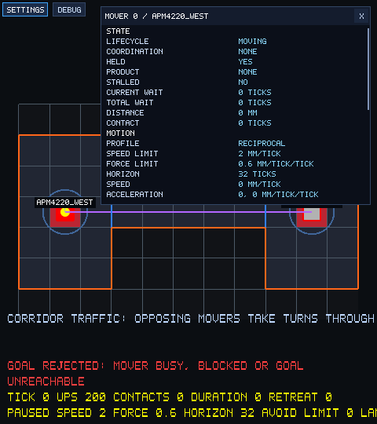
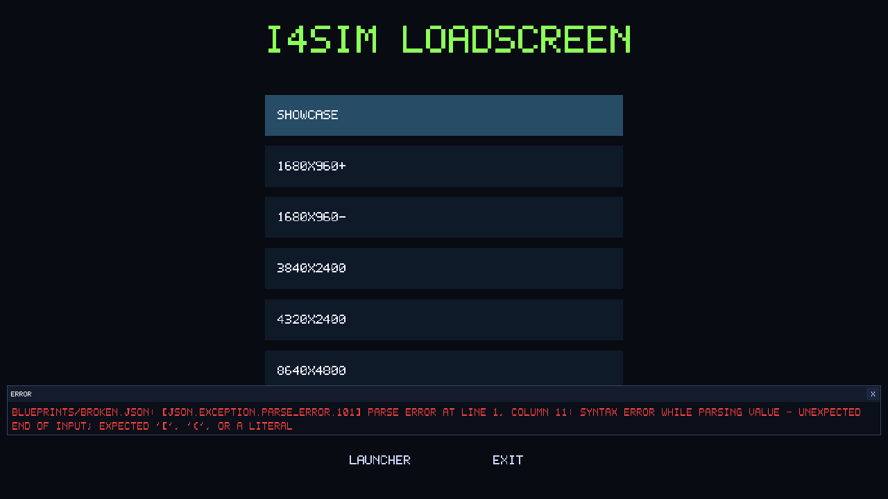
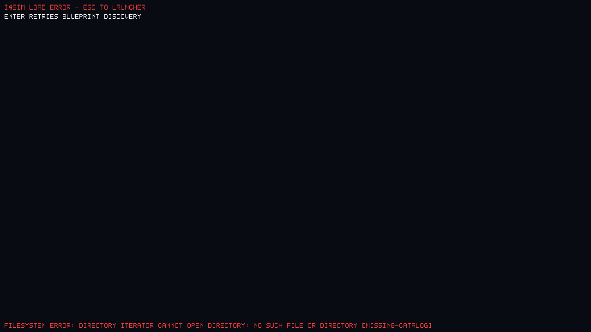

# HUD error style

Status: implemented · Branch: `ccr-41f5211f-186dv3` (Lab), `feat/hud-error-text` (Kinetra) · Related: [Kinetra's HUD text and errors](../../external/Kinetra/docs/engine/launcher-overlays.md#hud-text-and-errors)

The user found i4sim's error messages too small and hard to read, and asked that an error in any application use the font and size of the statistics, in red, directly above them. Kinetra now holds that HUD style, and a panel for screens without HUD lines to spare; i4sim uses both, and Demo and Dotio take their statistics style from it.

## Table of contents

- [Problem](#problem)
- [Goals and non-goals](#goals-and-non-goals)
- [Decisions](#decisions)
- [Design](#design)
- [Affected areas](#affected-areas)
- [Test plan](#test-plan)
- [Verification](#verification)
- [Review](#review)
- [Pull request](#pull-request)
- [Open points](#open-points)

[Directory guide](README.md) · [Project overview](../../README.md) · [Documentation index](../README.md)

## Problem

- i4sim drew its message at scale 0.8 under the toolbar (`labs/i4sim/src/presentation/hud.cpp`, `draw_text(runtime, content.message, {12, 98}, 0.8f, {1, 0.4f, 0.3f})`), while its statistics use scale 1.5 at the bottom. At 0.8 the 5 × 7 font is blurred over fractional pixels and hard to read.
- Every application picked its own HUD numbers: i4sim and Demo wrote `1.5f`, `{1, 1, 0}` and a 20-pixel line as literals, and Dotio its yellow. Nothing kept an error in one application like an error in another.
- The blueprint menu showed a load error through `LaunchMenu::draw(runtime, status)`: the first 80 characters at scale 1 or less, in orange. A load error starts with the blueprint's path, so the JSON error behind it was cut off. The load-error screen without a catalog used scale 1 and a pink tint.

## Goals and non-goals

Goals:

- One HUD style in Kinetra: the statistics' scale, line height, margin and yellow, and a red for errors.
- In i4sim, a message in that style, directly above the statistics, wrapped when it does not fit on one line.
- On the blueprint menu, a load error readable in full, in a panel that can use the whole window and closes with an X like the mover inspector's.
- Demo and Dotio draw their statistics from the same constants, so a future error there reads the same.

Non-goals:

- No error messages for Demo or Dotio: neither has one today.
- No change to what a message says or how long it stays (`FactoryController`).
- No change to the size of Demo's or Dotio's statistics: Dotio keeps its window-dependent scale.

## Decisions

| Decision | Choice | Why |
| --- | --- | --- |
| A message longer than a line | Wrap upward over up to four lines; the inspection and description move up | The user's choice; four lines hold a path with its parse error at a common width, and the full text stays on stderr and in the status |
| Where the shared style lives | Kinetra (`kinetra/runtime/hud_text.h`), not `labs/shared` | The user's choice: a HUD style has no game rules, and the launch menu, in Kinetra, needs it too |
| The loadscreens | Both take the style: the menu's error and the load-error screen | The user's choice |
| An error on the blueprint menu, where one HUD line fits below the menu | An error panel over the menu, at the bottom, as high as it needs up to the whole window, with an X | The user's choice, after seeing the one-line version cut the parse error off. The panel takes the pointer where it covers the menu; keys still reach the menu |
| The panel and the menu's footer (LAUNCHER, EXIT) | The panel ends above the footer when the whole message fits there; only a longer message grows over it. The footer stays clickable for short messages, such as a rejected goal's four-second message after BLUEPRINTS | The user's choice in review round 1, of three: above the footer, the panel only for load errors, or covering the footer. At 1280 × 720 and the default 1280 × 800 a one- or two-line panel at the bottom covered the footer |
| A message longer than the whole window, in the panel | The panel scrolls with the wheel instead of cutting, with the inspector's scroll bar; a new message starts at its first line | An earlier agent review on Kinetra#73 (blocking): at 320 × 240 a long blueprint path filled the panel and pushed the parse error past the cut. Scrolling keeps every part reachable at any window size; the HUD's four-line message keeps its cut, as decided above |
| Punctuation in diagnostics | The bitmap font gets glyphs for `{ } ( ) ' " ;` | The same review: nlohmann's *expected '[', '{', or a literal;* showed blanks where the token should be. No capture shows these characters, so none goes stale |
| Where the message sits when STATISTICS is off | Still on line 3 | The user asked for "above the statistics placeholder": the message does not jump when the statistics toggle |

## Design

**Kinetra.** [hud_text.h](../../external/Kinetra/include/kinetra/runtime/hud_text.h) is header-only: `text_scale` 1.5, `line_height` 20, `margin` 10, `statistics_color` yellow and `error_color` red; `line_top` and `lines_below` count lines from the bottom; `wrap` breaks at the last space that fits and cuts a longer word; `error_lines` caps the lines and ends a cut message with `...`; `draw_line` and `draw_error` draw. [error_view.h](../../external/Kinetra/include/kinetra/runtime/error_view.h) adds `error_panel::bounds`, `close_bounds`, `lines`, `update` and `draw`: the panel is as wide as the window less the margins, sits at the bottom, and uses the inspector's title bar (24 pixels) and close button (18 pixels). The panel shows every line of the message as far as the window allows, and the wheel scrolls the rest: `error_panel::update` returns the first line to show, which the caller keeps per message, and `draw` shows the lines from there with a scroll bar. Every `error_panel` function takes an optional region to keep clear: when the panel would cover it at the bottom, it sits directly above it, a margin away, if the whole message fits there; a longer message keeps the bottom. `LaunchMenu::update(input, viewport, error)` asks the panel first, with the footer (`MenuLayout::footer_bounds()`) as that region: over the panel the menu sees no pointer and no click, and a click on the X sets `error_closed()`. Whether the pointer moved is decided from the real pointer, so the panel coming or going does not hover a row. `LaunchMenu::draw(runtime, error)` draws the panel last.

**i4sim.** `draw_hud` draws the statistics on lines 1 and 2, the message from line 3 up (at most four lines), then the inspection and, one line higher, the description; `hud_lines(message_lines)` computes those lines. `BlueprintScreen::update` passes the message to the menu and returns `ScreenAction::dismiss` for a click on the X, on which the session clears the message. The load-error screen without a catalog draws its two headings at the HUD scale and the error on its bottom lines.

**Demo** reads `hud::text_scale`, `hud::margin`, `hud::statistics_color` and `hud::draw_line` instead of literals. **Dotio** reads only `hud::statistics_color`: it keeps its window-fitted scale and right alignment. Both draw the same pixels as before.

## Affected areas

- Kinetra: `include/kinetra/runtime/hud_text.h` and `error_view.h` (new), `src/runtime/error_view.cpp` (new), `launcher.h` and `launcher.cpp` (`LaunchMenu`), `CMakeLists.txt`, the tests in `presentation_tests.cpp`, `launcher_tests.cpp` and `runtime_tests.cpp`, `docs/review-lessons.md`, the [launcher contract](../../external/Kinetra/docs/engine/launcher-overlays.md), the runtime and tests READMEs, `README.md`, `AGENTS.md` (functionality index) and `docs/testing.md`.
- Lab: i4sim's `hud.cpp`, `hud.h`, `blueprint_screen.cpp`, `blueprint_screen.h`, `session.cpp` and `presentation_tests.cpp`; Demo's `renderer.cpp`; Dotio's `presentation.cpp`; i4sim's README and tests README; [launcher and overlays](../launcher-overlays.md); the [factory simulation architecture](../factory-simulation-architecture.md); `docs/review-lessons.md`; the three screenshots in `docs/design/assets/`.
- Media: no capture shows an error. The statistics of Demo, Dotio and i4sim and the launch menu without an error draw the same pixels, so no capture is stale.

## Test plan

| Behavior | Test | Level |
| --- | --- | --- |
| HUD lines count from the bottom; columns fit between the margins | `kinetra_presentation:HUD lines count up from the bottom of the viewport`, `HUD columns fit the width between the margins and are at least one` | Full (public header) |
| Wrapping at spaces, cutting long words, the cut mark | `kinetra_presentation:error text wraps at spaces and cuts words longer than a line`, `an error longer than its lines ends with the cut mark` | Full |
| The panel's size, position and cut at the window's height | `kinetra_launcher:the error panel grows with its message up to the whole window` | Full |
| The panel takes the pointer over the menu, its X closes, keys still work; a short error leaves EXIT free | `kinetra_launcher:an error panel over the menu takes the pointer and its close button reports the click` | Full |
| The panel moves above a region it would cover when its message fits there | `kinetra_launcher:the error panel moves above a region it would cover when its message fits there` | Full |
| The panel coming or going is no pointer move | `kinetra_launcher:the error panel coming or going is no pointer move, so keyboard navigation holds` | Full |
| What the panel and a HUD error draw: title bar, red lines in order, the lit X | `kinetra_engine_graphics:the error panel draws its title bar, red lines in order and a lit close button`, `a HUD error puts its first line on the higher HUD line` | Full (graphics) |
| Spaces at a wrap, on both sides of a break and before the first word | `kinetra_presentation:error text wraps at spaces and cuts words longer than a line` | Full |
| Every character of a real nlohmann diagnostic has a glyph | `kinetra_presentation:a parser diagnostic's punctuation has glyphs` | Full |
| A long path scrolls to its reason at 320 × 240; a new message starts at line one | `kinetra_launcher:the wheel scrolls an error longer than a small window to its end` | Full |
| i4sim's HUD lines with and without a message | `kinetra_i4sim_graphics:the HUD message sits directly above the statistics and pushes the text above it up` | Full (graphics) |
| A load error on the blueprint menu, above the footer, and its X | `kinetra_i4sim_graphics:a load error shows in a panel over the blueprint menu that its X closes` | Full (graphics) |
| Demo, Dotio and i4sim render as before | The existing graphics suites and smoke tests | Full (graphics) |
| How it looks | Frames read back from the real session in a temporary case (the capture tool has no scene with an error), looked at and committed as the [screenshots](#screenshots) | Looked at |

## Screenshots

Read back from the real i4sim session through the runtime's frame read-back, after review round 1.

The HUD at 480 × 540: a rejected goal's message in red, wrapped over two lines directly above the yellow statistics.

The blueprint menu at 1280 × 720 with a parse error: the panel ends above LAUNCHER and EXIT, and the expected tokens `'['` and `'{'` show.

The load-error screen without a catalog: the headings at the HUD scale, the error on the bottom line.

## Verification

Full level: a public Kinetra header, `LaunchMenu` and three `presentation/` folders changed. Locally, on Ubuntu 24.04 with software OpenGL:

| Command | Result |
| --- | --- |
| In `external/Kinetra`: `cmake --preset dev && cmake --build --preset dev && ctest --preset dev` | 318 of 318 passed, no warnings; 320 of 320 after merging Kinetra `main` |
| `cmake --build --preset dev` (Lab, `KINETRA_LAB_WARNINGS` on) | Built, no warnings |
| `ctest --preset dev -R '^kinetra_(i4sim\|menu\|lab:\|dotio:\|demo:)' -LE soak` | 272 of 272 passed; 270 of 270 after merging Lab `main` |
| `cmake --build --preset graphics && ctest --preset graphics -L graphics -LE soak` | 33 of 33 passed, 35 of 35 after merging Lab `main`, among them the i4sim, Demo and Dotio presentation suites, `kinetra_runtime_tests` and every smoke test |
| `clang-format --dry-run --Werror` on every changed C++ file | Clean |
| `python3 external/Kinetra/tools/check_docs.py`, in Lab and in Kinetra | All links resolve |
| `python3 external/Kinetra/tools/check_copies.py --term 'status line' --term '80 characters' --term 'below the toolbar' --term 'load-error screen'` | The hits are ADR status lines, the settings panel's toolbar and the load-error screen that still exists; none names the old behavior |
| Frames from a temporary case, looked at and not committed | The HUD at 1280 × 720 and 420 × 480 (the message wraps to two lines), the blueprint menu with a long parse error in the panel, and the load-error screen without a catalog |

Lab `main` moved its Kinetra pointer while the pull requests were open: Kinetra `main` (with the menu's LAUNCHER button) is merged into `feat/hud-error-text`, the pointer follows that merge, and Lab `main` is merged into this branch. `LaunchMenu` keeps both the LAUNCHER button and the error panel.

After review round 1: Kinetra `dev` 322 of 322, Kinetra `graphics` 25 of 25 (with the two new drawing cases), Lab `graphics` 35 of 35, Lab targeted 270 of 270, no warnings. Swapping the line order in `hud::draw_error` fails the new HUD case, so it catches what it is meant to. After merging both mains again (Kinetra #69, Lab #142 and #155): Kinetra `dev` 324 of 324, Lab `graphics` 35 of 35, Lab targeted 270 of 270.

After the rounds 2 and 3 fixes: Kinetra `dev` 326 of 326, Kinetra `graphics` 25 of 25, Lab `graphics` 35 of 35, Lab targeted 270 of 270, no warnings. Without the footer region in `LaunchMenu::update`, the short-error case fails.

The pull requests' CI completes the Full level.

## Review

`/code-review` at medium depth on both diffs:

- **Fixed:** a cut error in a panel narrower than three characters ended with the whole `...` mark, longer than its line. The mark is now cut to the line's width (Kinetra `fix(runtime): keep a cut HUD error within its columns`), with a test.
- **Out of scope:** the review also reported five points in code this change does not touch: three in i4sim's `make_way.cpp` (a refuge trip whose return is blocked by a waiting mover, a timed-out return into the beneficiary's lane, a shuttling beneficiary's request recorded as `cancelled`), one in `stall_detector.cpp` (a first observation for a goal at the origin) and `file(COPY_FILE)` in `benchmark_log_names.cmake`, which needs CMake 3.21 while the project declares 3.16. They are not verified; see [open points](#open-points).

Agent review round 1 (Fix first on both pull requests):

| Finding | Resolution | Commit |
| --- | --- | --- |
| Kinetra: the panel's `{-1, -1}` stand-in made its coming and going a pointer move, which could undo keyboard navigation | Movement is decided from the real pointer; the masked pointer only feeds hit tests and highlights. Test added | Kinetra `fix(launcher): address review: keep the error panel off the footer and the pointer real` |
| Kinetra: no graphics case draws the panel or `hud::draw_error` | Two cases in `runtime_tests.cpp`, with lines that start with different glyphs | Kinetra `test(runtime): address review: draw the error panel and a HUD error` |
| Lab question: the panel covers the menu's footer at 1280 × 720 and 1280 × 800 | The user chose: above the footer when the message fits there; new decision row | Kinetra `fix(launcher): …`; Lab test checks the panel ends above the footer |
| Lab: `factory-simulation-architecture.md` still named `LaunchMenu`'s status text | Now names the error panel | Lab `fix(i4sim): address review: …` |
| Both: no screenshot | Three [screenshots](#screenshots) | Lab `docs(design): …` |
| Nit: `wrap` kept a space after a run of spaces | Every space at a break goes | Kinetra `fix(runtime): address review: drop every space at a wrap` |
| Nit: the Tests table of the launcher contract; `draw()`'s comment; Dotio's wording; the message line taken from `hud_lines`; a test folder per run | Done | Kinetra and Lab review commits |
| Nit: the no-catalog screen's headings do not wrap below about 320 pixels | Left: a window that narrow cannot show the menu either, and the message below them wraps | — |
| Lessons | Added to each repository's `review-lessons.md` | `docs(lessons): …` |

Agent review rounds 2 and 3 (Ready to merge on both) and the earlier agent review on Kinetra#73:

| Finding | Resolution | Commit |
| --- | --- | --- |
| Earlier review, blocking: at small windows the parse error falls past the panel's cut | The panel scrolls with the wheel; test at 320 × 240 | Kinetra `feat(runtime): address review: scroll an error longer than the window` |
| Earlier review: the font drew `{ } ' "` blank | Glyphs for `{ } ( ) ' " ;`; test over a real diagnostic; the [menu screenshot](#screenshots) shows the tokens | Kinetra `fix(runtime): address review: show parser punctuation and trim spaces at a wrap` |
| Nit: `wrap` kept a space before a break in a run of spaces, and a blank first line for leading spaces | Trimmed; a break before the first word counts as no break | same |
| Nit: the window-free short-error case would pass without the footer region | Runs at 640 × 480, where a panel at the bottom covers EXIT; it fails without the region | Kinetra `feat(runtime): …` |
| Nit: "above the footer" is not exact in a tall window | "Keeps clear of the footer" in the contract, `LaunchMenu`'s comment and i4sim's README | Kinetra and Lab review commits |
| Nit: the i4sim case's click on the panel's center hits no control | A comment says it only checks a click off the X | Lab review commit |
| Nit: an accessor for the panel's place, so the i4sim case need not rebuild the menu layout | Left: the case's copy is one line, and the accessor would serve only tests | — |
| Nit: a failed `REQUIRE` leaves the test folder behind | Left: the folder is unique per run, in the system's temporary directory | — |

## Pull request

Title: `feat(i4sim): show messages in the shared HUD error style`

Summary: i4sim's error messages were small (scale 0.8) and hard to read. They now use a HUD style that Kinetra shares with every application: red, in the font and size of the statistics, directly above them, wrapped over up to four lines. On the blueprint menu a load error shows in full in an error panel above the footer, which can use the whole window when it needs to and closes with its X. Demo and Dotio read their statistics style from the same constants.

Changes:

- Kinetra ([feat/hud-error-text](https://github.com/SMB-M87/Kinetra/tree/feat/hud-error-text)): `hud_text.h` (scale, line height, margin, colors, wrapping, `draw_line`, `draw_error`), `error_view.h` (the error panel), and `LaunchMenu` showing its error in that panel.
- i4sim: the HUD message above the statistics (`hud_lines`), the error panel on the blueprint menu with `ScreenAction::dismiss`, and the load-error screen in the HUD style.
- Demo and Dotio: statistics drawn from `hud::` constants, same pixels.
- Docs: i4sim's README and tests README, [launcher and overlays](../launcher-overlays.md), and in Kinetra the launcher contract, runtime and tests READMEs.

Design: this document.

Verification: see [Verification](#verification); CI runs the Full level.

Dependencies and merge order: the Kinetra pull request merges first, with a merge commit; this pull request records its branch commit. Kinetra's `lab-pointer` workflow then moves the pointer to the merge commit.

Follow-up: the [open points](#open-points).

## Open points

- Demo and Dotio show no errors yet. When one does, it uses `hud::draw_error` on the line above its statistics.
- The five out-of-scope review points above are unverified; each needs a reproduction before it becomes a roadmap item.
