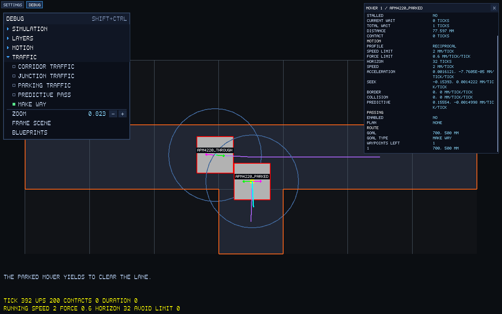

# i4sim make way

**Status** Implemented · **Branch** `feat/i4sim-make-way`

Let a parked mover clear the route of a stalled mover when a checked refuge can open the route. This is step 2 of stall detection and remedies. [Lab roadmap](../roadmap.md#later) · [Stall detection](2026-11-26-i4sim-stall-detection.md)

## Table of contents

- [Problem](#problem)
- [Goals and non-goals](#goals-and-non-goals)
- [Decisions](#decisions)
- [Design](#design)
- [Affected areas](#affected-areas)
- [Test plan](#test-plan)
- [Verification](#verification)
- [Review](#review)
- [Pull request](#pull-request)
- [Open points](#open-points)

[Directory guide](README.md) · [Project overview](../../README.md) · [Documentation index](../README.md)

## Problem

A mover at the front of a producer queue can get boxed into its own parking row when it follows a route past an already parked neighbor. The Reciprocal replays on `4320x2400` and `MAS-demonstrator` show the same mechanism. Route recovery has no path to follow while the blocking footprint stays in place. The stall detector from [PR #135](https://github.com/SMB-M87/Kinetra-Lab/pull/135) records the episode, which provides the starting point for the remedy. [Phase 7 replays](2026-11-21-i4sim-passing-under-pressure.md#step-4-why-two-movers-stand-still-near-a-destination)

## Goals and non-goals

- Offer optional parking relief for a diagnosed stall and keep the yielding mover's product, recipe step, queue slot and parking reservation.
- Reuse stall observations and the existing motion profiles. Keep the policy off by default and measure its effect on stalled movers, waiting, contacts and throughput.
- Queue-departure screening, a temporary motion fallback and the separate RECOVERY corner remain follow-ups.

## Decisions

| Decision | Choice | Reason |
| --- | --- | --- |
| Trigger | Use the merged detector's active stall episode and the current footprint geometry | A parked blocker can appear after the onset diagnosis |
| Eligibility | One unheld, parked mover per episode, including an idle product carrier | Both recorded blockages involve occupied parking rows, while held and processing movers have commitments that need to remain in force |
| Search | Prefer a checked alternate route, then the nearest usable refuge in a bounded neighborhood | A local remedy keeps selection deterministic and avoids a factory-wide search |
| Deadline | End relief after 1,200 ticks and allow a checked return even if the beneficiary still has the same route | A blocked next leg cannot hold the parking reservation or production queue indefinitely |
| Defaults | Off, configurable through the traffic menu, scenario and benchmark | Seeded replays show benefits for specific blockages and mixed outcomes elsewhere |

## Design

Enable the policy through DEBUG → TRAFFIC → MAKE WAY, `scenario.motion.makeWay` or the benchmark's `--make-way` flag. It starts disabled. It uses the merged observer's active episode as a trigger and checks current route geometry before taking action. The observer's onset diagnosis can be different from the obstacle currently in the way.

For each episode, first try a checked alternate route. Otherwise look for one nearby parked mover whose temporary departure opens a route while its footprint is in the refuge. Reuse the existing footprint-aware route refinement to check the stalled mover's route and each proposed trip. The full refuge footprint, with clearance, stays outside parking and processing reservations. Checked paths avoid enabled traffic zones and reserved exits. A shortcut is valid only after checking the live footprints and reservations. Motion checks the route again after admission and brakes before following a newly obstructed leg. If a zone or exit becomes protected around a mover, the mover can withdraw outward and stay outside once it clears the boundary. It still counts as an occupant while inside and makes no new admission request. The search covers two cells on each axis around the parked blocker and picks the nearest valid refuge in stable order.

An idle mover at its own parking place can yield while holding a product. Production defers a new movement while the mover is away and retains its product, recipe step and queue reservation. Exclude a held mover, a mover under other traffic control, a shuttle participant and a mover processing a product. The maneuver uses existing steering and contact rules and keeps its route independent of passing and corridor retreat. Product and mover distance counters record the actual detour even while production is deferred.

The request ends when the beneficiary clears, is held, changes goals, the policy is disabled or the 1,200-tick deadline passes. Cancellation, expiry and an invalidated traffic leg release the claim on the parking space. A traffic wait may slow movement, while the trip can still install a checked return. The blocker can turn back immediately once the return route is clear. Otherwise it uses the checked outbound leg or brakes when a new obstruction appears. It keeps checking for a return while braking, including when its brake target remains within a protected region. The event log records attempted relief, an unavailable path, and the request's outcome. A failed geometry search may retry once after 30 ticks, so a nearby mover can finish parking. Only one trip starts per episode.

## Affected areas

- Headless i4sim simulation, including the remedy, routing checks, motion totals, stall observation, and production assignment.
- Traffic settings, scenario parsing, the existing mover inspector, and benchmark event CSV.
- Seeded factory fixtures, controller coverage and the parking-relief documentation. Kinetra's recorded revision is shared with the base branch.

## Test plan

- A parked blocker moves to a checked refuge and returns to its reservation. The stalled mover reaches its original goal and both remain contact-free.
- A narrow floor with no refuge retains its stall and records the unavailable attempt. Disabling the feature or reaching its deadline returns the blocker safely when the route is clear.
- Check both recorded `4320x2400` seeds and the `MAS-demonstrator` product-bearing blocker. The mover retains its product and queue order while yielding. The ready product stays queued at the front until the mover returns. Product and mover odometers both count the detour.
- Check refuge overlap at a processing-place boundary, a checked shortcut around a mover, a newly admitted exit, an expired return with a persistent wait flag, withdrawal after a live traffic toggle, coexistence with predictive passing, and the scenario setting through load and application.
- Enable a corridor around an outbound mover whose return route is temporarily blocked. Verify that it brakes and retries the return as soon as the obstruction clears, whether the corridor remains enabled or is disabled again with the beneficiary still waiting.
- Run the i4sim controller, simulation, golden and pressure suites. Compare paired runs across Improved and Reciprocal on the 48-run harness and in the long benchmark.

## Verification

The Release build with warnings enabled passed all 165 i4sim checks including the golden and pressure suites, the inspector trace and review regressions. The initial timeout test failed because the refuge was still the destination after the deadline. Formatting, documentation links and whitespace checks passed.

```sh
cmake --preset release -DKINETRA_LAB_WARNINGS=ON -DKINETRA_WARNINGS=ON
cmake --build --preset release --target kinetra_i4sim_tests kinetra_i4sim_golden_tests \
  kinetra_i4sim_pressure_tests kinetra_i4sim_controller_tests kinetra_i4sim \
  kinetra_i4sim_motion_benchmark -j 4
ctest --preset release -R '^kinetra_i4sim' -j 4 --output-on-failure
python3 external/Kinetra/tools/check_docs.py
git diff --check
```

The software OpenGL capture shows the enabled TRAFFIC checkbox and the active `MAKE WAY` goal in the yielding mover's inspector.



| Blueprint and seed | Ticks | Products, off → on | Waiting ticks, off → on | Stuck at end, off → on | Contacts, off → on |
| --- | ---: | ---: | ---: | ---: | ---: |
| `4320x2400`, 2026 | 12,000 | 6 → 6 | 4,383 → 2,132 | 1 → 0 | 0 → 0 |
| `4320x2400`, 915839214 | 12,000 | 7 → 7 | 4,155 → 3,472 | 2 → 0 | 0 → 0 |
| `MAS-demonstrator`, 42 | 50,000 | 10 → 15 | 24,006 → 1,646 | 1 → 0 | 0 → 0 |

These runs used Reciprocal with other traffic policies and RECOVERY off. In the MAS replay, the first search at tick 27,028 finds no route. Thirty ticks later mover 4 can yield while retaining its product. The event log records the original blockage as cleared at tick 27,440.

In the 48-run harness, Reciprocal went from two runs with a stuck mover at the end to zero, with zero contacts throughout. Improved went from zero such runs to one, with 170 → 167 contacts and 3,487 → 3,832 waiting ticks. Both profiles completed the same number of products in aggregate. The remedy stays off by default.

The 50,000-tick benchmark used its default three blueprints and two seeds in each profile. Each row compares six runs per setting.

| Profile | Products, off → on | Contacts, off → on | Waiting ticks, off → on | Runs with a stuck mover at end, off → on |
| --- | ---: | ---: | ---: | ---: |
| Reciprocal | 334 → 344 | 0 → 0 | 152,001 → 104,020 | 3 → 0 |
| Improved | 343 → 348 | 1,386 → 837 | 8,022 → 7,635 | 1 → 1 |

```bash
benchmark=build-release/kinetra_i4sim_motion_benchmark
for mode in off on; do
  flags=()
  if [[ "$mode" == on ]]; then flags+=(--make-way); fi
  for profile in reciprocal improved; do
    "$benchmark" --profile "$profile" --ticks 12000 \
      --blueprint labs/i4sim/blueprints/1680x960+.json \
      --blueprint labs/i4sim/tests/MAS-demonstrator.json \
      --blueprint labs/i4sim/blueprints/3840x2400.json \
      --blueprint labs/i4sim/blueprints/4320x2400.json \
      --seed 42 --seed 915839214 --seed 7 --seed 1234 --seed 99 --seed 2026 \
      "${flags[@]}" > "/tmp/i4sim-harness-$profile-$mode.csv"
    "$benchmark" --profile "$profile" --ticks 50000 "${flags[@]}" > "/tmp/i4sim-long-$profile-$mode.csv"
  done
  "$benchmark" --profile reciprocal --ticks 50000 --seed 42 \
    --blueprint labs/i4sim/tests/MAS-demonstrator.json --events "/tmp/i4sim-mas-$mode" "${flags[@]}"
done
```

## Review

| Finding | Resolution |
| --- | --- |
| Time-out could keep the mover away from parking | Expiry releases the beneficiary's claim and allows a checked return. The regression keeps the beneficiary on its original route past the deadline. |
| Passing or waypoint shortcuts could replace a checked route | Passing and corridor retreat leave yielding movers out of new maneuvers. Shortcuts check the body and reservation clearance. Motion checks live exits after admission. |
| The refuge center alone could miss a processing boundary | Check the entire footprint against the reserved processing square. |
| Counters and queue behavior lacked direct coverage | Keep the physical counters and verify the recorded MAS queue, including readiness at its front and processing after return. |
| Scenario mapping and design evidence were incomplete | Apply the scenario setting in the loader test. Document the decision, tick order, commands and measured comparisons and include a capture of the traffic menu and the inspector. |

[Round 1 review](https://github.com/SMB-M87/Kinetra-Lab/pull/140#pullrequestreview-6087576789)

Round 2 found that a persistent wait could veto the return and that a zone enabled around a yielding mover could also trap it. The wait no longer vetoes a checked repair. The swept route may withdraw outward from an overlapping region, then must stay outside it. Regressions exercise the active timed-out trip and the steering response after a zone is enabled. [Round 2 review](https://github.com/SMB-M87/Kinetra-Lab/pull/140#pullrequestreview-6087733229)

Round 3 found that a temporary obstruction on the only withdrawal route could strand a braking mover. The trip now remembers the invalidation and retries the checked return during braking.

## Pull request

**Title** `feat(i4sim): let parked movers clear stalled routes`

**Summary.** Add optional MAKE WAY to i4sim. One parked mover can yield to a diagnosed stall using a checked refuge and return route, while retaining its production reservations.

**Changes.** Add the traffic setting to the debug menu and scenario loader, mark temporary goals in the shared inspector, and record remedy outcomes in the benchmark event CSV. Reuse the stall detector merged in #135.

**Design.** [i4sim make way](2026-11-27-i4sim-make-way.md).

**Verification.** `cmake --preset release -DKINETRA_LAB_WARNINGS=ON -DKINETRA_WARNINGS=ON` and the i4sim targets built with warnings enabled. `ctest --preset release -R '^kinetra_i4sim' -j 4 --output-on-failure` passed all 165 checks. The paired 48-run harness and the 50,000-tick benchmark cover Improved and Reciprocal. The [verification commands and results](2026-11-27-i4sim-make-way.md#verification) include the benchmark arguments and the software OpenGL capture. Documentation, formatting and whitespace checks passed.

**Review notes.** Review fixes cover checked returns under persistent traffic waits, outward withdrawal from a newly enabled zone and retrying a blocked withdrawal while braking. The queue-departure check and the separate Improved corner case remain open. The remedy stays opt-in.

**Dependencies and merge order.** Lab only, based on already-merged PR #135.

**Follow-up.** Evaluate stricter queue departures and a temporary motion fallback.

## Open points

- Decide how to apply the strict departure check when a product already has a mover and reaches the front of the producer queue.
- Measure and choose a temporary motion fallback. The separate RECOVERY corner case remains open.
- A single parked mover can fail to open a checked route. Keep such stalls visible and use the recorded cases to evaluate any future policy that moves several blockers.
