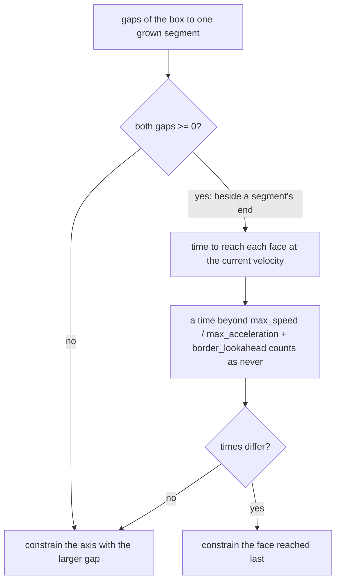

# i4sim: RECOVERY detour past a corner

Status: implemented · Branch: `fix/i4sim-recovery-corner` (Lab), `fix/border-face-at-rest` (Kinetra) · Related: [roadmap item](../roadmap.md#later), [phase 7, open points](2026-11-21-i4sim-passing-under-pressure.md#open-points), [Kinetra's border corner slide](../../external/Kinetra/docs/design/2026-11-19-border-corner-slide.md)

With route recovery (RECOVERY) on, mover 18 on `4320x2400` under Improved stops for good 3 mm beside a blocked cell, in six of the 48 runs of the tuning-stall harness. The cause is not the detour: it is Kinetra's `constrain_borders`, which beside the end of a wall picks the face to constrain by the time the body would reach it, and lets a drift of 3e-5 mm per tick toward a face 3 mm away decide. This change gives that choice a time horizon in Kinetra; Lab records the measurement and closes the roadmap item.

## Table of contents

- [Problem](#problem)
- [Goals and non-goals](#goals-and-non-goals)
- [Decisions](#decisions)
- [Design](#design)
- [Affected areas](#affected-areas)
- [Test plan](#test-plan)
- [Review](#review)
- [Verification](#verification)
- [Pull request](#pull-request)
- [Open points](#open-points)

[Directory guide](README.md) · [Project overview](../../README.md) · [Documentation index](../README.md)

## Problem

Replayed on 2026-11-27 at Lab `a83d82d` (Kinetra `e3ad07c`) with the [tuning-stall harness](2026-11-20-i4sim-tuning-stall.md#measurement-harness) and a scratch case that prints mover 18 every tick. The run is the same for all six seeds up to the stall.

1. At tick 346 mover 18 (half extents 77.5 by 77.5 mm) has made no progress for the stall limit and `recover_route` (`labs/i4sim/src/simulation/routing.cpp:121`) gives it a `kinetra::Navigation` detour from (872.9, 2162.9) to its parking place (800.5, 1359.5): (720, 2160), (720, 1800), (840, 1680), (800.5, 1359.5).
2. Navigation plans a circle of radius `max(half_extents) + 3` = 80.5 mm. The leg from (720, 1800) to (840, 1680) passes the bottom-right corner (720, 1680) of the blocked cell centered at (600, 1560) at 84.9 mm, which a circle clears but the square body does not: its corner reaches 109.6 mm along the diagonal. `constrain_borders` handles that as it should: from tick 784 the mover slides right along the cell's floor (y = 1680, its top at 1757.5 − 77.5), turns toward its parking place and comes to rest at (800.506, 1757.5), 3 mm right of the cell's side x = 720, its top flush with the floor.
3. From there the last leg runs straight up to (800.5, 1359.5), clear of the cell by 3 mm. The mover never takes it: every tick its seek asks for (0, −0.6) mm/tick² and the border constraint returns (0, 0.6), so it stands still until the end of the run with velocity (−2.98e-5, 0).
4. Why: for the cell's floor segment, `constrain_borders` (`external/Kinetra/src/simulation/priority_steering.cpp:8`) finds the body beside the segment's end, with gaps (3.006, 0). The rule from the [border corner slide](../../external/Kinetra/docs/design/2026-11-19-border-corner-slide.md#decisions) constrains the face the body would reach last at its current velocity, and a face it does not approach counts as never reached. The drift of 2.98e-5 mm/tick toward the side reaches x after 100,000 ticks; y, which the body does not approach, never. So y is constrained, with a gap of 0: the floor brakes the move up along the side. The side segment, beside its own end, makes the same choice.
5. Nothing frees it: at x ≈ 800 a float steps by 6.1e-5 mm, so the drift of 3e-5 never moves the body, and the seek toward x = 800.5 keeps the drift alive. RECOVERY plans again every few hundred ticks and gets the same last leg.

| Harness (48 runs, 12,000 ticks) | Runs with a stuck mover | Stuck movers | Completed products |
| --- | --- | --- | --- |
| RECOVERY off | 2 | 3 | 213 |
| RECOVERY on | 7 (six of them mover 18 on `4320x2400` under Improved) | 8 | 219 |

## Goals and non-goals

- Goal: a body at rest beside the end of a wall, with a residual drift toward a face far away, can move along the other face; mover 18 reaches its parking place in all six runs.
- Goal: the slide past a convex corner ([border corner slide](../../external/Kinetra/docs/design/2026-11-19-border-corner-slide.md)) and every existing braking case stay as they are; i4sim's golden and pressure summaries do not change.
- Goal: no public API change; the contract comment of `constrain_borders` names the horizon.
- Non-goal: route recovery itself. Its circular planning radius makes diagonal legs graze box corners, which the border constraint turns into a slide; that costs time but does not stall (see [Open points](#open-points)).
- Non-goal: the other stuck runs of the harness (Reciprocal at a destination, the subject of *Stall detection and remedies*).

## Decisions

✱ marks a decision the agent took without the user, recorded for review under [Open points](#open-points).

| Decision | Choice | Why |
| --- | --- | --- |
| Where to fix ✱ | In Kinetra's `constrain_borders`, not in i4sim's route recovery | The trap is in the reusable border constraint and catches any body that comes to rest beside a wall's end; for the same kind of trap on 2026-11-19 the user chose the fix in Kinetra. A wider recovery radius would only move the corner it grazes, and a radius of the half diagonal no longer reaches parking places 3 mm from a cell |
| Rule ✱ | A face counts as reached only within `max_speed / max_acceleration + border_lookahead`; beyond that it counts as never reached, so when neither face is reached in time, the larger gap decides, as before the corner slide | A face the body reaches only after it could brake from full speed needs no braking now. The horizon is in the caller's time units, like the other settings, and keeps every choice the swept rule made for a face reached soon. For i4sim it is 2 / 0.6 + 2 = 5.3 ticks |
| Velocity used ✱ | Still the current velocity | Tried first: judging by velocity plus requested acceleration frees mover 18 but makes three i4sim cases fail (a mover without path planning and two showcase scenes no longer finish their legs), as the corner slide's design predicted |
| Pull requests ✱ | One in Kinetra (fix, tests, contract), one in Lab (pointer, this document, roadmap) | The behavior change is Kinetra's; this document lives in Lab, where the problem, the measurement and the item are |
| Drift bound ✱ | Left as a named limit (Kinetra#69 review round 1) | A body resting closer to the far face than the horizon times its drift (about 1.6e-4 for 3e-5) still gets the old choice and can stay braked at large coordinates. Treating an approach that cannot change the float position as no approach would cover it, but it is a different rule and would move today's measurements; nothing measured hits the bound |
| Benchmark runs that end worse ✱ | Accepted | With RECOVERY on, three of the twelve benchmark runs now end with a mover sealed in by parked neighbors, the documented standstill that *make way* addresses; the change only steers those runs elsewhere. The harness's stuck runs drop from 7 to 1 of 48 and nothing else stalls in a new way (see [Verification](#verification)) |

## Design

The takeaway: only the step marked *never* is new. Mover 18's side at 100,000 ticks and its floor (not approached) are both *never*, so the larger gap (3 mm, the side) is constrained and the move up along the side is free.

## Affected areas

- Kinetra: `src/simulation/priority_steering.cpp` (the horizon), `include/kinetra/simulation/steering.h` (contract of `constrain_borders`), `docs/engine/navigation.md`, `tests/weighted_navigation_tests.cpp` (two cases).
- Lab: the `external/Kinetra` pointer, this document and the index, `docs/roadmap.md` (item removed). The phase 7 design document keeps its open point as history.
- Consumers: only i4sim calls `priority_steer` and `constrain_borders`.

## Test plan

| Behavior | Test | Level |
| --- | --- | --- |
| At rest 0.3 units beside a cell's side, top flush with its floor, drifting 3e-5 toward the side, the move up along the side keeps its full acceleration; also at i4sim's coordinates (720, 1680) | `kinetra_weighted_navigation`: a body at rest beside the end of a wall moves along the other wall's face | Targeted (Kinetra) |
| The horizon is the boundary: a face reached in 5 steps (within 5.33) still constrains, one reached in 6 no longer does | `kinetra_weighted_navigation`: only a face reached within the stopping horizon decides beside the end of a wall | Targeted (Kinetra) |
| The corner slide, braking and parking cases stay as they are | Existing `kinetra_weighted_navigation` cases and the rest of Kinetra's suite | Targeted (Kinetra) |
| i4sim's golden and pressure summaries are unchanged | `kinetra_i4sim_golden`, `kinetra_i4sim_pressure` against the Kinetra branch | Targeted (Lab) |
| RECOVERY on: mover 18 no longer stuck in the six runs; RECOVERY off: harness unchanged | Tuning-stall harness, before and after, recorded in [Verification](#verification) (a measurement, not a test: its outcome depends on chaotic runs) | Measurement |
| Every Lab and Kinetra build and test | Both pull requests' CI | Full |

Both new Kinetra cases failed before the fix: the move along the side got 0 instead of −0.6, and the 6-step face still braked it. A loop that integrates the body does not reproduce the stall at small coordinates, where the drift does move the body; the stall needs the float spacing near x = 800, which is why the first case checks the step itself at both places.

## Review

Self-review of both diffs before pushing:
- The rule changes the choice only when every face time present exceeds the horizon. A face reached within it, or one reached and one never, gives the same choice as before, so the corner slide and the braking cases keep their result; the Kinetra suite and i4sim's golden and pressure lines confirm it.
- The horizon uses settings that `constrain_borders` already validates as finite and positive, so it is finite and positive; it is in the caller's time units like `border_lookahead`.
- The lambda parameter was renamed from `gap` to `clearance_left`, which would have shadowed the outer `gap` under `KINETRA_WARNINGS`.
- `check_copies.py` with the terms *reach last*, *face the body would reach*, *face the agent would reach*, *convex corner*, *RECOVERY detour*, *3 mm to spare* and *mover 18*: the rule's copies in `steering.h`, `navigation.md` and Kinetra's `tests/README.md` now name the horizon; the roadmap item is removed; the dated design documents keep their history.

Agent review of Kinetra#69, round 1 (conclusion *Questions*): one question, whether a body resting within `horizon × drift` of the far face is in scope. Answered as a named limit (decision *Drift bound*), now stated in Kinetra's `docs/engine/navigation.md` and under [Open points](#open-points). The nits: the description links this pull request. `max(1, border_lookahead)` in the horizon is left for later (every consumer uses 2). The test's 0.3 units are mover 18's 3 mm at the cruiser's scale.

## Verification

Measured with Lab at `a83d82d`, Kinetra at `e3ad07c` (before) and `fix/border-face-at-rest` (after), Release.

**Tuning-stall harness** (48 runs: `1680x960+`, `MAS-demonstrator`, `3840x2400`, `4320x2400`, six seeds, Improved and Reciprocal, 12,000 ticks):

| RECOVERY | Runs with a stuck mover | Stuck movers | Completed products |
| --- | --- | --- | --- |
| Off, before / after | 2 / 2 (the same runs) | 3 / 3 | 213 / 213 |
| On, before / after | 7 / 1 | 8 / 1 | 219 / 222 |

Repeated after merging Lab `main` at `39cb628` (Kinetra-Lab#140, MAKE WAY, off by default): the same counts before and after, run for run. With RECOVERY on, mover 18 reaches its parking place in all six runs. The one stuck run left is `4320x2400` seed 2026 under Improved: movers 22 and 23 jostle beside parked mover 25 at (3359.5, 2331.5), the standstill of the [stall detection replay](2026-11-26-i4sim-stall-detection.md#problem).

**Motion benchmark** (`kinetra_i4sim_motion_benchmark`, 50,000 ticks, seeds 42 and 915839214). Rows not listed are equal before and after, tick for tick; `--profile reciprocal --recovery` is equal in every row. Cells are before → after.

| Run | Blueprint | Seed | Completed | Contacts | Waiting ticks | Stuck (at end) |
| --- | --- | --- | --- | --- | --- | --- |
| Improved | 3840x2400 | 42 | 54 → 59 | 1 → 3 | 853 → 634 | 1 (0) → 0 (0) |
| Improved | 3840x2400 | 915839214 | 60 → 59 | 18 → 0 | 1055 → 962 | 1 (0) → 1 (0) |
| Improved, `--recovery` | MAS-demonstrator | 42 | 14 → 15 | 72 → 43 | 263 → 980 | 1 (0) → 1 (1) |
| Improved, `--recovery` | MAS-demonstrator | 915839214 | 14 → 10 | 278 → 91 | 459 → 16201 | 1 (0) → 1 (1) |
| Improved, `--recovery` | 3840x2400 | 42 | 58 → 58 | 7 → 3 | 1085 → 739 | 0 (0) → 1 (1) |
| Improved, `--recovery` | 3840x2400 | 915839214 | 61 → 62 | 16 → 1 | 760 → 734 | 0 (0) → 1 (0) |

The three runs that now end with a stuck mover were replayed: mover 0 on `MAS-demonstrator` (both seeds) stands at (1016.5, 56.5) under the top wall, beside the blocked cell at x = 960, between parked movers 1 and 4, the case the [phase 7 replay](2026-11-21-i4sim-passing-under-pressure.md#step-4-why-two-movers-stand-still-near-a-destination) describes for seed 42; mover 5 on `3840x2400` stands under the top wall between parked movers 4 and 6. None of them stands beside a wall's end with a free face.

| Command | Result |
| --- | --- |
| Kinetra: `cmake --build --preset headless && ctest --preset headless` | 274 of 274 passed |
| Kinetra: the two new cases without the fix | Both fail: 0 instead of −0.6 along the side, and the face 6 steps away still brakes |
| Kinetra: `kinetra_weighted_navigation_tests` with `KINETRA_WARNINGS_AS_ERRORS=ON` | No warnings |
| Kinetra: `clang-format --dry-run --Werror` on the changed sources; `python3 tools/check_docs.py` | Clean; all links resolve |
| Lab: `cmake --build --preset release` for the i4sim targets, `ctest --preset release -R '^kinetra_i4sim'` | Every simulation, golden, pressure and controller case passes; golden and pressure lines unchanged; again after merging `main` with Kinetra-Lab#140 (160 of 160) |
| Lab: `python3 external/Kinetra/tools/check_docs.py`, `check_copies.py` with the terms above | All links resolve; hits judged in [Review](#review) |
| Both pull requests' CI | Full level; recorded on the pull requests |
| Lab after merging `main` (pointer at Kinetra `9841a50`): `cmake --build --preset release`, `ctest --preset release -LE soak` | 352 of 352 passed; Kinetra#70 changes only the runtime settings panel, which i4sim's logic does not use |

## Pull request

Title: `fix(i4sim): free mover 18 beside a cell corner under route recovery`

Summary: records Kinetra#69, which lets a body at rest beside a wall's end move along the other face. With RECOVERY on, mover 18 on `4320x2400` no longer stands still 3 mm beside a blocked cell; the tuning-stall harness goes from 7 to 1 stuck run of 48. Closes the roadmap item *RECOVERY detour past a corner*.

Changes: the `external/Kinetra` pointer; this design document and its index row; the roadmap item removed.

Dependencies and merge order: Kinetra#69 merged first, with a merge commit (`9841a50`). Lab `main` then recorded Kinetra#70's branch commit, so merging `main` here conflicted on the pointer. Its resolution is Kinetra `main` at `9841a50`, which holds both, and this pull request was verified again with it. The pointer is then on Kinetra `main`, so no pointer-only pull request follows unless Kinetra moves on.

Follow-up: none new; the remaining stuck runs belong to *Stall detection and remedies in i4sim*.

## Open points

For the user's review (decisions taken without the user):
- The fix in Kinetra rather than in route recovery, the horizon `max_speed / max_acceleration + border_lookahead`, and keeping the current velocity for the choice.
- Leaving the drift bound (below) as a named limit.
- Accepting that three benchmark runs with RECOVERY on now end with a sealed-in mover (one of them, `MAS-demonstrator` seed 915839214, completes 10 products instead of 14) while the harness's stuck runs drop from 7 to 1.

Known and not addressed here:
- The horizon frees a drift only toward a face farther than `horizon × drift`. A body resting closer, about 1.6e-4 for mover 18's 3e-5, keeps the old choice and stays braked where a float cannot absorb the drift. If such a stall appears, the remedy is to treat an approach that cannot change the position at its coordinates as no approach.
- The horizon adds the raw `border_lookahead`, while the braking divides by `max(1, border_lookahead)`; with a lookahead below 1 a face beyond the horizon could still need braking. No consumer uses a lookahead below 1.
- Route recovery plans with a circle of radius `max(half_extents) + 3` for a square mover, so a diagonal leg past a corner overlaps the corner by up to 29 mm (109.6 − 80.5) and the border constraint turns it into a slide along the wall. The detour still arrives, more slowly.
