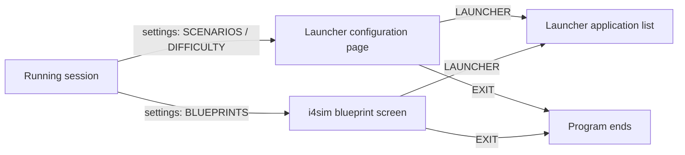

# Configuration button in the settings panel

Status: accepted · Branch: Lab `ccr-7c409f6c-5786az`, Kinetra `feat/settings-configuration-button` · Related: [launcher and overlays](../launcher-overlays.md), [Kinetra's contract](../../external/Kinetra/docs/engine/launcher-overlays.md), Kinetra [ADR 0013](../../external/Kinetra/docs/decisions/0013-settings-overlay-in-kinetra.md) and [ADR 0014](../../external/Kinetra/docs/decisions/0014-session-navigation-requests.md)

Demo's SCENARIOS, Dotio's DIFFICULTY and i4sim's BLUEPRINTS leave a running session for the application's own choice of variant. They sit at the bottom of the debug menu, so a player without the debug mode cannot reach them. The user asked to move them to the settings panel: each takes the place of LAUNCHER in the panel's action row, and the pages they open get a LAUNCHER button, so the launcher stays one click further away.

## Table of contents

- [Problem](#problem)
- [Goals and non-goals](#goals-and-non-goals)
- [Decisions](#decisions)
- [Design](#design)
- [Affected areas](#affected-areas)
- [Test plan](#test-plan)
- [Review](#review)
- [Verification](#verification)
- [Pull request](#pull-request)
- [Open points](#open-points)

[Directory guide](README.md) · [Project overview](../../README.md) · [Documentation index](../README.md)

## Problem

- The three buttons are debug-menu rows: `labs/demo/src/debug_panel.cpp:137` (SCENARIOS), `labs/dotio/include/dotio/application.h:244` (DIFFICULTY) and `labs/i4sim/src/controller.cpp:478` (BLUEPRINTS). The debug menu shows only in the debug mode, and in i4sim with LAYERS open BLUEPRINTS falls below the edge of a window lower than about 650 pixels ([roadmap](../roadmap.md)).
- The settings panel is Kinetra's `SettingsOverlay`. Its action row is fixed: LAUNCHER (`SessionRequest::menu`), RESUME and EXIT (`external/Kinetra/src/runtime/settings_view.cpp:41`). An application cannot change a button.
- The launcher's configuration page has no clickable way back to the application list, only the M key (`external/Kinetra/src/runtime/launcher.cpp`, `LaunchMenu::update`), and i4sim's blueprint screen leaves for the launcher only on Escape or M (`labs/i4sim/src/presentation/blueprint_screen.cpp:52`). With LAUNCHER gone from the panel, a mouse user would have no visible way back to the launcher.

## Goals and non-goals

Goals:
1. The settings panel's action row reads SCENARIOS / RESUME / EXIT in Demo, DIFFICULTY / RESUME / EXIT in Dotio and BLUEPRINTS / RESUME / EXIT in i4sim, in every mode, debug mode on or off.
2. The first button closes the panel and leaves for the same place the debug-menu row did: the launcher's configuration page of the application with the running configuration selected (Demo, Dotio), or i4sim's blueprint screen.
3. The three debug-menu rows are gone.
4. The launcher's configuration page and i4sim's blueprint screen, on both its pages, have a clickable LAUNCHER button next to EXIT that returns to the launcher's application list.
5. An application that keeps the default still gets LAUNCHER / RESUME / EXIT, and the launcher's application list is unchanged.

Non-goals:
- Keyboard shortcuts for the new buttons; M and Escape keep what they do.
- Clicking debug-menu rows by label in the scripts that still click by number (roadmap item).

## Decisions

| Decision | Choice | Why |
| --- | --- | --- |
| Where the buttons go | In place of LAUNCHER in the settings panel's action row, per application | The user's choice: the row stays three buttons, and the launcher moves one level down to the page the button opens |
| Labels | SCENARIOS, DIFFICULTY, BLUEPRINTS, as in the debug menu | The user's choice |
| What a click does | The panel closes and the action runs | The user's choice; for i4sim it keeps the panel from staying over the blueprint screen |
| A way back to the launcher | A clickable LAUNCHER button on the launcher's configuration page and on both pages of i4sim's blueprint screen | The user's choice: without it the launcher is reachable only by keyboard |
| Mechanism in Kinetra | `SettingsOverlay` takes an optional `LeaveAction {label, request}` for its first button, default `{"LAUNCHER", SessionRequest::menu}`; `request` is `menu` or `configurations` | Demo and Dotio already ask for `configurations`; with the request in the overlay their sessions just return `settings_.request()`. A callback would have kept a flag in every session |
| i4sim's request | i4sim serves `configurations` itself: it closes its blueprint and calls the new `SettingsOverlay::clear_request()` | i4sim's configuration page is its own blueprint screen, and the overlay outlives the blueprint; without a reset the next blueprint would close at once |
| Name of the first button's position | `SettingsOverlay::launcher_x` becomes `leave_x` | The button no longer always reads LAUNCHER; Lab is the only consumer and changes with it |
| LAUNCHER in `LaunchMenu` | `LaunchMenu` takes a `LauncherButton`: `configuration_page` (default) shows LAUNCHER on the configuration page, which returns to the application list as M does; `every_page` shows it on every page and only reports `launcher_requested()`, for a menu nested in a session such as i4sim's | One menu, two owners: the launcher navigates itself, a nested menu leaves through its session |
| Footer layout | Without LAUNCHER the footer is unchanged (PREVIOUS 50, EXIT 150, NEXT 250). With LAUNCHER: LAUNCHER 100 and EXIT 200; with paging PREVIOUS, LAUNCHER, EXIT and NEXT at 37.5, 112.5, 187.5 and 262.5. `LaunchMenu::footer_x(FooterButton)` returns a button's position on the current page; every footer button is clickable 36 panel pixels either side of its center | Four buttons fit the 300-pixel panel only at a quarter each; the old 40-pixel half width would overlap. Callers stop hard-coding 150 for EXIT |

No ADR: the row kinds of [ADR 0013](../../external/Kinetra/docs/decisions/0013-settings-overlay-in-kinetra.md) and the requests of [ADR 0014](../../external/Kinetra/docs/decisions/0014-session-navigation-requests.md) stay as they are; the overlay only lets an application choose the request its first button already makes.

## Design

**Kinetra.**
- `SettingsOverlay(rows, debug_mode, LeaveAction leave = {})`. The constructor throws `std::invalid_argument` for an empty label, a label wider than the button, or a request other than `menu` and `configurations`. A click on the first button sets `request()` to `leave.request` and closes the panel. `clear_request()` sets `request()` back to `none`, for a session that serves the request itself. The constants `leave_x`, `resume_x` and `exit_x` stay the button centers.
- `LaunchMenu(choices, heading, LauncherButton = configuration_page)`. `footer_x(FooterButton)` gives the panel x of PREVIOUS, LAUNCHER, EXIT or NEXT on the current page, or nothing when the page does not show it. On the configuration page, LAUNCHER leaves the page as M does; with `every_page`, LAUNCHER on any page sets `launcher_requested()`, which the owner consumes as it does `exit_requested()`.

**Lab.**
- Demo and Dotio pass `{"SCENARIOS", configurations}` and `{"DIFFICULTY", configurations}` to their overlays and return `settings_.request()`. `DebugPanel::scenarios_requested()` and `Application::difficulty_requested` go.
- i4sim passes `{"BLUEPRINTS", configurations}`. When the overlay asks for it, the session calls `FactoryController::close_later()` (the old BLUEPRINTS row's action, now public) and `clear_request()`; the next `begin_frame()` closes the blueprint, as before. Its blueprint screen builds its `LaunchMenu` with `every_page` and turns `launcher_requested()` into `ScreenAction::leave`.
- The capture tool's tour leaves a session through the first button and the configuration page's LAUNCHER; the `ui-launcher` clip returns to Demo's page through the settings panel.

*Takeaway:* a running session leaves for its own choice of variant; the launcher is one click further, on that page.

## Affected areas

- Kinetra: `include/kinetra/runtime/settings_view.h`, `src/runtime/settings_view.cpp`, `include/kinetra/runtime/launcher.h`, `src/runtime/launcher.cpp`, `tests/settings_view_tests.cpp`, `tests/launcher_tests.cpp`, `tests/runtime_tests.cpp`, `tests/consumer/main.cpp`, `docs/engine/launcher-overlays.md`, the README's shared UI and its GIFs `ui-launcher`, `ui-settings`, `ui-inspector`.
- Lab: Demo (`debug_panel`, presentation session, tests), Dotio (`application.h`, presentation session, tests), i4sim (`controller`, presentation session, blueprint screen, tests), `launcher/tests/runtime_tests.cpp`, the capture tool's tour and UI clips, `docs/launcher-overlays.md`, the three module READMEs, the roadmap, the captures that show the debug menus, the settings panel and the configuration pages.

## Test plan

| Behavior | Test | Level |
| --- | --- | --- |
| A `LeaveAction` labels the first button, sets its request and closes the panel; the default is LAUNCHER and `menu`; invalid actions throw; `clear_request()` resets | `kinetra_settings_view` cases in `settings_view_tests.cpp` | Kinetra targeted |
| The configuration page shows LAUNCHER and returns to the list on a click; the list has no LAUNCHER; `every_page` reports `launcher_requested()` on both pages; footer positions with and without paging, and no overlap | `kinetra_launcher` cases in `launcher_tests.cpp` | Kinetra targeted |
| The drawn panel shows the first button's label; the drawn configuration page shows LAUNCHER | `kinetra_engine_graphics` cases in `runtime_tests.cpp` | Kinetra full (CI) |
| Demo's, Dotio's and i4sim's debug menus no longer have the row | `kinetra_demo`, `kinetra_dotio`, `kinetra_i4sim_controller` row-list cases | Lab targeted |
| Each settings panel's first button leaves for the configuration page (Demo, Dotio) or the blueprint screen (i4sim) with the debug mode off, and the next blueprint does not close | `kinetra_runtime_tests` and `kinetra_i4sim_presentation_tests` graphics cases | Lab full (CI) |
| i4sim's blueprint screen LAUNCHER leaves on both pages | `kinetra_i4sim_presentation_tests` | Lab full (CI) |
| The tour and the UI clips run to their end | `kinetra_capture_tests`, `kinetra_capture_smoke` | Lab full (CI) |

## Review

Filled in after the review.

## Verification

Filled in after verification.

## Pull request

Filled in before the push.

## Open points

None yet.
