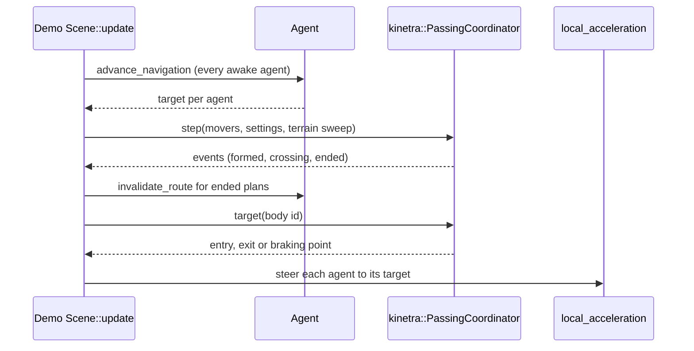

# Shared passing mechanism

Status: accepted · Branches: Kinetra `feat/passing-coordinator`; Lab `feat/shared-passing-demo` (step 1), `feat/shared-passing-dotio` (step 2) · Related: [roadmap](../roadmap.md#now), [Kinetra passing contract](../../external/Kinetra/docs/engine/navigation.md#predictive-passing), [ADR 0017](../../external/Kinetra/docs/decisions/0017-passing-coordinator.md)

Demo's crowds and Dotio's enemies get the head-on passing that i4sim's movers use: two movers that will meet agree on side lanes, drive to their entries and cross. The plan lifecycle that runs the shared geometry moves into Kinetra as `PassingCoordinator`, so both applications use one tested mechanism, and each application gets pressure scenarios like i4sim's.

## Table of contents

- [Problem](#problem)
- [Goals and non-goals](#goals-and-non-goals)
- [Decisions](#decisions)
- [Design](#design)
- [Affected areas](#affected-areas)
- [Test plan](#test-plan)
- [Review](#review)
- [Verification](#verification)
- [Pull request](#pull-request)
- [Open points](#open-points)

[Directory guide](README.md) · [Project overview](../../README.md) · [Documentation index](../README.md)

## Problem

Kinetra #64 moved i4sim's passing geometry into the engine (`passing.h`: `passing_conflict_time`, `passing_lane_candidates`, `PassingLaneGuard`), but only i4sim uses it, through its factory coordinator (`labs/i4sim/src/simulation/predictive_passing.cpp`, 356 lines with traffic controls and an event log). Demo's agents (`labs/demo/src/world/scene.cpp`, `Scene::steer_agents`) and Dotio's enemies (`labs/dotio/src/entities/enemy.cpp`) have no agreement about who passes on which side: Demo relies on reciprocal avoidance or legacy separation alone, Dotio on contact resolution between enemies. The plan lifecycle around the geometry (formation, waits for traffic with priority, timeouts, retries, outcomes) would be written twice more in Lab.

The roadmap item *Shared passing mechanism* asks to give Demo crowds and Dotio enemies the passing geometry and to run equivalent pressure scenarios for each application. It depended on *Stall detection and remedies in i4sim*, which is not finished; on 2026-11-27 the user asked to do this item first, so the open question of that dependency (whether making way and a motion fallback belong in the shared part) stays open and becomes the Kinetra roadmap item *i4sim on the passing coordinator*.

## Goals and non-goals

Goals:

- Kinetra offers a headless, deterministic `PassingCoordinator` with explicit tuning in the caller's units and steps, for movers of any shape; engine tests prove its lifecycle at two world scales and away from the origin.
- Demo's agents on commanded travel pass each other with it when PASSING is on, under both avoidance models; four Demo pressure scenarios hold.
- Dotio's enemies that follow a route pass each other with it when PASSING is on; Dotio pressure scenarios hold (step 2).
- With PASSING off, the default, every recorded line stays as it is: Demo's crowd characterization, Dotio's fingerprint and i4sim's golden and pressure lines.

Non-goals:

- i4sim keeps its own coordinator (Kinetra roadmap: *i4sim on the passing coordinator*).
- No stall remedy (making way, motion fallback); no debug layer that draws the lanes (an open point).
- Demo's wanderers do not pass: a wander leg is too short and random for an agreement.

## Decisions

| Decision | Choice | Why |
| --- | --- | --- |
| Where the lifecycle lives | In Kinetra, as `PassingCoordinator`, with ADR 0017 amending ADR 0016; i4sim keeps its own | The user's choice of 2026-11-27, over a Lab helper or a copy per application: two applications need it and it holds no game rules |
| Default | PASSING off, a debug-menu row in each application | The user's choice of 2026-11-27: recorded lines stay, and the pressure suites turn it on |
| Cut | Kinetra pull request; Lab stack of two: Demo (with the design), then Dotio | The user's choice of 2026-11-27 |
| Coordinator interface | One `step` per tick over every mover (body, route heading, destination, `available`, `stationary`), a world check per leg as a callback, events and targets out | The caller keeps its world and its steering; the coordinator checks other movers and reserved space itself, as i4sim does |
| Footprint | The axis-aligned box around a body's bounds, centered on its position | The guard and the lanes need boxes; centering on the position keeps the target the caller steers the position to. Conservative for rotated and round bodies |
| Priority | Fixed: a plan yields to movers in no plan and to older plans | i4sim's tested rule; another rule is an extension when a consumer needs it |
| Pressure scenarios | Outcomes (situation occurs, every agent arrives, no overlap), no recorded fingerprint | Recorded lines differ on Windows (*Golden tests on Windows*); outcomes hold on every toolchain |
| Demo participants | Awake agents on commanded travel; sleeping agents stationary; player and props never join and are stationary while slow | Wander legs are short and random; a standing player on a lane must block it |
| Demo row | PASSING at the end of AGENTS | No committed capture shows the AGENTS rows, so no media goes stale; MOTION is in `demo-debug` and Kinetra's `ui-debug-menu` GIF |

## Design



*Takeaway:* passing sits between navigation and steering; with it off, the tick is the same as before.

**Kinetra.** `PassingCoordinator::step` validates its input, builds footprints and a spatial index, advances the plans (unavailable participant, guard, progress, arrival) and forms new ones in index order, nearest conflict first, trying the six candidates of `passing_lane_candidates` in order. A candidate's legs pass the caller's check, a strict box sweep against the other footprints, and the reserved space of other plans. The guard is i4sim's: a stationary mover on a remaining leg or an oncoming one in the lane ends the plan as obstructed; a crossing mover with priority makes the participant wait at its braking point until the lane stayed clear for `resume_steps`; a wait or a stretch without progress longer than `timeout_steps` ends the plan. A failed plan keeps its pair out for `retry_steps`; a completed or cancelled one does not. `cancel` and `clear` let the caller end plans when a goal changes or ids are renumbered.

**Demo (step 1).** `Scene::steer_agents` first advances every agent's navigation, then calls `coordinate_passing` when PASSING is on, then steers. `coordinate_passing` hands all moving bodies to the coordinator with velocities per tick and the tuning converted from world units and seconds, checks legs with a box sweep against the loaded terrain (`terrain_index_`, `sweep_translation`), replans the routes of the agents whose plans ended and replaces the targets of the participants. `select_or_target`, `target_agents` and `command_agent` cancel an agent's plan before its new goal; `arrange`, `place_agents`, eviction and turning PASSING off end every plan. `place_agents` and `command_agent` exist for tests and tools with exact geometry.

**Dotio (step 2).** Enemies that follow a route (pursue, recover, route wander) are available, with the heading to their next waypoint and the route's end as destination; frozen or inactive enemies are left out and the player counts as a mover that never joins. Legs are checked with `WeightedGrid::clear` and the enemy's footprint; units are legacy pixels and updates. A PASSING row in Dotio's debug menu, off by default.

## Affected areas

- Kinetra: `include/kinetra/simulation/passing_coordinator.h`, `src/simulation/passing_coordinator.cpp`, `tests/passing_coordinator_tests.cpp` (suite `kinetra_passing_coordinator`), the consumer, `CMakeLists.txt`, ADR 0017 and the 0016 status, the navigation contract, the simulation and tests READMEs, the testing table, the README, the roadmap.
- Lab step 1: `labs/demo` (`world/scene`, `debug_panel`, `input/commands.h`, `application.cpp`, `tests/passing_tests.cpp` as `kinetra_demo_passing_tests`, `tests/debug_panel_tests.cpp`, README), `AGENTS.md` (the Demo row of the verification table), this document, the design index, the roadmap, the pointer.
- Lab step 2: `labs/dotio` (enemy movement, world, debug rows, tests, README).

## Test plan

| Behavior | Test | Level |
| --- | --- | --- |
| A head-on pair forms one plan, crosses and completes without contact, at scale 1 and at scale 1000 away from the origin | `kinetra_passing_coordinator:a head-on pair agrees on lanes…` | Targeted |
| Without a plan the same pair collides (the scene is a real conflict) | `…without a plan the same pair drives into each other` | Targeted |
| The world check chooses between candidate sides; targets follow the entry | `…the world check decides between candidate sides` | Targeted |
| A stationary mover on a lane ends the plan as obstructed; the retry delay holds | `…a mover standing on a lane…` | Targeted |
| A crossing mover with priority makes a participant wait and resume | `…a participant waits for crossing traffic…` | Targeted |
| Unavailability, the progress timeout, parallel plans, cancel and clear, a circle footprint, invalid input | the other `kinetra_passing_coordinator` cases | Targeted |
| An external consumer links and runs the coordinator | `tests/consumer` | Full (CI) |
| Demo: head-on pair, one against a column, a body stopping on a lane exit, two streams through the doorway, under both avoidance models: the situation occurs, every agent arrives, no overlap above 0.01 units | `kinetra_demo_passing` | Targeted |
| Demo: PASSING row starts off, reaches the scene, is reset | `kinetra_demo:PASSING starts off…` | Targeted |
| Demo with PASSING off computes what it did before | the unchanged `kinetra_demo_crowd_characterization` lines and the `kinetra_demo_crowd` soak cases | Targeted, Full (CI) |
| Dotio scenarios and fingerprint (step 2) | `kinetra_dotio` | Targeted |
| The whole branch | pull request CI (format, docs, `headless`, `ci`, Windows) | Full |

## Review

Not yet reviewed.

## Verification

Step 1, Kinetra branch `feat/passing-coordinator` in the `dev` preset:

```sh
cmake --preset dev && cmake --build --preset dev -j 8
ctest --preset dev -LE graphics -j 8    # 306 of 306 passed, kinetra_passing_coordinator's 11 among them
cmake -S tests/consumer -B /tmp/consumer -G Ninja -DKINETRA_SOURCE="$PWD" && cmake --build /tmp/consumer && /tmp/consumer/consumer   # exit 0
```

Step 1, Lab with the pointer on that branch, `dev` preset:

```sh
cmake --build --preset dev --target kinetra_demo_tests kinetra_demo_terrain_tests kinetra_demo_crowd_tests kinetra_demo_crowd_characterization_tests kinetra_demo_passing_tests
ctest --preset dev -R '^kinetra_demo(:|_terrain|_crowd|_passing)' -LE soak -j 8   # 75 of 75 passed
```

The crowd characterization lines are unchanged, so PASSING off computes what it did before. The four Demo pressure cases report, for reciprocal and legacy: the head-on pair one plan completed each; the column one plan completed (reciprocal) and two obstructed (legacy); the stopped body one obstructed each; the doorway five and four plans, almost all obstructed. No case had a tick with an overlap above 0.01 units, and every agent arrived. The soak cases and the Full level run in CI.

## Pull request

Kinetra: [#68](https://github.com/SMB-M87/Kinetra/pull/68), `feat(navigation): add a passing coordinator for applications without factory rules`.

Step 1, title: `feat(demo): pass head-on through Kinetra's passing coordinator`

**Summary.** Step 1 of 2. Demo's agents on commanded travel pass each other head-on in agreed side lanes when PASSING is on, through Kinetra's new `PassingCoordinator`; four pressure scenarios prove it under both avoidance models.

**Changes.** `Scene` computes every navigation target before steering and, with PASSING on, lets `coordinate_passing` replace the targets of the participants; new goals cancel plans, renumbering ends them. `place_agents` and `command_agent` serve tests with exact geometry. A PASSING row ends the AGENTS section, off by default and reset by RESET PARAMETERS. `kinetra_demo_passing_tests` holds the scenarios; Lab's verification table names the suite. The pointer follows Kinetra #68.

**Design.** This document; [ADR 0017](../../external/Kinetra/docs/decisions/0017-passing-coordinator.md).

**Verification.** See [Verification](#verification): 75 of 75 Demo cases in `dev`, characterization lines unchanged; CI is the Full level.

**Review notes.** Check that the reordered `steer_agents` reads nothing another agent's steering wrote, the tick unit conversion in `coordinate_passing`, and the cancellation on every path that changes a goal.

**Dependencies and merge order.** Kinetra #68 merges first, with a merge commit; then this pull request, with its pointer at the Kinetra branch commit; then step 2 (Dotio); the pointer to Kinetra's merge commit follows in a pointer-only pull request.

**Follow-up.** Step 2: Dotio. Open points below.

## Open points

- No debug layer draws the plans, waits or braking points.
- In Demo's doorway and column most plans end as obstructed, because the other agents of a stream soon stand or drive in the lanes; the agents then pass by avoidance. A rule that lets a plan include a follower, or reserves the lane for a stream, would be a further step.
