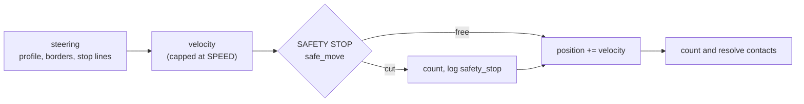

# i4sim movers that never touch

Status: implemented · Branch: `ccr-2106dbda-2f6sm1` · Related: [roadmap: i4sim toward a million ticks per second](../roadmap.md#next), [longer headless runs](2026-11-28-longer-headless-runs.md), [i4sim at 100,000 ticks per second](2026-11-28-i4sim-100k-ticks.md), [MAKE WAY](2026-11-27-i4sim-make-way.md)

On 2026-11-28 the user asked to merge #164 and #165, to go on with the roadmap item on ticks per second, and to use the new long runs to look critically at how movers move: under Reciprocal on A* with every special movement and recovery there should be no contacts, and the user wants no contacts between agents at all, checked over many ticks before drawing conclusions. Long sweeps found contacts that short runs miss, and two ways a factory stops for good. This change makes every move contact-free with a safety stop, removes the cause of most contacts in the traffic stop lines, gives stranded MAKE WAY movers back to the factory, and adds 100,000-tick tests on every bundled factory.

## Table of contents

- [Problem](#problem)
- [Goals and non-goals](#goals-and-non-goals)
- [Decisions](#decisions)
- [Design](#design)
- [Affected areas](#affected-areas)
- [Test plan](#test-plan)
- [Review](#review)
- [Verification](#verification)
- [Pull request](#pull-request)
- [Open points](#open-points)

[Directory guide](README.md) · [Project overview](../../README.md) · [Documentation index](../README.md)

## Problem

Sweeps on Lab `cadb3a6` with Kinetra `f2e55eb`, Release, 300,000 ticks per run, under Reciprocal on plain A* with recovery and every traffic policy (parking, junction and corridor traffic, predictive passing, MAKE WAY, DEPARTURE CHECK, RIGHT OF WAY), seeds 1 to 8, 42 and 915839214:

| Floor | Runs that touched | Contacts per run | Runs that stopped for good |
| --- | --- | --- | --- |
| `1680x960+`, `3840x2400` | 0 of 10 each | 0 | 0 |
| `4320x2400` | 9 of 10 | 3 to 16 | 0 |
| `test-environment` | 3 of 10 | 1 | 4 (seed 42 after 23,070 ticks and six products) |

A scratch trace of every contact, with each mover's steering forces in the ticks before it, showed three causes:

1. **Stop lines that cross a mover.** Junction and corridor traffic stop a waiting mover with a stop line, `stop_before`, on the side of the zone it faces. When the mover already reaches past that side, which the zone's exit pocket makes common, the line runs through it. `constrain_borders` reads that as a penetration and pushes the mover out at up to full speed, 2 mm per tick, whatever stands beside it: on `4320x2400`, seed 915839214, tick 15794, mover 25 was pushed sideways into mover 10. Nearly every contact on `4320x2400` had a border correction of 0.6 to 1.2 mm/tick² just before it.
2. **Steering corrections after avoidance.** Reciprocal shares the avoidance of a pair half and half; a wall correction applied afterwards can leave a mover unable to do its half, and its neighbor, counting on it, touches it. On `test-environment`, seed 7, mover 5 drove mover 10 back from its goal for 200 ticks at a 2 mm gap until a wall stopped mover 10.
3. **Improved's defaults** touched 16 times in 20,000 ticks on `test-environment` (the golden run), and 3 to 1,578 times per 300,000-tick run on the bundled floors.

And two ways a factory stops for good:

4. **A stranded MAKE WAY mover.** Mover 4 made way for mover 0, its trip ended (obstructed or cancelled), and its way home stayed blocked by mover 0, which waited for the place mover 4 stood on. Its goal stays `making_way`, so production skips its product and MAKE WAY no longer sees it as a parked blocker.
5. **Head-on standstills under Reciprocal.** Two movers stand nose to nose, each heading for the place behind the other; avoidance cancels their seek exactly. RIGHT OF WAY grants nothing, since neither is pushed back.

## Goals and non-goals

Goals: no contact between movers, or between a mover and a border, under every steering profile and traffic policy, from any state that does not already touch; the traffic stop lines brake and never push; a yielding mover never stays stranded after its trip; 100,000-tick tests on every bundled factory that check it; a count of how often steering needed the stop, as a measure of its quality; a cost of at most a few percent of the ticks per second.

Non-goals: the head-on standstills (cause 5), which need RIGHT OF WAY or another remedy in Kinetra; Improved's jostling beside parked neighbors; the HUD; Kinetra's avoidance and steering.

## Decisions

| Decision | Choice | Why |
| --- | --- | --- |
| How to rule contacts out | A safety stop on the integrated move, after all steering | Steering, border constraints, stop lines and contact resolution correct each other in turn; only a check of the move itself, against where every neighbor stands now, can promise no contact. Industrial movers have the same layer in their safety scanners |
| Gaps | 0.05 mm to a mover, 0.001 mm to a border | A mover may touch a wall, as at a parking place against it, but a contact between movers counts at any penetration; 0.05 mm is more than the rounding of a position on the largest floor |
| Flush movers | Per axis no closer than the gap, or than the mover already is; only the component toward the obstacle is cut | A mover that slides along a wall at 0 mm would otherwise stop at every convex corner of the H (the *without path planning* test) |
| Default | On, under every profile, with a menu row, scenario key and benchmark flag to turn it off | The user wants no contacts; steering alone can be compared with `--no-safety-stop`. Improved loses products on the tight floors under it ([open points](#open-points)) |
| What counts as a stop | A cut of more than 0.01 mm | The end of an approach that steering already slows ends within that; counted, those were 1,500 stops per run on `4320x2400`, almost all against walls |
| Stop lines | The line moves to the mover's front face when the mover already reaches past the zone's side | It then only brakes the mover where it stands. All 192 tests passed unchanged with this alone |
| Stranded movers | Given back to the factory after 240 ticks of standing still on their own after the trip ended; the count starts again while the mover drives home or is held | Kinetra's lifecycle forgets a trip whose mover no longer yields, so Lab can end it without an engine change; production then resumes the product |
| Recorded steering tests | Run without the safety stop | They pin steering situations recorded without it (the pushed-back stall, the DEPARTURE CHECK squeeze); with it the situation does not arise |

## Design



*Takeaway:* the stop sits between steering and the position update, so no steering choice can bring two movers into touch.

1. **SAFETY STOP** (`MotionStep::safe_move`, `clear_move`). Before `integrate` adds the velocity to the position, every neighbor of the mover's surroundings, at its current place (movers earlier in the tick have already moved), and every border near it is an obstacle box. Per axis the bound is the touching distance plus the gap, or the current distance when the mover is already closer; the move is cut where it would be within the bound on both axes at once, and only its component on the axis it reaches last. A box that already overlaps on both axes only stops approaching on the axis it overlaps least. The tests repeat until nothing changes, at most four rounds, and a move still changing becomes no move. When the cut move is shorter than wanted, its two axis parts are tried too and the one that goes farthest in the wanted direction wins, so a corner never stops a mover that one axis would take past it. Obstacles farther than the move and the gap are skipped first. The velocity becomes the cut move: the mover brakes at once.
2. **Counting.** A cut of more than 0.01 mm counts a stop tick; a stop after a free tick also counts a stop and records a `safety_stop` event with the mover and what it stopped short of. `Simulation::safety_stops()` and `safety_stop_ticks()` report them, and so do `summary.json`, the benchmark and the sweep.
3. **Arrival.** The final snap onto a destination, within 0.1 mm, checks the place against every neighbor where it stands now and not the gap, so parking places beside walls and neighbors stay reachable.
4. **Stop lines** (`stop_before`). The side facing the body, as before, but clamped to the body's front face.
5. **Stranded movers** (`MakeWay::release_stranded`). `MakeWay` remembers when a yielding mover's trip ended, from the lifecycle's `ended` event, and from then on the tick since which it stands still on its own. After 240 ticks (`stranded_ticks`) its goal becomes automatic; without a product it heads for its parking place.

## Affected areas

`labs/i4sim/include/i4sim/simulation/simulation.h` (`MotionSettings::safety_stop`, `safety_stops()`, `safety_stop_ticks()`), `events.h` (`EventKind::safety_stop`), `simulation.cpp`, `detail/simulation_core.h`, `simulation_core.cpp` (`summary.json`), `detail/motion_step.h`, `motion_step.cpp`, `geometry.cpp`, `detail/make_way.h`, `make_way.cpp`, `controller.cpp` (MOTION → SAFETY STOP), `blueprint/scenario.cpp` (`motion.safetyStop`); tests `simulation_tests.cpp`, `golden_tests.cpp` (five lines), `controller_tests.cpp`, the new `contact_tests.cpp` (`kinetra_i4sim_contact_tests`, label `soak`), `motion_benchmark.cpp` (`--planner`, `--no-safety-stop`, columns `safety_stops`, `safety_stop_ticks`, `ticks`); docs: i4sim README, test guide, blueprint guide, architecture, Lab AGENTS.md and README, roadmap.

## Test plan

| Behavior | Test | Level |
| --- | --- | --- |
| No contact over 100,000 ticks on every bundled factory under the fullest configuration, with products, rare stops and no stranded mover | `kinetra_i4sim_contact`: five cases, two seeds each but `8640x4800` | Targeted |
| No contact under every profile's defaults | `kinetra_i4sim_contact:every steering profile with its defaults never touches` | Targeted |
| The stop does the work: steering alone touches in the same runs | `SAFETY STOP keeps default motion on test-environment from touching` (16 contacts off, 0 on, events equal the count), `SAFETY STOP stops movers that steering would let touch` (head-on swap, the gap kept) | Targeted |
| Sliding along walls and past convex corners, parking beside walls and neighbors | The existing *without path planning* and *movers return to their reservations* cases | Targeted |
| Stop lines brake only | `a stop line never crosses the mover it stops` | Targeted |
| A stranded yielding mover returns | `a mover stranded after MAKE WAY returns to the factory` | Targeted |
| Menu row, scenario key | Controller and scenario cases | Targeted |
| Whole runs | Golden lines (five change: the three that touched now do not, two runs with near misses) | Targeted |
| Cost | Sweep runs on `3840x2400`, on and off interleaved | Targeted |

## Review

- The first version scaled the whole move at an obstacle: a mover flush with a wall stopped at the H's convex corner. Cutting only the component toward the obstacle, plus the axis candidates at a corner, fixed it.
- With a 0.05 mm gap to borders the stop counted about 1,500 stops per run on `4320x2400`, almost all the last approach to a wall that `constrain_borders` already slows; a 0.001 mm border gap and the 0.01 mm counting threshold left about 150.
- The first stranded count ran on while the operator held a yielding mover, so the *make way preserves a parked product* case saw it released on release of the hold; the count now starts again while the mover moves or is held.
- `bounds()` per neighbor made the stop cost about 12% of a run; movers are unrotated boxes, and with their extents and a reach test first it costs about 2%, with identical results.

## Verification

On 2026-11-28, `release` preset (GCC 13.3), cloud machine with four cores, Kinetra `f2e55eb`:

- `ctest --preset release -R '^kinetra_i4sim'`: 202 of 202, the contact suite in about 30 s.
- Failure evidence, each fix turned off in turn: without SAFETY STOP the contact suite fails on `4320x2400` (4 and 7 contacts) and for Improved (151 on `test-environment`, 340 on `1680x960+`) and RVO experiment (93 and 806); without the stop-line clamp `a stop line never crosses the mover it stops` fails (200 for 180, 0 for 20); without the release `a mover stranded after MAKE WAY returns to the factory` fails (mover 4 stranded 26,548 ticks, 6 products) and so does the contact suite on `4320x2400`, seed 42 (4,452 ticks).
- With SAFETY STOP off, every test of `main` passes with the stop-line clamp and the release alone.
- Sweeps, 300,000 ticks per run, the fullest configuration, seeds 1 to 8, 42, 915839214 (four seeds on `8640x4800`): 0 contacts in all 44 runs. Stops per run: `1680x960+` 0 to 23, `3840x2400` 4 to 106, `4320x2400` 91 to 169, `8640x4800` 647 to 969, `test-environment` 0 to 27. Products on average, with the stop against without it: `1680x960+` 119 and 119, `3840x2400` 417 and 422, `4320x2400` 366 and 372; `test-environment` 87 and 94, where three runs with and two without lock head-on ([open points](#open-points)). Without it, `4320x2400` touched in five of ten seeds (1 to 13 times) and `test-environment` in three, after the stop-line clamp.
- Improved's defaults, seeds 1 to 5, 42, 915839214: without the stop 3 to 1,578 contacts per run, with it none; products on average `1680x960+` 48 → 23, `test-environment` 38 → 29, `3840x2400` 362 → 366, `4320x2400` 351 → 353.
- Cost: `3840x2400`, Improved, 300,000 ticks, three interleaved runs each: median 2.34 s with the stop, 2.30 s without.
- `clang-format`, `check_docs.py`, `check_copies.py`.

## Pull request

**fix(i4sim): movers never touch, with a safety stop, braking stop lines and stranded MAKE WAY movers given back**, `ccr-2106dbda-2f6sm1` → `main`. Lab only; no Kinetra change.

```markdown
## Summary

300,000-tick sweeps found contacts that short runs miss: under Reciprocal on A* with recovery and every traffic policy, 4320x2400 touched in nine of ten seeds and test-environment in three; Improved's defaults touched up to 1,578 times per run. SAFETY STOP now cuts every move short of a contact, traffic stop lines only brake, and a stranded MAKE WAY mover goes back to the factory. 100,000-tick tests check every bundled factory.

## Changes

- **SAFETY STOP** (on by default; DEBUG → MOTION, `motion.safetyStop`, `--no-safety-stop`): a move is cut where it would come within 0.05 mm of a neighbor at its current place, or cross a border; only the component toward the obstacle, so flush movers slide past corners. Stops are counted, logged (`safety_stop`) and exported (`summary.json`, benchmark columns).
- **Stop lines** of junction and corridor traffic move to a waiting mover's front face when it already reaches past the zone, instead of pushing it out sideways at full speed.
- **MAKE WAY**: a yielding mover that stands still on its own for 240 ticks after its trip ended gets an automatic goal again.
- **Tests**: `kinetra_i4sim_contact_tests` (soak, about 30 s), unit cases for each fix, five golden lines, controller and scenario cases; the benchmark gets `--planner`.
- **Docs**: i4sim README (safety stop, make way, open points), test and blueprint guides, architecture, AGENTS.md verification row, roadmap item for head-on standstills.

## Design

[i4sim movers that never touch](docs/design/2026-11-28-i4sim-no-contacts.md)

## Verification

- `ctest --preset release -R '^kinetra_i4sim|^kinetra_capture'`: 238 of 238; i4sim built with `KINETRA_LAB_WARNINGS` and warning-free errors; `clang-format`, `check_docs.py`, `check_copies.py`.
- Each fix turned off, its new tests fail (numbers in the design's verification); with SAFETY STOP off, every test of `main` passes.
- Sweeps of 300,000 ticks, the fullest configuration, 44 runs: 0 contacts, about as many products (4320x2400 366 against 372). Improved's defaults: 0 contacts, but fewer products on the tight floors (1680x960+ 48 → 23).
- Cost: about 2% of the ticks per second.

## Review notes

Scaling the whole move stopped flush movers at convex corners; cutting only the approaching component fixed it. A 0.05 mm border gap counted 1,500 harmless stops per run; a 0.001 mm border gap and a 0.01 mm counting threshold left about 150. Under SAFETY STOP, Improved locks more often on tight floors, because it got past parked neighbors by touching them: a trade the user may want to settle (default on, or only for Reciprocal).

## Dependencies and merge order

None; Kinetra unchanged.

## Follow-up

Roadmap: *Unlock i4sim head-on standstills* (RIGHT OF WAY for `opposing_mover` in Kinetra), which also covers Improved under SAFETY STOP.
```

## Open points

- **Head-on standstills under Reciprocal.** Two movers that stand nose to nose, each heading for the place behind the other, lock: avoidance cancels their seek exactly. RIGHT OF WAY needs one of them pushed back, and recovery plans the same route again. Reproductions on `test-environment` under the fullest configuration: seed 5 (movers 0 and 1, and 4 and 6, from about tick 105,000), seed 7 (movers 8 and 9), seed 2 (movers 0 and 4), seed 915839214 without the stop (movers 9 and 10). A remedy belongs in Kinetra: RIGHT OF WAY for an `opposing_mover` stall, granted to one of the pair.
- **Improved under SAFETY STOP.** Improved got past parked neighbors by touching them and being pushed out; with the stop it swings to and fro beside them (on `test-environment`, seed 5, mover 6 beside parked mover 5 was stopped 37,946 times) and the tight floors lock more often. Reciprocal with every policy does not lose products.
- **Recovery and RIGHT OF WAY share a threshold.** A mover's first route recovery resets its ticks without progress at exactly 120, the threshold of RIGHT OF WAY and the stall detector, so a pushed-back mover gets the right of way only from its second recovery on.
- The HUD shows no stop count.
