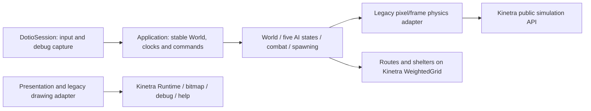

# Dotio architecture

Application ownership and its boundary with the public Kinetra engine.

## Table of contents

- [Components](#components)
- [Lifecycle and constraints](#lifecycle-and-constraints)
- [Source navigation](#source-navigation)

[Directory guide](README.md) · [Project overview](../README.md) · [Documentation index](README.md)

## Components

Movement consumes 60 Hz ticks; AI runs at 20 Hz, sequentially on the owning thread. Legacy Y-down pixels map to Kinetra Y-up world units at 25 pixels/unit. [physics_adapter.h](../labs/dotio/include/dotio/entities/physics_adapter.h) converts state; engine integration, contacts, impulses, circle sweeps and raster queries perform reusable mechanics. Legacy field names and grid conversion policies stay local; canonical vector operations delegate to Kinetra.

Source: [Application](../labs/dotio/include/dotio/application.h), [session](../labs/dotio/src/presentation/session.cpp), [presentation](../labs/dotio/src/presentation/presentation.cpp), [logic](../labs/dotio/include/dotio/). The engine imports none of these headers.

The session is a `dotio::Session` ([session.h](../labs/dotio/include/dotio/presentation/session.h)): a Lab session that also returns its Application. A tool that plays the game reads the world through it between frames and answers with ordinary input; the [capture tool](../tools/capture/README.md#how-it-works)'s scripted player aims that way, because the AI is not seeded. The launcher uses only the base type.

## Lifecycle and constraints

Application owns dotio::World through a unique_ptr to keep the address stable: enemies and AI states reference that world. World owns its grid (with its route planner), actor/projectile pools and props, so several worlds can exist side by side.

Streaming rebases actors, projectiles, props and the camera together; routes and spatial partitions rebuild. Absolute district coordinates retain seeded terrain identity while local coordinates bound the active simulation. Presentation adapts legacy drawing to Runtime; game rules and route planning remain independent of SDL/OpenGL.

## Source navigation

Start with the [application guide](../labs/dotio/README.md) and its [layout](../labs/dotio/README.md#layout), which lists every header and source by topic. See the [system architecture](architecture.md) for target dependencies and shared session flow.
